# Contextra Memory Engine — Systemarchitektur & Ring-Modell

Dieses Dokument ist die maßgebliche technische Architekturbeschreibung der Contextra Memory Engine. Es übersetzt die normative Gesamtspezifikation (`docs/spec/GESAMTSPEZIFIKATION-v4.md`) in eine vertiefte Systembeschreibung, dokumentiert den aktiven EP1 Crate-Bestand (17 Kern-Crates, LAB-Crates separat), das Ring-0–4-Modell, die Single-Node Ein-Prozess-Garantie (`cargo add contextra`), die Layering-Invarianten und das Inferenz-Modell (Inferenz-Ports über `contextra-ports`).

---

## Inhaltsverzeichnis
1. [Ring-Modell (Ring 0–4) & Layering-Invarianten](#1-ring-modell)
2. [Crate-Inventar (Ist-Zustand nach W3-01)](#2-crate-inventar)
3. [Abhängigkeitsdiagramm](#3-abhaengigkeitsdiagramm)
4. [Bekannte Abweichungen IST vs. SOLL](#4-bekannte-abweichungen-ist-vs-soll)
5. [Unsafe-Inseln, Invarianten & Locking-Disziplin](#5-unsafe-inseln-invarianten--locking-disziplin)
6. [Referenzen & Weiterführende Dokumente](#6-referenzen)

---

<a id="1-ring-modell"></a>
## 1. Ring-Modell (Ring 0–4) & Layering-Invarianten

Contextra gliedert seine Funktionalität in ein Fünf-Ring-Schichtenmodell (Ring 0 bis Ring 4). Abhängigkeiten dürfen ausschließlich **von höheren Ringen auf tiefere Ringe** verlaufen. Aufwärtskanten (z. B. ein Ring-0-Crate, das von einem Ring-3-Crate abhängt) sind streng verboten.

### 1.1 Definition der Ringe (EP1 Umfang)

* **Ring 0 — Foundation & Pure Numerics / Types**:
  Enthält kerneigenen Datenstrukturen, Typdefinitionen, Port-Traits, Kryptographie, System- und Durability-Abstraktionen, SIMD-Distanzberechnungen sowie BM25-Textsuche und 4-Signal-Fusion-Primitive. Ring 0 enthält **kein `tokio`** (Grundsatz *Sync-Kern, async-Schale*, P26).
  *Crates:* `contextra-types`, `contextra-ports`, `contextra-sys`, `contextra-wire`, `contextra-simd`, `contextra-durable-fs`, `contextra-crypto`, `contextra-mvcc`, `contextra-text`, `contextra-rank`.
* **Ring 1 — Persistence & Cache**:
  Enthält Persistenz-Engines (LSM-Tree, WAL, Block-Cache, HNSW-Vektorindex, Checkpoint-Verwaltung). Async-I/O ist an den Grenzen erlaubt.
  *Crates:* `contextra-store`, `contextra-vector`, `contextra-checkpoint`.
* **Ring 2 — External Adapters & Sandboxing (Leaf Engines)**:
  Plattform- und Sandbox-Adapter. In EP1 sind keine externen Inferenz- oder WASM-Schwergewichte im Kern enthalten (externe Adapter gesichert im Tag `park/EP4/v1`).
* **Ring 3 — Orchestration & Memory**:
  Enthält die Geschäfts- und Orchestrierungslogik (Transaktions-Management, Collection-Engine, Synthese, embedded Hybrid-Search).
  *Crates:* `contextra-engine`, `contextra-db`.
* **Ring 4 — Boundary & Composition Roots**:
  Öffentliche Fassade (`contextra`) und MCP-Server (`contextra-mcp`). Bildet die einzige Composition Root.
  *Crates:* `contextra`, `contextra-mcp`.

### 1.2 Verbot von Aufwärtskanten (DAG-Integrität, P5)

Das System erzwingt strikte Directed Acyclic Graph (DAG) Modularität.

Die Engine erhält Inferenz-Provider über Trait-Objekte (`Arc<dyn EmbeddingProvider>`) aus `contextra-ports` (Ring 0). Konkrete Entkopplung stellt sicher, dass keine Kern-Engine von geparkten Inferenz-Adaptern abhängt.

---

<!-- BEGIN GENERATED -->
## 2. Crate-Inventar (Ist-Zustand nach W3-01)

Nach Abschluss der Entkopplung (W3-01) besteht der aktive Workspace aus **17 EP1 Kern-Crates** (Ring 0–4) sowie **4 LAB-Crates** (Testkit, Benchmarks, build tooling):

### 2.1 EP1 Kern-Crates (17 Crates)

| Crate-Name | Ring | Verantwortlichkeit |
|---|---|---|
| `contextra-crypto` | Ring 0 | Encryption at Rest, Deletion Proof V4 and cryptographic primitives for Contextra |
| `contextra-durable-fs` | Ring 0 | Durable filesystem operations and synchronous disk flushing for Contextra |
| `contextra-mvcc` | Ring 0 | Multi-Version Concurrency Control (MVCC), sequence log, and transaction buffer for Contextra |
| `contextra-ports` | Ring 0 | Canonical dyn-compatible port traits for Contextra subsystems |
| `contextra-rank` | Ring 0 | 4-Signal Fusion and Isotonic & Platt Calibration primitives for Contextra |
| `contextra-simd` | Ring 0 | Ring 0 SIMD distance kernels and runtime dispatch for Contextra (Unsafe Island) |
| `contextra-sys` | Ring 0 | Low-level unsafe system abstractions and FFI island for Contextra (Ring 0) |
| `contextra-text` | Ring 0 | Contextra — Text processing and BM25 search for Hybrid Search |
| `contextra-types` | Ring 0 | Canonical domain types, IDs, budgets, filters, and error types for Contextra |
| `contextra-wire` | Ring 0 | Ring 0 Unsafe Island: Auto-generated FlatBuffers IPC code and zero-copy adapters for Contextra |
| `contextra-checkpoint` | Ring 1 | Backup and snapshot management for Contextra storage |
| `contextra-store` | Ring 1 | LSM-Tree storage engine for Contextra |
| `contextra-vector` | Ring 1 | HNSW vector index with SIMD distance computation for Contextra |
| `contextra-db` | Ring 3 | Contextra — Embedded hybrid-search storage facade for AI agents |
| `contextra-engine` | Ring 3 | Contextra — Core storage, index, and transaction orchestrator engine |
| `contextra` | Ring 4 | Contextra — Embedded hybrid-search for AI agents (Facade) |
| `contextra-mcp` | Ring 4 | Model Context Protocol server interface for Contextra |

### 2.2 LAB-Crates (4 Crates)

| Crate-Name | Kategorie | Verantwortlichkeit |
|---|---|---|
| `contextra-bench` | LAB (Bench) | Reproducible Benchmark Harness for Retrieval Accuracy |
| `contextra-testkit` | LAB (Tooling) | Deterministic test utilities, ManualClock, InMemoryStorageEngine, and FaultVfs |
| `xtask` | LAB (Tooling) | Primary build, lint, and verification harness |
| `xtask-heavy` | LAB (Tooling) | Heavy verification tasks and integration suites |

---

## 3. Abhängigkeitsdiagramm (EP1 Kern & LAB post-W3-01)

Das folgende Mermaid-Diagramm bildet die tatsächlichen `[dependencies]` zwischen den 17 EP1-Kern-Crates ab:

```mermaid
graph TD
    contextra[contextra] --> contextra_db[contextra-db]
    contextra[contextra] --> contextra_engine[contextra-engine]
    contextra[contextra] --> contextra_ports[contextra-ports]
    contextra[contextra] --> contextra_rank[contextra-rank]
    contextra[contextra] --> contextra_store[contextra-store]
    contextra[contextra] --> contextra_types[contextra-types]
    contextra_checkpoint[contextra-checkpoint] --> contextra_mvcc[contextra-mvcc]
    contextra_checkpoint[contextra-checkpoint] --> contextra_ports[contextra-ports]
    contextra_checkpoint[contextra-checkpoint] --> contextra_types[contextra-types]
    contextra_crypto[contextra-crypto] --> contextra_durable_fs[contextra-durable-fs]
    contextra_crypto[contextra-crypto] --> contextra_ports[contextra-ports]
    contextra_crypto[contextra-crypto] --> contextra_types[contextra-types]
    contextra_db[contextra-db] --> contextra_checkpoint[contextra-checkpoint]
    contextra_db[contextra-db] --> contextra_crypto[contextra-crypto]
    contextra_db[contextra-db] --> contextra_engine[contextra-engine]
    contextra_db[contextra-db] --> contextra_ports[contextra-ports]
    contextra_db[contextra-db] --> contextra_rank[contextra-rank]
    contextra_db[contextra-db] --> contextra_store[contextra-store]
    contextra_db[contextra-db] --> contextra_sys[contextra-sys]
    contextra_db[contextra-db] --> contextra_text[contextra-text]
    contextra_db[contextra-db] --> contextra_types[contextra-types]
    contextra_db[contextra-db] --> contextra_vector[contextra-vector]
    contextra_durable_fs[contextra-durable-fs] --> contextra_sys[contextra-sys]
    contextra_engine[contextra-engine] --> contextra_checkpoint[contextra-checkpoint]
    contextra_engine[contextra-engine] --> contextra_crypto[contextra-crypto]
    contextra_engine[contextra-engine] --> contextra_mvcc[contextra-mvcc]
    contextra_engine[contextra-engine] --> contextra_ports[contextra-ports]
    contextra_engine[contextra-engine] --> contextra_rank[contextra-rank]
    contextra_engine[contextra-engine] --> contextra_store[contextra-store]
    contextra_engine[contextra-engine] --> contextra_sys[contextra-sys]
    contextra_engine[contextra-engine] --> contextra_text[contextra-text]
    contextra_engine[contextra-engine] --> contextra_types[contextra-types]
    contextra_engine[contextra-engine] --> contextra_vector[contextra-vector]
    contextra_mcp[contextra-mcp] --> contextra[contextra]
    contextra_mcp[contextra-mcp] --> contextra_crypto[contextra-crypto]
    contextra_mcp[contextra-mcp] --> contextra_ports[contextra-ports]
    contextra_mcp[contextra-mcp] --> contextra_types[contextra-types]
    contextra_mcp[contextra-mcp] --> contextra_wire[contextra-wire]
    contextra_mvcc[contextra-mvcc] --> contextra_ports[contextra-ports]
    contextra_mvcc[contextra-mvcc] --> contextra_types[contextra-types]
    contextra_ports[contextra-ports] --> contextra_types[contextra-types]
    contextra_simd[contextra-simd] --> contextra_types[contextra-types]
    contextra_store[contextra-store] --> contextra_crypto[contextra-crypto]
    contextra_store[contextra-store] --> contextra_durable_fs[contextra-durable-fs]
    contextra_store[contextra-store] --> contextra_mvcc[contextra-mvcc]
    contextra_store[contextra-store] --> contextra_ports[contextra-ports]
    contextra_store[contextra-store] --> contextra_sys[contextra-sys]
    contextra_store[contextra-store] --> contextra_types[contextra-types]
    contextra_text[contextra-text] --> contextra_ports[contextra-ports]
    contextra_text[contextra-text] --> contextra_types[contextra-types]
    contextra_vector[contextra-vector] --> contextra_crypto[contextra-crypto]
    contextra_vector[contextra-vector] --> contextra_durable_fs[contextra-durable-fs]
    contextra_vector[contextra-vector] --> contextra_mvcc[contextra-mvcc]
    contextra_vector[contextra-vector] --> contextra_ports[contextra-ports]
    contextra_vector[contextra-vector] --> contextra_simd[contextra-simd]
    contextra_vector[contextra-vector] --> contextra_sys[contextra-sys]
    contextra_vector[contextra-vector] --> contextra_types[contextra-types]
```


<!-- END GENERATED -->

---

<a id="4-bekannte-abweichungen-ist-vs-soll"></a>
## 4. Bekannte Abweichungen IST vs. SOLL

1. **Entkopplung aller Parkplatz-Crates vollständig (W3-01):**
   Geparkte Module wurden vollständig entkoppelt. Der Quellcode der entkoppelten Produktkomponenten (EP2 bis EP6) verbleibt gesichert in den Git-Tags `park/EP1/v1` bis `park/EP6/v1`.
2. **`contextra-db` Fassadenrolle:**
   `contextra-db` fungiert im Kern als Fassade für den eingebetteten Speicherbetrieb.

---

<a id="5-unsafe-inseln-invarianten--locking-disziplin"></a>
## 5. Unsafe-Inseln, Invarianten & Locking-Disziplin

### 5.1 Zero-Panic-Doctrine & Unsafe-Inseln

Standardmäßig gilt in allen Nicht-Insel-Crates `#![forbid(unsafe_code)]`. Es gibt genau **drei zulässige Unsafe-Inseln** im EP1-Produktionscode:

1. **`contextra-sys`**: Abstraktionen für Low-Level-OS-Operationen (`mmap`, `mlock`, Win32-ACLs).
2. **`contextra-simd`**: SIMD-Vektordistanzberechnungskerne (AVX2, AVX-512, NEON) mit Laufzeit-Dispatch.
3. **`contextra-wire`**: FlatBuffers-generierter Code, der konstruktionsbedingt `unsafe` Blöcke für Zero-Copy-Transfers benötigt.

Jeder `unsafe`-Block in diesen Inseln muss zwingend mit einem `// SAFETY:`-Kommentar begründet werden.

### 5.2 Locking-Disziplin & Sperrenhierarchie

Zur Vermeidung von Deadlocks gilt im gesamten System eine strikte Sperrenhierarchie:

```
collections (RwLock) → kv_locks (schlüssel-granular via KvKeyLocks) → embedder (RwLock)
```

* **Sperren-Reihenfolge**: Wenn mehrere Locks akquiriert werden müssen, geschieht dies ausnahmslos von links nach rechts.
* **Key-Granulares Locking (`KvKeyLocks`)**: Schreibzugriffe auf Schlüsselebene nutzen Sharded Locks (`tokio::sync::Mutex<()>`). Die Shards serialisieren Schreibzugriffe pro Schlüssel-Shard. Bei Mehrschlüssel-Operationen (`lock_many_sorted` / `acquire_multi_sorted`) werden die Shard-Indizes zwingend **aufsteigend sortiert** akquiriert, um Zyklen im Wait-For-Graph auszuschließen.
* **Kein Async unter Sync-Locks**: Kein `.await`-Aufruf darf gehalten werden, während ein synchroner Mutex/RwLock-Guard existiert.

#### Verifizierte Lock-Felder in `contextra-engine`

Die folgenden Struct-Felder in `contextra-engine` halten Mutex- oder RwLock-Instanzen:

1. **`ContextraEngine` (`crates/contextra-engine/src/lib.rs`):**
   - `collections`: `tokio::sync::RwLock<ahash::AHashMap<String, Arc<Collection<LsmStorage>>>>`
   - `tenant_collections`: `tokio::sync::RwLock<TenantCollectionMap>`
   - `embedder`: `parking_lot::RwLock<Option<Arc<dyn TextEmbeddingEngine>>>`
   - `metrics_sink`: `parking_lot::RwLock<Arc<dyn contextra_ports::MetricsSink>>`

2. **`Collection` & `KvKeyLocks` (`crates/contextra-engine/src/collection/`):**
   - `kv_locks.shards`: `[tokio::sync::Mutex<()>; 16]` (`kv_lock.rs`)
   - `embedder`: `parking_lot::RwLock<Option<Arc<dyn TextEmbeddingEngine>>>` (`mod.rs`)
   - `consolidation_guard`: `Arc<tokio::sync::Mutex<()>>` (`mod.rs`)
   - `config`: `parking_lot::RwLock<CollectionConfig>` (`mod.rs`)
   - `pressure_rx`: `parking_lot::RwLock<Option<tokio::sync::watch::Receiver<contextra_store::SystemPressure>>>` (`mod.rs`)
   - `clock`: `parking_lot::RwLock<Arc<dyn Clock>>` (`mod.rs`)
   - `metrics`: `parking_lot::RwLock<Arc<dyn MetricsSink>>` (`mod.rs`)

3. **`DbTransaction` (`crates/contextra-engine/src/transaction/db_transaction.rs`):**
   - `staged_forward_keys`: `std::sync::Mutex<Vec<StagedKeyOp>>`
   - `staged_reverse_keys`: `std::sync::Mutex<Vec<StagedKeyOp>>`
   - `staged_doc_ids`: `std::sync::Mutex<Arc<Vec<DocId>>>`
   - `staged_text_ops`: `std::sync::Mutex<Vec<(DocId, String)>>`
   - `staged_text_deletes`: `std::sync::Mutex<Vec<DocId>>`

Für alle Locks außerhalb der Hauptachse (`collections` → `kv_locks` → `embedder`) gilt: keine dokumentierte Ordnung, nicht verschachteln.

---

<a id="6-referenzen"></a>
## 6. Referenzen & Weiterführende Dokumente

* **Normative Spezifikation**: `README.md`
* **Entwickler- & Agent-Anweisungen**: `AGENTS.md`
