# Contextra Memory Engine — Systemarchitektur & Ring-Modell

Dieses Dokument ist die maßgebliche technische Architekturbeschreibung der Contextra Memory Engine. Es übersetzt die normative Gesamtspezifikation (`docs/spec/CONTEXTRA_FINALE_PRODUKTSPEZIFIKATION.md`) in eine vertiefte Systembeschreibung, dokumentiert den Crate-Bestand (17 EP1 Kern-Crates, LAB-Crates separat, geparkte Module via `park/<ID>/v1` Tags), das Ring-0–4-Modell, die Single-Node Ein-Prozess-Garantie (`cargo add contextra`) und die Layering-Invarianten.

---

## Inhaltsverzeichnis
1. [Ring-Modell (Ring 0–4) & Layering-Invarianten](#1-ring-modell)
2. [Crate-Inventar (Ist-Zustand)](#2-crate-inventar)
3. [Abhängigkeitsdiagramm](#3-abhaengigkeitsdiagramm)
4. [Bekannte Abweichungen IST vs. SOLL](#4-bekannte-abweichungen-ist-vs-soll)
5. [Unsafe-Inseln, Invarianten & Locking-Disziplin](#5-unsafe-inseln-invarianten--locking-disziplin)
6. [Referenzen & Weiterführende Dokumente](#6-referenzen)

---

<a id="1-ring-modell"></a>
## 1. Ring-Modell (Ring 0–4) & Layering-Invarianten

Contextra gliedert seine Funktionalität in ein Fünf-Ring-Schichtenmodell (Ring 0 bis Ring 4). Abhängigkeiten dürfen ausschließlich **von höheren Ringen auf tiefere Ringe** verlaufen. Aufwärtskanten (z. B. ein Ring-0-Crate, das von einem Ring-3-Crate abhängt) sind streng verboten.

### 1.1 Definition der Ringe

* **Ring 0 — Foundation & Pure Numerics / Types**:
  Enthält kerneigenen Datenstrukturen, Typdefinitionen, Traits, Kryptographie, Mathematik, Vektor- und Graph-Primitive. Ring 0 enthält **kein `tokio`** (Grundsatz *Sync-Kern, async-Schale*, P26).
* **Ring 1 — Persistence & Cache**:
  Enthält Persistenz-Engines (LSM-Tree, WAL, Block-Cache, KV-Cache-Segmentdateien) und Time-Travel-Registries. Async-I/O ist an den Grenzen erlaubt.
* **Ring 2 — External Adapters & Sandboxing (Leaf Engines)**:
  Isoliert externe Adapter (geparkt unter `park/EP4/v1` / `park/EP6/v1`).
* **Ring 3 — Orchestration & Cognition**:
  Enthält die Geschäfts- und Orchestrierungslogik (Transaktions-Management, Collection-Engine, Synthese).
* **Ring 4 — Boundary & Composition Roots**:
  Öffentliche Fassade (`contextra`) und MCP-Server (`contextra-mcp`). Bildet die einzige Composition Root.

### 1.2 Verbot von Aufwärtskanten (DAG-Integrität, P5)

Das System erzwingt strikte Directed Acyclic Graph (DAG) Modularität.

**Konkretes Negativ-Beispiel für eine verbotene Aufwärtskante:**
In einer früheren Version hing das Datenbank-Crate `contextra-db` (damals Layer 2 / Ring 3) direkt von Inferenz-Adaptern (Tag `park/EP4/v1`) ab, um Embedding-Backends direkt zu instanziieren. Dies verletzte P5, da eine Kern-Engine von konkreten Inferenz-Adaptern abhing.
Im Zielmodell (`ARCHITECTURE.md` / `README.md` §4.2) erhält die Engine stattdessen Trait-Objekte (`Arc<dyn EmbeddingProvider>`) aus `contextra-ports` (Ring 0), und die konkrete Verdrahtung erfolgt ausschließlich in Ring 4 (`contextra` Fassade).

### 1.3 Auto-Entity-Extraktion Konfiguration & Abschaltwege

Die automatische OpenIE-Entitätsextraktion beim Einfügen von Dokumenten verfügt über zwei steuerbare Abschaltwege und eine strikte Vorrangordnung:

1. **Compile-Zeit Opt-Out (`auto-extraction-opt-out` Feature):**
   Das Aktivieren des Cargo-Features `auto-extraction-opt-out` deaktiviert die Entitätsextraktion statisch für den gesamten Build, unabhängig von jeglicher Laufzeit-Konfiguration.
2. **Laufzeit-Konfiguration (`AutoExtractionMode` / `CollectionProfile`):**
   Wenn das Compile-Zeit-Feature nicht gesetzt ist, erfolgt die Steuerung dynamisch per Collection über `AutoExtractionMode` (`Enabled` vs. `Disabled`) im `CollectionProfile` bzw. in `AutoExtractionConfig`.

**Vorrangordnung (Precedence):**
`Compile-Zeit Opt-Out (Feature)` **>** `Laufzeit Mode (Disabled)` **>** `Default Mode (Enabled)`

*Falls `auto-extraction-opt-out` aktiv ist, hat eine Laufzeit-Einstellung `AutoExtractionMode::Enabled` keine Wirkung.*

**Deployment-Tier Defaults & Spec D.6 Status:**
- `EdgeMinimal`, `PowerUserLocal` und `EnterpriseShared` nutzen `DEFAULT_AUTO_EXTRACTION_MODE` (`AutoExtractionMode::Enabled`).
- `EnterpriseRegulated` nutzt den benannten Tier-Default `ENTERPRISE_REGULATED_AUTO_EXTRACTION_DEFAULT` (`AutoExtractionMode::Enabled`). Der Status ist im Code und in der Spezifikation als `DECISION-PENDING (Spec D.6)` hinterlegt.

---

<!-- BEGIN GENERATED -->
## 2. Crate-Inventar (Ist-Zustand post-W3-01)

### 2.1 EP1 Kern-Crates (17 Crates)

Die folgende Tabelle führt die 17 im EP1-Umfang verbliebenen Kern-Crates auf, eingeordnet in das Ring-Modell:

| Crate-Name | Ring | Verantwortlichkeit |
|---|---|---|
| `contextra-types` | Ring 0 | Kanonische Domänentypen, IDs, Budgets, Filter und Fehlertypen für Contextra |
| `contextra-ports` | Ring 0 | Kanonische dyn-kompatible Port-Traits für Contextra-Subsysteme |
| `contextra-sys` | Ring 0 | Low-level OS-Abstraktionen und FFI-Insel für Contextra (Unsafe-Insel) |
| `contextra-wire` | Ring 0 | Auto-generierter FlatBuffers IPC-Code und Zero-Copy-Adapter für Contextra (Unsafe-Insel) |
| `contextra-simd` | Ring 0 | SIMD-Vektordistanzberechnungskerne und Laufzeit-Dispatch für Contextra (Unsafe-Insel) |
| `contextra-durable-fs` | Ring 0 | Dauerhafte Dateisystemoperationen und synchrone Disksynchronisation für Contextra |
| `contextra-crypto` | Ring 0 | Verschlüsselung at Rest und kryptografische Hilfsfunktionen für Contextra |
| `contextra-mvcc` | Ring 0 | Multi-Version Concurrency Control (MVCC), Sequenzlog und Transaktionspuffer für Contextra |
| `contextra-text` | Ring 0 | Textverarbeitung und BM25-Suche für Hybridsuche |
| `contextra-rank` | Ring 0 | 4-Signal-Fusion, kalibrierte Fusion und Drifterkennung |
| `contextra-store` | Ring 1 | LSM-Tree Storage-Engine für Contextra |
| `contextra-vector` | Ring 1 | HNSW Vektorindex mit SIMD-Distanzberechnung für Contextra |
| `contextra-checkpoint` | Ring 1 | Backup- und Snapshot-Verwaltung für Contextra Speicher |
| `contextra-engine` | Ring 3 | Kernspeicher-, Index- und Transaktionsorchestrator-Engine für Contextra |
| `contextra-db` | Ring 3 | Embedded Hybrid-Search Fassade für AI Agenten |
| `contextra` | Ring 4 | Embedded Hybrid-Search Einbettungsfassade für AI Agenten |
| `contextra-mcp` | Ring 4 | Model Context Protocol (MCP) Server Gateway für Contextra |

### 2.2 LAB-Crates (Tooling & Benchmarking)

Die Werkzeug- und Benchmark-Crates sind im Ring LAB isoliert:

| Crate-Name | Ring | Verantwortlichkeit |
|---|---|---|
| `contextra-testkit` | LAB | Deterministische Testwerkzeuge, ManualClock, InMemoryStorageEngine und FaultVfs |
| `contextra-bench` | LAB | Reproduzierbares Benchmark-Harness für Retrieval-Genauigkeit |
| `xtask` | LAB | Automatisierungs- und Governance-Harness |
| `xtask-heavy` | LAB | Erweiterte Integrations- und Schwergewichts-Test-Harnesses |

### 2.3 Geparkte Module (`park/<EP>/v1` Tags)

Geparkte Module wurden im Rahmen der Entkopplung aus dem aktiven Workspace entfernt und auf annotated Git-Tags gesichert:
- **`park/EP1/v1`**: Deprecated `contextra-core` Strangler Facade und `contextra-py` Bindings.
- **`park/EP2/v1`**: `contextra-license`, `contextra-audit-export`, `contextra-avv-generator`.
- **`park/EP3/v1`**: `contextra-graph`.
- **`park/EP4/v1`**: `contextra-infer-candle`, `contextra-infer-ollama`, `contextra-infer-onnx`, `contextra-kvcache`.
- **`park/EP5/v1`**: `contextra-cognition`, `contextra-adapt`, `contextra-router`, `contextra-agent`.
- **`park/EP6/v1`**: `contextra-privacy`, `contextra-sandbox`.

---

## 3. Abhängigkeitsdiagramm (EP1 Kern & LAB post-W3-01)

Das folgende Mermaid-Diagramm bildet die tatsächlichen `[dependencies]` der 17 EP1 Kern-Crates und LAB-Crates ab:

```mermaid
graph TD
    contextra[contextra] --> contextra_db[contextra-db]
    contextra[contextra] --> contextra_engine[contextra-engine]
    contextra[contextra] --> contextra_ports[contextra-ports]
    contextra[contextra] --> contextra_rank[contextra-rank]
    contextra[contextra] --> contextra_store[contextra-store]
    contextra[contextra] --> contextra_types[contextra-types]
    contextra_bench[contextra-bench] --> contextra_crypto[contextra-crypto]
    contextra_bench[contextra-bench] --> contextra_db[contextra-db]
    contextra_bench[contextra-bench] --> contextra_ports[contextra-ports]
    contextra_bench[contextra-bench] --> contextra_store[contextra-store]
    contextra_bench[contextra-bench] --> contextra_text[contextra-text]
    contextra_bench[contextra-bench] --> contextra_types[contextra-types]
    contextra_bench[contextra-bench] --> contextra_vector[contextra-vector]
    contextra_checkpoint[contextra-checkpoint] --> contextra_mvcc[contextra-mvcc]
    contextra_checkpoint[contextra-checkpoint] --> contextra_ports[contextra-ports]
    contextra_checkpoint[contextra-checkpoint] --> contextra_types[contextra-types]
    contextra_crypto[contextra-crypto] --> contextra_durable_fs[contextra-durable-fs]
    contextra_crypto[contextra-crypto] --> contextra_ports[contextra-ports]
    contextra_crypto[contextra-crypto] --> contextra_types[contextra-types]
    contextra_db[contextra-db] --> contextra_checkpoint[contextra-checkpoint]
    contextra_db[contextra-db] --> contextra_crypto[contextra-crypto]
    contextra_db[contextra-db] --> contextra_engine[contextra-engine]
    contextra_db[contextra-db] --> contextra_ports[contextra-ports]
    contextra_db[contextra-db] --> contextra_rank[contextra-rank]
    contextra_db[contextra-db] --> contextra_store[contextra-store]
    contextra_db[contextra-db] --> contextra_sys[contextra-sys]
    contextra_db[contextra-db] --> contextra_text[contextra-text]
    contextra_db[contextra-db] --> contextra_types[contextra-types]
    contextra_db[contextra-db] --> contextra_vector[contextra-vector]
    contextra_durable_fs[contextra-durable-fs] --> contextra_sys[contextra-sys]
    contextra_engine[contextra-engine] --> contextra_checkpoint[contextra-checkpoint]
    contextra_engine[contextra-engine] --> contextra_crypto[contextra-crypto]
    contextra_engine[contextra-engine] --> contextra_mvcc[contextra-mvcc]
    contextra_engine[contextra-engine] --> contextra_ports[contextra-ports]
    contextra_engine[contextra-engine] --> contextra_rank[contextra-rank]
    contextra_engine[contextra-engine] --> contextra_store[contextra-store]
    contextra_engine[contextra-engine] --> contextra_sys[contextra-sys]
    contextra_engine[contextra-engine] --> contextra_text[contextra-text]
    contextra_engine[contextra-engine] --> contextra_types[contextra-types]
    contextra_engine[contextra-engine] --> contextra_vector[contextra-vector]
    contextra_mcp[contextra-mcp] --> contextra[contextra]
    contextra_mcp[contextra-mcp] --> contextra_crypto[contextra-crypto]
    contextra_mcp[contextra-mcp] --> contextra_ports[contextra-ports]
    contextra_mcp[contextra-mcp] --> contextra_types[contextra-types]
    contextra_mcp[contextra-mcp] --> contextra_wire[contextra-wire]
    contextra_mvcc[contextra-mvcc] --> contextra_ports[contextra-ports]
    contextra_mvcc[contextra-mvcc] --> contextra_types[contextra-types]
    contextra_ports[contextra-ports] --> contextra_types[contextra-types]
    contextra_rank[contextra-rank] --> contextra_ports[contextra-ports]
    contextra_rank[contextra-rank] --> contextra_types[contextra-types]
    contextra_simd[contextra-simd] --> contextra_types[contextra-types]
    contextra_store[contextra-store] --> contextra_crypto[contextra-crypto]
    contextra_store[contextra-store] --> contextra_durable_fs[contextra-durable-fs]
    contextra_store[contextra-store] --> contextra_mvcc[contextra-mvcc]
    contextra_store[contextra-store] --> contextra_ports[contextra-ports]
    contextra_store[contextra-store] --> contextra_sys[contextra-sys]
    contextra_store[contextra-store] --> contextra_types[contextra-types]
    contextra_testkit[contextra-testkit] --> contextra_ports[contextra-ports]
    contextra_testkit[contextra-testkit] --> contextra_store[contextra-store]
    contextra_testkit[contextra-testkit] --> contextra_types[contextra-types]
    contextra_text[contextra-text] --> contextra_ports[contextra-ports]
    contextra_text[contextra-text] --> contextra_types[contextra-types]
    contextra_vector[contextra-vector] --> contextra_crypto[contextra-crypto]
    contextra_vector[contextra-vector] --> contextra_durable_fs[contextra-durable-fs]
    contextra_vector[contextra-vector] --> contextra_mvcc[contextra-mvcc]
    contextra_vector[contextra-vector] --> contextra_ports[contextra-ports]
    contextra_vector[contextra-vector] --> contextra_simd[contextra-simd]
    contextra_vector[contextra-vector] --> contextra_sys[contextra-sys]
    contextra_vector[contextra-vector] --> contextra_types[contextra-types]
    xtask[xtask] --> contextra_types[contextra-types]
    xtask_heavy[xtask-heavy] --> contextra_bench[contextra-bench]
```


<!-- END GENERATED -->

---

<a id="4-bekannte-abweichungen-ist-vs-soll"></a>
## 4. Bekannte Abweichungen IST vs. SOLL

Gemäß `ADR-PARK-001` wurden alle geparkten Module entkoppelt und auf `park/<EP>/v1` Tags gesichert.

1. **`contextra-core` Entfernung:**
   * `contextra-core` wurde im Rahmen von W3-01 vollständig entkoppelt. Das Modul ist im Tag `park/EP1/v1` gesichert.
2. **`contextra-db` Fassade:**
   * `contextra-db` verbleibt als reine EP1-Embedded-Fassade.
3. **Inferenz & Vektorindex:**
   * Inferenz-Backends sind geparkt unter `park/EP4/v1`. `contextra-vector` agiert als EP1-Kern Vektorindex.

---

<a id="5-unsafe-inseln-invarianten--locking-disziplin"></a>
## 5. Unsafe-Inseln, Invarianten & Locking-Disziplin

### 5.1 Zero-Panic-Doctrine & Unsafe-Inseln

Standardmäßig gilt in allen Nicht-Insel-Crates `#![forbid(unsafe_code)]`. Es gibt genau **drei zulässige Unsafe-Inseln** im EP1-Produktionscode:

1. **`contextra-sys`**: Abstraktionen für Low-Level-OS-Operationen (`mmap`, `mlock`, Win32-ACLs).
2. **`contextra-simd`**: SIMD-Vektordistanzberechnungskerne (AVX2, AVX-512, NEON) mit Laufzeit-Dispatch.
3. **`contextra-wire`**: FlatBuffers-generierter Code, der konstruktionsbedingt `unsafe` Blöcke für Zero-Copy-Transfers benötigt.

Jeder `unsafe`-Block in diesen Inseln muss zwingend mit einem `// SAFETY:`-Kommentar begründet werden.

### 5.2 Locking-Disziplin & Sperrenhierarchie

Zur Vermeidung von Deadlocks gilt im gesamten System eine strikte Sperrenhierarchie:

```
collections (RwLock) → kv_locks (schlüssel-granular via KvKeyLocks) → embedder (RwLock)
```

* **Sperren-Reihenfolge**: Wenn mehrere Locks akquiriert werden müssen, geschieht dies ausnahmslos von links nach rechts.
* **Key-Granulares Locking (`KvKeyLocks`)**: Schreibzugriffe auf Schlüsselebene nutzen Sharded Locks (`tokio::sync::Mutex<()>`). Die Shards serialisieren Schreibzugriffe pro Schlüssel-Shard. Bei Mehrschlüssel-Operationen (`lock_many_sorted` / `acquire_multi_sorted`) werden die Shard-Indizes zwingend **aufsteigend sortiert** akquiriert, um Zyklen im Wait-For-Graph auszuschließen.
* **Kein Async unter Sync-Locks**: Kein `.await`-Aufruf darf gehalten werden, während ein synchroner Mutex/RwLock-Guard existiert.

#### Verifizierte Lock-Felder in `contextra-engine`

Die folgenden Struct-Felder in `contextra-engine` halten Mutex- oder RwLock-Instanzen:

1. **`ContextraEngine` (`crates/contextra-engine/src/lib.rs`):**
   - `collections`: `tokio::sync::RwLock<ahash::AHashMap<String, Arc<Collection<LsmStorage>>>>`
   - `tenant_collections`: `tokio::sync::RwLock<TenantCollectionMap>`
   - `embedder`: `parking_lot::RwLock<Option<Arc<dyn TextEmbeddingEngine>>>`
   - `metrics_sink`: `parking_lot::RwLock<Arc<dyn contextra_ports::MetricsSink>>`

2. **`Collection` & `KvKeyLocks` (`crates/contextra-engine/src/collection/`):**
   - `kv_locks.shards`: `[tokio::sync::Mutex<()>; 16]` (`kv_lock.rs`)
   - `embedder`: `parking_lot::RwLock<Option<Arc<dyn TextEmbeddingEngine>>>` (`mod.rs`)
   - `consolidation_guard`: `Arc<tokio::sync::Mutex<()>>` (`mod.rs`)
   - `config`: `parking_lot::RwLock<CollectionConfig>` (`mod.rs`)
   - `pressure_rx`: `parking_lot::RwLock<Option<tokio::sync::watch::Receiver<contextra_store::SystemPressure>>>` (`mod.rs`)
   - `clock`: `parking_lot::RwLock<Arc<dyn Clock>>` (`mod.rs`)
   - `metrics`: `parking_lot::RwLock<Arc<dyn MetricsSink>>` (`mod.rs`)

3. **`DbTransaction` (`crates/contextra-engine/src/transaction/db_transaction.rs`):**
   - `staged_forward_keys`: `std::sync::Mutex<Vec<StagedKeyOp>>`
   - `staged_reverse_keys`: `std::sync::Mutex<Vec<StagedKeyOp>>`
   - `staged_doc_ids`: `std::sync::Mutex<Arc<Vec<DocId>>>`
   - `staged_text_ops`: `std::sync::Mutex<Vec<(DocId, String)>>`
   - `staged_text_deletes`: `std::sync::Mutex<Vec<DocId>>`

4. **Auto-Extraction Reentrancy-Guard (`crates/contextra-engine/src/collection/crud/auto_extraction.rs`):**
   - `GLOBAL_REENTRANCY_GUARD`: `parking_lot::RwLock<ahash::AHashMap<...>>`

Für alle Locks außerhalb der Hauptachse (`collections` → `kv_locks` → `embedder`) gilt: keine dokumentierte Ordnung, nicht verschachteln.

---

<a id="6-referenzen"></a>
## 6. Referenzen & Weiterführende Dokumente

* **Normative Spezifikation**: `README.md`
* **Entwickler- & Agent-Anweisungen**: `AGENTS.md`
* **Refactoring- & Audit-Protokolle**:
  * `docs/refactor/router-db-edge-audit.md` (Audit der `router` → `db` Abhängigkeit)
  * `docs/refactor/mcp-upward-edges-audit.md` (Audit der MCP-Gateway-Schichten)
