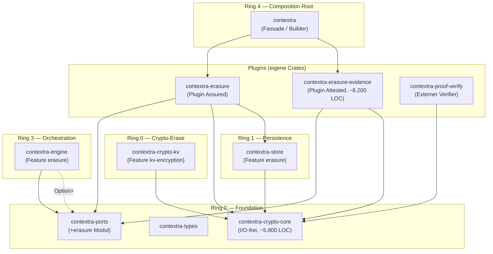
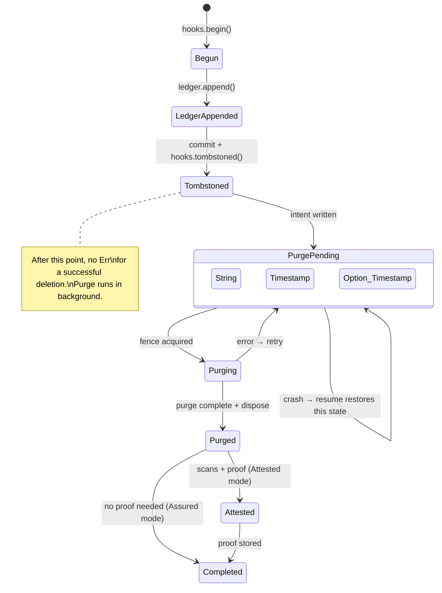

# Contextra – Implementierungsspezifikation: Löscharchitektur und Löschnachweis

**Basis:** Gesamtanalyse HEAD `16764583` (14.10.2026) · **Version:** 1.0 · **Datum:** 14.10.2026  
**Verantwortlich:** Principal Senior Rust Architect  
**Status:** Verbindliche Implementierungsanweisung für alle Phasen

> [!IMPORTANT]
> Dieses Dokument **ersetzt** das Analysedokument *„Contextra – Gesamtanalyse Architektur und Löschnachweis (HEAD 16764583)"* als verbindliche Arbeitsgrundlage. Es transformiert die Befunde in konkrete Implementierungsanweisungen mit Dateipfaden, Signaturen, Akzeptanzkriterien und Abhängigkeitsketten.

---

## Inhaltsverzeichnis

1. [Zusammenfassung und Zustandsbewertung](#1-zusammenfassung-und-zustandsbewertung)
2. [Architekturprinzipien (verbindlich)](#2-architekturprinzipien-verbindlich)
3. [Zielarchitektur: Crate-Schnitt und Abhängigkeiten](#3-zielarchitektur-crate-schnitt-und-abhängigkeiten)
4. [Erasure-Modi: Off, Assured, Attested](#4-erasure-modi-off-assured-attested)
5. [Port-Spezifikation: `contextra-ports::erasure`](#5-port-spezifikation-contextra-portserasure)
6. [Purge v2: Vollständige Spezifikation](#6-purge-v2-vollständige-spezifikation)
7. [Fence-Protokoll Option B: Implementierungsdetails](#7-fence-protokoll-option-b-implementierungsdetails)
8. [Evidenzkette: Zeugen → Beweis → Verifikation](#8-evidenzkette-zeugen--beweis--verifikation)
9. [Löschpfad: Vollständiger Ablauf je Modus](#9-löschpfad-vollständiger-ablauf-je-modus)
10. [Crypto-Erase: Schlüsselvernichtung](#10-crypto-erase-schlüsselvernichtung)
11. [Recovery, Resume und Restore](#11-recovery-resume-und-restore)
12. [Phasenplan mit konkreten Arbeitspaketen](#12-phasenplan-mit-konkreten-arbeitspaketen)
13. [Konfiguration, Features und Builder-API](#13-konfiguration-features-und-builder-api)
14. [Prüfbares Budget und Abnahmekriterien](#14-prüfbares-budget-und-abnahmekriterien)
15. [ADR-Register (Architekturentscheidungen)](#15-adr-register-architekturentscheidungen)
16. [Befundregister und Korrekturmatrix](#16-befundregister-und-korrekturmatrix)
17. [Risiken und Auflagen](#17-risiken-und-auflagen)

---

## 1. Zusammenfassung und Zustandsbewertung

### 1.1 Kernaussage

Der Löschpfad von Contextra ist am HEAD `16764583` **funktionslos** (Standard-Delete gibt `CapabilityUnsupported` zurück), der Purge-Kern **defekt** (trifft keine physischen Schlüssel, lässt Marker auf Platte, verdeckt neuere Versionen), und der Löschnachweis **nicht belastbar** (fabrizierte Zeugen, fehlende Produktionsaufrufer). Die Entkopplung über Ports hat nicht begonnen.

### 1.2 Blocker-Status

| ID | Severity | Kurzbezeichnung | Auswirkung |
|---|---|---|---|
| **N-N** | 🔴 Kritisch | Engine kompiliert nicht | Alles oberhalb Store nicht baubar |
| **N-O** | 🔴 Kritisch | Fassade kompiliert nicht | Workspace-Check, Fassaden-Tests blockiert |
| **N-P** | 🟠 Hoch | Lockfile veraltet | `--locked`-Builds und CI blockiert |
| **N-B** | 🔴 Kritisch | Standard-Delete funktionslos | Jede `Collection::delete()` gibt Fehler |
| **N-A** | 🔴 Kritisch | Crash-Resume fail-open | Abgestürzter Purge gilt als erledigt |
| **N-K** | 🟠 Hoch | Drop-Purge trifft nichts | Logische Präfixe matchen keine physischen Schlüssel |

### 1.3 Was funktioniert

- Ed25519-Signatur mit CSPRNG-Schlüssel (F1)
- v4-TLV-Format mit Domain-Tag
- Echter LSM-Manifest-Zeuge (A05)
- Default-Policy mit Pflicht-Layern (B02)
- Store kompiliert und besteht eigene Tests
- Ring-Architektur und DAG-Invariante grundsätzlich intakt

---

## 2. Architekturprinzipien (verbindlich)

Diese Prinzipien gelten für **alle** Implementierungen im Löschpfad und dürfen nicht abgeschwächt werden.

| # | Prinzip | Prüfmethode |
|---|---|---|
| **P-E1** | **Kosten sind opt-in.** Wer Löschgarantie nicht aktiviert, zahlt nichts: weder Code im Binary noch Laufzeit | `cargo tree -e normal -p <binary> --no-default-features` ohne Erasure-Crates |
| **P-E2** | **Kern-Crates sprechen nur mit `contextra-ports`.** Kein `use contextra_crypto::*` in Store, Engine, Vector | `cargo xtask dependency-graph-audit` |
| **P-E3** | **Kein Aufpreis im Normalbetrieb.** Schreibpfad: höchstens ein Atomic-Load je Batch. Löschpfad: `dyn` akzeptabel | Criterion-Benchmark p50/p99 ≤ 1% Abweichung |
| **P-E4** | **Fail-closed, keine fabrizierte Evidenz.** Zeugen nur aus echten Scans. Fehler = sichtbarer Zustand, nie stiller Erfolg | Mutationstest: Scanner = No-op → Beweis wird abgelehnt |
| **P-E5** | **Eine Wahrheitsquelle:** `ErasureMode`, persistent im Store-Manifest als Hochwassermarke | Test: Downgrade ohne explizite Aktion → `PolicyViolation` |
| **P-E6** | **Gemergt ist nicht wirksam.** Jedes Symbol braucht Produktionsaufrufer + End-to-End-Test über Fassade | `cargo xtask deletion-guarantee-gate` |
| **P-E7** | **Jeder Löschtest über `LsmStorage` UND `TenantScopedStorage<LsmStorage>`.** N-B und N-K treten nur im Wrapper auf | Tenant-Matrix in allen Lösch-Testsuiten |

---

## 3. Zielarchitektur: Crate-Schnitt und Abhängigkeiten

### 3.1 Crate-Aufteilung



### 3.2 Crate-Spezifikationen

#### `contextra-crypto-core` (I/O-freier Kern)

**Ring:** 0 · **Größe:** ~5.800 LOC · **Unsafe:** Nein

**Enthält (aus heutigem `contextra-crypto`):**
| Modul | Dateien | LOC (ca.) |
|---|---|---|
| `crypto` (KeyManager, KDF) | `crypto.rs`, `kdf.rs`, `keystore.rs`, `kms.rs` | 1.122 + 350 + 280 + 190 |
| `wal_crypto` | `wal_crypto.rs` | 954 |
| `secure_buf` | `secure_buf.rs` | 380 |
| `anti_tamper` | `anti_tamper.rs` | 310 |
| `wal_completeness` | `wal_completeness.rs` | 66 |
| `ed25519_proof` (Signaturen) | `ed25519_proof.rs` | 420 |
| `error` | `error.rs` | ~200 |

**Abhängigkeiten:** `contextra-types`, `contextra-ports` (nur Traits)  
**Kein:** `durable-fs`, kein I/O, keine Dateizugriffe

```toml
# crates/contextra-crypto-core/Cargo.toml
[package]
name = "contextra-crypto-core"
edition = "2021"

[dependencies]
contextra-types = { path = "../contextra-types" }
contextra-ports = { path = "../contextra-ports" }
aes-gcm-siv = "0.11"
blake3 = "1"
ed25519-dalek = { version = "2", features = ["rand_core"] }
zeroize = { version = "1", features = ["derive"] }
rand_core = "0.6"
```

#### `contextra-crypto-kv` (Crypto-Erase)

**Ring:** 0 · **Größe:** ~3.400 LOC

**Enthält:**
| Modul | Dateien | LOC (ca.) |
|---|---|---|
| `kv_cipher` | `kv_cipher.rs` | ~400 |
| `kv_segment` | `kv_segment/mod.rs`, `segment.rs`, `store.rs`, `eviction_worker.rs` | 1.428 |
| `kv_shredding` | `kv_shredding.rs` | 954 |
| `revocation_log` | `revocation_log.rs` | 1.032 |

**Abhängigkeiten:** `contextra-crypto-core`, `contextra-durable-fs`

```toml
[package]
name = "contextra-crypto-kv"

[dependencies]
contextra-crypto-core = { path = "../contextra-crypto-core" }
contextra-durable-fs = { path = "../contextra-durable-fs" }
contextra-types = { path = "../contextra-types" }
```

#### `contextra-erasure` (Plugin Assured)

**Ring:** 3 · **Neu** · **Größe:** ~2.500 LOC (geschätzt)

**Enthält (aus heutigem `contextra-engine/src/deletion/`):**
| Modul | Quell-Datei | Rolle |
|---|---|---|
| `coordinator` | `deletion/mod.rs` (Neufassung) | Zustandsmaschine `Begun→Tombstoned→PurgePending→Purged` |
| `purge_driver` | `deletion/purge_driver.rs` | Purge-Orchestrierung über Plugin-Hooks |
| `registry` | `deletion/registry.rs` | `KeyFamilyRegistry` für Footprint |
| `footprint` | `deletion/footprint.rs`, `footprint_handle.rs` | Footprint-Berechnung |
| `restore_filter` | `deletion/restore_filter.rs` | `RestoreGuard`-Implementierung |
| `reverse_sweep` | `deletion/reverse_sweep.rs` | Rohsweep-Orakel |
| `copy_observer` | `deletion/copy_observer.rs` | Kopien-Registry |

**Abhängigkeiten:** `contextra-ports`, `contextra-types`, `contextra-crypto-core`, `contextra-store` (Feature `erasure`)

#### `contextra-erasure-evidence` (Plugin Attested)

**Ring:** 3 · **Neu** · **Größe:** ~8.200 LOC

**Enthält (aus heutigem `contextra-crypto`):**
| Modul | Quell-Dateien | LOC (ca.) |
|---|---|---|
| `deletion_proof/*` | 20 Dateien | 6.425 |
| `deletion_proof_typestate` | 1 Datei | 463 |
| `deletion_witness` | 1 Datei | 716 |
| `audit_chain` | 1 Datei | ~620 |

**Abhängigkeiten:** `contextra-ports`, `contextra-types`, `contextra-crypto-core`, `contextra-durable-fs`  
**Kein:** `contextra-store`, `contextra-engine`, `contextra-license`

#### `contextra-proof-verify` (Externer Verifier)

**Ring:** 0 · **Neu** · **Größe:** ~800 LOC

**Enthält:**
- `verify_strict` (nur v4)
- TLV-Parser
- Ed25519-Signaturprüfung
- Testvektoren (B19)

**Abhängigkeiten:** `contextra-crypto-core` (nur Ed25519 + TLV), keine Engine, kein Store, keine Lizenz  
**Zweck:** Auditoren können Beweise prüfen ohne die gesamte Engine zu bauen.

### 3.3 Abhängigkeitsmatrix (Soll)

| Crate | Darf abhängen von | Darf NICHT abhängen von |
|---|---|---|
| `contextra-store` | `crypto-core`, `ports`, `types`, `durable-fs`, `sys` | `crypto` (alt), `erasure-evidence`, `license` |
| `contextra-vector` | `crypto-core`, `ports`, `types`, `simd`, `durable-fs` | `crypto` (alt), `erasure-evidence` |
| `contextra-engine` | `ports`, `types`, `store`, `vector`, `text`, `graph` | `crypto` (alt), `erasure-evidence`, `license` |
| `contextra-kvcache` | `crypto-core`, `ports`, `types` | `crypto` (alt) |
| `contextra-db` | `engine`, `store`, `ports`, `types` | `crypto` (alt) |
| `contextra-erasure` | `ports`, `types`, `crypto-core`, `store` | `crypto` (alt), `engine`, `license` |
| `contextra-erasure-evidence` | `ports`, `types`, `crypto-core`, `durable-fs` | `store`, `engine`, `license` |
| `contextra-mcp` | `contextra` (Fassade), `ports`, `types` | `crypto` (direkt), `erasure-evidence` (direkt) |

### 3.4 Migration: `pub use`-Shims

Beim Crate-Split (Phase 4) bleibt `contextra-crypto` als Fassade bestehen und re-exportiert:

```rust
// crates/contextra-crypto/src/lib.rs (nach Phase 4)
//! Backward-compatibility shim. New code should depend on
//! `contextra-crypto-core`, `contextra-crypto-kv`, or the erasure plugins directly.

pub use contextra_crypto_core::*;

#[cfg(feature = "kv-encryption")]
pub use contextra_crypto_kv::*;

// deletion_proof re-exports only for backward compat during migration
#[cfg(feature = "deletion-proof")]
#[deprecated(note = "Use contextra-erasure-evidence directly")]
pub mod deletion_proof {
    pub use contextra_erasure_evidence::deletion_proof::*;
}
```

---

## 4. Erasure-Modi: Off, Assured, Attested

### 4.1 Modusvergleich

| Eigenschaft | Off (Standard) | Assured | Attested |
|---|---|---|---|
| **Löschmethode** | Tombstone + Compaction | Footprint → Ledger → Tombstone → Purge + Crypto-Erase | wie Assured |
| **Ledger** | — | ✅ Anti-Resurrection-Ledger mit fsync | ✅ |
| **Fence** | — | ✅ Präfix-Fence im Schreibpfad | ✅ |
| **Resume nach Crash** | — | ✅ Scope aus Ledger, Fence aus Intent | ✅ |
| **Restore-Schutz** | — (dokumentierte Nicht-Garantie) | ✅ `RestoreGuard` streamend | ✅ |
| **Zeugen** | — | — | ✅ Echte Layer-Scans |
| **Beweis** | — | — | ✅ v4-TLV, Ed25519, Policy |
| **Zeitanker** | — | — | ✅ RFC 3161 |
| **Transparenzlog** | — | — | ✅ RFC 9162 |
| **Feature** | Kern | `erasure` | `erasure` + `erasure-evidence` |
| **Lizenz** | — | — | `FeatureRing::Sovereign` |
| **Laufzeitkosten** | Null | 1 Ledger-Append + 1 Batch-Check | + Scans + Signatur |
| **Dateien** | — | `purge/<id>.intent`, `erasure_ledger/` | + `proofs/`, `transparency_log/` |

### 4.2 Hochwassermarke

```rust
// Im Store-Manifest (contextra-store/src/manifest/mod.rs)
pub struct ManifestHeader {
    // ... bestehende Felder ...

    /// Höchster je aktiver ErasureMode. Nur aufwärts änderbar.
    /// Geschützt durch Manifest-HMAC.
    pub erasure_high_water_mark: ErasureMode,
}
```

**Invarianten:**
1. `open(mode)` mit `mode < high_water_mark` → `Err(PolicyViolation)`
2. Downgrade nur über `erasure_downgrade(AcknowledgeToken)`:
   - Ledger wird archiviert (nicht gelöscht)
   - Signierter Eintrag „Garantie endet bei Tx X" in der Audit-Kette
   - `high_water_mark` wird zurückgesetzt
3. Modus ist je Öffnen unveränderlich

### 4.3 Modus-Ableitung für `delete()`

```rust
// Pseudocode in der Engine
impl<S: StorageEngine> Collection<S> {
    pub fn delete(&self, doc_id: &str) -> Result<DeleteOutcome, ContextraError> {
        match self.erasure_mode() {
            ErasureMode::Off => {
                // Direkter Tombstone, keine Assurance, kein Ledger
                self.storage.delete(doc_id)?;
                Ok(DeleteOutcome::Logical { tx })
            }
            ErasureMode::Assured | ErasureMode::Attested => {
                // Vollständiger Löschpfad über ErasureHooks
                let hooks = self.erasure_hooks
                    .as_ref()
                    .ok_or(ContextraError::ConfigurationError("erasure hooks not wired"))?;
                self.erase_document(doc_id, hooks).await
            }
        }
    }
}
```

> [!IMPORTANT]
> `ForgetOptions::default()` mit `assurance: S1` entfällt aus dem Kern. `ForgetOptions` existiert nur noch im Plugin `contextra-erasure`. Der Kern-`delete()` kennt kein Assurance-Feld. Damit wird N-B strukturell unmöglich.

---

## 5. Port-Spezifikation: `contextra-ports::erasure`

### 5.1 Neue Datei: `crates/contextra-ports/src/erasure.rs`

```rust
//! Erasure port definitions for the deletion guarantee subsystem.
//!
//! These traits define the contract between the core engine and the
//! erasure plugins. The core never depends on plugin implementations.

use crate::{ContextraError, TxId};

// ────────────────────────────────────────────────────────────
// Mode
// ────────────────────────────────────────────────────────────

/// Persistent erasure mode. Acts as a high-water mark in the store manifest.
#[derive(Debug, Clone, Copy, PartialEq, Eq, PartialOrd, Ord, Hash)]
#[repr(u8)]
pub enum ErasureMode {
    /// No erasure guarantees. Tombstone + compaction only.
    Off = 0,
    /// Anti-resurrection ledger, fence, purge with resume, restore guard.
    Assured = 1,
    /// Assured + witnesses from real scans, signed proof, time anchor.
    Attested = 2,
}

impl Default for ErasureMode {
    fn default() -> Self {
        Self::Off
    }
}

// ────────────────────────────────────────────────────────────
// Physical Scope (N-K fix)
// ────────────────────────────────────────────────────────────

/// Physical scope for purge operations. Only constructible by the storage
/// backend, ensuring tenant-encoded prefixes are always correct.
///
/// This type prevents the prefix mismatch (N-K) structurally:
/// logical prefix `__col:{name}:` vs physical `t:{id}:__col:{name}:`.
#[derive(Debug, Clone)]
pub struct PhysicalScope {
    /// Tenant-encoded key prefixes ready for physical matching.
    prefixes: Vec<Vec<u8>>,
    /// Individual tenant-encoded keys.
    keys: Vec<Vec<u8>>,
}

impl PhysicalScope {
    /// Only callable by `ErasureBackend` implementors.
    pub fn new(prefixes: Vec<Vec<u8>>, keys: Vec<Vec<u8>>) -> Self {
        Self { prefixes, keys }
    }

    pub fn prefixes(&self) -> &[Vec<u8>] {
        &self.prefixes
    }

    pub fn keys(&self) -> &[Vec<u8>] {
        &self.keys
    }

    pub fn is_empty(&self) -> bool {
        self.prefixes.is_empty() && self.keys.is_empty()
    }
}

// ────────────────────────────────────────────────────────────
// Logical Scope (input from callers)
// ────────────────────────────────────────────────────────────

/// Logical scope as provided by callers (collection names, doc IDs).
/// The `ErasureBackend` translates this to `PhysicalScope`.
#[derive(Debug, Clone)]
pub enum LogicalScope {
    /// A single document within a collection.
    Document {
        collection: String,
        doc_id: String,
    },
    /// An entire collection.
    Collection {
        collection: String,
    },
    /// An entire tenant.
    Tenant {
        tenant_id: u64,
    },
}

// ────────────────────────────────────────────────────────────
// Erasure Backend (replaces downcasts, K4/D6)
// ────────────────────────────────────────────────────────────

/// Implemented by the storage engine. Replaces all five `downcast_ref::<LsmStorage>()`
/// calls (collection/mod.rs:405,528,532, crud/delete.rs:79, db_transaction_commit.rs:35).
pub trait ErasureBackend: Send + Sync {
    /// Translate a logical scope to physical (tenant-encoded) keys/prefixes.
    fn physical_scope(&self, scope: &LogicalScope) -> Result<PhysicalScope, ErasureError>;

    /// Execute a physical purge. Returns the purge output with metrics.
    fn purge(
        &self,
        scope: &PhysicalScope,
        as_of_tx: TxId,
        probe: &dyn FreeSpaceProbe,
    ) -> Result<PurgeOutput, PurgeError>;

    /// Acquire a prefix fence for the given scope.
    fn acquire_fence(&self, scope: &PhysicalScope) -> Result<FenceGuard, ErasureError>;
}

/// Extension trait on `StorageEngine` for erasure capability discovery.
pub trait StorageErasureExt {
    /// Returns `Some` if the storage supports erasure operations.
    /// `None` means erasure is not available (mode Off, or backend doesn't support it).
    fn erasure_backend(&self) -> Option<&dyn ErasureBackend>;
}

// ────────────────────────────────────────────────────────────
// Erasure Hooks (Plugin interface)
// ────────────────────────────────────────────────────────────

/// Hook token returned by `begin()`, threaded through the deletion lifecycle.
#[derive(Debug)]
pub struct HookToken {
    inner: u64,
}

impl HookToken {
    pub const NONE: Self = Self { inner: 0 };

    pub fn new(id: u64) -> Self {
        Self { inner: id }
    }
}

/// Context for an erasure operation.
#[derive(Debug)]
pub struct EraseCtx {
    pub scope: LogicalScope,
    pub mode: ErasureMode,
    pub tx_id: TxId,
}

/// The plugin's attestation output.
#[derive(Debug)]
pub enum ErasureAttestation {
    /// No attestation (Assured mode).
    None,
    /// Signed proof bytes (Attested mode).
    Proof(Vec<u8>),
}

/// Lifecycle hooks for the erasure plugins.
///
/// The default implementation is a no-op (mode Off behavior).
/// `contextra-erasure` implements this for Assured.
/// `contextra-erasure-evidence` wraps and extends for Attested.
pub trait ErasureHooks: Send + Sync + 'static {
    /// Called before any mutation. Sets up the deletion context.
    fn begin(&self, ctx: &EraseCtx) -> Result<HookToken, ErasureError> {
        let _ = ctx;
        Ok(HookToken::NONE)
    }

    /// Called after the tombstone commit. The deletion is now durable.
    fn tombstoned(&self, token: &HookToken, tx: TxId) -> Result<(), ErasureError> {
        let _ = (token, tx);
        Ok(())
    }

    /// Called after physical purge completes.
    /// The `scans` parameter provides access to layer scanners (Attested only).
    fn purged(
        &self,
        token: &HookToken,
        scans: &[&dyn LayerScan],
    ) -> Result<(), ErasureError> {
        let _ = (token, scans);
        Ok(())
    }

    /// Called to finalize the deletion and optionally produce an attestation.
    fn finish(&self, token: HookToken) -> Result<ErasureAttestation, ErasureError>;
}

// ────────────────────────────────────────────────────────────
// Layer Scan (Evidence chain)
// ────────────────────────────────────────────────────────────

/// Layer identifier for the proof system.
#[derive(Debug, Clone, Copy, PartialEq, Eq, Hash)]
pub struct LayerId(pub u32);

impl LayerId {
    pub const LSM_MEMTABLE: Self = Self(1);
    pub const LSM_SSTABLE_ALL: Self = Self(3);
    pub const TEXT_INDEX: Self = Self(20);
    pub const RELATIONS_GRAPH: Self = Self(21);
    pub const HNSW_VECTOR: Self = Self(26);
    pub const ERASURE_LEDGER: Self = Self(30);
}

/// Result of scanning a single layer for remnants of deleted data.
#[derive(Debug)]
pub struct LayerObservation {
    pub layer: LayerId,
    /// True if the scan found no remnants of the target scope.
    pub clean: bool,
    /// Digest of the observed state (for the proof).
    pub state_digest: [u8; 32],
    /// Additional metadata (e.g., files scanned, bytes checked).
    pub metadata: LayerScanMetadata,
}

#[derive(Debug, Default)]
pub struct LayerScanMetadata {
    pub files_scanned: u64,
    pub bytes_checked: u64,
    pub excluded_files: Vec<String>,
}

/// Layer scanner trait. Implemented by each index/storage subsystem.
///
/// The scan is **fail-closed**: any error means the layer is NOT clean.
pub trait LayerScan: Send + Sync {
    fn layer(&self) -> LayerId;

    /// Scan the layer for remnants of the given scope.
    /// Returns `Ok(observation)` or `Err` (fail-closed: no proof possible).
    fn scan(&self, scope: &PhysicalScope) -> Result<LayerObservation, ScanError>;
}

// ────────────────────────────────────────────────────────────
// Restore Guard
// ────────────────────────────────────────────────────────────

/// Verdict for a single key during checkpoint restore.
#[derive(Debug, Clone, Copy, PartialEq, Eq)]
pub enum RestoreVerdict {
    /// Key may be restored.
    Admit,
    /// Key must be filtered out (was deleted after checkpoint).
    Reject,
}

/// Streaming restore guard. Checks each key against the anti-resurrection ledger.
///
/// In mode Off: no guard is set, restore is unrestricted.
/// In mode Assured/Attested: guard is mandatory; missing guard = startup error.
pub trait RestoreGuard: Send + Sync {
    /// Check whether a key from checkpoint transaction `cp_tx` may be restored.
    fn admit(&self, key: &[u8], cp_tx: TxId) -> RestoreVerdict;
}

// ────────────────────────────────────────────────────────────
// Write Gate (Fence abstraction for the core)
// ────────────────────────────────────────────────────────────

/// Fence guard RAII token. Dropping releases the fence.
#[derive(Debug)]
pub struct FenceGuard {
    _inner: Box<dyn Send + Sync>,
}

// ────────────────────────────────────────────────────────────
// Free Space Probe
// ────────────────────────────────────────────────────────────

/// Probes available disk space. Production implementation uses `statvfs`.
pub trait FreeSpaceProbe: Send + Sync {
    /// Returns available bytes, or `None` if unknown.
    /// `None` means "unknown", NOT "zero" (W16 fix).
    fn available_bytes(&self) -> Option<u64>;
}

// ────────────────────────────────────────────────────────────
// Purge Output
// ────────────────────────────────────────────────────────────

/// Typed purge output (L4 fix: includes obsolete file list).
#[derive(Debug)]
pub struct PurgeOutput {
    pub records_purged: u64,
    pub bytes_reclaimed: u64,
    pub sstables_replaced: u32,
    /// SSTable files that were fully consumed and can be disposed.
    pub obsolete_files: Vec<std::path::PathBuf>,
    pub report: PurgeReport,
}

#[derive(Debug)]
pub struct PurgeReport {
    pub scope_key_count: u64,
    pub sstables_scanned: u32,
    pub sstables_rewritten: u32,
    pub duration: std::time::Duration,
}

// ────────────────────────────────────────────────────────────
// Errors
// ────────────────────────────────────────────────────────────

#[derive(Debug)]
pub enum ErasureError {
    /// Storage does not support erasure (mode Off or no backend).
    NotAvailable,
    /// Mode downgrade attempted without explicit acknowledgement.
    PolicyViolation { current: ErasureMode, requested: ErasureMode },
    /// Erasure hooks not wired in the builder.
    NotConfigured(String),
    /// I/O or internal error.
    Internal(String),
}

#[derive(Debug)]
pub enum PurgeError {
    InsufficientDiskSpace { needed: u64, available: Option<u64> },
    FenceConflict,
    IoError(std::io::Error),
    CompactionBusy,
    /// Read error during SSTable scan (L5 fix: no silent truncation).
    ReadError { file: String, offset: u64, source: std::io::Error },
}

#[derive(Debug)]
pub enum ScanError {
    IoError(std::io::Error),
    CorruptedIndex(String),
    /// Scanner could not complete — proof must not be issued.
    Incomplete(String),
}

// ────────────────────────────────────────────────────────────
// Delete Outcome (replaces ForgetOptions in the core)
// ────────────────────────────────────────────────────────────

/// The outcome of a deletion, visible to the caller.
#[derive(Debug)]
pub enum DeleteOutcome {
    /// Logically deleted. Physical removal via compaction (mode Off).
    Logical { tx: TxId },
    /// Logically deleted, purge scheduled (mode Assured).
    Assured { tx: TxId, purge_handle: PurgeHandle },
    /// Logically deleted, purge scheduled, attestation will follow (mode Attested).
    Attested { tx: TxId, purge_handle: PurgeHandle },
}

/// Handle to track a pending purge operation.
#[derive(Debug, Clone)]
pub struct PurgeHandle {
    pub purge_id: [u8; 16],
}

impl PurgeHandle {
    /// Query the status of this purge operation.
    pub fn status(&self) -> PurgeStatus {
        // Resolved by the coordinator
        PurgeStatus::Pending
    }
}

#[derive(Debug, Clone, Copy, PartialEq, Eq)]
pub enum PurgeStatus {
    Pending,
    InProgress,
    Completed,
    Failed { retriable: bool },
}
```

### 5.2 Integration in `contextra-ports/src/lib.rs`

```rust
// Hinzufügen in crates/contextra-ports/src/lib.rs:
pub mod erasure;
pub use erasure::*;
```

### 5.3 `StorageErasureExt` Implementierung im Store

```rust
// crates/contextra-store/src/lsm/mod.rs
#[cfg(feature = "erasure")]
impl StorageErasureExt for LsmStorage {
    fn erasure_backend(&self) -> Option<&dyn ErasureBackend> {
        Some(self)
    }
}

#[cfg(not(feature = "erasure"))]
impl StorageErasureExt for LsmStorage {
    fn erasure_backend(&self) -> Option<&dyn ErasureBackend> {
        None
    }
}

// TenantScopedStorage delegiert und übersetzt:
impl<S: StorageErasureExt> StorageErasureExt for TenantScopedStorage<S> {
    fn erasure_backend(&self) -> Option<&dyn ErasureBackend> {
        // Delegation mit Scope-Translation
        self.inner.erasure_backend()
    }
}
```

---

## 6. Purge v2: Vollständige Spezifikation

Der Purge-Kern muss **vor** dem Crate-Split (Phase 4) korrekt funktionieren. Alle Korrekturen in Phase 0d.

### 6.1 Korrekturmatrix

| # | Befund | Korrektur | Datei(en) | Test |
|---|---|---|---|---|
| **L4** | Obsolete SSTables bleiben auf Platte | `PurgeOutput.obsolete_files` befüllen; Orchestrator reicht an `dispose()` | `ops/purge.rs`, `purge/orchestrator.rs`, `purge/dispose.rs` | Rohsweep: keine Marker-Bytes nach Purge |
| **L5** | `while let Ok(Some(..))` verschluckt Lesefehler | Ersetzung durch `match`: `Ok(Some)` → weiter, `Ok(None)` → Ende, `Err(e)` → `return Err(PurgeError::ReadError{..})` | `ops/purge.rs` (2 Stellen) | Injektion von I/O-Fehler → `Err`, Dateien unverändert |
| **L6** | Umgeschriebener Reader an falscher Position | `rank` und Sequenzbereich des alten Readers übernehmen; alter Reader an gleicher Position ersetzen statt anhängen | `ops/purge.rs`, Manifest-Update | Differenztest: `BTreeMap`-Referenzmodell |
| **L8** | `None`-Probe = 0 Byte frei | `None` = unbekannt, Purge darf starten (konservativ: weniger SSTs gleichzeitig), `Some(0)` = kein Platz | `ops/purge.rs`, `compaction/purge_select.rs` | Test: `None`-Probe → Purge läuft |
| **L12** | `CompactionBusy` für I/O-Fehler missbraucht | Eigene Fehlervarianten: `PurgeError::ReadError`, `PurgeError::WriteError`, `PurgeError::ManifestError` | `ops/purge.rs` | Typ-Matching in Tests |
| **N-K** | Logische Präfixe matchen nicht | `purge_keys` akzeptiert nur `PhysicalScope`; `TenantScopedStorage` übersetzt in `physical_scope()` | `ops/purge.rs`, `lsm/mod.rs` | `zz_audit_h3_l6::h3_logical_prefix_does_not_match` → grün |
| **N-E** | Eine Intent-Datei je Store | `purge/<purge_id>.intent` mit Zufallsanteil; Fence mit Referenzzähler je Präfix | `purge/intent.rs`, `fence.rs` | Test: zwei parallele Purges verschiedener Scopes |
| **N-F** | `Vec` + doppeltes Lesen | Streaming-Rewrite: Iterator über SSTable → gefilterter Writer; ein Durchlauf | `ops/purge.rs` | Speicher-Peak unabhängig von SSTable-Größe |
| **N-G** | Orphan-GC ohne Scrub | Orphan-GC nutzt `durable_remove` mit echtem Scrub; `manifest_generation` nicht auf 1 zurücksetzen | `recovery.rs` | Orphan-Test: nach GC keine Alt-SSTs |
| **N-J** | Failpoints per Umgebungsvariable | `check_failpoint` nur unter `#[cfg(feature = "fault-injection")]` | `purge/failpoint.rs` | `grep -r 'std::env::var.*PURGE_FAILPOINT' crates/contextra-store/src/` → 0 Treffer |

### 6.2 Purge-Ablauf (nach Korrektur)

```
purge_keys(scope: &PhysicalScope, as_of_tx: TxId, probe: &dyn FreeSpaceProbe)
  │
  ├─ 1. Probe: available_bytes()
  │     None → konservativ (1 SST gleichzeitig)
  │     Some(0) → Err(InsufficientDiskSpace)
  │     Some(n) → Budget berechnen
  │
  ├─ 2. Kandidaten-Auswahl (Metadaten: Bloom, Schlüsselbereich)
  │     Nur SSTs mit potenziellem Scope-Treffer
  │
  ├─ 3. Streaming-Rewrite je Kandidat:
  │     for entry in sst.iter() {
  │         match entry {
  │             Ok(Some(kv)) if scope.matches(&kv.key) && kv.seq <= as_of_tx
  │                 → skip (purge)
  │             Ok(Some(kv))
  │                 → write to new SST
  │             Ok(None) → break (EOF)
  │             Err(e) → return Err(PurgeError::ReadError{..})  // L5 fix
  │         }
  │     }
  │     Neuer SST erhält rank + seq_range des alten → Position bleibt  // L6 fix
  │
  ├─ 4. Manifest-Update (atomisch):
  │     - Neuer SST ersetzt alten an gleicher Position
  │     - Leerer neuer SST → alter SST wird obsolete
  │
  ├─ 5. PurgeOutput zusammenstellen:
  │     PurgeOutput {
  │         records_purged,
  │         bytes_reclaimed,
  │         sstables_replaced,
  │         obsolete_files: vec![old_sst_path, ...],  // L4 fix
  │         report,
  │     }
  │
  └─ 6. Koaleszenz: Sammelfenster fasst mehrere Scopes in einen Durchlauf
```

### 6.3 Dispose-Pfad (L4 fix)

```rust
// purge/dispose.rs — nach Korrektur
pub fn dispose(
    store_dir: &Path,
    obsolete: &[PathBuf],
    scrub: bool,
) -> Result<DisposeReport, DisposeError> {
    let mut report = DisposeReport::default();
    for path in obsolete {
        if scrub {
            // Überschreiben mit Nullen, dann löschen
            durable_fs::scrub_and_remove(path)?;
        } else {
            durable_fs::durable_remove(path)?;
        }
        report.files_disposed += 1;
        report.bytes_freed += path.metadata()?.len();
    }
    // fsync des Verzeichnisses
    durable_fs::sync_dir(store_dir)?;
    Ok(report)
}
```

### 6.4 Differenztest-Framework

```rust
// tests/purge_correctness.rs
/// Referenzmodell: BTreeMap<Key, Vec<(SeqNo, Value)>>
/// Nach jedem Purge:
/// 1. Lese alle Schlüssel aus dem Store
/// 2. Vergleiche mit Referenzmodell (ohne gepurgte Einträge)
/// 3. Prüfe: kein Schlüssel fehlt, keine Version vertauscht (L6)
/// 4. Rohsweep: suche Marker-Bytes in allen Dateien (L4)
fn test_purge_correctness() {
    let reference = BTreeMap::new();
    // ... Writes + Purge ...
    
    // L6-Prüfung: Lesereihenfolge korrekt
    for (key, versions) in &reference {
        let stored = store.get(key);
        assert_eq!(stored, versions.last().map(|(_, v)| v));
    }
    
    // L4-Prüfung: Rohsweep
    let marker = b"CANARY_FOR_PURGE_TEST";
    for file in store_dir.read_dir() {
        let content = fs::read(file.path());
        assert!(!content.windows(marker.len()).any(|w| w == marker),
            "Marker found in {}", file.path().display());
    }
}
```

---

## 7. Fence-Protokoll Option B: Implementierungsdetails

### 7.1 Architektur (ADR-10)

Der Serialisierungspunkt liegt in `lsm/ops/write.rs`: `commit_internal()` unter `commit_mutex`. Leader/Follower-Group-Commit ermöglicht eine Lock-freie Prüfung im Normalbetrieb.

### 7.2 Datenstruktur

```rust
// crates/contextra-store/src/lsm/fence.rs (Neuimplementierung)

/// Per-prefix reference-counted fence. Only behind feature `erasure`.
#[cfg(feature = "erasure")]
pub(crate) struct ErasureGate {
    /// Fast path: is any fence active? Checked with Acquire in the leader.
    active: AtomicBool,
    /// Prefix table with reference counts. Swapped atomically.
    fences: ArcSwap<Vec<PrefixFence>>,
}

#[derive(Debug, Clone)]
pub(crate) struct PrefixFence {
    /// Physical prefix being fenced.
    prefix: Vec<u8>,
    /// Reference count (multiple purges can fence different sub-prefixes).
    ref_count: u32,
    /// Purge ID for diagnostics.
    purge_id: [u8; 16],
}

#[cfg(feature = "erasure")]
impl ErasureGate {
    pub fn new() -> Self {
        Self {
            active: AtomicBool::new(false),
            fences: ArcSwap::from_pointee(Vec::new()),
        }
    }

    /// Acquire a fence. MUST be called under commit_mutex.
    pub fn acquire(
        &self,
        prefixes: &[Vec<u8>],
        purge_id: [u8; 16],
    ) -> FenceGuard {
        let mut current = (*self.fences.load()).clone();
        for prefix in prefixes {
            if let Some(existing) = current.iter_mut().find(|f| f.prefix == *prefix) {
                existing.ref_count += 1;
            } else {
                current.push(PrefixFence {
                    prefix: prefix.clone(),
                    ref_count: 1,
                    purge_id,
                });
            }
        }
        self.fences.store(Arc::new(current));
        self.active.store(true, Ordering::Release);
        FenceGuard { /* ... */ }
    }

    /// Release a fence. MUST be called under commit_mutex.
    pub fn release(&self, prefixes: &[Vec<u8>]) {
        let mut current = (*self.fences.load()).clone();
        current.retain_mut(|f| {
            if prefixes.contains(&f.prefix) {
                f.ref_count -= 1;
                f.ref_count > 0
            } else {
                true
            }
        });
        let any_active = !current.is_empty();
        self.fences.store(Arc::new(current));
        self.active.store(any_active, Ordering::Release);
    }

    /// Check a batch of keys against the fence.
    /// Called by the leader AFTER re-acquiring commit_mutex.
    pub fn check_batch(&self, keys: &[&[u8]]) -> Result<(), FencedKey> {
        if !self.active.load(Ordering::Acquire) {
            return Ok(()); // Fast path: no fence active
        }
        let fences = self.fences.load();
        for key in keys {
            for fence in fences.iter() {
                if key.starts_with(&fence.prefix) {
                    return Err(FencedKey {
                        key: key.to_vec(),
                        prefix: fence.prefix.clone(),
                        purge_id: fence.purge_id,
                    });
                }
            }
        }
        Ok(())
    }
}

#[cfg(not(feature = "erasure"))]
pub(crate) struct ErasureGate;

#[cfg(not(feature = "erasure"))]
impl ErasureGate {
    pub fn new() -> Self { Self }
}
```

### 7.3 Integration in den Schreibpfad

```rust
// crates/contextra-store/src/lsm/ops/write.rs
// In commit_internal(), NACH dem erneuten Mutex-Erwerb
// und VOR prepare_batch für die Follower:

fn commit_internal(&self, /* ... */) -> Result<(), StoreError> {
    // 1. Leader sammelt Followers
    let commit_lock = self.commit_mutex.lock();
    // ... Leader staging ...
    drop(commit_lock); // Sammelfenster öffnen

    // 2. Sammelfenster (Followers reihen sich ein)
    std::thread::sleep(self.group_commit_window);

    // 3. Mutex wieder erwerben
    let commit_lock = self.commit_mutex.lock();

    // 4. *** FENCE CHECK (N-H fix) ***
    #[cfg(feature = "erasure")]
    if let Some(gate) = &self.erasure_gate {
        let all_keys: Vec<&[u8]> = leader_ops.iter()
            .chain(follower_ops.iter())
            .map(|op| op.key())
            .collect();
        
        gate.check_batch(&all_keys).map_err(|fenced| {
            // Reject fenced followers via their oneshot channels
            for follower in &followers {
                if follower.ops.iter().any(|op|
                    op.key().starts_with(&fenced.prefix))
                {
                    let _ = follower.result_tx.send(
                        Err(StoreError::FencedWrite(fenced.clone()))
                    );
                }
            }
            StoreError::FencedWrite(fenced)
        })?;
    }

    // 5. prepare_batch, WAL-Append, apply_mem_updates
    // ...
}
```

### 7.4 Kosten-Analyse

| Situation | Kosten ohne Fence (heute) | Kosten mit Fence (Option B) |
|---|---|---|
| **Mode Off** | — | `ErasureGate` ist `None`, kein Code ausgeführt |
| **Assured, kein Purge aktiv** | 3× `RwLock`-Read je Schlüssel (6 Stellen) | 1× `AtomicBool::load(Acquire)` je Batch |
| **Assured, Purge aktiv** | 3× `RwLock`-Read + lineare Präfixschleife | 1× `AtomicBool` + Präfixabgleich nur für betroffene Batches |
| **Fence-Erwerb** | — | Unter `commit_mutex`: µs bis Sammelfenster |

### 7.5 Auflagen vor Freigabe

1. **Loom-Modell:** Follower-Einreihen ↔ Fence-Erwerb ↔ Leader-Lauf (mindestens 3 Threads, 2 Szenarien: Fence vor/nach Leader-Erwerb)
2. **Leader-Eigen-Ops (8.6 Nr. 5):** Seq-Vergabe vor dem Fenster → Rückbau bei eigenem Reject prüfen. Alternative: Seq-Vergabe nach dem Fenster.
3. **Benchmark:** Criterion `put` + `commit` (p50, p99) in `{Off, Assured idle, Assured+Purge}` vs. Baseline ≤ 1%
4. **Abnahmetest:** „Schreibvorgänge außerhalb des Scopes blockieren während des Rewrites nicht"

---

## 8. Evidenzkette: Zeugen → Beweis → Verifikation

### 8.1 Ist-Zustand und Korrekturplan

| Zeuge | Ist-Zustand | Soll-Zustand | Korrektur |
|---|---|---|---|
| **LSM-Manifest** (Layer 1) | ✅ Echt (A05) | ✅ Beibehalten | — |
| **LSM-SSTable-All** (Layer 3) | ❌ `\|\| Ok(true)` ohne Scan | ✅ Rohsweep nach Marker-Bytes | `scan_and_issue_sstable_witness` verdrahten |
| **Ledger** (Layer 30) | ❌ Fabriziert: `[0u8;32]`, `entry_confirmed: true` | ✅ Aus echtem Ledger-Append | L1: `ErasureLedger::append` aufrufen |
| **Text-Index** (Layer 20) | ❌ Nie ausgestellt (`None` → `Err` → `if let Ok`) | ✅ Aus echtem Scan | N-D: `scan_and_issue_text_witness` verdrahten |
| **Relations-Graph** (Layer 21) | ❌ Nie ausgestellt | ✅ Aus echtem Scan | N-D: `scan_and_issue_relations_witness` verdrahten |
| **HNSW-Vektor** (Layer 26) | ❌ `forget_document` mit Konstanten | ✅ Aus echtem Scan oder entfernen | N-C: `forget_document` löschen |

### 8.2 Zeugenerzeugung: Pull-Modell

> [!IMPORTANT]
> Im neuen Modell ruft das **Plugin** (nicht die Engine) die Layer-Scans auf. Zeugen-Konstruktoren sind `pub(crate)` innerhalb des Plugins. `issue_sealed`/`WitnessIssuerToken` entfallen zugunsten der Crate-Grenze.

```rust
// contextra-erasure-evidence/src/witness_collector.rs
pub(crate) struct WitnessCollector {
    scanners: Vec<Box<dyn LayerScan>>,
    policy: ProofPolicy,
}

impl WitnessCollector {
    /// Collect witnesses from all registered layer scanners.
    /// Fail-closed: any scan error prevents proof issuance.
    pub(crate) fn collect(
        &self,
        scope: &PhysicalScope,
    ) -> Result<Vec<LayerObservation>, EvidenceError> {
        let mut observations = Vec::with_capacity(self.scanners.len());
        
        for scanner in &self.scanners {
            let obs = scanner.scan(scope).map_err(|e| {
                EvidenceError::ScanFailed {
                    layer: scanner.layer(),
                    source: e,
                }
            })?;
            observations.push(obs);
        }

        // Validate against policy: all required layers present?
        self.policy.validate_layers(&observations)?;

        Ok(observations)
    }
}
```

### 8.3 Layer-Scan-Implementierungen

Jeder Index-Crate implementiert `LayerScan` hinter Feature `erasure-scan`:

```rust
// crates/contextra-store/src/lsm/layer_scan.rs
#[cfg(feature = "erasure-scan")]
pub struct LsmMemtableScan<'a> {
    storage: &'a LsmStorage,
}

#[cfg(feature = "erasure-scan")]
impl LayerScan for LsmMemtableScan<'_> {
    fn layer(&self) -> LayerId { LayerId::LSM_MEMTABLE }

    fn scan(&self, scope: &PhysicalScope) -> Result<LayerObservation, ScanError> {
        let mut hasher = blake3::Hasher::new();
        let mut clean = true;

        // Scan memtable for scope keys
        for prefix in scope.prefixes() {
            if self.storage.memtable_contains_prefix(prefix) {
                clean = false;
            }
            hasher.update(prefix);
        }

        // Include memtable generation in digest
        hasher.update(&self.storage.manifest_generation().to_le_bytes());
        hasher.update(&self.storage.in_flight_count().to_le_bytes());

        Ok(LayerObservation {
            layer: LayerId::LSM_MEMTABLE,
            clean,
            state_digest: *hasher.finalize().as_bytes(),
            metadata: LayerScanMetadata {
                bytes_checked: self.storage.memtable_size() as u64,
                ..Default::default()
            },
        })
    }
}

// crates/contextra-text/src/layer_scan.rs
#[cfg(feature = "erasure-scan")]
pub struct TextIndexScan<'a> {
    index: &'a InvertedIndex,
}

#[cfg(feature = "erasure-scan")]
impl LayerScan for TextIndexScan<'_> {
    fn layer(&self) -> LayerId { LayerId::TEXT_INDEX }

    fn scan(&self, scope: &PhysicalScope) -> Result<LayerObservation, ScanError> {
        // Scan all posting lists for doc IDs in scope
        let doc_ids = scope.extract_doc_ids();
        let mut clean = true;
        let mut hasher = blake3::Hasher::new();

        for doc_id in &doc_ids {
            if self.index.contains_doc(*doc_id)? {
                clean = false;
            }
            hasher.update(&doc_id.to_le_bytes());
        }

        Ok(LayerObservation {
            layer: LayerId::TEXT_INDEX,
            clean,
            state_digest: *hasher.finalize().as_bytes(),
            metadata: Default::default(),
        })
    }
}
```

### 8.4 Proof-Härtung

| Befund | Korrektur | Phase |
|---|---|---|
| **E1:** `verify` statt `verify_strict` | `verify` entfernen, überall `verify_strict` | 5 |
| **E2:** `bincode` im Signaturpfad | TLV für alle v4-Pfade (bereits teilweise), `bincode` nur für Legacy-v2/v3 (Read-only) | 5 |
| **E5:** Policy-Passung | Test: Default-Pflichtlayer (`[1, 3, 20, 21, 26]`) ⊆ real erzeugbare Zeugen | 5 |
| **E6:** `LayerWitness::issue` ist `pub` | `pub(crate)` im Plugin, `issue_sealed`/`WitnessIssuerToken` entfallen | 5 |
| **N-I:** v3-Erzeugung trotz Verbot | `DeletionProof::create` (v3) entfernen, nur v4 | 0e |
| **L10:** Drop-Pfad mit `temp_dir()` und `[0x33;16]` | Echte `purge_id`, echtes `store_dir`, Ergebnis nicht verwerfen | 0e |

### 8.5 Tampering-Matrix (Abnahme für Phase 5)

Jedes Feld eines v4-Beweises wird einzeln verändert → Verifier muss ablehnen:

```rust
#[test]
fn tampering_matrix() {
    let proof = create_valid_proof();
    
    // Feld für Feld mutieren
    let mutations = vec![
        ("signature", mutate_signature(&proof)),
        ("domain_tag", mutate_domain_tag(&proof)),
        ("timestamp", mutate_timestamp(&proof)),
        ("scope_hash", mutate_scope_hash(&proof)),
        ("layer_digest_0", mutate_layer_digest(&proof, 0)),
        ("layer_digest_1", mutate_layer_digest(&proof, 1)),
        ("version", mutate_version(&proof)),
        ("public_key", mutate_public_key(&proof)),
        ("audit_chain_prev", mutate_chain_prev(&proof)),
    ];
    
    for (field, mutated) in mutations {
        let result = verify_strict(&mutated, &public_key);
        assert!(result.is_err(), "Tampering of '{}' not detected", field);
    }
}
```

---

## 9. Löschpfad: Vollständiger Ablauf je Modus

### 9.1 Modus Off

```
Collection::delete(doc_id)
  │
  ├─ storage.delete(doc_id)  // Tombstone via StorageEngine trait
  │     └─ tx_buffer.stage_delete(key)
  │         └─ commit_internal() // regulär, ohne Fence-Check
  │
  └─ Ok(DeleteOutcome::Logical { tx })
  
  Physische Entfernung: bei nächster Compaction (keine Garantie)
  Restore: unrestricted, Gelöschtes kann zurückkehren
  Dateien: keine zusätzlichen
```

### 9.2 Modus Assured

```
Collection::delete(doc_id)  // über ErasureHooks
  │
  ├─ 1. hooks.begin(EraseCtx { scope, mode: Assured, tx })
  │     └─ Coordinator erstellt DeletionState::Begun
  │         └─ Footprint über KeyFamilyRegistry (einmal, nicht je Layer)
  │
  ├─ 2. ErasureLedger::append(scope, tx) + fsync        ← L1 fix
  │     └─ MUSS VOR dem Tombstone-Commit stehen
  │
  ├─ 3. hooks.tombstoned(token, tx)
  │     └─ Tombstone-Commit via StorageEngine
  │     └─ RAM-Indizes bereinigen (HNSW, Text, Graph)
  │     └─ KV-Schlüssel widerrufen (RevocationLog)
  │     └─ DeletionState → Tombstoned
  │
  ├─ 4. Purge-Intent anlegen: purge/<purge_id>.intent
  │     └─ purge_id = random [u8; 16]                    ← N-E fix
  │     └─ DeletionState → PurgePending
  │
  ├─ 5. Physische Bereinigung (Hintergrund-Task):
  │     ├─ Fence erwerben (unter commit_mutex)
  │     ├─ physical_scope = backend.physical_scope(&logical)  ← N-K fix
  │     ├─ purge_keys(&physical_scope, as_of_tx, &probe)
  │     │     └─ Streaming-Rewrite (§6)
  │     ├─ dispose(obsolete_files, scrub: true)            ← L4 fix
  │     ├─ Fence freigeben
  │     └─ DeletionState → Purged
  │
  ├─ 6. Intent löschen, Ledger-Eintrag als „completed" markieren
  │
  └─ Ok(DeleteOutcome::Assured { tx, purge_handle })

  Nach dem Tombstone-Commit gibt es kein Err für eine wirksame Löschung.
  Fehlgeschlagener Purge → PurgePending { reason, since, retry_at }
  → überlebt Neustarts, wird als Status abfragbar.
```

### 9.3 Modus Attested

```
Wie Assured, plus nach Schritt 5:

  ├─ 6. WitnessCollector::collect(&physical_scope)
  │     └─ LayerScan für jede registrierte Schicht:
  │         ├─ LsmMemtableScan
  │         ├─ LsmSstableScan (Rohsweep)
  │         ├─ TextIndexScan
  │         ├─ GraphRelationsScan
  │         ├─ HnswVectorScan
  │         └─ ErasureLedgerScan
  │     └─ Policy-Prüfung: alle Pflicht-Layer anwesend?
  │
  ├─ 7. DeletionProofV4::create_and_sign(observations, &signing_key)
  │     └─ TLV-Format mit Domain-Tag "contextra/deletion-proof/v4\0"
  │     └─ verify_strict() als Selbstprüfung
  │
  ├─ 8. Optional: Zeitanker (RFC 3161), Transparenzlog (RFC 9162)
  │
  └─ Ok(DeleteOutcome::Attested { tx, purge_handle })
      └─ Attestation enthält Proof-Bytes, abrufbar über purge_handle
```

### 9.4 Zustandsmaschine



---

## 10. Crypto-Erase: Schlüsselvernichtung

### 10.1 Strategie

| Lösch-Granularität | Methode | Komplexität |
|---|---|---|
| Ganze Collection | Schlüssel widerrufen → O(1) | `RevocationLog::revoke(collection_key_id)` |
| Ganzer Mandant | Mandant-Schlüssel widerrufen → O(1) | `RevocationLog::revoke(tenant_key_id)` |
| Einzelnes Dokument | Rewrite-Purge → O(SST-Größe) | Streaming-Rewrite wie §6 |

### 10.2 Ablauf Collection-Drop

```
drop_collection(name)
  │
  ├─ 1. Schlüssel-ID der Collection aus KeyManager abrufen
  ├─ 2. RevocationLog::revoke(key_id) → fsync
  │     └─ fail-closed: bei Fehler kein Drop (E8)
  ├─ 3. Collection-Metadaten löschen (Tombstone)
  ├─ 4. Lazy-Bereinigung: nächste Compaction entfernt verschlüsselte Daten
  │     └─ Compaction prüft RevocationLog, überspringt widerrufene Schlüssel
  └─ 5. Optional (Assured/Attested): Purge-Intent für Restdaten
```

### 10.3 Wartefrist

Schlüsselvernichtung ist unwiderruflich. Schutz vor Fehlbedienung:
- Konfigurierbare Wartefrist (Standard: 72h) vor physischer Schlüsselvernichtung
- Widerruf sofort wirksam (keine Entschlüsselung mehr möglich)
- Physische Löschung des Schlüsselmaterials nach Ablauf der Frist

---

## 11. Recovery, Resume und Restore

### 11.1 Resume nach Crash (N-A fix)

**Ist-Zustand (defekt):**
```
recovery.rs:525 → PurgeWiring::build_default().resume_pending()
  └─ OrxHooks::default() → kein reconstruct_scope → Scope = Keys([])
  └─ PurgeOrchestrator::new_standalone → storage: None
  └─ P2 Fence: if let Some(storage) → skip
  └─ P4 purge_keys: if let Some(storage) → skip
  └─ P5 dispose(Vec::new())
  └─ Intent gelöscht → "erfolgreich", aber nichts passiert
```

**Soll-Zustand:**

```rust
// Resume NACH Storage-Aufbau, nicht in der Recovery
// crates/contextra-store/src/lsm/purge/resume.rs (Neufassung)

pub fn resume_pending_purges(
    storage: &LsmStorage,
    ledger: &ErasureLedger,  // Pflicht in Assured/Attested
    probe: &dyn FreeSpaceProbe,
) -> Result<Vec<ResumedPurge>, ResumeError> {
    let intent_dir = storage.store_dir().join("purge");
    let mut resumed = Vec::new();

    for entry in fs::read_dir(&intent_dir)? {
        let entry = entry?;
        if entry.path().extension() == Some("intent".as_ref()) {
            let intent = PurgeIntent::load(&entry.path())?;

            // 1. Scope aus Ledger rekonstruieren (nicht aus Default)
            let scope = ledger.reconstruct_scope(&intent.scope_hash)?
                .ok_or(ResumeError::ScopeNotInLedger {
                    purge_id: intent.purge_id,
                })?;

            // 2. Fence aktivieren BEVOR das Öffnen Ok meldet
            let _fence = storage.acquire_fence(&scope)?;

            // 3. Rewrite als Hintergrund-Task starten
            let handle = spawn_background_purge(
                storage.clone(),
                scope,
                intent,
                probe,
            );

            resumed.push(ResumedPurge {
                purge_id: intent.purge_id,
                handle,
            });
        }
    }

    Ok(resumed)
}
```

**Kritische Änderungen:**
1. Resume erhält `&LsmStorage` (nicht `storage: None`)
2. Scope wird aus dem Ledger rekonstruiert (nicht aus `Default`)
3. Fence wird aus dem Intent aktiviert **bevor** das Öffnen `Ok` meldet
4. Rewrite läuft als Hintergrund-Task (Öffnen blockiert nicht)
5. Im Modus Off existiert kein `purge.intent` → kein Resume nötig

### 11.2 Restore je Modus (N-L, W15 fix)

| Modus | Verhalten | Implementierung |
|---|---|---|
| **Off** | Erlaubt, keine Barriere, kein Filter. Gelöschtes kann zurückkehren. Dokumentierte Nicht-Garantie | `checkpoint_store.restore()` ohne `RestoreGuard` |
| **Assured** | `RestoreGuard` Pflicht. Streamend über Schlüsselbereiche, nicht Voll-Scan. Erfasst KV, Vektor, Text, Graph. Fehlt der Guard → **Startfehler** | Builder setzt Guard aus Ledger + RevocationLog |
| **Attested** | Wie Assured, plus Eintrag im Beweis | Guard-Ergebnis wird in den Proof aufgenommen |

```rust
// crates/contextra-erasure/src/restore_guard.rs
pub struct LedgerRestoreGuard {
    ledger: Arc<ErasureLedger>,
    revocation_log: Arc<RevocationLog>,
}

impl RestoreGuard for LedgerRestoreGuard {
    fn admit(&self, key: &[u8], cp_tx: TxId) -> RestoreVerdict {
        // 1. Prüfe ob der Schlüssel nach cp_tx gelöscht wurde
        if self.ledger.was_deleted_after(key, cp_tx) {
            return RestoreVerdict::Reject;
        }
        // 2. Prüfe ob der Verschlüsselungsschlüssel widerrufen wurde
        if self.revocation_log.is_revoked_for_key(key) {
            return RestoreVerdict::Reject;
        }
        RestoreVerdict::Admit
    }
}
```

### 11.3 A15-Barriere: Modusabhängig

```rust
// crates/contextra-checkpoint/src/restore.rs
pub fn restore_checkpoint(
    &self,
    checkpoint: &Checkpoint,
    guard: Option<&dyn RestoreGuard>,
    mode: ErasureMode,
) -> Result<(), RestoreError> {
    // Barriere NUR bei Assured/Attested
    if mode >= ErasureMode::Assured && guard.is_none() {
        return Err(RestoreError::GuardRequired {
            mode,
            hint: "Builder must set RestoreGuard for Assured/Attested mode",
        });
    }

    // Streaming restore mit optionalem Filter
    for entry in checkpoint.entries() {
        if let Some(guard) = guard {
            match guard.admit(&entry.key, checkpoint.tx_id()) {
                RestoreVerdict::Reject => continue,
                RestoreVerdict::Admit => {}
            }
        }
        self.apply_entry(entry)?;
    }

    Ok(())
}
```

---

## 12. Phasenplan mit konkreten Arbeitspaketen

### 12.1 Phasenübersicht

```mermaid
flowchart LR
    P0a["Phase 0a<br/>Build + CI<br/>~2d"]
    P0b["Phase 0b<br/>N-B Hotfix<br/>~1d"]
    P0c["Phase 0c<br/>Gate + Orakel<br/>~2d"]
    P0d["Phase 0d<br/>Purge-Korrektheit<br/>~5d"]
    P0e["Phase 0e<br/>Löschpfad ehrlich<br/>~3d"]
    P1["Phase 1<br/>Ports<br/>~2d"]
    P2["Phase 2<br/>Off + Fence B<br/>~5d"]
    P3["Phase 3<br/>Assured<br/>~8d"]
    P4["Phase 4<br/>Crate-Split<br/>~3d"]
    P5["Phase 5<br/>Attested<br/>~5d"]
    P6["Phase 6<br/>Fassade<br/>~3d"]

    P0a --> P0b --> P0c --> P0d --> P0e --> P1 --> P2 --> P3 --> P4 --> P5 --> P6
```



### Phase 0a — Build und CI (~2 Tage)

| AP | Aufgabe | Dateien | Abnahme |
|---|---|---|---|
| **Q-01a** | Match-Arm `PurgeBlocked::UnknownFreeSpace` in Engine | `crates/contextra-engine/src/deletion/purge_driver.rs:172` | `cargo check -p contextra-engine` grün |
| **Q-01b** | Router-Wiring: `clock`-Typ (`Arc<dyn Clock>` statt `Option`), `RouterWiringDeps: Default` | `crates/contextra/src/builder.rs:675-676` | `cargo check -p contextra --features router` grün |
| **Q-01c** | Lockfile aktualisieren und committen | `Cargo.lock` | `cargo check --locked` grün |
| **Q-11** | Merge-Queue-Regeln: ein Prompt → ein Merge | CI-Konfiguration, `CONTRIBUTING.md` | Dokumentiert |

**Gate:** `cargo check --locked -p <jedes Default-Mitglied>` UND `-p contextra --features router` grün

### Phase 0b — N-B Hotfix (~1 Tag)

| AP | Aufgabe | Dateien | Abnahme |
|---|---|---|---|
| **Q-02a** | `Collection::delete()` ruft `erase_document` mit S0 (kein Assurance im Kern) | `crates/contextra-engine/src/crud/delete.rs` | Kein `CapabilityUnsupported` |
| **Q-02b** | Capability-Prüfung nur bei Assurance ≥ S1 | `crates/contextra-engine/src/crud/delete.rs:~100` | `delete()` auf jeder Collection erfolgreich |
| **Q-02c** | End-to-End-Test über die Fassade | `crates/contextra/tests/` | `tenant_isolation_facade` grün |

**Gate:** `cargo test -p contextra --test tenant_isolation_facade` grün

### Phase 0c — Gate und Orakel (~2 Tage)

| AP | Aufgabe | Dateien | Abnahme |
|---|---|---|---|
| **Q-14a** | `deletion-guarantee-gate` (B17) ausführen | `xtask/` | Gate läuft in CI |
| **Q-14b** | Rohsweep-Prüfung im Gate erweitern | `xtask/src/harness/deletion_guarantee_gate.rs` | Gate findet Marker |
| **Q-14c** | Tenant-Matrix-Prüfung | Gate-Erweiterung | Tests über beide Storage-Wrapper |
| **Q-14d** | Docstring ↔ Aufrufgraph-Prüfung (W11) | Gate-Erweiterung | Jeder dokumentierte Schritt hat Aufrufer |

**Gate:** Gate läuft in CI und meldet aktuelle Befunde (rot ist erwartet)

### Phase 0d — Purge-Korrektheit (~5 Tage)

| AP | Aufgabe | Dateien | Abnahme |
|---|---|---|---|
| **P-01** | Fehlerbehandlung: `while let Ok(Some(..))` → explizites Matching (L5) | `crates/contextra-store/src/lsm/ops/purge.rs` (2 Stellen) | Injizierter I/O-Fehler → `Err` |
| **P-02** | Typisierte Ausgabe: `PurgeOutput` mit `obsolete_files` (L4) | `ops/purge.rs`, `purge/orchestrator.rs` | Rohsweep: keine Marker nach Purge |
| **P-03** | Positionserhalt: Reader an gleicher Position (L6) | `ops/purge.rs`, Manifest-Update | Differenztest gegen `BTreeMap`-Referenz |
| **P-04a** | Produktive `FreeSpaceProbe` über `statvfs` (L8) | `crates/contextra-sys/src/`, neue Datei | `None` ≠ `Some(0)` |
| **P-04b** | `CompactionGate` als Lease (L11) | `crates/contextra-store/src/compaction/` | Purge und Compaction nicht gleichzeitig |
| **Q-03** | `PhysicalScope` (Interim: Engine kodiert Scope mit Mandantenpräfix) (N-K) | `ops/purge.rs`, Engine | `zz_audit_h3_l6` grün |
| **Q-04** | Resume nach Storage-Aufbau + Scope-Rekonstruktion (N-A, N-E) | `purge/resume.rs`, `purge/intent.rs` | `na_resume_after_crash` grün, Test mit 2 parallelen Purges |
| **Q-05** | Failpoints nur hinter `fault-injection` (N-J) | `purge/failpoint.rs` | Kein `std::env::var` im Produktionspfad |
| **Q-06** | Streaming-Rewrite (N-F) + Orphan-GC mit Scrub (N-G) | `ops/purge.rs`, `recovery.rs` | Speicher-Peak unabhängig von SST-Größe |

**Gate:** Alle 4 `zz_audit`-Tests + alle 4 `zz_audit_h3_l6`-Tests grün. Differenztest grün.

### Phase 0e — Löschpfad ehrlich (~3 Tage)

| AP | Aufgabe | Dateien | Abnahme |
|---|---|---|---|
| **P-08a** | `ErasureLedger::append` aufrufen VOR Tombstone-Commit (L1) | `crates/contextra-engine/src/crud/delete.rs` | Ledger-Eintrag vorhanden |
| **P-08b** | Fehlerpropagation statt `if let Ok` (L2) | `crud/delete.rs` | Jeder Fehler propagiert |
| **P-08c** | Kein `Err` nach wirksamer Löschung (L3) | `crud/delete.rs` | `ConcurrentModification` VOR Commit |
| **Q-08** | `purge_tenant`: umbenennen oder erweitern (N-M) | `crates/contextra-engine/src/` | Test physische Entfernung |
| **Q-09a** | `forget_document` löschen (N-C) | `crates/contextra-crypto/src/` | Kein Aufrufer, kein Code |
| **Q-09b** | v3-Erzeugung entfernen (N-I) | `crates/contextra-crypto/src/deletion_proof/`, Engine `collections.rs:511` | Kein `DeletionProof::create(v3)` |
| **Q-09c** | Text/Relations-Zeugen aus Scans verdrahten (N-D) | Engine `deletion/` | Zeugen nicht mehr `None` |

**Gate:** Kein Zeuge ohne Scan, kein `Err` nach wirksamer Löschung, kein v3-Code.

### Phase 1 — Ports (~2 Tage)

| AP | Aufgabe | Dateien | Abnahme |
|---|---|---|---|
| **P1-01** | `erasure.rs` in `contextra-ports` erstellen (§5) | `crates/contextra-ports/src/erasure.rs` | Kompiliert |
| **P1-02** | `lib.rs` um `pub mod erasure` erweitern | `crates/contextra-ports/src/lib.rs` | — |
| **P1-03** | `ErasureMode` mit `Default::Off` | In `erasure.rs` | Tests |
| **P1-04** | Alle Port-Typen laut §5.1 | `erasure.rs` | Tests |

**Gate:** Rein additiv, keine Verhaltensänderung. `cargo test -p contextra-ports` grün.

### Phase 2 — Off als Nullpfad + Fence B (~5 Tage)

| AP | Aufgabe | Dateien | Abnahme |
|---|---|---|---|
| **P2-01** | Feature `erasure` im Store | `crates/contextra-store/Cargo.toml`, `lsm/mod.rs` | Conditional compilation |
| **P2-02** | `ErasureGate` als `Option` (§7) | `crates/contextra-store/src/lsm/fence.rs` | — |
| **P2-03** | Fence-Check im Leader nach Mutex-Wiedererwerb (§7.3) | `lsm/ops/write.rs` | Loom-Modell |
| **P2-04** | Engine-Löschpfad ohne Footprint/Zeugen im Modus Off | Engine `crud/delete.rs` | Zähler-Mocks: 0 Scans, 0 Zeugen |
| **Q-10** | Leader-Eigen-Ops: Seq-Vergabe prüfen | `lsm/ops/write.rs` | Loom + Benchmark |
| **P-07** | MVCC-Rescan statt `write_seq` (L9) | Engine | — |

**Gate:** Loom grün. Benchmark ≤ 1% gegen Baseline. Zähler-Mocks belegen Null-Overhead in Off.

### Phase 3 — Assured (~8 Tage)

| AP | Aufgabe | Dateien | Abnahme |
|---|---|---|---|
| **P3-01** | `DeletionCoordinator` mit Zustandsmaschine (§9.2) | `crates/contextra-erasure/src/coordinator.rs` (neu) | — |
| **P3-02** | Hochwassermarke im Manifest (§4.2) | `crates/contextra-store/src/manifest/mod.rs` | Downgrade → `PolicyViolation` |
| **P3-03** | Ledger vor Tombstone (L1 endgültig) | Coordinator | Crash zwischen Ledger und Tombstone → wiederholbar |
| **P3-04** | Resume nach Storage-Aufbau (N-A endgültig, §11.1) | `crates/contextra-erasure/src/resume.rs` | Crash-Matrix |
| **P3-05** | `RestoreGuard` streamend (§11.2) | `crates/contextra-erasure/src/restore_guard.rs` | Restore bringt Gelöschtes nicht zurück |
| **P3-06** | Crypto-Erase für Collection/Tenant (§10) | `crates/contextra-crypto-kv/src/` | RevocationLog Crash-Test |
| **Q-07** | Modusabhängige Barriere (N-L, W15) | `crates/contextra-checkpoint/src/restore.rs` | Off → Restore erlaubt, Assured → Guard Pflicht |

**Gate:** Crash-Matrix. Restore ohne Resurrection. RevocationLog Crash-Test.

### Phase 4 — Crate-Split (~3 Tage)

| AP | Aufgabe | Dateien | Abnahme |
|---|---|---|---|
| **P4-01** | `contextra-crypto-core` extrahieren | Neue Crate, `pub use`-Shims in `contextra-crypto` | Kein Verhaltensänderung |
| **P4-02** | `contextra-crypto-kv` extrahieren | Neue Crate | — |
| **P4-03** | `contextra-erasure` erstellen (aus Engine `deletion/`) | Neue Crate | — |
| **P4-04** | `contextra-erasure-evidence` erstellen (aus Crypto `deletion_proof/`) | Neue Crate | — |
| **P4-05** | `contextra-proof-verify` erstellen | Neue Crate | — |
| **P4-06** | Abhängigkeitsvalidierung | — | `cargo tree` je Binary ohne Evidence |

**Gate:** `cargo tree -e normal -p contextra --no-default-features` ohne `erasure-evidence` und `crypto-kv`. Alle Tests grün.

> [!WARNING]
> Phase 4 erst nach Abschluss (oder Verwerfen) von A07, A11, B10, B18. Offene Prompts in `contextra-crypto` verschieben vervielfacht den Merge-Aufwand.

### Phase 5 — Attested-Härtung (~5 Tage)

| AP | Aufgabe | Dateien | Abnahme |
|---|---|---|---|
| **P-10a** | Zeugen `pub(crate)` (E6) | `crates/contextra-erasure-evidence/src/` | Kein externer Zugriff |
| **P-10b** | `verify_strict` überall (E1) | Alle Verifier-Stellen | `verify` entfernt |
| **P-10c** | TLV für alle v4-Pfade, `bincode`-Elimination (E2) | `deletion_proof/` | — |
| **P-10d** | Policy-Passung testen (E5) | Tests | Default-Pflichtlayer ⊆ erzeugbare Zeugen |
| **P-12** | Zeitanker und Transparenzlog verdrahten | Evidence-Plugin | Produktionsaufrufer + Test |
| **P-13** | Verifier-Crate mit Testvektoren | `crates/contextra-proof-verify/` | Grenzfall-Vektoren (B19) |
| **TM** | Tampering-Matrix (§8.5) | Tests | Alle Felder: Mutation → Ablehnung |
| **MT** | Mutationstest: Scanner = No-op | Tests | Leerer Scanner → Beweis abgelehnt |

**Gate:** Tampering-Matrix grün. Mutationstest grün. Testvektoren grün.

### Phase 6 — Fassade (~3 Tage)

| AP | Aufgabe | Dateien | Abnahme |
|---|---|---|---|
| **P6-01** | Feature-Definitionen (§13) | `crates/contextra/Cargo.toml` | — |
| **P6-02** | Builder-API: `with_erasure()`, `with_erasure_evidence()` | `crates/contextra/src/builder.rs` | — |
| **P6-03** | `deletion_proof_active` entfernen | Alle Dateien | Kein Treffer im Repo |
| **P6-04** | Totes Feature `deletion-proof` entfernen | `Cargo.toml`-Dateien | Kein `cfg(feature = "deletion-proof")` |
| **P6-05** | Modus-Tests Off/Assured/Attested | Integrationstests | End-to-End je Modus |

**Gate:** Modus-Tests grün. `deletion_proof_active` → 0 Treffer. Features korrekt.

---

## 13. Konfiguration, Features und Builder-API

### 13.1 Cargo-Features

```toml
# crates/contextra/Cargo.toml
[features]
default = []

# Erasure guarantee (Assured mode)
erasure = [
    "dep:contextra-erasure",
    "contextra-store/erasure",
    "contextra-engine/erasure",
]

# Erasure evidence (Attested mode, requires erasure)
erasure-evidence = [
    "erasure",
    "dep:contextra-erasure-evidence",
]

# Convenience bundles
sovereign = ["privacy", "erasure-evidence"]
compliance = ["sovereign", "audit-export", "avv-generator"]
```

### 13.2 Builder-API

```rust
// crates/contextra/src/builder.rs
impl ContextraBuilder {
    /// Set the erasure mode. Default: Off.
    /// 
    /// - `Off`: No erasure guarantees, no runtime cost.
    /// - `Assured`: Anti-resurrection, purge, crypto-erase. Requires feature `erasure`.
    /// - `Attested`: Assured + signed proof. Requires feature `erasure-evidence`.
    pub fn with_erasure_mode(mut self, mode: ErasureMode) -> Self {
        self.erasure_mode = mode;
        self
    }

    /// Register erasure hooks (required for Assured/Attested).
    #[cfg(feature = "erasure")]
    pub fn with_erasure_hooks(
        mut self,
        hooks: Arc<dyn ErasureHooks>,
    ) -> Self {
        self.erasure_hooks = Some(hooks);
        self
    }

    /// Register evidence collector (required for Attested).
    #[cfg(feature = "erasure-evidence")]
    pub fn with_erasure_evidence(
        mut self,
        evidence: Arc<dyn EvidenceCollector>,
    ) -> Self {
        self.evidence_collector = Some(evidence);
        self
    }

    pub fn build(self) -> Result<Contextra, BuildError> {
        // Validation
        match self.erasure_mode {
            ErasureMode::Off => {
                // No hooks needed, no files created
            }
            ErasureMode::Assured => {
                #[cfg(not(feature = "erasure"))]
                return Err(BuildError::FeatureRequired("erasure"));
                
                if self.erasure_hooks.is_none() {
                    return Err(BuildError::ConfigError(
                        "Assured mode requires erasure hooks"
                    ));
                }
            }
            ErasureMode::Attested => {
                #[cfg(not(feature = "erasure-evidence"))]
                return Err(BuildError::FeatureRequired("erasure-evidence"));
                
                if self.erasure_hooks.is_none() || self.evidence_collector.is_none() {
                    return Err(BuildError::ConfigError(
                        "Attested mode requires erasure hooks and evidence collector"
                    ));
                }
                // License check
                if !self.license.has_ring(FeatureRing::Sovereign) {
                    return Err(BuildError::LicenseRequired("Sovereign"));
                }
            }
        }
        // ...
    }
}
```

### 13.3 Kein stilles Ignorieren

```rust
// Anti-Pattern (heute in lifecycle.rs): stilles Herabsetzen
// VERBOTEN. Stattdessen:
if config.erasure_mode == ErasureMode::Attested && !has_sovereign_license() {
    return Err(ConfigError::LicenseRequired {
        mode: ErasureMode::Attested,
        required_ring: FeatureRing::Sovereign,
    });
}
```

---

## 14. Prüfbares Budget und Abnahmekriterien

### 14.1 Entkopplung

| Metrik | Prüfbefehl | Akzeptanz |
|---|---|---|
| Plugin-Abwesenheit (Off) | `cargo tree -e normal -p contextra --no-default-features` | Kein `erasure-evidence`, kein `crypto-kv` |
| Plugin-Abwesenheit (MCP) | `cargo tree -e normal -p contextra-mcp` | Kein direkter `erasure-evidence` |
| Plugin-Abwesenheit (Py) | `cargo tree -e normal -p contextra-py` | Kein direkter `erasure-evidence` |
| Store ohne Evidence | `cargo tree -e normal -p contextra-store --all-features` | Kein `erasure-evidence` |
| Engine ohne Evidence | `cargo tree -e normal -p contextra-engine --all-features` | Kein `erasure-evidence` |

### 14.2 Performance

| Metrik | Prüfbefehl | Akzeptanz |
|---|---|---|
| Hot Path p50/p99 | Criterion `put` + `commit`, Off vs. Baseline | ≤ 1% Abweichung |
| Hot Path p50/p99 | Criterion `put` + `commit`, Assured idle vs. Baseline | ≤ 1% Abweichung |
| Hot Path p50/p99 | Criterion `put` + `commit`, Assured+Purge vs. Baseline | Außerhalb Scope nicht blockiert |
| Off-Overhead | Zähler-Mocks | 0 `LayerScan`, 0 Zeugen, 0 Dateien |

> [!TIP]
> Benchmarks MÜSSEN sowohl offene als auch geschlossene Last testen (Coordinated Omission vermeiden). Pro Paket bauen, nie `--workspace`.

### 14.3 Korrektheit

| Test-Kategorie | Was | Wo |
|---|---|---|
| **Differenztest** (L5/L6) | Referenzmodell gegen LSM vor/nach Purge | `contextra-store/tests/purge_correctness.rs` |
| **Rohsweep** (L4) | Keine Marker-Bytes nach Purge | Alle Purge-Tests |
| **Tenant-Matrix** | Jeder Löschtest über beide Storage-Wrapper | Alle Lösch-Tests |
| **Wirkungstest** (W12) | Failpoint-Tests enden mit Datentest | `contextra-store/tests/` |
| **Loom** | Fence-Protokoll: 3 Threads, 2 Szenarien | `contextra-store/tests/loom_fence.rs` |
| **Crash-Matrix** | Ledger, Purge, Recovery an jedem Zustandsübergang | `contextra-erasure/tests/` |
| **Mutationstest** | Scanner = No-op → Beweis abgelehnt | `contextra-erasure-evidence/tests/` |
| **Tampering-Matrix** | Jedes Proof-Feld mutiert → Verifier lehnt ab | `contextra-proof-verify/tests/` |
| **Testvektoren** | Ed25519-Grenzfälle (B19) | `contextra-proof-verify/tests/` |

### 14.4 Phase-0-Abnahme (Zusammenfassung)

1. ✅ `cargo check --locked` je Paket grün
2. ✅ `tenant_isolation_facade` grün
3. ✅ Alle `zz_audit_*` Tests grün
4. ✅ Rohsweep: keine Marker nach Purge
5. ✅ Resume nach Crash in P3/P4/P5: gleicher Endzustand
6. ✅ Lesefehler im Purge → `Err`, Dateien unverändert
7. ✅ Beweis ohne Pflicht-Layer → abgelehnt

---

## 15. ADR-Register (Architekturentscheidungen)

| ADR | Entscheidung | Verworfene Alternative | Status |
|---|---|---|---|
| **01** | Ports in `contextra-ports`, Plugins implementieren sie | Traits im Plugin (Kern müsste vom Plugin abhängen) | ✅ Entschieden |
| **02** | `dyn` im Löschpfad, `Option`/`cfg` im Schreibpfad | Generischer `Engine<E>` (infiziert API + Python-Bindings) | ✅ Entschieden |
| **03** | Ledger zu Assured, nicht in den Kern | Ledger im Kern (Pflichtartefakt in jedem Prozess) | ✅ Entschieden |
| **04** | Crypto-Erase in `crypto-kv`, Beleg im Plugin | Alles ins Plugin (Verschlüsselung ohne Widerruf nicht löschfähig) | ✅ Entschieden |
| **05** | Eigener Verifier-Crate | Verifier im Plugin (Auditoren müssten Engine bauen) | ✅ Entschieden |
| **06** | Compile-Feature + Laufzeitmodus, Standard Off | Nur Laufzeit (Code bleibt im Binary) | ✅ Entschieden |
| **07** | Hochwassermarke, Downgrade nur explizit | Nur Ledger-Existenz prüfen (Downgrade unbemerkt) | ✅ Entschieden |
| **08** | Crypto-Erase primär für Collection/Tenant, Rewrite für Dokumente | Rewrite für alles (O(Gesamtdaten), SSD-Remanenz) | ✅ Entschieden |
| **09** | Plugins als eigene Crates, Features nur für Store-Interna | Nur Features (Unification zieht Code in jedes Binary) | ✅ Entschieden |
| **10** | Fence Option B (Atomic-Load + Leader-Check) | Option A Drain (2 RMW je Schreibvorgang) | ✅ Entschieden, Vorbehalt: Loom |
| **11** | MVCC-Rescan als Prüfung, Fence als Prävention | `write_seq` als Beweis (zählt nur Abweisungen) | ✅ Entschieden |
| **12** | Purge v2 vor dem Crate-Split | Split zuerst (defektes Subsystem verschieben) | ✅ Entschieden |
| **13** | `delete()` im Kern ohne Assurance | `ForgetOptions::default()` = S1 (verursacht N-B) | ✅ Entschieden |
| **14** | `PhysicalScope` als Port-Typ, nur vom Backend erzeugbar | Konvention (Mandant/Collection-Verwechslung N-K) | ✅ Entschieden |
| **15** | Resume nach Storage-Aufbau, Scope aus Ledger | Resume in Recovery ohne Storage (N-A) | ✅ Entschieden |
| **16** | Failpoints nur per Feature `fault-injection` | Umgebungsvariable im Produktionscode (N-J) | ✅ Entschieden |
| **17** | Restore je Modus, Barriere nur bei ≥ Assured | Barriere immer (Off blockiert Restore, N-L/W15) | ✅ Entschieden |
| **18** | Pflicht-CI: Merge-Queue, Check je Paket + Feature-Matrix | Workspace-Check allein (Unification verdeckt Fehler) | ✅ Entschieden |

### 15.1 Offene Entscheidungen

| # | Frage | Empfehlung | Entscheider |
|---|---|---|---|
| **OE-1** | Muss Assured Verschlüsselung im Ruhezustand voraussetzen? | Nein. Claims aus Fähigkeit ableiten | Architekt |
| **OE-2** | Darf es einen Modus-Downgrade geben? | Ja, nur explizit + signiert | Architekt |
| **OE-3** | Ist ein Schreib-Stall außerhalb des Scopes tragbar? | Nein. Nur beim Fence-Erwerb (µs–ms) | Benchmark |
| **OE-4** | Braucht Assured einen Lizenzring? | Nein, nur Attested → Sovereign | Product |
| **OE-5** | Was passiert mit A07, A11, B10, B18? | A07 mergen, B10 umlenken, B18 nach 0d, A11 prüfen | Architekt |

---

## 16. Befundregister und Korrekturmatrix

### 16.1 Vollständige Korrekturzuordnung

| Befund-ID | Severity | Phase | AP | Korrektur-Datei(en) | Abnahmetest |
|---|---|---|---|---|---|
| **N-N** | 🔴 | 0a | Q-01a | `engine/src/deletion/purge_driver.rs` | `cargo check -p contextra-engine` |
| **N-O** | 🔴 | 0a | Q-01b | `contextra/src/builder.rs` | `cargo check -p contextra --features router` |
| **N-P** | 🟠 | 0a | Q-01c | `Cargo.lock` | `cargo check --locked` |
| **N-B** | 🔴 | 0b | Q-02 | `engine/src/crud/delete.rs` | `tenant_isolation_facade` |
| **N-A** | 🔴 | 0d | Q-04 | `store/src/lsm/purge/resume.rs` | `na_resume_after_crash` |
| **N-K** | 🟠 | 0d | Q-03 | `store/src/lsm/ops/purge.rs` | `zz_audit_h3_l6` |
| **N-E** | 🟠 | 0d | Q-04 | `store/src/lsm/purge/intent.rs`, `fence.rs` | Parallele Purges |
| **N-F** | 🟡 | 0d | Q-06 | `store/src/lsm/ops/purge.rs` | Speicher-Peak |
| **N-G** | 🟡 | 0d | Q-06 | `store/src/lsm/recovery.rs` | Orphan-Test |
| **N-H** | 🟠 | 2 | Q-10 | `store/src/lsm/ops/write.rs` | Loom |
| **N-I** | 🟡 | 0e | Q-09b | `engine/src/collections.rs`, `crypto/deletion_proof/` | Kein v3 |
| **N-J** | 🟡 | 0d | Q-05 | `store/src/lsm/purge/failpoint.rs` | grep = 0 |
| **N-L** | 🟠 | 3 | Q-07 | `checkpoint/src/restore.rs` | Off: Restore OK, Assured: Guard Pflicht |
| **N-M** | 🟡 | 0e | Q-08 | `engine/src/` | Physische Entfernung |
| **N-C** | 🟡 | 0e | Q-09a | `crypto/src/` | Code entfernt |
| **N-D** | 🟠 | 0e | Q-09c | `engine/src/deletion/` | Zeugen nicht None |
| **L1** | 🔴 | 0e/3 | P-08a | `engine/src/crud/delete.rs` | Ledger-Eintrag |
| **L2** | 🟠 | 0e | P-08b | `engine/src/crud/delete.rs` | Fehler propagiert |
| **L3** | 🟠 | 0e | P-08c | `engine/src/crud/delete.rs` | Kein Err nach Commit |
| **L4** | 🔴 | 0d | P-02 | `store/src/lsm/ops/purge.rs`, `purge/dispose.rs` | Rohsweep |
| **L5** | 🟠 | 0d | P-01 | `store/src/lsm/ops/purge.rs` | I/O-Fehler → Err |
| **L6** | 🔴 | 0d | P-03 | `store/src/lsm/ops/purge.rs` | Differenztest |
| **L7** | 🟠 | 2 | P-04a | `store/src/lsm/fence.rs` | — |
| **L8** | 🔴 | 0d | P-04a | `store/src/lsm/ops/purge.rs`, `sys/` | None ≠ 0 |
| **L9** | 🟡 | 2 | P-07 | Engine | MVCC-Rescan |
| **L10** | 🟠 | 0e | P-06 | `engine/src/collections.rs` | Echte IDs |
| **L11** | 🟡 | 2 | P-04b | `store/src/compaction/` | Lease |
| **L12** | 🟡 | 0d | P-01 | `store/src/lsm/ops/purge.rs` | Eigene Fehlervarianten |
| **E1** | 🟡 | 5 | P-10b | Verifier | `verify` entfernt |
| **E2** | 🟡 | 5 | P-10c | `deletion_proof/` | TLV überall |
| **E5** | 🟡 | 5 | P-10d | Tests | Pflichtlayer ⊆ erzeugbar |
| **E6** | 🟠 | 5 | P-10a | `erasure-evidence/src/` | `pub(crate)` |
| **K1-K4** | 🟠 | 1/4 | P1/P4 | Ports, Crate-Split | `dependency-graph-audit` |
| **K5** | 🟡 | 2 | Q-10 | `store/src/lsm/` | Atomic statt RwLock |

---

## 17. Risiken und Auflagen

### 17.1 Architektur-Risiken

| Risiko | Wahrscheinlichkeit | Auswirkung | Mitigation |
|---|---|---|---|
| Fence Option B: Leader-Eigen-Ops-Problem | Mittel | Korrekheit | Loom-Modell MUSS vor Merge grün sein |
| Resume mit Fence vor `Ok`: Öffnungsverzögerung | Niedrig | Performance | Fence sofort, Rewrite als Hintergrund-Task |
| Crypto-Erase: Schlüsselverlust = Datenverlust | Niedrig | Kritisch | Schlüssel-Backup, Wartefrist, Crash-Tests |
| Nachweis-Anteil wächst weiter (53.2%) | Hoch | Verschiebeaufwand | Phase 4 erst nach B-Serie abgeschlossen |
| `PhysicalScope`-Verwechslung Mandant/Collection | Mittel | Korrektheit | Port-Typ statt Konvention (ADR-14) |

### 17.2 Prozess-Auflagen

| Auflage | Prüfung | Phase |
|---|---|---|
| Merge-Queue mit Check je Paket | CI-Konfiguration | 0a |
| Feature-Matrix in CI: `{off, erasure, erasure-evidence}` | CI-Konfiguration | 2 |
| `--locked` in allen CI-Checks | CI-Konfiguration | 0a |
| Ein Prompt → ein Merge (N-R) | Prozessregel | 0a |
| Kein Commit mit rotem `main` | Merge-Queue | 0a |

### 17.3 Nicht abgedeckt

- Benchmarks, Loom, Crash-Matrix: noch nicht ausgeführt
- WAL-Append und -Wiederherstellung: nicht gelesen
- HNSW-Zeroisierung: nicht verifiziert
- KV-Shredding: nicht gelesen
- Zeitanker/Transparenzlog: Verdrahtung nicht geprüft
- Rechtsbeurteilung: DSGVO Art. 17, § 371a ZPO offen
- SSD-Remanenz, Prozessspeicher, Backups: Ausschlüsse im Beweis

### 17.4 Ehrlichkeits-Klausel

Der Beweis ist ein **Audit mit definierten Zeugen und Toleranzen**, kein mathematischer Beweis. Im signierten Beweis MÜSSEN folgende Ausschlüsse stehen:

1. SSD-Remanenz (wear leveling, spare area)
2. Prozessspeicher (Daten können im RAM gewesen sein)
3. Backups und Kopien (extern verwaltet)
4. Auftragsverarbeiter (externe Systeme)
5. Swap-Partitionen und Core-Dumps

Claim-Texte unterscheiden **„beobachtet"** von **„garantiert"**.

---

> [!NOTE]
> Dieses Dokument ist die verbindliche Arbeitsgrundlage für alle Phasen. Änderungen erfordern Review durch den Principal Architect und werden als Versionierung in diesem Dokument nachgeführt.
