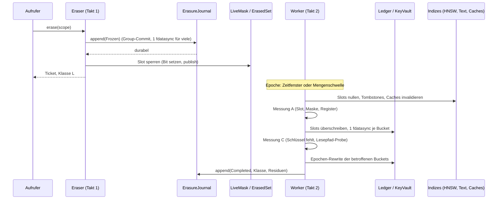

# Contextra: Gesamtprüfung des Repositorys und Entscheidungsgrundlage

| Feld | Wert |
| --- | --- |
| Repository | `https://github.com/tfufuz1/contextra` (Rust-Workspace) |
| Geprüfter Stand | Remote-HEAD `ba62852cd` („Shell-Commit“, 31.10.2026, 14:42 +0100), 21 Commits nach `8ed1754` |
| Vergleichsstand | `8ed1754` (Merge PR #5497, 31.10.2026), `e595e79` (Merge PR #5495, 31.10.2026, 09:35) |
| Prüfzeitpunkt | 31.10.2026 |
| Zweck | Eigenständige Bewertung des Projekts: Bauzustand, Sicherheit und Datenschutz, Löschung, Korrektheit, Architektur, Eigenbau-Entscheidungen, Produktzuschnitt und Handlungsreihenfolge |
| Charakter | Technische Prüfung mit Quelltext-Analyse und Build-Diagnose. Die Tests wurden in dieser Sitzung nicht ausgeführt. Keine Rechtsberatung und keine Anlageberatung |

---

## 1. Kurzfassung

**Das Projekt ist in seinem aktuellen Zustand nicht produktionsreif und nicht einmal baubar.** Am aktuellen Remote-HEAD bricht `cargo metadata` mit Exit-Code 101 ab. Die Ursache ist ein Commit, der sieben Crates aus dem Dateisystem entfernt hat, während `Cargo.toml` sie weiter als Workspace-Mitglieder führt. Der Workspace lässt sich deshalb nicht laden, und damit ist auch kein Build, kein Test und kein Lint möglich.

Die wichtigsten Ergebnisse im Überblick:

1. **Der Workspace ist am HEAD kaputt.** Sieben von 36 Mitgliedern fehlen (`contextra-graph`, `contextra-infer-onnx`, `contextra-router`, `contextra-infer-candle`, `contextra-adapt`, `contextra-kvcache`, `contextra-cognition`). Neun Einträge in `[workspace.dependencies]` zeigen auf fehlende Pfade. Am Vorgängerstand `8ed1754` lädt der Workspace dagegen sauber (36 Pakete).
2. **Der Reduktionsschritt wurde unvollständig abgeschlossen.** Der HEAD-Commit löscht 313 Dateien mit 80.585 Zeilen. Die Abhängigkeiten der verbleibenden Crates (u. a. Engine, DB, MCP, Fassade) wurden nicht bereinigt.
3. **Der Typfehler im Löschpfad ist bestätigt.** `delete_segment` gibt weiter `bool` zurück, obwohl `revoke_subkey` ein `Result<bool>` liefert. Das ist ein Kompilierfehler (E0308) und blockiert alle Crates oberhalb des Speichers. Der Reparaturcommit existiert nur lokal bei den Prüfern und ist nicht im Remote.
4. **Die Datenschutz-Grundeinstellungen sind schwach.** Verschlüsselung ist standardmäßig aus, Mandantentrennung ist optional, die automatische LLM-Entitätsextraktion ist standardmäßig an, die Passphrase wird per HKDF statt per Argon2id abgeleitet. Alle vier Punkte sind am Quelltext des HEAD belegt.
5. **Das Löschversprechen ist der wichtigste und am schlechtesten belegte Bereich.** Die Einzel-Dokument-Löschung über das MCP-Tool `contextra_delete` ist mandantenlos, erzeugt keinen Beweis und verwirft Schlüssel und Mandanten-ID. Die Schlüsselvernichtung ist im Löschpfad nicht verdrahtet. Frühere Testläufe zeigten Reste im HNSW-Index und einen Löschbeweis-Export, der manipulierte Dokumente akzeptiert.
6. **Zwei Datenverlustpfade sind belegt.** Der Purger ignoriert den Löschauftrag und räumt die Daten des ganzen Mandanten ab. Ein fehlgeschlagener SSTable-Rewrite kann Daten still verlieren. Beides ist statisch aus dem Quelltext abgeleitet und am HEAD bestätigt.
7. **Das Commit-Verhalten ist nicht cancel-safe.** Ein abgebrochener Commit wird in einem Teil der Fälle nach einem Neustart doch wirksam. Für eine Löschanforderung ist das ein direkter Datenschutzfehler.
8. **Das Regelwerk ist dichter als seine Durchsetzung.** Das Gate-Paket `xtask` existiert nicht mehr, 22 von 34 CI-Workflows rufen es trotzdem auf.
9. **Die Zerlegung in Produkte ist fachlich sinnvoll, aber nur als Ziel.** Empfohlen werden höchstens zwei Produkte: zuerst ein Privacy-Gateway (Guard), dann Retrieval mit dokumentierter Löschung (Memory). Alles andere wird eingefroren, ausgelagert oder gestrichen.
10. **Rechtlich ist die Schlüsselvernichtung als Löschung im Sinne des Art. 17 DSGVO ungeklärt.** Eine Aufsichtsbehörde oder ein Gericht hat sie weder anerkannt noch abgelehnt. Produkttexte dürfen nur den messbar belegten Zustand mit deklarierten Grenzen beschreiben.

**Gesamturteil:** Die Idee (lokales, DSGVO-orientiertes Retrieval mit prüfbarem Löschen) ist fachlich tragfähig und in Teilen gut umgesetzt, etwa bei der Kryptografie-Auswahl und der Parser-Architektur. Die Umsetzung ist aber in einem Zustand, in dem sich die Datenschutzaussagen nicht belegen lassen. Die nächsten Schritte müssen zuerst den Bau wiederherstellen, dann die Sicherheitsvorgaben umkehren und erst danach Produktversprechen formulieren.

---

## 2. Untersuchungsgegenstand und Methode

### 2.1 Vorgehen

Das Repository wurde vollständig geklont (5.020 Commits, 10 Tags). Geprüft wurde in drei Schichten:

- **Strukturprüfung am HEAD:** Workspace-Mitglieder, Pfadabhängigkeiten, Dateibestand, Workflows, Governance-Dateien. Dazu ein echter Lauf von `cargo metadata --no-deps` mit Cargo 1.75 (Ubuntu-Paket). Cargo 1.75 reicht für das Laden des Manifests aus, es ist aber nicht der vorgeschriebene Toolchain.
- **Quelltext-Prüfung:** Gezielte Lesungen und Suchen für die zentralen Befunde (Löschpfad, Schlüsselverwaltung, Ingest, Commit-Pfad, Konfigurationsdefaults).
- **Vergleich der Stände:** Abgleich des HEAD mit `8ed1754` und `e595e79`, um festzustellen, welche Aussagen durch spätere Commits überholt wurden.

### 2.2 Nicht möglich in dieser Umgebung

- **Kein Build und kein Test des Workspace.** Das Repository fordert Rust 1.89.0 (`rust-toolchain.toml`, `rust-version = "1.89"`). Der verfügbare Toolchain ist 1.75, und der Download eines passenden Toolchains über rustup war nicht möglich. Außerdem ist der HEAD nicht ladbar.
- **Kein Lauf von Clippy mit den Projekt-Lints.** Die Zahl 399 stammt aus einem früheren Lauf und ist nicht erneut belegt.
- **Keine Ausführung von `cargo audit`, `cargo deny`, Fuzzing, Miri, Loom und Mutationstests.**
- **Kein Zugriff auf die GitHub-Actions-Oberfläche.** Der CI-Status ist deshalb nur aus früheren Beobachtungen übernommen.
- **Keine Primärprüfung der Rechtsquellen.** Die rechtlichen Aussagen in Abschnitt 9 stammen aus einer früheren Analyse, die sich teilweise auf Sekundärquellen stützte.

### 2.3 Kennzeichnung der Aussagen

| Marke | Bedeutung |
| --- | --- |
| **✓ HEAD** | In dieser Sitzung am Remote-HEAD `ba62852` nachgeprüft (Datei, Zeile oder Befehl angegeben) |
| **✗ überholt** | Am HEAD nicht mehr zutreffend |
| **◐ teilweise** | Am HEAD teilweise bestätigt, Umfang oder Ursache weicht ab |
| **○ übernommen** | Aus einer früheren Prüfung eines älteren Stands übernommen, in dieser Sitzung nicht erneut geprüft |

---

## 3. Repository-Stand und Entwicklungsverlauf

### 3.1 Verlauf

| Datum | Stand | Inhalt |
| --- | --- | --- |
| 14.10.2026 | Tags `park/EP1/v1` bis `EP6/v1` | Sechs „disjunkte Endprodukte“ als Idee; alle Tags zeigen auf denselben Commit `5d349c188` |
| 28.10.2026 | SPEC 3.1 „Baukasten“ | Modulprinzipien, vier Profile |
| 30.10.2026 | SPEC 4.0 „Reduktion“ | Kern aus 14 Crates; Inferenz, Agenten, MCP, Python, Ingest, Guard und KV-Cache als Nicht-Ziele. Die Reduktion wurde begonnen und wieder abgebrochen |
| 31.10.2026 | `3a0b11699` „RÜCKSTELLUNG MEISTE CRATES“ | Bringt 884 Dateien und 21 Crates zurück. Der Workspace hat wieder 35 Crates plus Benchmark-Crate. Folge: Teile des Repos stammen aus dem Stand vor, Teile aus dem Stand nach der Reduktion |
| 31.10.2026 | `ff50100` | Nur Dokumentation (flacher Klon mit einem Commit); Grundlage früherer Build- und Testläufe |
| 31.10.2026 | `e595e79` | Letzter Stand mit Quelltext-Stichprobe in früheren Prüfungen. Feature `onnx` verdrahtet, `contextra_delete` ehrlicher gekennzeichnet |
| 31.10.2026 | `8ed1754` | Vergleichsstand für Architektur- und Eigenbau-Aussagen. Workspace lädt, 36 Pakete |
| 31.10.2026 | `a01a18b46` | „LETZTER FULL CRATES COMMIT vor Kernfokussierung“ |
| 31.10.2026 | `ba62852` (HEAD) | „Shell-Commit“. Entfernt sieben Crates (313 Dateien, 80.585 gelöschte Zeilen), ohne die Manifeste anzupassen |

Der lokale Reparaturcommit `5629fff`, der in früheren Prüfungen erwähnt wurde, existiert nicht im Remote. Er ist ✓ HEAD als nicht vorhanden bestätigt. Die Merge-Nummern und die Branch-Namen der Form `jules/…` deuten auf stark automatisierte Änderungen hin.

### 3.2 Was am HEAD fehlt

| Bereich | Stand am HEAD |
| --- | --- |
| Crates `graph`, `cognition`, `adapt`, `router`, `kvcache`, `infer-candle`, `infer-onnx` | ✓ HEAD: Verzeichnisse fehlen, Einträge in `Cargo.toml` bleiben |
| Verzeichnis `docs/decisions` (ADRs) | ✓ HEAD: fehlt. Am Stand `8ed1754` 13 Dateien |
| Wurzelverzeichnis: `README.md`, `CLAUDE.md`, `AGENTS.md`, `reduce_contextra.py`, `REDUCTION_RESIDUALS.md`, Bundle | ✓ HEAD: nicht vorhanden |
| Verzeichnis `reports/` | ✓ HEAD: eine Datei |
| Verzeichnis `xtask/` | ✓ HEAD: fehlt, Alias in `.cargo/config.toml` bleibt |

Verbleibend sind unter anderem `docs/` mit `SPEC.md`, `ARCHITECTURE.md`, `VETOES.md`, `DELETION-DSGVO.md`, `SOURCE_OF_TRUTH.md`, `TYPE_REGISTRY.md`, `CONSTITUTION.md`, `SECURITY.md`, `CONTRIBUTING.md` und `CHANGELOG.md`. Außerdem `governance/`, `capabilities.toml`, `clippy.toml`, `deny.toml`, `justfile`, `.github/` und `tools/`.

---

## 4. Bauzustand

### 4.1 Workspace lädt nicht

| Prüfung | Ergebnis am HEAD `ba62852` | Ergebnis am `8ed1754` |
| --- | --- | --- |
| `cargo metadata --no-deps` (Cargo 1.75) | ✓ HEAD: **Exit 101**, `failed to load manifest for workspace member … contextra-store … contextra-graph/Cargo.toml: No such file or directory` | Exit 0, 36 Pakete |
| Mitglieder mit fehlendem Verzeichnis | ✓ HEAD: 7 von 36 (`graph`, `infer-onnx`, `router`, `infer-candle`, `adapt`, `kvcache`, `cognition`) | – |
| Einträge `[workspace.dependencies]` mit fehlendem Pfad | ✓ HEAD: 9 (darunter `contextra-embed` als Alias auf `infer-onnx` und `contextra-candle` als Alias auf `infer-candle`) | – |
| Default-Mitglieder | 27 von 36 | 27 |

Die Folge ist, dass kein `cargo build`, `cargo test` oder `cargo clippy` gelingt. Auch ein Einzel-Crate-Build scheitert, weil Cargo den ganzen Workspace lädt.

Betroffene Abhängigkeitsdeklarationen (✓ HEAD):

- **Laufzeit-Abhängigkeiten auf entfernte Crates:** `contextra-engine` (`contextra-graph`, optional `contextra-adapt` und `contextra-infer-onnx`), `contextra-db` (`contextra-cognition`, `contextra-graph`, `contextra-adapt`), `contextra-mcp` (`contextra-router`, optional `contextra-infer-candle` und `contextra-infer-onnx`), `contextra` (optional `contextra-infer-candle`), `contextra-agent` (`contextra-graph`, `contextra-router`), `contextra-py` (`contextra-adapt`).
- **Nur Dev-Abhängigkeiten:** `contextra-store` (`contextra-graph`) und `contextra-rank` (`contextra-adapt`). Auch sie blockieren, weil Cargo den Workspace lädt.

### 4.2 Typfehler im Löschpfad (B-01)

✓ HEAD: `crates/contextra-store/src/kv/segment.rs:152–157`:

```rust
pub fn delete_segment(&self, group_id: u64) -> bool {
    match self.config.delete_mode {
        KvDeleteMode::CryptoShred => self.registry.revoke_subkey(group_id),
        KvDeleteMode::TombstoneOnly => false,
    }
}
```

✓ HEAD: `crates/contextra-crypto/src/kv_shredding.rs:300` deklariert `pub fn revoke_subkey(&self, group_id: u64) -> Result<bool>`.

Das ist ein Typfehler: Ein `Result<bool>` wird als `bool` zurückgegeben. Das ist durch Lesen des Quelltextes eindeutig belegt, nicht durch einen Compilerlauf.

Die richtige Korrektur gibt den Fehler weiter, statt ihn zu schlucken. Ein `unwrap_or(false)` oder `.ok()` würde einen Löschfehler als „nichts zu löschen“ erscheinen lassen. Bei einer Lösch-API ist das ein Sicherheitsfehler. Außerhalb der Tests hat `delete_segment` heute keinen Aufrufer, der Pfad ist also aktuell tot. Trotzdem blockiert der Typfehler den Bau aller Crates, die `store` verwenden.

### 4.3 Weitere Bauprobleme

| ID | Schwere | Befund | Stand |
| --- | --- | --- | --- |
| B-02 | K | Gate-Infrastruktur zeigt auf das nicht existierende `xtask`: Alias in `.cargo/config.toml:2`, 9 Aufrufe in `justfile`, 22 von 34 Workflows | ✓ HEAD (22 von 34 bestätigt) |
| B-03 | H | `contextra-durable-fs` importiert `contextra_sys::{flush_dir, flush_file, fs_class, rename_durable, FsClass, FlushKind}` (`lib.rs:45,54`, `scrub.rs:39`, `vfs.rs:136`). `contextra-sys` exportiert diese Namen nicht mehr (nur `durable_flush_file`, `durable_flush_dir`, `write_all_durable`, u. a.) | ✓ HEAD |
| B-03 | K | Lexer-Fehler in `durable-fs/src/journal.rs:183`: Zeichenliteral `'` mit echtem Zeilenumbruch statt `'\n`. An dieser Stelle sollen Löschvorgänge nach einem Absturz wieder aufgenommen werden | ✓ HEAD |
| B-04 | M | `benchmarks/contextra-bench` nutzt entfernte Module und einen undeklarierten Schalter `onnx-bench` | ○ übernommen |
| B-05 | M | `Cargo.lock` enthält `xtask`-Abhängigkeiten; `--locked` scheitert | ○ übernommen |
| B-06 | M | `contextra-ingest`: `fmt-docx` und `fmt-sheets` kompilieren nicht (`crate::safe::{xml,opc}` fehlt); `chunking/stubs.rs:95` ruft `paged_impl::draft_paged` auf, das Modul heißt `paged` | ○ übernommen |
| B-07 | M | `contextra-py`: `cargo test` mit Default-Features linkt nicht; `crud_macros.rs` nutzt `contextra_rank::FusionWeights`, der Typ liegt in `contextra_types` | ○ übernommen |
| B-09 | M | `engine/.../lifecycle.rs:144` initialisiert das nicht mehr existierende Feld `_pid_controller` | ○ übernommen |
| B-10 | M | `default-members` weicht ab: `privacy`, `ingest`, `license`, `py`, `sandbox`, `audit-export`, `avv-generator`, `infer-candle` fehlen. `cargo build` ohne `--workspace` prüft den Datenschutzkern nicht | ✓ HEAD (Liste der Default-Mitglieder) |
| B-12 | M | `contextra-db/tests/filter_tests.rs:6` importiert `contextra_db::MetadataFilter`, der Typ liegt in `contextra_db::filter` | ○ übernommen |

### 4.4 Ergebnis des Reparaturversuchs

In früheren Prüfungen wurde am Stand `ff50100` mit sechs kleinen Eingriffen der Workspace kompilierbar gemacht (`--all-targets`, Exit 0). Diese Eingriffe sind nicht im Remote. Am HEAD müssen zusätzlich die sieben fehlenden Crates behandelt werden, bevor der Build wieder möglich ist. Der Reparaturweg wird in Abschnitt 12 beschrieben.

Clippy meldete im früheren Lauf 399 Verstöße gegen die workspaceweiten Deny-Lints (`indexing_slicing` 278, `unwrap`/`expect` 77, Slicing 28, Produktionscode-Verbote 15, Makro-Verbot 1). Diese Zahl ist ○ übernommen und am HEAD nicht erneut belegt.

---

## 5. Testlage

### 5.1 Frühere Messung (nicht reproduziert)

Eine frühere Testausführung am Stand `ff50100` mit Rust 1.89.0 (Debug-Profil, 2 vCPU, 240 Sekunden je Test-Binary) ergab:

| Kennzahl | Wert |
| --- | --- |
| Test-Binaries | 633 |
| Bestandene Tests | 3.942 |
| Fehlgeschlagene Tests | 83 (72 regulär, 11 in abgebrochenen Binaries) |
| Binaries mit Timeout | 18 |
| `contextra-py` separat | 88 bestanden, 2 fehlgeschlagen |

Diese Zahlen sind ○ übernommen. Am HEAD lässt sich der Workspace nicht bauen, deshalb ist auch offen, ob sie am aktuellen Stand gelten.

### 5.2 Fehlschläge nach Themen (○ übernommen)

- **Löschung:** `deletion_e2e::test_tdel_1_canary_bytes_erased_after_compaction` scheitert. Im Test `deletion_chain_e2e` meldet Szenario 1 „Attrappe entlarvt“ Erfolg, obwohl Reste verbleiben. Szenario 3 scheitert an einem Snapshot-Problem, Szenario 4 meldet „Layer has 11 residual live entries“ im HNSW-Index. Die Engine-Tests `test_erase_distinct_deletions_produce_distinct_proofs` und `test_proof_verify_with_wrong_key_fails` scheitern.
- **Löschbeweis-Export:** `guarantee_deletion_irrecoverable` Szenario 3: ein manipuliertes JSON-Dokument wird deserialisiert, obwohl die externe Prüfung fehlschlagen müsste. Szenario 4: Der Roundtrip liefert `left != right`.
- **Transaktionen und WAL:** `checkpoint_layer_bounds`: „snapshot too old (snapshot_seq 34 < pruned_through 9223372036854775807)“. `checkpoint_stress`: „Cannot prepare batch for sealed WAL segment“. `concurrent_collection_stress`: nach allen Deletes verbleibt ein Dokument.
- **Mandanten:** Vier Test-Binaries mit Mandantenbezug laufen in den Timeout. In `contextra-py` ist die Fehlerzuordnung `NamespaceViolation | TenantMismatch` nicht erreichbar, weil die Varianten im Fehlertyp fehlen.
- **Vektor und SIMD:** Zehn Fehlschläge bei den u8-Kerneln, z. B. `u8 DotProduct mismatch at dim 64: scalar=890080, dispatch=62432`. DiskANN-Laden lehnt gültige Konfigurationen ab.
- **MCP:** Acht Fehlschläge, darunter Lizenz-Gate und Bestätigungspflicht. Das sind Schutzmechanismen.
- **Sicherheitstest:** `no_test_hooks_in_release_api` (Datei ✓ HEAD vorhanden) schlägt fehl. Testhooks sind damit nicht sicher aus der Release-API ausgeschlossen.

### 5.3 Hänger (○ übernommen)

Achtzehn Binaries liefen in den Timeout. Zwei Klassen: Benchmarks und sehr langsame Tests im Debug-Profil, sowie vermutliche Deadlocks (Prozesse im Zustand `futex_do_wait` bei Load-Average 0,00). Betroffen sind gerade Mandanten-Isolation, Löschbeweise und Transaktionen. Ein hängender Mandanten-Test zählt nicht als bestanden. Die Ursache ist nicht untersucht.

### 5.4 Ignorierte Tests und übersprungene Tests

- ✓ HEAD: 15 `#[ignore]`-Attribute in `crates/` und `benchmarks/` (früher 21, durch entfernte Crates reduziert). Ignore-Gründe werden nicht gegen den Code geprüft, und kein Gate zählt sie.
- ✓ HEAD: 11 Stellen mit `pytest.importorskip` oder `pytest.skip` in den Python-Tests von `contextra-py` und `contextra-mcp`. Ohne gebaute Erweiterung werden Tests übersprungen und zählen als grün.

### 5.5 Testqualität und Messung

- ✓ HEAD: 216 Quelldateien in `crates/*/src` enthalten `#[cfg(test)]`-Module. Das erschwert belastbare Metriken für Panic-Inventar und Coverage.
- Die Qualität zentraler Funktionen ist nicht gemessen: PII-Erkennung (kein Recall/Precision-Messung), Fusionsqualität, HNSW-Recall (Messung nur mit 1.000 Vektoren à 128 Dimensionen), Retrieval-Korpus (50 Chunks, 10 Abfragen). Ein 100.000er-Skalierungslauf brach mit „Memory budget exceeded (95%)“ ab.

---

## 6. Sicherheit und Datenschutz

### 6.1 Konfigurationsdefaults

| ID | Schwere | Befund | Fundstelle | Stand |
| --- | --- | --- | --- | --- |
| S-02 | K | **Verschlüsselung ist standardmäßig aus.** Der Builder setzt `encryption_mode: None`. Dokumente, Embeddings und WAL liegen dann im Klartext. Ein Warnhinweis wird nur protokolliert | `contextra/src/builder.rs:147` | ✓ HEAD |
| S-03 | H | **Mandantentrennung ist standardmäßig optional.** `TenantPolicy` hat `#[default] Optional`. Daten ohne Mandantenbindung liegen gemeinsam | `contextra-engine/src/lib.rs:206–209`, Konfiguration Zeile 347 | ✓ HEAD |
| S-04 | H | **Automatische LLM-Entitätsextraktion ist standardmäßig an.** `AutoExtractionMode::default()` liefert `Enabled`, außer das Feature `auto-extraction-opt-out` ist aktiv. Dokumententext geht ohne Zutun an einen Generator | `contextra-types/src/types/domain/misc.rs:591–600` | ✓ HEAD |
| S-01 | K | **Passphrase wird per HKDF-SHA256 abgeleitet, nicht per Argon2id.** `KeyManager::try_new` nutzt `Hkdf::<Sha256>::new(Some(salt), passphrase)`. Die Produktionspfade rufen `try_new` auf. Eine schwache Passphrase ist nach Zugriff auf Salt und Chiffrat offline schnell prüfbar. Die vorhandene Argon2id-Variante `try_new_with_kdf` wird außerhalb von `crypto` nicht aufgerufen | `contextra-crypto/src/crypto.rs:88,105` | ✓ HEAD |
| S-05 | H | **Passphrase als Klartext-String.** `secret.as_str().to_string()` kopiert das `Zeroizing`-Secret in einen nie gelöschten `String`. `LsmConfig` leitet `Debug` und `Serialize` ab | `contextra/src/builder.rs:355` | ✓ HEAD (Zeile 355) |
| S-12 | H | **ONNX-Backend fällt still aus.** Ohne Feature `onnx` wird der Backend-Wechsel nur mit `tracing::debug!` quittiert und die Initialisierung läuft weiter, ohne Embedder | `contextra-engine/src/contextra_impl/lifecycle.rs:203–210` | ✓ HEAD (Logging auf debug-Ebene bestätigt) |

### 6.2 Eingabe und Parser

| ID | Schwere | Befund | Fundstelle | Stand |
| --- | --- | --- | --- | --- |
| S-06 | H | **ODF-Dekompressionsbudget umgangen.** `charge_decompressed(file.size())` belastet die im ZIP-Header **deklarierte** Größe. Danach liest `read_to_end` ohne Obergrenze. `zip =0.6.6` begrenzt nur die komprimierte Eingabe. Ein gefälschter Header ermöglicht eine Dekompressionsbombe | `contextra-ingest/src/formats/odf/mod.rs:124–131`; `Cargo.toml:159` | ✓ HEAD |
| S-07 | H | **EPUB fail-open.** `check_epub_encryption` gibt bei fehlender `META-INF/encryption.xml` und bei einem Lesefehler `Ok(())` zurück. Die DRM- und Verschlüsselungsprüfung wird damit still übersprungen | `contextra-ingest/src/formats/web/epub.rs:122–135` | ✓ HEAD |
| S-08 | M | Zwei Archivpfade mit unterschiedlicher Sicherheitslogik. Untrusted-Parser (`lopdf`, `mail-parser`, `calamine`, `cfb`) laufen im selben Prozess wie die Anwendung | `contextra-ingest` | ○ übernommen |

### 6.3 Schlüssel, Beweise und Protokolle

| ID | Schwere | Befund | Fundstelle | Stand |
| --- | --- | --- | --- | --- |
| S-09 | H | **Löschbeweis-Schlüssel ohne Mindestanforderung, doppelte Auflösung.** `proof_key.rs` mit `#[allow(dead_code)]`-Funktionen neben dem aktiven `proof_key_env.rs` (`resolve_proof_key_from_env`). Ein kurzer Schlüssel macht Beweise fälschbar, wenn der Prüfer ihn kennt. Eine Längen- oder Entropieprüfung wurde nicht gefunden | `contextra-mcp/src/proof_key.rs:19,31,45`; `proof_key_env.rs:93` | ✓ HEAD (Doppelung bestätigt), Längenprüfung ○ übernommen |
| S-10 | M | **Egress-Audit standardmäßig ein No-Op.** `NoopEgressAuditSink` ist Default. Remote-Zugriffe werden verweigert (gut), lokale Zugriffe bleiben unauditiert | `contextra-infer-ollama` | ✓ HEAD (Default bestätigt) |
| S-11 | M | Noop-Typen im Produktivpfad: `NoopLlmGenerator` liefert `"[]"` und verbirgt Fehlkonfiguration als „nichts zu extrahieren“ | `engine/.../auto_extraction.rs` | ○ übernommen |
| S-14 | M | **Lizenz- und DRM-Schicht in einer MIT/Apache-Bibliothek.** `contextra-license` (Ed25519-signierte Aktivierung, 7-stufiges Gate). Ein Gate im offenen Quelltext schützt nichts | `contextra-license`; in `capabilities.toml` als erlaubte Abhängigkeit der Fassade geführt | ◐ teilweise |
| S-15 | M | **Doppelte Zeroize-Mechanik.** `sys/src/vault.rs` (eigenes `write_volatile` und `mlock`) neben `zeroize` in `crypto` | ○ übernommen |
| S-16 | M | **WAL-Integritätsschlüssel im Klartext.** `.wal_integrity_key` liegt neben dem WAL, ohne `KeyManager`. Das untergräbt jede Löschwirkung durch Schlüsselvernichtung. Dokumentiert, aber nicht behoben | `contextra-store/src/wal/hmac.rs:221–223` | ✓ HEAD |
| S-17 | M | Risikoabhängigkeiten: `bincode 1.3.3` für persistierte Formate, `zip =0.6.6` hart gepinnt (✓ HEAD), `ort 2.0.0-rc.12` (Release Candidate), `lru 0.16.4` mit Unsound-Advisory. `cargo audit` und `cargo deny` wurden nie ausgeführt | Cargo.toml | ◐ teilweise |
| S-19 | M | Fehlerbehandlung per Zustandsflag oder Standardwert statt `Result` (Ollama-Konstruktor, Lizenzfehler im Builder, EPUB, ONNX). Fehlkonfiguration wird nicht laut | verteilt | ✓ HEAD (Muster bestätigt) |

### 6.4 Bereits behobene oder überholte Punkte

- **S-13 (KV-Cache täuscht):** ✗ überholt. Die Crates `contextra-kvcache` und `contextra-infer-candle`, in denen der Platzhalter-Tensor stand, sind am HEAD entfernt. Restteile im Crate `contextra-crypto` (`kv_cipher.rs`, `kv_segment/`, `kv_shredding.rs`) bleiben und gehören zum selben Themenkreis.
- **S-18 (Testhooks):** Der Test existiert (✓ HEAD), sein Ergebnis am HEAD ist nicht geprüft.
- **Feature `onnx` ohne Abhängigkeit:** ◐ teilweise behoben. Am Stand `e595e79` ist das Feature verdrahtet, das stille Ausbleiben ohne Feature (S-12) bleibt.

---

## 7. Löschung und Nachweis

### 7.1 Ist-Zustand am HEAD

✓ HEAD, `crates/contextra-engine/src/contextra_impl/erasure.rs`:

- Die Löschung läuft als Abfolge: logisches Löschen, Purger in fester Reihenfolge (Text, Vektor, LSM), anschließend Scanner je Schicht, am Ende der Beweis.
- Die Orchestrierung hat 616 Zeilen. Verlangt wird ein `ProofKeyProvider`. Jeder offene Snapshot führt zur Ablehnung (Zeilen 153 und 361, `min_active_seqno() != u64::MAX`).
- Die Konstante `UNMEASURED_ERASURE_LAYERS` (Zeile 64) listet sieben Schichten, die nicht gemessen werden: Blob, Caches, Lineage, Checkpoints, Schlüsselmaterial, Graph, KV-Cache.
- **Keine Schlüsselvernichtung im Löschpfad.** Im Engine-Löschpfad gibt es keinen Aufruf von `revoke_group`, `revoke_record` oder `CryptoShred`. Die Schlüsselmechanik `KeyRegistry` (`kv_shredding.rs`) wird nur von KV-Modulen, Tests und Benchmarks genutzt.
- `SagaRecord::new` kommt in der Produktion nicht vor, nur in Tests (`crates/contextra/tests/review_stub_proof.rs`).

### 7.2 Strukturelle Schwächen

| ID | Befund | Stand |
| --- | --- | --- |
| E1 | **Kosten wachsen mit der Datenmenge.** Der HNSW-Purger läuft unter `write_mutex` (`contextra-vector/src/hnsw/purge.rs`) | ✓ HEAD (Mutex-Verwendung in `purge.rs`) |
| E2 | Graph-Reparatur pro Löschung (Entfernen eingehender und ausgehender Kanten, Neuwahl des Entry-Points) in `hnsw/deletion.rs`. Das widerspricht dem Veto „kein HNSW-Rewiring“ | ○ übernommen |
| E3 | **Blockierendes Async.** `block_on_async` in `contextra-text/src/inverted/scanner.rs:76` wird pro Dokument und je Term aufgerufen. Das ist ein Deadlock-Risiko | ✓ HEAD |
| E4 | **Ein Schlüssel für alles.** SSTable-Blöcke verwenden `KeyManager::encrypt_auto_nonce` (`sstable/builder.rs:362`). Kein Dokument ist kryptografisch einzeln vernichtbar | ✓ HEAD |
| E5 | **Schlüsselregister nur im RAM.** `KeyRegistry` hält Gruppen- und Record-Schlüssel ohne Persistenz | ✓ HEAD (Nutzer nur in `kv_*`, Tests, Benchmarks) |
| E6 | **Snapshot-Sperre.** Ein offener Snapshot verhindert jede Löschung | ✓ HEAD (`erasure.rs:153,361`) |
| E7 | **Scan statt Konstruktion.** Verifikation durch erneutes Lesen jeder Schicht | ○ übernommen |
| E8 | **Report als Zustandsflag.** `Ok(ErasureReport { verified: false })` statt Fehler mit Wiederholung | ○ übernommen |
| E9 | **Schlüsselname als String.** Ziel-IDs werden als `t:{tenant}:{col}:doc:{id}` gebaut und per Präfix interpretiert | ✓ HEAD |
| E10 | Rund 2.600 Zeilen Produktionscode nur für Orchestrierung, Purger und Scanner | ✓ HEAD (`erasure.rs` 616 Zeilen, Scanner-Modul im Store) |

### 7.3 Befunde im Löschpfad

Alle Befunde beziehen sich auf den Quelltext am HEAD, sofern nicht anders angegeben.

| ID | Schwere | Befund | Fundstelle | Stand |
| --- | --- | --- | --- | --- |
| L-04 | K | **Einzel-Dokument-Löschung (`contextra_delete`) ist unvollständig.** Der Beweisschlüssel wird nur geprüft und als `_proof_key` verworfen. Die Mandanten-ID wird nur geprüft und als `_tenant_id` verworfen. Gelöscht wird über `self.db.collection(col_name)` (mandantenlos). Unter `TenantPolicy::Optional` löscht der Aufruf mandantenübergreifend. Ein Beweis wird nicht erzeugt; die Antwort ist seit `e595e79` ehrlich mit `proof: null`, `claim: LogicalDeletionOnly`, `erasure_measured: false` gekennzeichnet | `crates/contextra-mcp/src/tools_crud.rs:210–218` | ✓ HEAD |
| F01 | K | **Purger ignoriert das Ziel.** `LsmPurger::purge(&self, ctx, _target)` benutzt `_target` nicht. Der Filter nutzt `codec.scan_prefix()` (`t:{tenant}:`) und erfasst damit alle Collections des Mandanten. Ein Löschauftrag für ein Dokument entfernt also die SSTable- und WAL-Einträge des ganzen Mandanten. Zusätzlich gibt es eine Abweichung zwischen Ziel-Schlüssel (Collection-**Name**) und Speicherschlüssel (Collection-**ID**) | `contextra-store/src/scanner/purge.rs:36,45` | ✓ HEAD |
| F02 | K | **SSTable-Rewrite kann Daten still verlieren.** `let _ = builder.add(..)`. Ein neuer Reader entsteht nur bei Erfolg von `finish()` und `open()`. Bei einem Fehler bleibt weder alter noch neuer Reader. Der Verzeichnis-Sweep löscht danach jede `.sst` ohne aktiven Pfad. Zusätzlich verschluckt `reader.iter().await.unwrap_or_default()` Lesefehler | `purge.rs` („SSTables filtern“) | ○ übernommen |
| F03 | H | Die Einzel-Löschung ruft keine `revoke_*`-Funktion auf. Der Schlüsselwiderruf ist nicht verdrahtet | `erasure.rs` | ✓ HEAD (kein Treffer) |
| F04 | H | **Keine durable Saga.** `SagaRecord` entsteht erst nach der Messung. Ein Absturz nach dem logischen Löschen führt zu keinem Wiederaufsetzen. Ein Teilfehler liefert `Ok(verified: false)` ohne Wiedervorlage. `serde_json::to_vec(..).unwrap_or_default()` kann einen leeren Wert persistieren | `erasure.rs` | ✓ HEAD (Saga nur in Tests) |
| F05 | H | **Schlüsselgranularität zu grob.** `KeyRegistry` gruppiert 64 Records je KEK (`DEFAULT_SHRED_KEY_GROUP_SIZE = 64`, `kv_shredding.rs:34`). Ein Gruppen-Widerruf trifft 63 Fremd-Records. `revoke_record` setzt nur ein RAM-Flag, ein Neustart kann den Einzel-Widerruf verlieren | `crypto/src/kv_shredding.rs` | ✓ HEAD (Konstante bestätigt) |
| F06 | H | **Überschreiben über den Pfad.** `tokio::fs::write(&path, zeros)` mit verworfenem Fehler (`let _`), ohne `sync_all`, ohne `Vfs`. Auf SSD und CoW-Dateisystemen ohne Löschwirkung. Gleiches Muster beim WAL | `purge.rs:132,204,223` | ✓ HEAD |
| F07 | H | Ebene A gilt nur für Text, HNSW und LSM. Sieben Schichten sind als ungemessen markiert. Die Klasse E ist damit konstruktiv nicht erreichbar | `erasure.rs:64` | ✓ HEAD |
| F08 | H | **Kein `ErasedSet`, kein Restore-Guard, keine Commitments.** Das Beweisziel enthält die Klartext-ID im `target_id`-String | Repository-weit | ✓ HEAD (kein Treffer für `ErasedSet`) |
| F09 | M | **Globale Blockade** durch offene Snapshots. Ein hängender Leser blockiert jede Löschung | `erasure.rs`, `purge.rs:38` | ○ übernommen |
| F12 | M | Synchroner `Purger`-Trait über asynchrone I/O mit `block_on` | `scanner/sstable.rs`, `text/inverted/purge.rs` | ✓ HEAD (`block_on_async` in `text`) |
| F13 | M | Beweis v1/v2 mit symmetrischem HMAC: Der Prüfer kann selbst fälschen. Nur v3 (Ed25519) ist extern prüfbar. Der Schlüssel liegt als `Vec<u8>` ohne `Zeroizing` vor | `deletion_proof/types.rs` | ○ übernommen |
| F14 | M | Argon2id-Untergrenze `MIN_M_COST_KIB = 19456` (19 MiB). Die Empfehlung liegt bei m ≥ 64 MiB und t ≥ 3 | `contextra-crypto/src/kdf.rs:36` | ✓ HEAD |
| F15 | M | Doc-Kommentar „informationstheoretisch unentschlüsselbar“ ist falsch. AES-256-GCM-SIV ist rechnerisch sicher. Die Formulierung ist als Produktaussage unzulässig | `kv_shredding.rs:6` | ○ übernommen |
| F16 | M | Der Canary-Datensatz wird in den **produktiven** WAL geschrieben | `scanner/wal.rs:47,68` | ○ übernommen |
| L-02 | K | **Löschbeweis-Export manipulierbar.** `export_for_audit` setzt `integrity_warning` auf einem Klon nach der Signatur. Das Feld ist nicht signiert. Manipulierte JSON-Dokumente werden deserialisiert, ohne dass die externe Prüfung fehlschlägt | `crypto/src/deletion_proof/verification.rs:136–154` | ✓ HEAD (Zuweisungen auf Klon bestätigt), Testergebnis ○ |
| L-03 | K | `delete_segment` kann Registry-Fehler nicht melden (siehe 4.2). Bis zur Korrektur gibt es kein verifiziertes Löschprodukt | `store/src/kv/segment.rs:152–157` | ✓ HEAD |
| L-05 | H | **Widerrufsprotokoll kann Personenbezug behalten.** `RevocationLog` enthält `RevocationTarget` (`Group(u64)`, `Kek(String)`, `Dek(String)`, `Record(String)`). Tragen die Strings Personen- oder Dokumentbezug, bleibt er bestehen. Was tatsächlich geschrieben wird, ist ungeprüft | `crypto/src/revocation_log` | ○ übernommen |
| L-06 | H | Die Schlüsselvernichtung deckt keine Klartext-Strukturen ab (HNSW-Graph, BM25-Posting-Listen, Caches, Arbeitsspeicher) | ○ übernommen |
| L-07 | H | Beweise sind nicht an echte Messungen gebunden. Im Einzelpfad steht `erasure_measured: false` | ✓ HEAD (Feld in Antwort) |
| L-08 | M | Keine Algorithmenmigration für Obsoleszenz (AES-GCM-SIV, Argon2, `bincode`-Format) | ○ übernommen |
| L-09 | M | Löschung kaskadiert nicht verlässlich (Tombstone-Tests schlagen fehl, verbliebene Dokumente nach Deletes) | ○ übernommen |

### 7.4 Positivbefunde

Diese Teile sind gut und sollten bleiben: `#![forbid(unsafe_code)]` in den Löschmodulen; `ZeroizeOnDrop` auf Schlüsseltypen mit `REDACTED`-Debug; Log-vor-RAM-Reihenfolge in `revoke_group` (fail-safe bei Absturz zwischen beiden Schritten); Positivkontrolle über Canary; HNSW-Slot-Zeroing (`zeroize_and_free_node`); Ed25519-Beweis (v3); `unsafe` in der Löschkette nur im generierten FlatBuffers-Code. Außerdem sind die Ed25519-Signatur, die Hash-Kette in `crypto` und der Löschbeweis für ganze Collections (`drop_collection`) korrekt verdrahtet. Die Egress-Policy für Remote-Zugriffe ist fail-closed.

### 7.5 Commit-Verhalten (D-01)

✓ HEAD: `crates/contextra-store/src/lsm/ops/write.rs`:

- `follower_commit_path` (Zeile 485) reiht die Anfrage in `queue.requests` ein und wartet auf `rx.await` (Zeile 564).
- Nur der Leader-Pfad besitzt einen `LeaderCancelGuard` (Zeile 610 ff.). Im Zweig „vom Leader übernommen“ wartet der Follower ohne Timeout.
- Ein äußeres `tokio::time::timeout` oder `select!` verwirft den Future. Die Anfrage bleibt in der Queue und wird nach einem Neustart teilweise wieder eingespielt.

○ übernommen (Reproduktion am Stand `ff50100`, in dieser Sitzung nicht erneut ausgeführt): Ein mit `tokio::time::timeout(1 ns, …)` abgebrochener Commit war live nicht lesbar. Nach einem Neustart war er in 8 von 15 Läufen (mit späterem Commit) bzw. 4 von 15 Läufen (ohne späteren Commit) vorhanden. Der ignorierte Test `fsync_timeout_rollback` bestand in 9 von 15 Läufen. Das ist ein echter, intermittierender Befund: Ein als fehlgeschlagen gemeldeter Commit kann nach einem Neustart wirksam werden.

**Korrektur (Vorschlag):** (1) Drop-Guard im Follower-Pfad, der die Anfrage aus `queue.requests` entfernt, solange der Leader sie nicht übernommen hat; (2) im Zweig „vom Leader übernommen“ das Warten an die Transaktionszeit binden; (3) den Test auf „nach Abbruch nicht wirksam“ umschreiben, `#[ignore]` entfernen und als Regressionstest mit 50 Läufen in der CI aufnehmen.

### 7.6 Weitere Korrektheitsbefunde (D)

| ID | Schwere | Befund | Stand |
| --- | --- | --- | --- |
| D-02 | K | **Snapshot-Sentinel.** `pruned_through` wird mit `i64::MAX` belegt, Commits schlagen fehl. Welcher Aufrufer den Wert einspeist, ist nicht lokalisiert | ○ übernommen |
| D-03 | K | Crash-Durability scheitert in Iteration 1 von 25 (Ursache offen) | ○ übernommen |
| D-04 | K | WAL unter Nebenläufigkeit: „Cannot prepare batch for sealed WAL segment“ und mehrere WAL-Tests scheitern | ○ übernommen |
| D-05 | K | Mandantentrennung nicht belegt: Test-Binaries mit Mandantenbezug laufen in den Timeout | ○ übernommen |
| D-06 | H | **SIMD-u8-Kernel liefern falsche Ergebnisse** (`scalar=890080, dispatch=62432`). Der Dispatcher wählt AVX2 oder AVX-512. Die Ursache ist eine Hypothese (vorzeichenbehandelter Operand im VNNI-Befehl). Der Dispatch ist am HEAD vorhanden (`contextra-simd/src/dispatch.rs:105–126`), die Zeilen aus früheren Berichten haben sich verschoben | ✓ HEAD (Dispatch), Fehler ○ |
| D-07 | H | DiskANN-Laden lehnt gültige Konfigurationen ab oder die Fixtures sind veraltet | ○ übernommen |
| D-08 | H | **WAL-Fortsetzungspunkt fehlt.** `wal_tail_offset` wird im Hardlink-Cloner auf `None` gesetzt (`contextra-checkpoint/src/hardlink_cloner.rs:244`, Kommentar „explicit placeholder“). Checkpoint-Restore kann Lücken oder Doppelanwendungen erzeugen | ✓ HEAD |
| D-09 | M | SST-v1-Kompatibilität nicht belegt | ○ übernommen |
| D-10 | M | **Direkter Dateizugriff umgeht `Vfs`.** Die Regel „I/O nur über `Vfs`“ wird nicht eingehalten. Zwei `Vfs`-Traits existieren (`contextra_ports::Vfs` ohne produktive Implementierung, `contextra_durable_fs::Vfs` mit `RealFs`). Fehlerinjektion und Crash-Tests greifen dort nicht | ○ übernommen |
| D-13 | M | Agent-Audit und -Speicher sind In-Memory (`InMemoryStorageEngine`), nicht dauerhaft | ○ übernommen |

---

## 8. Architektur, Scope und Governance

| ID | Schwere | Befund | Stand |
| --- | --- | --- | --- |
| A-01 | H | **Scope unentschieden.** Spezifikation und Plan beschreiben 14 Crates, der Workspace hatte 35. Die Entscheidung (ADR 0009) steht auf „Proposed“. Am HEAD fehlt das ADR-Verzeichnis | ✓ HEAD |
| A-02 | H | **Ring-Einordnung unplausibel.** `adapt`, `graph`, `audit-export` und `avv-generator` standen in Ring 0. Ring 0 soll der minimale Kern sein. Vorschlag: Ring 0 nur `types`, `ports`, `simd`, `sys`, `durable-fs` | ○ übernommen |
| A-03 | M | **Unsafe-Allowlist veraltet.** Die Dokumentation nennt nur `sys` und `simd`, der Test drei Inseln, die Allowlist bis sieben Crates. Gemessen: `simd` 269 Zeilen mit `unsafe`, `wire` 45 (überwiegend generiert), `sys` 21, `store`, `vector`, `crypto` und `db` jeweils 0 | ✓ HEAD (Zählung) |
| A-04 | M | **Reifegrad-Labels unzuverlässig.** `capabilities.toml` führt 34 Einträge: 15 `stable`, 12 `beta`, 6 `experimental`, 1 `deprecated`. Die Labels sind nicht aus der CI abgeleitet. `stable` wird teils von `deprecated`, `beta` und `experimental` Crates abgeleitet | ✓ HEAD (Zählung) |
| A-05 | M | `may_depend_on`-Listen sind zu weit gefasst | ○ übernommen |
| A-06 | M | **Forschungscode im Kern:** `diskann`, `rabitq`, `predicate-augmented-search`, `flow_thompson`, `lyapunov`, `homeostat`, `bandit`, `cognition`. Empfehlung: Auslagerung in ein separates Labor-Repository | ○ übernommen |
| A-07 | M | Dubletten: `off_policy.rs` (3 Zeilen) neben `offpolicy.rs` (307 Zeilen); `contextra-core` als deprecated Fassade, noch genutzt; `contextra-db` als Legacy-Fassade | ○ übernommen (`off_policy.rs` und `core` am HEAD zu prüfen) |
| A-08 | M | **Testcode in Produktionsdateien.** 216 Quelldateien enthalten `#[cfg(test)]`-Module (am HEAD). Dadurch schwanken Zeilenzahlen je nach Zählweise erheblich | ✓ HEAD (Zählung) |
| A-09 | H | **Lint-Regime wird nicht eingehalten.** `indexing_slicing`, `unwrap_used`, `expect_used`, `panic` sind workspaceweit `deny`. Die Lints dürfen nicht herabgestuft werden | ○ übernommen |
| A-10 | M | **Dokumente widersprechen dem Code.** Beispiele: `docs/SPEC.md` ist kurz, aber als „Gesamtspezifikation“ geführt. Cargo-Kommentare nennen 9 Crates, `default-members` enthält 27 von 36 | ✓ HEAD (Default-Liste) |
| A-11 | M | **Governance ersetzt Prüfbarkeit.** Konstitution, Spezifikation, ADRs, Vetos und TOML-Dateien in `governance/`, aber die Durchsetzung fehlt. Mehrere Agenten-Sitzungen dokumentierten denselben Compilerfehler, keine behob ihn | ○ übernommen |
| A-12 | M | **Berichte sind bei Build-Aussagen unzuverlässig.** Clippy-Zahlen widersprechen sich zwischen Berichten. Build-Aussagen dürfen nur mit Protokollauszug und Exit-Code übernommen werden. Am HEAD liegt nur noch eine Berichtsdatei vor | ✓ HEAD (Dateizahl) |
| A-13 | N | Rauschen: `chunking/stubs.rs` heißt „Stubs“, enthält aber produktive Chunker; veraltete Zeitstempel in Dateiköpfen; doppelte Benchmarks | ○ übernommen |
| A-14 | N | Testhilfen liegen im Produktionsbaum (`audit-export/src/testkit.rs`, `ports/src/contract_tests`) | ○ übernommen |

### 8.1 Gate-Infrastruktur und CI

| ID | Schwere | Befund | Stand |
| --- | --- | --- | --- |
| T-01 | K | **CI ist rot.** Die öffentliche Actions-Seite zeigte für die Tiefenprüfung die letzten 25 Läufe als fehlgeschlagen. Die Ursache des ersten fehlschlagenden Jobs ist ohne Anmeldung nicht eindeutig | ○ übernommen |
| T-02 | H | Übersprungene Tests zählen als grün (siehe 5.4) | ✓ HEAD |
| T-03 | M | Benchmarks und langsame Tests laufen im Debug-Testprofil und überschreiten das Limit | ○ übernommen |
| T-04 | M | **Testisolation:** parallele Tests teilen ein Datenverzeichnis (`redb_operation_sequence`) | ○ übernommen |
| T-06 | M | CI-Befehl unvollständig: Er muss `--workspace --exclude contextra-py` plus separaten Python-Lauf mit `--no-default-features` und die Feature-Matrix für `ingest` enthalten | ○ übernommen |
| T-08 | M | Qualitätsmessung fehlt für PII-Erkennung, Fusion, Hybrid-Suche, HNSW-Recall, KV-Cache, Graph und Router | ○ übernommen |

---

## 9. Eigenbau oder etablierte Lösung

### 9.1 Maßstab

Ein Eigenbau bleibt nur, wenn er bewiesen nicht schwächer ist als die etablierte Lösung. Der Beweis besteht aus vier Gates:

- **G1 Korrektheit:** Die Komponente besteht dieselbe Konformitäts- und Differentialsuite wie die Referenz, ohne Hänger.
- **G2 Haltbarkeit:** Sie übersteht Crash- und Kill-Tests ohne Datenverlust und ohne Klartext-Reste nach Löschung.
- **G3 Leistung:** Mindestens das 1,5-Fache der Referenz in der Kennzahl, die den Eigenbau rechtfertigt. Der Faktor bildet den Wartungsaufschlag eines Ein-Personen-Projekts ab. Ein Benchmark mit Ergebnisdatei muss im Repository liegen.
- **G4 Wartbarkeit:** Schmaler Port, `unsafe` nur in einer benannten Insel, Panic-Freiheit.

Wo es keine etablierte Lösung gibt (deutsche Komposita-Zerlegung, Mandanten-Schlüsselvernichtung, deutsche Prüfziffern), entfällt G3.

### 9.2 Urteil je Komponente

| Komponente | Umfang | Urteil | Begründung |
| --- | --- | --- | --- |
| Speicher (`store`, eigener LSM) | ca. 13.700 Produktionszeilen | **ERSETZEN (v1)** | Größtes Risiko: Crash-Durability scheitert, mehrere Testfehler und Hänger. Für Embedded-RAG auf einem Knoten bringt ein LSM keinen belegbaren Vorteil. Referenzen: `redb` (reiner Rust-B-Baum, ACID, ein Schreiber, parallele Leser), Alternativen SQLite und `fjall`. Kein einfacher Austausch: Der Port `StorageEngine` mit 26 Methoden ist LSM-förmig, die Engine kennt den Typ konkret. Vorgehen: Port verschlanken, `redb`-Adapter gegen die Konformitätssuite laufen lassen, vorhandenen Vergleichs-Benchmark ausführen, LSM erst bei bestandenem G1 bis G3 als optionales Backend behalten |
| MVCC und SSI (`mvcc`) | ca. 1.800 Zeilen | VERSCHLANKEN | Serialisierbare Isolation schützt vor Schreibkonflikten paralleler Schreiber. Bei Ein-Schreiber-Modell entfällt die Aufgabe. Basistypen (`TxId`, Sequenznummern) behalten |
| Kryptografie (`crypto`) | ca. 3.700 Zeilen | BEHALTEN (Kern), VERSCHLANKEN (Rest) | Primitive stammen aus RustCrypto, keine Eigenkonstruktionen. Behalten: `KeyManager`, `kdf.rs`, HKDF-Unterschlüssel, `audit_chain.rs`. Korrigieren: `try_new` (S-01). Verschlanken: `ed25519_proof.rs` und `deletion_proof/*` (signiertes Löschprotokoll behalten, die Beweisbehauptung auf das Gemessene begrenzen). Streichen: `kv_cipher.rs`, `kv_segment/*`, `kv_shredding.rs`, `anti_tamper.rs`. Prüfen: `revocation_log.rs` |
| KV-Cache | ca. 8.300 Zeilen Produktion | STREICHEN | Nutzen heute null: Der „Tensor“ ist ein Textstring, der Prefill läuft immer vollständig, kein anderes Crate bindet ihn ein. Am HEAD sind die Crates `kvcache` und `infer-candle` bereits entfernt. Ein künftiger echter Tensor-Cache enthielte Rückschlüsse auf Prompt-Inhalte und wäre selbst personenbezogen |
| Vektorindex (`vector`) | ca. 8.700 Zeilen | BEHALTEN + GATE (HNSW mit Filter), STREICHEN (DiskANN, RaBitQ, Partial-Rebuild) | Der Produktpfad braucht gefilterte Suche für mandantengebundene Abfragen. Für kleine Collections (bis etwa 100.000 Vektoren) reicht ein flacher Exakt-Scan mit SIMD und ist trivial korrekt und löschbar. Gate: Recall@10 ≥ 0,95 gegen Exakt-Scan, Löschtest ohne Restmenge, Vergleich mit `usearch` oder `hnsw_rs` |
| SIMD (`simd`) | ca. 1.200 Zeilen, 223–271 `unsafe`-Stellen | BEHALTEN + GATE (f32), ERSETZEN (u8) | u8-Kerne sind nachweislich falsch und nur für die ungenutzte Quantisierung nötig: streichen, nur Skalarpfad. f32: Benchmark gegen eine sichere portable Variante. Liegt der Handkernel nicht beim 1,5-Fachen, ersetzen |
| Volltext und deutsche Morphologie (`text`) | ca. 3.000 Zeilen | BEHALTEN | Deutsche Komposita („Bundesverfassungsgericht“) sind produktrelevant. Das Crate hat keinen Dateizugriff. Gate: Top-10-Überlappung mit BM25-Referenz auf deutschem Testkorpus. Wortlisten und ihre Lizenz dokumentieren |
| Fusion (`rank`) | ca. 3.000 Zeilen | BEHALTEN | RRF und Gewichtung sind kleine, prüfbare Algorithmen. Ungenutzte Funktionen streichen |
| Ingest | ca. 15.000 Produktionszeilen | BEHALTEN (als Adapter), VERDRAHTEN, VERSCHLANKEN | Adapter über etablierte Rust-Parser (`calamine`, `lopdf`, `quick-xml`, `html5ever`, `mail-parser`, `cfb`, `csv`, `zip`). Nutzen sehr hoch, Ist-Zustand null: von keinem Crate eingebunden. Maßnahmen: schmaler `IngestPort`, Einbindung in die Engine, Reparatur von `fmt-docx` und `fmt-sheets`, Golden-Tests je Format, Parser in einem Subprozess mit eingeschränkten Rechten (Linux seccomp oder Landlock) |
| PII-Erkennung (`privacy`) | ca. 2.600 Zeilen | BEHALTEN | Regex mit Prüfziffernvalidierung (IBAN Mod-97, Luhn, Steuer-ID u. a.). Kaum Alternativen im Rust-Ökosystem. Namen und Adressen brauchen Wörterbuch oder NER-Modell. Bis zur Messung Aussage „Mustererkennung für strukturierte Kennungen“ statt „PII-Erkennung“ |
| Sandbox (`sandbox`, wasmtime) | ca. 1.350 Zeilen | EINFRIEREN | Nur als optionale Abhängigkeit für einen Merge-Operator eingebunden, für die Parser-Isolation nicht genutzt. Große Abhängigkeit mit Update-Last |
| `sys`, `durable-fs` | 643 / 859 Zeilen | `sys` VERSCHLANKEN, `durable-fs` STREICHEN | `sys`: `mlock` für Schlüsselmaterial und Dateirechte behalten. `durable-fs` ist nicht kompilierbar und ohne Nutzer. Für atomare Dateischreibvorgänge genügt `tempfile::persist` mit `File::sync_all`. Kompromiss: keine Erkennung von Netz- und Cloud-Dateisystemen; Betrieb auf Netzlaufwerken dokumentiert ausschließen |
| Wire-Format (`wire`, FlatBuffers) | 471 Zeilen plus generierter Code | ERSETZEN | 47 `unsafe` im generierten Code. Eine In-Process-Bibliothek mit PyO3 braucht kein Zero-Copy-IPC. JSON-RPC-Typen behalten |
| Lizenz (`license`) | ca. 500 Zeilen | AUSLAGERN | Lizenzprüfung in einer MIT/Apache-Bibliothek ist widersprüchlich. Gehört ins Produkt-Binary oder entfällt. Entscheidung vor dem ersten Release |
| MCP (`mcp`) | ca. 3.100 Zeilen | BEHALTEN (Tools), ERSETZEN (Transport) | Tool-Definitionen, Bestätigungs- und Egress-Logik behalten. Transport auf das offizielle Rust-SDK umstellen, nach Prüfung |
| Python, Ollama, ONNX, AVV/Audit, Testkit | – | BEHALTEN | PyO3-Standardweg (Integrationstest ohne Skip fehlt). Ollama passt zu lokalen LLMs. AVV-Generator und Audit-Export haben unmittelbaren Nutzen für Art. 28 und 30 DSGVO. Testkit ist der Schiedsrichter für jeden Austausch |
| Graph, Cognition, Adapt, Router, Agent, Checkpoint | ca. 20.000 Zeilen | EINFRIEREN | Für v1 nicht nötig oder forschungsnah. Am HEAD sind `graph`, `cognition`, `adapt` und `router` bereits entfernt, aber noch in Abhängigkeiten. `checkpoint` und Time-Travel stehen im Widerspruch zur Löschpflicht: Wer Zustände rekonstruierbar hält, hält gelöschte Daten vor |
| `core`, `bench`, `anti_tamper` | – | STREICHEN oder reparieren | Altlasten ohne Nutzer |

### 9.3 Offene Stellen der Eigenbau-Bewertung

- **Speichertausch:** Die Analyse ist sich nicht einig, ob der Tausch hinter dem bestehenden Port möglich ist. Die genauere Prüfung zeigt, dass der Port LSM-förmig ist. Maßgeblich ist der Umbau mit Portverschlankung.
- **Checkpoint und MVCC:** Die Zerlegung ordnet beide dem Kern zu, die Eigenbau-Bewertung will `checkpoint` einfrieren. Offene Entscheidung.
- **Löschnachweis:** Die Eigenbau-Bewertung empfiehlt ein signiertes Löschprotokoll mit Verschlankung des Rest-Scanners. Das Zielkonzept (Abschnitt 10) behält Messung und Canary als Grundlage der Klassenaussage. Vermittelnd: Messung bleibt, die Außenaussage wird auf die gemessene Klasse begrenzt. Offene Entscheidung des Betreibers.

---

## 10. Zielarchitektur der Löschpipeline

Dies ist ein technischer Entwurf. Er ist nicht compilergeprüft. Das System liefert messbare Zustände, keine Rechtsfeststellung.

### 10.1 Leitprinzipien

1. **Zwei Ebenen mit getrennten Verträgen.** Ebene A bereinigt Klartext-Strukturen synchron und messbar. Ebene B vernichtet den Dokumentschlüssel und wirkt sofort. Physisches Überschreiben persistenter Segmente ist kein Wirkmechanismus.
2. **Der Scope ist ein Typ, kein String.** `ErasureScope { tenant, collection, doc }`, ohne Präfix-Matching auf freien Strings.
3. **Zustand ist durabel, Übergänge sind rein.** Eine reine Funktion `ErasureState::step` plus durables Journal. Jeder Schritt ist idempotent.
4. **Fail-closed auf der Leseseite.** Lesepfade prüfen den `ErasedSet`. Unbekannter Zustand bedeutet Ablehnung.
5. **Das Ergebnis ist eine Klasse mit Evidenz.** Sie wird aus Zeugen je Schicht berechnet. Eine fehlende Schicht senkt die Klasse automatisch.
6. **Physische Bereinigung läuft asynchron und gebündelt.** Rechtlich sofort wirksam ist die Schlüsselvernichtung.

### 10.2 Ebenen und Klassen

| | Ebene A: Klartext-Strukturen | Ebene B: persistente Reste |
| --- | --- | --- |
| Verortung | RAM, aktive HNSW-Indizes, BM25-Postings, Caches | Unveränderliche SSTables, WAL, Blob-Segmente, Checkpoints, Flash |
| Methode | Zeroizing der Arena-Slots, Segment-Rewrite der Postings, Cache-Invalidierung | Vernichtung des dokumentspezifischen Schlüssels (DocDek) |
| Messung | Struktureller Scan mit Canary-Positivkontrolle | Schlüsselabwesenheit im KeyTable, fehlgeschlagene Canary-Entschlüsselung |

Das System gibt nur die messtechnisch belegte Klasse aus:

| Klasse | Aussage | Voraussetzung |
| --- | --- | --- |
| **L** logisch gesperrt | Scope für alle Lese- und Suchpfade gesperrt | `ErasedSet`-Eintrag durabel (fsync), Lesesperre aktiv |
| **P** Klartext bereinigt | Keine Klartextkopie in aktiven Indizes und Caches | Ebene-A-Purge vollzogen, Canary-Scan erfolgreich |
| **C** persistente Reste unlesbar | Alle Kopien nur als Chiffrat unter vernichtetem Schlüssel | Schlüsselvernichtung vollzogen, Schlüsselabwesenheit gemessen |
| **E** technisch vollständig | P und C lückenlos, alle Schichten gemessen | `LayerWitness` je Schicht, vollständige Positivkontrolle |

E ist eine technische Aussage innerhalb deklarierter Schranken, keine rechtliche Feststellung nach Art. 17 DSGVO. Ein `LayerCatalog` als Konstante führt jede Schicht mit Ebene und Pflichtstatus. Eine neue Schicht ohne Eintrag lässt einen Test scheitern.

### 10.3 Löschsaga

Zustände: `Requested → Frozen → LogicallyDeleted → PlaintextPurged → PlaintextMeasured → KeyDestroyed → Measured → Completed`, dazu `Restricted`.

- **Frozen:** Der `ErasedSet`-Eintrag wird durabel per fsync geschrieben. Ab hier gilt die Lesesperre.
- **Schlüsselvernichtung erst nach `PlaintextMeasured`.** Die Purger schreiben Blöcke mehrerer Dokumente neu und müssen dafür entschlüsseln können.
- **Idempotenz:** Vernichtung eines bereits vernichteten Schlüssels liefert `Ok`. Purge auf eine bereinigte Schicht liefert `Ok` mit Nullstatistik.
- **Wiederaufnahme:** `ErasureSaga::recover()` läuft vor Freigabe des Lesepfads, füllt den `ErasedSet` und setzt fort. Bis dahin verweigert der Lesepfad.
- **Retry statt Abbruch:** Ein Schrittfehler lässt den Zustand unverändert. Der Hintergrundtreiber wiederholt mit Backoff. Eine Snapshot-Blockade wird zu einem Wartezustand mit Alarm, wenn die Wartezeit eine Frist überschreitet (Vorschlag 7 Tage, damit die Monatsfrist des Art. 12 Abs. 3 DSGVO nicht reißt).
- **Batching:** Ebene-A-Arbeit wird gebündelt (ein Rebuild-Check, ein Posting-Rewrite pro Zeitfenster). Schlüsselvernichtungen laufen einzeln.

### 10.4 Schlüsselhierarchie

`KEK_root = Argon2id(Passphrase, Salt; m ≥ 64 MiB, t ≥ 3, p ≥ 1)`, versioniert im KDF-Header → `KEK_coll = HKDF-SHA256(KEK_root, Kontext ‖ Mandant ‖ Collection)` → `DocDek` (32 Byte aus dem Betriebssystem-Zufall, je Dokument, gewrappt unter `KEK_coll`).

- Payload-Verschlüsselung mit AEAD und einer AAD-Bindung an Mandant, Collection, Dokument, Schlüsselgeneration, Suite-ID und Formatversion. Das verhindert das Vertauschen von Chunks zwischen Dokumenten und Mandanten.
- Chunk-Text, Vektor (fp32 und SQ8) und Blob eines Dokuments laufen unter demselben `DocDek`. Embeddings gelten vorsorglich als personenbezogen.
- Krypto-Agilität über eine Suite-ID im Header. Ein Wechsel erfordert nur das Neuwrappen der DocDeks.
- Längenschutz durch Padding auf Zweierpotenzen ab 256 Byte (Standard an).
- **KeyTable** als Segmentdatei mit festen Slots. Änderungen erfolgen per Replace: neue Tabelle in einer Temp-Datei ohne den zu löschenden Eintrag, fsync, atomares rename, fsync des Verzeichnisses. Die alte Tabelle wird unter einem rotierenden Tabellenschlüssel gehalten, der nach dem Replace vernichtet wird.
- Kein Key-Escrow und kein Recovery-Pfad im Kern. Wer das will, konfiguriert es explizit, und der Beweis deklariert es.
- Schlüssel im gesperrten Speicher (`mlock`). Für Klasse C zusätzlich Core-Dumps und Dumpable deaktivieren. Nicht erreichbar bedeutet deklariertes Restrisiko.

### 10.5 Abdeckung je Schicht

| Schicht | Mechanismus | Messung |
| --- | --- | --- |
| Memtable | Eintrag per exaktem Schlüssel, nicht per Mandanten-Präfix | Introspektion und Canary |
| SSTable und WAL | Keine synchrone Neuschreibung. Schlüsselvernichtung. Compaction-Filter verwirft Records des `ErasedSet` | Jeder Record trägt die DocDek-Hülle. Decrypt-Probe scheitert |
| HNSW | Slot-Zeroing für fp32 und SQ8, Rebuild-Schwelle, Arena-Reuse erst nach Rebuild | Slot-Scan und Canary |
| BM25 und Postings | Segment-Rewrite je Zeitfenster, Wörterbuch-Bereinigung bei Dokumentfrequenz null | Postings-Scan und Canary |
| Caches, Blob, Lineage, Checkpoints, Graph | Gemeinsames `Purgeable`-Register, Registrierung ist Pflicht. Sonst `OutOfScope` im Beweis und keine Klasse E | Je Scanner |
| Logs und Audit | Inhalte nie loggen; Audit-Ereignisse ohne Freitext, nur IDs, Commitments und Zähler | Log-Scan auf Canary-ID |
| Temp, Swap, Dumps | Prozess-Härtung. Nicht messbar, also deklariert | – |

Alle Dateioperationen laufen über `Vfs`. Ein Lint-Test verbietet direkte Dateizugriffe außerhalb des `Vfs`-Adapters.

### 10.6 Weitere Bausteine

- **`ErasedSet`:** Durable Menge von Commitments (HMAC über den kanonischen Scope mit einem epochenbezogenen Commit-Schlüssel). Der Commit-Schlüssel lebt mindestens so lange wie die Aufbewahrung der Backups. Danach wird er vernichtet.
- **Restore-Guard:** Nach einer Rücksicherung liest das System den `ErasedSet` vor dem ersten Lesezugriff, sperrt erneut nach, vernichtet wiederhergestellte DocDeks erneut und setzt Sagas fort. Ein Backup jenseits des Aufbewahrungshorizonts wird abgelehnt.
- **Aufbewahrungspflichten:** Port `RetentionPolicy` je Datum. Ist eine Pflicht gesetzt, geht das Dokument in den Zustand `Restricted`: Es wird aus dem Retrieval isoliert, aber weder bereinigt noch geschlüsselt vernichtet. Ohne gesetzte Policy startet die Saga nicht.
- **Löschbericht (Proof v4):** Nur Ed25519. Signaturschlüssel über einen Port. Inhalt: Commitment, Klasse als Bitset, Digest je Schicht, Parameter-IDs, Liste der Restrisiken (z. B. Backup-Schlüsselkopien bis zur Ablaufgeneration, Swap und Dumps, externe Kopien, nicht gemessene Schichten). **Kein** Feld mit Klartext-Kennung, Inhalt oder Chunk-Hash. Das API-Feld `verified: bool` wird durch eine Klassenmenge ersetzt.
- **Wording:** Begriffe wie „garantiert“, „DSGVO-konform“ oder „informationstheoretisch“ werden im Quelltext per Doc-Lint verboten.

### 10.7 Verifikationsstrategie

- **Regressionstests vor dem Fix (rot):** R-F01 (Mandant mit zwei Dokumenten in zwei Collections; Löschung von A; B bleibt in allen Schichten lesbar). R-F02 (Fault-Dateisystem lässt Schreibvorgänge scheitern; alle übrigen Records bleiben lesbar und der Fehler wird propagiert).
- Property-Tests für Zustandsübergänge und Klassifikation. Crash-Tests mit Absturzpunkten vor und nach jedem fsync, rename und Journal-Append. Differentialtests gegen ein Referenzmodell.
- Positivkontrollen: Scanner-Selbsttest (Canary vorhanden, also Treffer, sonst Lauf ungültig). Canary-Test: Entschlüsselung vor Vernichtung gelingt, danach scheitert sie. Der Canary landet nie im produktiven WAL.
- Sicherheitstests: AAD-Substitution, Mandantenübergreifende Löschfälle. Restore-Tests über den Horizont.
- Performance: p50 und p99 von `erase_document` bei 10⁴ und 10⁶ Chunks, Schreibverstärkung, RAM-Spitze. Gate: keine Regression über 5 %.

### 10.8 Arbeitspakete

Voraussetzung ist ein grüner Build.

| Paket | Crate | Inhalt |
| --- | --- | --- |
| E0 | store | Regressionstests R-F01 und R-F02 (rot, kein `#[ignore]`) |
| E1 | store | Scope-Fix: Purger und Scanner nutzen das Dokument-Präfix. Der Adapter parst den Ziel-Schlüssel strikt und lehnt bei Abweichung ab |
| E2 | store | SSTable-Filter streamend, fehlerpropagierend, atomar (Temp, fsync, rename, Verzeichnis-fsync). Alter Reader bleibt bis Erfolg. `tokio::fs::write(zeros)` entfernen |
| E3 | types | `ErasureState`, Events, `step`, `ClassSet`, `classify`, `LayerCatalog` |
| E4 | ports | `ErasureJournal`, `KeyVault`, `LayerPurger`, `LayerScanner`, `ErasedSetView`; ADR |
| E5 | crypto | `DocDek`, AAD, AEAD-Suite, Padding, KeyTable, Rotation des Tabellenschlüssels, Argon2-Defaults, Korrektur F15 |
| E6 | store | Journal-Adapter, KeyTable-Adapter, Compaction-Filter |
| E7 | engine | `ErasureSaga`, `recover()`, Lesesperre, Retry mit Backoff, Clock-Injektion, Ersatz für `erase_document` und `erase_collection` |
| E8 | engine und Adapter | `Purgeable`-Register, Cache-, Blob- und Lineage-Adapter, Prozess-Härtung, Canary-B |
| E9 | crypto und engine | `ErasedSet`, Commit-Schlüssel mit Epochen, Restore-Guard, Horizont |
| E10 | crypto und Doku | Proof v4, Restrisiken, Wording-Lint, Bereinigung der Dokumentation |
| E11 | engine | `RetentionPolicy`, `Restricted`, Scheduler |
| E12 | bench und testkit | Gates, Konformitätssuite, Regressionsbudget |

Reihenfolge: E0, E1, E2, dann E3 und E4 parallel, E5, E6, E7, dann E8 und E9 parallel, E10, E11, E12. **E1 und E2 sind eigenständig auslieferbar und sollten vor allem anderen gemergt werden, weil sie bestehende Datenverlust-Pfade schließen.**

### 10.9 Entscheidungen vor Start

- Scope der Löschschichten für v1: Außerhalb des Kerns liegende Schichten (Graph, KV-Cache, Checkpoints, Guard) werden im Beweis als `OutOfScope` deklariert. Klasse E gilt nur für den Kern-Scope.
- Ports sind synchron. Asynchrone I/O wird über einen zentralen Adapter gebündelt.
- `DocDek` je Dokument. Ein `SubjectIndex` führt von der betroffenen Person auf die Dokumentmenge.
- Frist (`erase_sla`) und Backup-Alter (`backup_max_age`) haben keinen Standardwert. Die Konfiguration verweigert den Start ohne Werte, weil es keine behördliche Frist gibt.
- Padding ist standardmäßig an. Embeddings liegen unter dem `DocDek`.

### 10.10 Nicht-Ziele

Keine Löschung im Parameterraum eines LLM. Keine Cloud-KMS-Anbindung im Kern, weil Wartefristen von 7 bis 90 Tagen Klasse C unerreichbar machen. Kein verteiltes Löschen.

---

## 11. Zerlegung in eine Produktfamilie

### 11.1 Ausgangslage

Das Repository ist ein Schichtenbau mit 36 Mitgliedern. Die teuren Kopplungen hängen an wenigen Stellen. Technische Zerlegung ist aber nicht dasselbe wie Produktveröffentlichung: Jedes Produkt braucht Release-Gates, Messungen, Dokumentation, Support, Sicherheitsupdates und mindestens einen echten Nutzer. Externe Nutzer sind nicht belegt.

### 11.2 Prinzipien

1. Ein Produkt ist eine Release-Einheit mit eigenem Zielnutzer, eigener Messlatte und eigenem Reife-Gate.
2. **Disjunktion:** Ein Produkt hängt hart nur von sich selbst und vom Kern ab. Zusammenarbeit läuft über Ports, optionale Features oder den Hub.
3. Der Kern kennt kein Produkt.
4. **Nichts wird gelöscht.** Jedes Crate bekommt genau ein Zuhause. Fassaden bleiben bis zur Migration.
5. Schnitt nach Beleg: Nur Kanten, deren Symbolzahl gemessen ist, werden gekappt.
6. **Ratchet statt Big Bang:** Bekannte Querkanten stehen auf einer Liste, die nur schrumpfen darf. Neue Kanten brechen die CI.
7. Monorepo zuerst, Repo-Split erst nach zwei Release-Zyklen mit stabilen Verträgen.

### 11.3 Produkte

| Produkt | Wertversprechen | Crates |
| --- | --- | --- |
| EP1 Memory | Eingebettete, verschlüsselte Hybrid-Suche mit Gedächtnisspeicher, mandantengetrennt, ohne Server | store, vector, text, engine, db, durable-fs (später ersetzen) |
| EP2 Proof | Extern prüfbare Löschbeweise und DSGVO-Nachweise | audit-export, avv-generator, neues Prüf-Crate `verify` |
| EP3 Graph | GraphRAG (Wissensgraph, PPR, Communities) | graph (am HEAD entfernt) |
| EP4 Inference | Lokale Embedding-, Rerank- und Generierungs-Provider | infer-onnx, infer-ollama, infer-candle (am HEAD entfernt), kvcache (am HEAD entfernt) |
| EP5 Agent | Wiederanlauffähige, budgetierte Agenten-Laufzeit mit Routing | agent, router (am HEAD entfernt) |
| EP6 Guard | Fail-closed-Firewall für LLM-Ein- und Ausgänge | privacy, sandbox |
| EP7 Ingest | Dokument zu kanonischem Text zu Chunks mit Byte-Spans, offline | ingest (plus neues Chunk-Crate) |

**Memory** verbindet HNSW mit SQ8 und gefilterter Suche, BM25 mit Kompositazerlegung, RRF-Fusion, MVCC, LSM mit verkettetem WAL, Verschlüsselung und Gedächtnis-Lebenszyklus. **Proof** ist das dünnste Produkt. Der Prüfer-Teil (`verify`) ist ein eigenes Produkt-Modul. **Grenze der externen Prüfbarkeit:** Die HMAC-Ebene ist nur mit geteiltem Schlüssel prüfbar. Extern prüfbar ist nur die Ed25519-Ebene. Das gehört in jede Produktaussage. **Guard** besteht aus Egress-Gateway mit DLP, Exfiltrations-Detektor, Prompt-Injection-Guard und einer Sandbox. **Ingest** ist das größte Crate, parst nicht vertrauenswürdige Dateien (Fuzzing ist Pflicht) und hat bei geringer Kopplung den höchsten eigenständigen Wert.

### 11.4 Die harten Querkanten

| # | Kante | Ursache | Schnitt | Größe |
| --- | --- | --- | --- | --- |
| 1 | `ingest` zu `engine` | Chunker und Token-Schätzung, re-exportiert über `db` und Fassade | neues Crate `chunk` | klein |
| 2 | `router` zu `privacy` | Re-Export einer Datei mit 75 Zeilen | Modul nach `ports` | trivial |
| 3 | `privacy` zu `avv-generator` | AVV-Rendering im Guard | Feature `avv` | klein |
| 4 | `agent` zu `db` | `Collection`, `Contextra`, Vault-Typen | Port `NamespacedKv`; Vault-Teile in neues Kern-Crate | mittel |
| 5 | `agent` zu `store` | `LsmStorage` als Default-Typparameter | generisch über `StorageEngine` | klein |
| 6 | `agent` zu `graph` | ein Symbol im Testmodul | dev-dependency | trivial |
| 7 | `engine` zu `graph` | 19 Produktionszeilen plus öffentlicher Graph-Index | Feature-Gate, dann Werttypen in eigenes Crate, dann Port erweitern | **groß** |
| 8 | `db` zu `graph` | ein Re-Export | folgt aus 7 | klein |
| 9 | `cognition` zu `graph` | 15 Produktionszeilen | folgt aus 7 | groß |

Der Graph-Schnitt braucht drei PRs: erst das verhaltensneutrale Feature-Gate, dann Werttypen in ein eigenes Kern-Crate, dann die Umstellung auf eine Trait-Abstraktion mit erweitertem Port. Das ist der einzige Schnitt mit öffentlichem API-Bruch und braucht eine Deprecation-Phase.

**Weitere Befunde:** Der Engine-Flag `onnx` ruft einen Netz-Download auf. Lösung: Embedder-Fabrik-Port, den der Hub mit `infer-onnx` bestückt. `tokio` steht in 11 Crates unter `[dependencies]` (u. a. `checkpoint` und `sandbox`) und zusätzlich in 14 Crates unter `[dev-dependencies]`. Die Datei `mcp/sandbox.rs` ist keine WASM-Sandbox, sondern Volatile-Isolation. Die Abhängigkeiten `py → adapt` und `py → rank` sind ungenutzt (mit `cargo machete` zu bestätigen).

### 11.5 Korrekturen zur Produktaufteilung

Die Produktaufteilung wurde ohne Repository-Zugriff erstellt, ausschließlich aus einem Funktionsinventar und einer Schnittstellenspezifikation. Die folgenden Aussagen sind am Repository geprüft:

- **Falsch:** „`tokio` in der Volltext-Crate, die laut Spezifikation in Ring 0 liegt.“ ✓ HEAD: `contextra-text` hat `tokio` nur als **dev-dependency**. Der Ring-Verstoß ist nicht vorhanden.
- **Bestätigt:** Die Governance-Kopplung an Jules. ✓ HEAD: 46 Dateien erwähnen Jules, darunter `jules-dispatch.yml`, `refresh-jules-context.yml` und `CODEOWNERS`.
- **Nicht belegt:** Die Robotik-Herkunft. ✓ HEAD: Im gesamten Repository findet sich kein Treffer für „robot“. Die Aussage, die Herkunft sei nicht sichtbar, ist also korrekt.
- **Nicht prüfbar:** Der Jules-Termin am 11.11.2026, die Marktzahlen und die Bewertungspunkte. Sie sind Einschätzungen und keine Messungen.
- **Bestätigt:** Der obfuskierte Legacy-Schlüssel hinter dem Feature `legacy-wal-key`, das nicht standardmäßig aktiv ist.

### 11.6 Produktkandidaten und Bewertung

| Kandidat | Marktbedarf | Differenzierung | Technische Reife | Solo-Machbarkeit | Einordnung |
| --- | --- | --- | --- | --- | --- |
| A. Privacy Gateway | 5 | 3 | 3 | 4 | Produkt 1 |
| B. Retrieval mit Löschnachweis | 4 | 4 | 2 | 3 | Produkt 2 |
| C. Agent-Checkpoint und Audit | 3 | 3 | 3 | 3 | Bibliothek nach A und B |
| H. Compliance-Dokumente | 3 | 1 | 5 | 5 | Modul in A |
| D. Lokales Routing | 3 | 2 | 2 | 3 | Feature von A |
| E. Inferenz-Adapter | 3 | 1 | 2 | 2 | Extern nutzen |
| F. KV-Cache | 3 | 2 | 2 | 1 | Forschungsspur |
| G. Robotik-IPC | 2 | 3 | 1 | 1 | Zurückstellen |
| I. Eigener LSM-Speicher | 2 | 1 | 4 | 2 | Nicht als Produkt |

Die Bewertung ist eine fachliche Einschätzung und keine Messung. Sie sollte nach ersten Gesprächen mit Zielkunden überprüft werden.

---

## 12. Strategische Empfehlung und Umsetzungsplan

### 12.1 Strategie

- **Zerlegen:** Billig und reine Hygiene. Querkanten als Ratchet in der CI, `default-members` je Produktprofil.
- **Veröffentlichen:** Höchstens ein bis zwei Produkte, jeweils mit Go/No-Go-Kriterien (etwa zehn Kundengespräche, drei echte Installationen, Messkorpus).
- **Alles andere einfrieren:** Im Repository behalten, nicht in der Pflicht-CI-Matrix, nur auf Kompilierbarkeit prüfen.

**Erstes Produkt: Guard (Privacy-Firewall).** Kleinste Hülle (ca. 13.000 Zeilen), baut und besteht Tests ohne Änderung. Braucht den problematischen Speicher nicht (SQLite für Vault und Protokoll). Nachfrage durch DSGVO und AI Act Art. 50. **Vorsicht:** Der Markt ist dicht, ein kostenloser lokaler Detektor existiert. Erkennung allein verkauft sich nicht. Differenzierung: reversible Tokenisierung, vollständig lokaler Betrieb, kryptografisch verketteter Protokollnachweis, deutsche Standardkonfiguration. Mindestbedingung: versionierter deutschsprachiger Korpus mit Mindestquoten je Entitätstyp und eine Latenzaussage. Abbruchkriterium: keine drei Installationen und keine messbare Trefferquote nach vier Monaten, dann als Bibliothek weiterführen.

**Zweites Produkt: Memory mit dokumentierter Löschung.** Das eigentliche Alleinstellungsmerkmal (deutsche Komposita-Suche plus Löschung über alle abgeleiteten Schichten), aber das riskanteste Versprechen. Releasefähig erst, wenn: Verschlüsselung Standard ist (S-01, S-02), die Speicher-Atomarität behoben ist (D-01, D-03, D-04), die Löschkette inklusive HNSW reproduzierbar leer läuft (L-01), der Löschbeweis manipulationssicher ist (L-02), die Metadaten im Widerrufsprotokoll geprüft sind (L-05) und ein externer Review der Nachweis-Konstruktion vorliegt. **Ein Löschnachweis auf einem Speicher, der abgebrochene Commits nach einem Neustart wieder einspielt, wäre schlimmer als kein Nachweis.**

**Jetzt nicht als Produkte:** Proof nur als Add-on zu Memory. Ingest erst mit Subprozess-Isolation, Budget-Korrekturen und Fuzzing. Graph, Agent, Inference, Cognition und KV-Cache einfrieren.

**Zielkunde:** Softwarehäuser und Systemintegratoren, die für den Mittelstand bauen. Dazu Python-Bindings und eine Single-Binary- oder Docker-Variante.

### 12.2 Reparaturweg (Stufe 0: Bau wiederherstellen)

Ziel: bis zum 11.11.2026 eine vollständig laufende, erklärbare Testsuite. Ein Schritt je Pull-Request, jeder mit einem zuvor roten Test. Ein roter Workspace sperrt Folgearbeiten.

1. **Workspace-Manifest reparieren.** Entscheidung treffen: Die sieben fehlenden Crates entweder wiederherstellen (aus `8ed1754`) oder aus `members`, `default-members` und `[workspace.dependencies]` entfernen. Die Abhängigkeiten der verbleibenden Crates auf entfernte Crates (Engine, DB, MCP, Fassade, Agent, Store und Rank in dev-deps) auflösen oder hinter ein Feature legen. Ohne diesen Schritt ist nichts anderes möglich.
2. **`cargo metadata` muss mit Exit 0 laufen.** Als Test oder CI-Gate absichern.
3. **Typfehler B-01 beheben:** `delete_segment` auf `Result<bool, ContextraError>`, Fehler durchreichen, Aufrufer und Tests anpassen.
4. **`xtask`-Verweise entfernen:** Alias in `.cargo/config.toml`, neun Aufrufe in `justfile`, 22 Workflows. Ersatz durch reine `cargo test`-Tests oder Skripte.
5. **`durable-fs` reparieren oder entfernen:** Lexer-Fehler in `journal.rs:183` korrigieren, Importe anpassen oder das Crate aus dem Workspace nehmen. Entscheidung über das doppelte `Vfs` treffen.
6. **`ingest`, `py`, `engine` und `db` bereinigen:** `fmt-docx` und `fmt-sheets` reparieren, `FusionWeights` aus dem richtigen Crate importieren, `_pid_controller` entfernen, Import von `MetadataFilter` korrigieren.
7. **`cargo test --workspace` einmal vollständig laufen lassen.** Benchmarks aus dem Testlauf nehmen, Hänger klären (Mandanten-Tests zuerst), Ergebnis dokumentieren, Reifegrade neu setzen.

### 12.3 Stufe 1: Datenschutz- und Löschaussagen

Release-Blocker für jede Datenschutz- oder Löschaussage:

- **Sicherheits-Defaults umkehren:** S-01 (Argon2id für neue Speicher, versionierte Migration, BSI-Aussage korrigieren), S-02 (Verschlüsselung standardmäßig an, Pflichtpassphrase, Klartext nur über einen expliziten Typ), S-03 (`Required` als Standard, expliziter Einzelmandanten-Modus), S-04 (`Disabled` als Standard, mit ADR).
- **Commit-Verhalten:** D-01 (Drop-Guard im Follower-Pfad, Begrenzung des Wartens), D-02, D-03, D-04, jeweils mit zuvor rotem Regressionstest.
- **Löschpfad:** F01 und F02 festnageln und beheben (Pakete E0 bis E2). L-01 und L-02: Entscheidung zu `integrity_warning` (signieren oder entfernen), Roundtrip- und Mutationstest grün, externe Prüfung vor jeder Löschaussage. L-04: `contextra_delete` über den mandantenbezogenen Zugriff, Beweis erzeugen oder das Tool deaktivieren.
- **Vektor-Korrektheit:** D-06, Skalarpfad für u8 festlegen, Differentialtest als Gate.

### 12.4 Stufe 2: Vor dem ersten Release

- **Geheimnisse und Parser:** S-05 (`SecretString` mit redigiertem `Debug`, kein Kopierpfad), S-06 und S-07 (hartes Limit auf gelesene Bytes, alle ZIP-Leser über einen gemeinsamen sicheren Pfad, Bombentest mit gefälschtem Header), S-09 (eine Auflösungsfunktion, Mindestlänge), S-10, S-11, S-12, S-19 (Konstruktoren mit `Result`, keine stille Fehlerbehandlung), S-16 (WAL-Integritätsschlüssel über `KeyManager`), S-18.
- **Löschpipeline ausbauen:** Pakete E3 bis E12 (Abschnitt 10). L-05, L-06, L-07: Widerrufsprotokoll prüfen und pseudonymisieren, aktive Indizes physisch bereinigen, Beweise an echte Messungen binden. Algorithmenmigration (L-08).
- **Lints:** `allow-*-in-tests` in `clippy.toml`, Produktionstreffer Crate für Crate abarbeiten (zuerst `crypto`). Clippy als blockierendes Gate. Nicht herabstufen.
- **Tests und CI:** Ursache des roten CI-Laufs identifizieren, Skip- und Ignore-Zähler als Gate mit Ablaufdatum, Messkorpora für PII, Fusion und Recall.
- **Checkpoint:** WAL-Offset atomar mit der Sequenznummer erfassen (D-08). Bis dahin Checkpoint-Restore als nicht garantiert kennzeichnen.

### 12.5 Stufe 3: Scope und Hygiene

- **Scope-Entscheidung treffen** (ADR „Produktfamilie“, Richtung Option „Hybrid“: die übrigen Crates als experimentell außerhalb der Standard-Mitglieder). Reste aus dem Wurzelverzeichnis entfernen.
- **Streichen ohne Funktionsverlust** (ca. 12.000 Zeilen): `kvcache` samt Krypto-KV und Candle-Bridge, `core`, DiskANN und RaBitQ, `anti_tamper`, das Benchmark-Crate in seiner jetzigen Form.
- **Einfrieren:** `graph`, `checkpoint`, `cognition`, `adapt`, `router`, `agent`, `sandbox`. Vorher die harte Kopplung der Engine an `graph` und `checkpoint` hinter ein Feature legen.
- **Gates für Entscheidungen:** Speicher (Port verschlanken, `redb`-Adapter, Konformitätssuite, Benchmark mit Ergebnisdatei), Vektor (Recall gegen Exakt-Scan, Löschung ohne Restmenge), SIMD (u8 streichen, f32-Benchmark), Ingest (Port, Golden-Tests, Parser-Subprozess).
- **Architektur prüfen lassen:** Ringe, Unsafe-Allowlist und `may_depend_on`-Listen an die Realität angleichen und per Test absichern. I/O per Test erkennen und über `Vfs` führen (D-10).
- **Lizenz und Abhängigkeiten:** Lizenzmodell entscheiden, `cargo audit`, `cargo deny` und `cargo vet` als Pflicht, Entscheidung zu `bincode` und `zip`, stabile `ort`-Version, MCP-Transport auf das SDK umstellen.

### 12.6 Offene Entscheidungen des Betreibers

| # | Entscheidung | Empfehlung |
| --- | --- | --- |
| 1 | Zielkunde | Softwarehäuser und Systemintegratoren für den Mittelstand; Python-Bindings und Single-Binary-Variante |
| 2 | Scope von v1 | Speicher und RAG-Kern, Ingest, Privacy. Zerlegung nach Produktgruppen, Veröffentlichung nur ein bis zwei Produkte |
| 3 | Speicher | `redb` oder SQLite hinter einem verschlankten Port; LSM nur als optionales Backend nach bestandenen Gates |
| 4 | Lizenzmodell | Vor dem ersten öffentlichen Release klären: Lizenzprüfung aus dem Kern entfernen oder bewusst kommerziell im Produkt-Binary. Spätere Änderung ist schwer |
| 5 | Verschlüsselungs-Default | An, mit Pflichtpassphrase; Klartext nur über einen expliziten Typ |
| 6 | Löschnachweis | Genügt ein signiertes Protokoll oder braucht es einen externen Prüfer? Davon hängt der Umfang der Kryptografie-Crate ab |
| 7 | Zielhardware und Korpusgröße | Entscheidet zwischen Exakt-Scan und HNSW |
| 8 | C- und C++-Abhängigkeiten erlaubt? | Entscheidet über `usearch`, `simsimd`, SQLite, RocksDB als Kandidaten |
| 9 | Governance | Weniger Dokumente, mehr ausführbare Tests; Ratchet-Skripte statt Prosa |
| 10 | Löschschichten im Scope | Für v1 als `OutOfScope` im Beweis deklarieren; Klasse E nur für den Kern-Scope |

---

## 13. Rechtlicher Rahmen des Löschversprechens

*Keine Rechtsberatung. Die folgenden Aussagen stammen aus einer früheren Analyse, die sich teilweise auf Sekundärquellen stützt. Vor Außenverwendung sind die Fundstellen am Primärtext zu prüfen.*

### 13.1 Kernaussagen

1. **Keine Methode vorgeschrieben, aber ein klarer Maßstab.** Die DSGVO definiert „Löschung“ nicht und schreibt keine Methode vor. Das Standard-Datenschutzmodell verlangt Unkenntlichmachen: keine Person mehr identifizierbar, Informationsgehalt nicht oder nur unwahrscheinlich reproduzierbar, keine Kopie mehr beim Verantwortlichen. Einfache Löschbefehle, Schnellformatierung oder Nutzungsverbote genügen nicht. Kryptografisches Löschen wird dort nicht ausdrücklich genannt, verlangt aber Regeln für Schlüssel und deren Vernichtung.
2. **Schlüsselvernichtung als Löschung im Sinne des Art. 17 DSGVO ist rechtlich offen.** Weder Aufsichtsbehörde noch Gericht hat sie anerkannt oder abgelehnt. Die einzige gefundene Aussage der EDPB-Leitlinien zu Blockchains (Leitlinien 02/2025) besagt sinngemäß: Nach Vernichtung des Schlüssels sind verschlüsselte Daten nur unverständlich, bis der Algorithmus gebrochen wird oder der Schlüssel zuvor kompromittiert wurde. Verschlüsselte Daten bleiben personenbezogen. Verlangt werden ein Plan für Algorithmenwechsel und eine periodisch neu bewertete Risikoanalyse. Die Übertragung auf RAG-Systeme ist eine Analogie.
3. **Verschlüsselte Daten bleiben personenbezogen, solange irgendein Schlüssel existiert.** Der EuGH folgt einem relativen Ansatz (Breyer, C-582/14; EDPS/SRB, C-413/23 P). Ein gesperrter, aber nicht vernichteter Schlüssel ist nur Einschränkung der Verarbeitung (Art. 4 Nr. 3), keine Löschung.
4. **Anonymisierung als Löschung ist umstritten.** Einzelne Instanzgerichte bejahen sie. Der EDPB-Bericht zur koordinierten Prüfung 2025 kritisiert, dass in der Praxis oft nur pseudonymisiert oder maskiert wird, und verlangt Nachweise. Kein Urteil erkennt Crypto-Shredding als ausreichend an.
5. **Der Wirkungsbereich des Schlüssels ist begrenzt.** Ein RAG-System hält Daten in mehreren Repräsentationen: Quelldokument, Chunk, Vektor, HNSW-Graph, BM25-Postings, Caches, Protokolle, Swap, Dumps, Backups und Kontexte bei externen LLM-Diensten. Schlüsselvernichtung wirkt nur auf verschlüsselte persistente Reste, nicht auf Klartext im Arbeitsspeicher. Beides ist zu kombinieren (Ebene A und Ebene B aus Abschnitt 10).
6. **Embeddings sind vorsorglich wie personenbezogene Daten zu behandeln.** Die Rekonstruktion aus Vektoren ist technisch möglich. Die Aufsichtspraxis ist uneinheitlich.
7. **Backups:** Nicht überall sofort löschen, aber nach einer Rücksicherung unmittelbar erneut löschen und den Prozess überwachen. Eine feste Höchstfrist nennt keine Behörde. Rotationsfristen von 30, 60 oder 90 Tagen sind Praxisempfehlungen. Die Vorschrift des § 35 Abs. 1 BDSG greift für automatisierte Vektordatenbanken und Backups nicht, weil sie nur nicht-automatisierte Verarbeitung betrifft.
8. **Nachweis über Metadaten, nicht über Inhalte.** Das Löschprotokoll darf keine Inhalte oder Klartext-Kennungen der betroffenen Person dauerhaft speichern. Ob und wie lange ein Löschnachweis mit Personenbezug zulässig ist, ist umstritten.
9. **Rollen.** Ein Anbieter lokal installierter Software ohne Zugriff auf Klartext, Chunks, Vektoren und Schlüssel ist in der Regel weder Verantwortlicher noch Auftragsverarbeiter. Das ändert sich bei Fernwartung mit Datenzugriff, Telemetrie mit Personenbezug, Hosting, Key-Escrow, Update-Servern mit Nutzerdaten oder Weiterleitung an externe LLM-Dienste. Der Anwender trägt die Gesamtverantwortung.
10. **Aufbewahrungspflichten gehen vor, werden aber je Datum geprüft** (Art. 17 Abs. 3 DSGVO). Dann tritt Einschränkung an die Stelle der Löschung. Die Fristen sind unter anderem: Buchungsbelege acht Jahre (seit 01.01.2025, zehn Jahre bei Banken und Versicherungen), Handels- und Geschäftsbriefe sechs Jahre, Bücher und Jahresabschlüsse zehn Jahre, Patientenakten zehn Jahre nach Abschluss der Behandlung.
11. **KI-Regulierung ersetzt die DSGVO nicht.** Ein RAG-System ist ein KI-System im Sinne des AI Act. Hochrisiko-Pflichten gelten nur bei entsprechendem Einsatz. Die Anwendungsfristen wurden nach Sekundärquellen verschoben und sind am Amtsblatt zu prüfen. Art. 12 verlangt Ereignisprotokolle, nicht die Klartext-Speicherung aller Ein- und Ausgaben. NIS2 und der Cyber Resilience Act können über die Lieferkette wirken.
12. **Werbeaussagen:** Pauschale Aussagen wie „garantiert“, „DSGVO-konform“ oder „erfüllt Art. 17 automatisch“ bergen erhebliches Risiko nach UWG und BGB.

**Zulässige Außenkommunikation (Vorschlag):** „Das System führt bei Löschaufrufen einen physischen Purge der Arbeitsspeicher-Indizes durch. Unveränderliche Speichersegmente werden durch Vernichtung des dokumentspezifischen Schlüssels unlesbar gemacht. Das System stellt einen signierten Löschbericht über die gemessenen Systemzustände aus. Nicht erfasst sind externe Backups und Kopien außerhalb der Anwendung. Die rechtliche Bewertung der Löschwirkung und die Einhaltung von Aufbewahrungsfristen verbleiben beim Betreiber.“

### 13.2 Bedingungen und Stand im Code

| # | Bedingung | Stand im Code | Bewertung |
| --- | --- | --- | --- |
| 1 | Schlüssel je löschbarer Einheit (Betroffener, Dokument) | Gruppen-Schlüssel mit 64 Records, kein Dokumentschlüssel | nicht erfüllt |
| 2 | Alle Schlüsselkopien vernichtet | `.wal_integrity_key` im Klartext (S-16), Swap und Dumps ungeprüft | teilweise |
| 3 | Kein unverschlüsselter Parallelbestand | Standard unverschlüsselt (S-02), aktive Indizes im Klartext (L-06), Auto-Extraktion an (S-04) | **nicht erfüllt** |
| 4 | Metadaten ohne Re-Identifizierung | Widerrufsprotokoll mit String-Feldern, Beweisziel mit Klartext-ID (F08) | **offen und kritisch** |
| 5 | Stand der Technik und Algorithmenwechsel | Primitive gut (RustCrypto), keine Migration (L-08) | teilweise |
| 6 | Passphrase-Ableitung schließt Brute-Force praktisch aus | HKDF statt Argon2id im Produktionspfad (S-01) | **nicht erfüllt** |
| 7 | Echte Vernichtung (Überschreiben, kein Swap) | `zeroize` und `mlock` vorhanden, Doppelmechanik (S-15), Passphrase-Kopie (S-05) | teilweise |
| 8 | Wartefristen bei Cloud-KMS | Kein Cloud-KMS im Code, lokaler Schlüsselspeicher | Dokumentationspflicht beim Betrieb |
| 9 | Keine Kompromittierung vor Vernichtung | Passphrase-Kopie und Serialisierung (S-05) | riskant |
| 10 | Nachweisbarkeit des Schlüssellebenszyklus | Hashkette und Ed25519 vorhanden, Export manipulierbar (L-02), Einzelpfad ohne Beweis (L-04) | technisch angelegt, **nicht belastbar** |

### 13.3 Verbreitete Fehlzuordnungen

- Ein Urteil aus 2021 wird oft als Beleg für „Anonymisierung ist ein Minus zur Löschung“ zitiert. Es betrifft Inkasso- und Aufbewahrungspflichten. Keine der Entscheidungen äußert sich zu Crypto-Shredding.
- „BSI TR-02102 empfiehlt kryptografisches Löschen“: Die Richtlinie regelt Algorithmen und Schlüssellängen, nicht das Löschen.
- „Die DSK-Orientierungshilfe zu RAG nennt Crypto-Shredding“: Sie erwähnt es nicht.
- „AI Act Art. 12 verlangt Protokollierung aller Ereignisse und Ausgaben“: Nur für Hochrisiko-Systeme, und dort Ereignisprotokolle.
- „§ 203 StGB als Aufbewahrungsgrundlage“: § 203 StGB ist eine Schweigepflicht.

---

## 14. Gesamtbewertung der früheren Einschätzungen

Diese Tabelle zeigt, welche Aussagen aus früheren Prüfungen am HEAD gelten und welche nicht.

| Frühere Aussage | Stand am HEAD `ba62852` |
| --- | --- |
| Build war nach sechs Eingriffen grün | ✗ überholt: Der HEAD ist nicht ladbar, die Eingriffe sind nicht im Remote |
| Die Crypto-Lösch-Fundamente sind grün („107/107“) | ○ früher widerlegt: Integrationstests scheitern |
| `redb` ist eine grüne Gegenprobe für den Speicher | ○ früher nicht belegt: Differentialtests scheitern, teils wegen Testisolation |
| `contextra_delete` meldet keinen Beweis | ✓ HEAD bestätigt, Kennzeichnung ist ehrlich, Löschung bleibt mandantenlos (L-04) |
| Feature `onnx` ohne Abhängigkeit | ◐ behoben am Stand `e595e79`; das stille Ausbleiben bleibt (S-12) |
| KV-Cache liefert Platzhalter-Tensoren | ✗ überholt: Crates sind am HEAD entfernt |
| Reports zu Build-Aussagen sind verlässlich | ✗ am HEAD nur noch eine Berichtsdatei vorhanden |
| 35 Crates im Workspace | ✗ überholt: 36 Mitglieder, davon 7 fehlend |
| 22 von 34 Workflows verweisen auf `xtask` | ✓ HEAD bestätigt |
| `durable-fs` und `bench` sind aus dem Workspace genommen | ✗ am HEAD bleiben beide Mitglieder |
| `tokio` in der Volltext-Crate verletzt Ring 0 | ✗ nur dev-dependency |
| Roboter-Herkunft in der Spezifikation nicht sichtbar | ✓ HEAD bestätigt: kein Treffer |
| Jules ist an die Governance gekoppelt | ✓ HEAD bestätigt (46 Dateien) |
| Zeilenzahl 114.000 Produktionszeilen | ○ nicht reproduzierbar: Die Zählweise ist nicht offengelegt. Die rohe Summe der `src`-Zeilen am HEAD beträgt 174.713 (inklusive Tests und Testmodule) |
| Der Löschpfad ist mit `erase_document` verdrahtet | ✓ HEAD: keine Schlüsselvernichtung im Löschpfad |

---

## 15. Grenzen dieser Prüfung

1. **Keine Ausführung von Build und Tests** am HEAD. Der Workspace lässt sich nicht laden. Die Testzahlen in Abschnitt 5 stammen aus einem früheren Lauf und sind nicht erneut belegt.
2. **Stichprobe am Quelltext:** Die Befunde mit ✓ HEAD sind an konkreten Dateien und Zeilen nachgeprüft. Die übrigen sind ○ übernommen und nicht erneut verifiziert.
3. **Die Ursache der Hänger** und des Testfehlers bei `crash_kill_durability` ist nicht ermittelt.
4. **Die Ursache des VNNI-Fehlers** (D-06) ist eine Hypothese.
5. **Die Race-Ursache von D-01** ist nicht auf eine konkrete Codezeile festgelegt.
6. **Kryptografische Korrektheit** wurde nur strukturell gesichtet, nicht im Detail geprüft.
7. **Rechtliche Aussagen** sind nicht am Primärtext geprüft.
8. **Marktaussagen** sind Einschätzungen ohne belastbare Datenbasis.
9. **Fremdbibliotheken** (`redb`, `fjall`, `usearch`, `tantivy`, `rmcp`, `wide`) sind aus dem Gedächtnis beschrieben und vor einer Übernahme gegen aktuelle Dokumentation und `cargo deny` und `cargo audit` zu prüfen.
10. **Zählweisen schwanken:** Zeilenzahlen, Testzahlen und `unsafe`-Zahlen hängen von der Methode ab. Größen sollten nur mit Angabe der Zählmethode veröffentlicht werden. Eine belastbare Panic-Zahl liefert nur `cargo clippy --workspace --lib --no-deps -- -W clippy::unwrap_used -W clippy::expect_used -W clippy::panic` nach einem erfolgreichen Build.

---

## Anhang A: Reproduktion der Kernprüfungen

Die Befehle laufen im Wurzelverzeichnis des geklonten Repositorys.

```bash
# Ausgangslage
git clone https://github.com/tfufuz1/contextra && cd contextra
git log -1 --format='%h %s %ad'          # HEAD ba62852 erwartet

# Workspace-Ladbarkeit (Cargo 1.75 reicht für das Laden des Manifests)
cargo metadata --no-deps --format-version 1 > /dev/null; echo "exit=$?"   # HEAD: exit 101
git worktree add /tmp/anc 8ed1754 && (cd /tmp/anc && cargo metadata --no-deps --format-version 1 > /dev/null; echo "exit=$?")  # exit 0

# Fehlende Mitglieder und Pfade
python3 - <<'EOF'
import tomllib, os
d = tomllib.load(open('Cargo.toml', 'rb'))
print('fehlende Mitglieder:', [m for m in d['workspace']['members'] if not os.path.isdir(m)])
print('fehlende Pfade in workspace.dependencies:',
      [k for k, v in d['workspace'].get('dependencies', {}).items()
       if isinstance(v, dict) and 'path' in v and not os.path.isdir(v['path'])])
EOF

# B-01: Rückgabetyp von delete_segment
sed -n 152,157p crates/contextra-store/src/kv/segment.rs
grep -n 'pub fn revoke_subkey' crates/contextra-crypto/src/kv_shredding.rs

# B-02: xtask-Verweise
grep -l xtask .github/workflows/* | wc -l          # HEAD: 22
ls .github/workflows | wc -l                       # HEAD: 34

# B-03: Lexer-Fehler
sed -n 181,185p crates/contextra-durable-fs/src/journal.rs

# S-01, S-02, S-03, S-04
grep -n 'Hkdf::<Sha256>::new' crates/contextra-crypto/src/crypto.rs
grep -n 'encryption_mode: None' crates/contextra/src/builder.rs
grep -n -B2 'Optional,' crates/contextra-engine/src/lib.rs | head -4
sed -n 591,600p crates/contextra-types/src/types/domain/misc.rs

# S-06: ODF-Budget
sed -n 124,131p crates/contextra-ingest/src/formats/odf/mod.rs

# L-04: Einzel-Löschung
sed -n 208,220p crates/contextra-mcp/src/tools_crud.rs

# F01: Purger ignoriert das Ziel
sed -n 36,46p crates/contextra-store/src/scanner/purge.rs

# F03/F08: fehlende Schlüsselvernichtung und ErasedSet
grep -rn 'revoke_\|CryptoShred' crates/contextra-engine/src/contextra_impl/erasure.rs || echo "kein Treffer"
grep -rln 'ErasedSet' crates || echo "kein Treffer"

# D-01: Commit-Pfad
grep -n 'follower_commit_path\|LeaderCancelGuard\|rx.await' crates/contextra-store/src/lsm/ops/write.rs

# Mandanten und Ignore-Attribute
grep -rn '#\[ignore' crates benchmarks --include=*.rs | wc -l    # HEAD: 15

# Reifegrade
python3 -c "import tomllib,collections; d=tomllib.load(open('capabilities.toml','rb')); print(collections.Counter(v.get('maturity') for v in d.values() if isinstance(v, dict)))"
```

## Anhang B: Abhängigkeiten auf entfernte Crates (HEAD)

| Crate | Abhängigkeit | Art |
| --- | --- | --- |
| `contextra-engine` | `contextra-graph` | Laufzeit |
| `contextra-engine` | `contextra-adapt`, `contextra-infer-onnx` | optional |
| `contextra-db` | `contextra-cognition`, `contextra-graph`, `contextra-adapt` | Laufzeit |
| `contextra-mcp` | `contextra-router` | Laufzeit |
| `contextra-mcp` | `contextra-infer-candle`, `contextra-infer-onnx` | optional |
| `contextra` | `contextra-infer-candle` | optional |
| `contextra-agent` | `contextra-graph`, `contextra-router` | Laufzeit |
| `contextra-py` | `contextra-adapt` | Laufzeit |
| `contextra-store` | `contextra-graph` | dev-dependency |
| `contextra-rank` | `contextra-adapt` | dev-dependency |

Die Zuordnung wurde anhand der Abschnittsüberschriften der jeweiligen `Cargo.toml` geprüft. Bei `contextra-store` und `contextra-rank` stehen die Abhängigkeiten in `[dev-dependencies]` und betreffen nur Tests. Sie blockieren den Workspace dennoch, weil Cargo beim Laden alle Mitglieder und Pfade auflöst.

---


# Contextra: Neukonzeption der Löschkette („Erasure by Design“)

| Feld | Wert |
| --- | --- |
| Datum | 31.10.2026 |
| Geprüfter Stand | Remote-HEAD `ba62852` („Shell-Commit“, 31.10.2026), Shallow-Klon nach Pull. Davor `a01a18b` |
| Auftrag | Die Löschkette völlig neu denken, damit Löschen im Alltag effizient und performant ist und die Datenschutzziele der V1-Kernspezifikation trägt |
| Verhältnis zu früheren Dokumenten | Ersetzt Abschnitt 9 und korrigiert Abschnitt 7 der „V1-Kernspezifikation“ (Korrekturen in Abschnitt 13) |
| Charakter | Entwurf. **Nichts wurde kompiliert, getestet oder gemessen:** In der Sandbox ist kein `cargo` installiert. Keine Rechtsberatung |

---

## 0. Lesehilfe

| Marke | Bedeutung |
| --- | --- |
| **\[K\]** | Im Klon `ba62852` am Quelltext gelesen (Datei genannt). Nicht kompiliert, nicht ausgeführt |
| **\[Q\]** | Aus den früher hochgeladenen Berichten übernommen, hier nicht erneut geprüft |
| **\[E\]** | Entwurf dieses Dokuments |
| **\[S\]** | Schätzung oder Zielwert, keine Messung. Zielwerte sind Vorschläge für Gates, keine Zusagen |
| **\[?\]** | Aus dem Gedächtnis, vor Übernahme prüfen |

---

## 1. Ergebnis in Kürze

1. **Die heutige Löschkette löscht am Ende und prüft per Scan.** Beim Löschen eines Dokuments laufen Purger in fester Reihenfolge über Text, Vektor und LSM, danach scannen drei bis fünf Scanner jede Schicht erneut, am Schluss wird ein Beweis ausgestellt \[K: `erasure.rs`\]. Der HNSW-Purger durchläuft dabei alle Knoten im RAM unter dem globalen Schreib-Mutex \[K: `hnsw/purge.rs`\]. Die Kosten wachsen mit der Datenmenge, nicht mit dem gelöschten Dokument.
2. **Die Kette ruht auf einem Fundament, das es nicht gibt.** Der Store verschlüsselt SSTable-Blöcke und WAL-Einträge mit **einem** Schlüssel für alles \[K: `sstable/builder.rs:362`, `wal/io.rs:179`\]. Die vorhandene Einzelschlüssel-Mechanik (`KeyRegistry`, `RecordDek`) lebt nur im Arbeitsspeicher und wird im Produktionspfad nur für den KV-Cache benutzt \[K: `kv_shredding.rs`\]. Für Dokumente gibt es heute keine Schlüsselvernichtung. Die Löschung ist reines physisches Überschreiben und Kompaktieren.
3. **Neue Leitidee:** Löschbarkeit wird **beim Schreiben** gebaut, nicht beim Löschen nachgeholt. Jedes Dokument hat einen eigenen zufälligen Schlüssel, einen dichten Slot in allen Indizes und eine einzige Lebend-Maske. Löschen heißt dann: einen Bit setzen, einen Schlüssel vernichten, alles Weitere geschieht gebündelt im Hintergrund.
4. **Zwei Takte statt einer Saga im Vordergrund:**
   - **Takt 1** (synchron, Zielwert p99 ≤ 5 ms \[S\]): durabler Journal-Eintrag per Group-Commit, Lesesperre für alle Pfade. Ergebnis: Klasse **L**.
   - **Takt 2** (asynchron, gebündelt, Zielwert ≤ 60 s \[S\]): Klartext-Strukturen bereinigen (**P**), Schlüssel vernichten (**C**), Epoche abschließen.
5. **Der Snapshot-Stau entfällt.** Heute wird jede Löschung abgewiesen, solange irgendein Snapshot offen ist \[K: `erasure.rs:153`, `:361`\]. Im neuen Modell sind alte Versionen ohne Schlüssel nicht mehr lesbar. Leser blockieren das Löschen nicht mehr.
6. **Collection- und Mandanten-Löschung werden O(1)** in der Kryptografie, weil Schlüssel zufällig und hierarchisch gewrappt sind (nicht per HKDF abgeleitet, siehe Korrektur in 13).
7. **Verifikation ohne Voll-Scan pro Löschung:** Zeugen entstehen aus Konstruktion (Slot, Maske, Schlüsselabwesenheit, Lesepfad-Probe). Ein Voll-Audit läuft getrennt und zeitversetzt.
8. **Ehrliche Grenze:** Ohne schreibbare, wirklich löschbare Schlüsselablage (TPM, Secure Element, OS-Keystore) bleibt Flash-Remanenz ein deklariertes Restrisiko. Das ist physikalisch, nicht ein Designmangel, und gehört in jeden Bericht (Abschnitt 5.4).

---

## 2. Ist-Analyse am Stand `ba62852`

### 2.1 Zustand des Repos

Der Reduzierungs-Commit entfernt sieben Crates (`adapt`, `cognition`, `graph`, `infer-candle`, `infer-onnx`, `kvcache`, `router`) und 313 Dateien mit 80.585 gelöschten Zeilen \[K: `git show --stat`\]. Der Workspace ist **noch nicht konsistent**: `Cargo.toml` führt die sieben Crates weiter als Mitglieder, und die Manifeste von `engine`, `db`, `store` und `agent` hängen weiter von `contextra-graph` bzw. `contextra-cognition` ab. Im Quelltext der Engine stehen 88 Treffer auf `contextra_graph` \[K\]. `cargo metadata` würde scheitern. Das ist erwartbar mitten in einer Reduktion und gehört in WP0 des Fahrplans (Abschnitt 14).

### 2.2 Wie die Löschkette heute arbeitet \[K\]

| Schritt | Ort | Verhalten |
| --- | --- | --- |
| Preflight | `engine/…/erasure.rs` | Verlangt einen `ProofKeyProvider` (sonst Fehler), lehnt bei **jedem** offenen Snapshot ab |
| Logisches Löschen | `col.delete(id)` | Fehler ⇒ `Ok(ErasureReport { verified: false })` |
| Purger | `spawn_blocking`, Reihenfolge Text → Vektor → LSM | Erster Fehler bricht ab, bereits Gelöschtes bleibt gelöscht |
| Scanner | drei LSM-Scanner plus Text und HNSW | Jeder Scanner läuft einzeln, `remaining > 0` ⇒ Fehlschlag |
| Beweis | `DeletionProof::issue` | Nur wenn alle Witnesses sauber |
| Collection-Löschen | `erase_collection` | Ziel ist `t:{tenant}:`, also mandantenweit statt collection-genau |

### 2.3 Strukturelle Schwächen

| # | Befund | Beleg | Folge |
| --- | --- | --- | --- |
| E1 | **Kosten wachsen mit N.** Der HNSW-Purger iteriert über alle RAM-Knoten, um das Ziel zu finden, obwohl `doc_to_node` existiert, und hält dabei `write_mutex` | `hnsw/purge.rs` | Eine Löschung blockiert alle Schreiber und kostet O(N) |
| E2 | **Graph-Reparatur pro Löschung.** `remove_with_graph_repair` entfernt eingehende und ausgehende Kanten und wählt den Entry-Point neu. Das widerspricht dem Veto „kein HNSW-Rewiring“ aus der Löschkonzeption \[Q\] | `hnsw/deletion.rs`, Kopfkommentar `purge.rs` | Hoher Aufwand, Recall-Risiko |
| E3 | **Blockierendes Async.** Der Text-Purger ruft `block_on_async` für jedes `get`/`delete` auf, pro Dokument, danach je Term | `text/inverted/purge.rs` | Latenz, Deadlock-Risiko (passt zu den 18 Test-Hängern \[Q\]) |
| E4 | **Ein Schlüssel für alles.** SSTable-Blöcke und WAL mit demselben `KeyManager` | `sstable/builder.rs:362`, `wal/io.rs:179` | Kein Dokument ist kryptografisch einzeln vernichtbar |
| E5 | **Schlüsselregister nur im RAM.** `KeyRegistry` hält Gruppen- und Record-Schlüssel in `AHashMap`, ohne Persistenz. Aufrufer außerhalb von `kv_*`, Tests und Benches wurden nicht gefunden | `kv_shredding.rs` | Die vorhandene Shredding-Mechanik schützt keine Dokumente |
| E6 | **Snapshot-Sperre.** Offener Snapshot ⇒ Löschen unmöglich | `erasure.rs:153,361` | Im Alltag mit langen Lesern kaum löschbar |
| E7 | **Scan statt Konstruktion.** Verifikation durch erneutes Lesen jeder Schicht | `scanner/*`, Orchestrierung | Doppelte I/O-Kosten, Scanner vertraut nur dem Scan |
| E8 | **Report als Zustandsflag.** `Ok(report{verified:false})` statt Fehlerzustand und Retry | `erasure.rs` | Kein Wiederaufsetzen, keine Frist-Überwachung |
| E9 | **Klartext-Schlüsselname.** Ziel-IDs werden als Strings gebaut (`t:{tenant}:{col}:doc:{id}`) und per Präfix interpretiert | `erasure.rs` | F01-Fehlerklasse (Scope-Verwechslung) \[Q\] |
| E10 | **Größe.** Rund 2.600 Zeilen Produktionscode nur für Orchestrierung, Purger und Scanner (616 + 228 + 213 + 353 + 489 + ca. 700 im Store) | `wc -l` | Wartungslast für eine Person |

### 2.4 Was brauchbar ist

Die Ed25519-Signatur und die Hash-Kette in `crypto`, das Zeroize-Muster, die Idee der Positivkontrolle (Canary), die Typen für Witnesses und die vorhandenen Tests als Anforderungsliste. Der Rest wird ersetzt (Abschnitt 14).

---

## 3. Grundidee: Löschbarkeit beim Schreiben bauen

Fünf Prinzipien:

| # | Prinzip | Konsequenz |
| --- | --- | --- |
| P1 | **Eine Löscheinheit = ein Dokument = ein Schlüssel.** Chunks, Vektoren, Blobs und Hilfsstrukturen eines Dokuments laufen unter demselben zufälligen `DocDek` | Schlüsselvernichtung wirkt auf alles Persistente eines Dokuments gleichzeitig |
| P2 | **Eine Identität in allen Indizes: der `Slot`.** Jedes Dokument bekommt pro Collection eine dichte `u32`-Nummer. HNSW-Knoten, Posting-Einträge und Caches referenzieren nur den Slot | Ein Bit in einer gemeinsamen Maske sperrt das Dokument in allen Indizes |
| P3 | **Die Lebend-Maske ist die Wahrheit im Lesepfad.** Jede Suche und jedes Lesen prüft `LiveMask` (O(1)) | Löschen wirkt sofort, ohne dass Indizes umgebaut werden |
| P4 | **Indizes sind Ableitungen.** Persistierte Index-Stände enthalten nichts, was ohne `DocDek` lesbar ist, und sie müssen nie bei einer Löschung neu geschrieben werden | Kein Rewrite großer Dateien pro Löschung |
| P5 | **Aufwand wird gebündelt (Epochen).** Teure Schritte laufen für viele Löschungen zusammen: ein Journal-`fsync`, ein Ledger-Rewrite je betroffenem Bucket, ein Rebuild nach Tombstone-Schwelle | Amortisierte Kosten pro Löschung nahe konstant |

Daraus folgt der Zusammenhang zwischen Recht und Technik: **Rechtlich und praktisch sofort wirksam ist die Sperre (L) und die Schlüsselvernichtung (C). Physische Bereinigung der Klartext-Strukturen (P) folgt in Sekunden bis Minuten, nicht Wochen** und liegt weit innerhalb der Monatsfrist nach Art. 12 Abs. 3 DSGVO.

---

## 4. Datenmodell und Schichtenkatalog

### 4.1 Wo ein Dokument liegt und wie es verschwindet

| Schicht | Repräsentation | Löschmechanismus | Takt | Kosten pro Dokument \[S\] | Messung |
| --- | --- | --- | --- | --- | --- |
| Chunk-Text, Blob, Metadaten | `Sealed` unter `DocDek` im `KvStore` | Schlüsselvernichtung. Optional Löschen der Einträge beim nächsten Kompaktieren (Speicherplatz) | 2 | 1 Slot-Überschreibung (64 B) | Schlüsselabwesenheit, Lesepfad-Probe |
| Vektor (fp32 und SQ8) persistent | `Sealed` unter `DocDek` | wie oben | 2 | wie oben | wie oben |
| Vektor im RAM (HNSW-Arena) | Klartext, Slot-adressiert | Slot nullen (fp32 und SQ8), Tombstone | 2 | O(d), Mikrosekunden | Slot-Check, Stichproben-Canary |
| HNSW-Graph (Nachbarlisten) | Slot-IDs, kein Inhalt | bleibt bis zum Shadow-Rebuild; Navigation über „Waypoint“ (6.2) | 2 | O(1) | Tombstone-Anteil |
| Volltextindex Postings | Segmente: `blind(term) → [slot, tf]` | Eintrag in `LiveMask`, Posting-Zeilen bleiben bis Segment-Merge | 1 (Maske), 2 (Merge) | O(1) | Maske, Segment-Audit |
| Volltextindex Wörterbuch | `blind(term) = HMAC(K_idx, term)` | Entfällt je Dokument. Merge entfernt Terme mit `df == 0` | 2 | amortisiert | Merge-Bericht |
| Forward-Terme (`fw:`) | `Sealed` unter `DocDek`, nur für Rebuild | Schlüsselvernichtung | 2 | 0 | Schlüsselabwesenheit |
| Caches (Embedding, Abfrage, Kontext) | `Purgeable`-Register, Slot-adressiert | Invalidierung per Register | 2 | O(1) je Cache | Register-Vollständigkeitstest |
| Audit-Log | nur IDs, Commitments, Zähler | nicht inhaltlich, nichts zu löschen | – | – | Log-Scan auf Canary |
| Backups, Swap, Dumps, externe Kopien | außerhalb | nicht adressierbar, deklariert | – | – | – |

Die Posting-Terme sind blind (`HMAC` unter einem Collection-Schlüssel, 16 Byte), damit der Index selbst keine lesbaren Wörter enthält. Kosten: ein HMAC pro Token beim Indexieren und Abfragen (größenordnungsmäßig 100 bis 300 ns \[S\]).

### 4.2 Der Slot

```
DocId   (128 Bit, zufällig)   ──Katalog──▶   Slot (u32, dicht, pro Collection)
Slot ──▶ HNSW-Knoten, Posting-Einträge, Cache-Schlüssel, LiveMask-Bit
```

- **Slot-Wiederverwendung erst nach Rebuild/Merge**, damit nirgends ein veralteter Verweis auf einen neuen Besitzer zeigt.
- Der Katalog (`DocId ↔ Slot ↔ DocDek-Slot im Ledger`) liegt im `KvStore`, sealed unter dem Collection-Schlüssel.

### 4.3 Eine Lebend-Maske für alles

`LiveMask` ist eine Bitmap (Roaring oder einfaches `Vec<AtomicU64>` \[?\]) je Collection. Der Lesepfad prüft nur ein Bit:

- HNSW-Suche: Kandidaten werden über die Maske gefiltert (dieselbe Stelle, an der heute ACORN-Prädikate filtern).
- BM25-Auswertung: Posting-Iterator überspringt tote Slots.
- Chunk-Abruf: Katalog-Lookup, Maske, erst dann `unwrap` des Schlüssels.

Veröffentlicht wird die Maske lock-frei (copy-on-write mit atomarem Austausch eines `Arc`, oder atomare Wörter). Ein Lesender sieht nach Takt 1 garantiert den gesperrten Zustand.

---

## 5. Schlüsselarchitektur (korrigiert)

### 5.1 Hierarchie mit zufälligen, gewrappten Schlüsseln

```
Passphrase ─Argon2id(m≥64 MiB, t≥3, p≥1; KDF-Header versioniert)─▶ KEK_root
KEK_root   ─wrap─▶ K_tenant   (zufällig, 32 B, je Mandant)
K_tenant   ─wrap─▶ K_coll     (zufällig, 32 B, je Collection)
K_coll     ─wrap─▶ DocDek     (zufällig, 32 B, je Dokument)    ◀── Löscheinheit
```

Alle Zwischenschlüssel sind **zufällig** und liegen nur gewrappt vor. Sie werden nicht per HKDF aus dem Elternschlüssel abgeleitet, weil Abgeleitetes jederzeit neu berechenbar ist und sich deshalb nicht vernichten lässt. Der Code im Bestand macht das bereits richtig (`kek_bytes` aus `OsRng`, „never derived“) \[K: `kv_shredding.rs`\]; die Kernspezifikation (Abschnitt 7.1) hatte HKDF für `KEK_coll` vorgesehen und wird hier korrigiert.

Ausnahmen, in denen Ableitung sinnvoll bleibt: Blind-Index-Schlüssel (`K_idx`) und `K_commit` für den `ErasedSet`, weil sie nicht gelöscht, sondern mit Ablauf rotiert werden.

### 5.2 Das Ledger

Das Ledger ist die persistente Schlüsselablage und das einzige Objekt, das beim Löschen **überschrieben** wird:

| Eigenschaft | Festlegung \[E\] |
| --- | --- |
| Layout | Pro Collection Bucket-Dateien mit festen Slots zu 64 Byte: `{doc_slot u32, key_gen u32, nonce 12, wrapped_dek 48 (32+16 Tag)}`, 4096 Slots je Bucket (256 KiB) |
| Zugriff | `pread`/`pwrite` auf feste Offsets, keine Neuordnung. Das Entpacken eines `DocDek` kostet einen AEAD-Aufruf (rund 100 bis 200 ns \[S\]) |
| Cache | LRU-Cache entpackter `DocDek` (Zeroizing). `mlock` nur für `K_tenant`/`K_coll`, nicht für Millionen `DocDek`, weil `RLIMIT_MEMLOCK` das nicht hergibt |
| Vernichtung (Takt 2) | Slot mit Nullen überschreiben, je betroffener Bucket-Datei ein `fdatasync` für alle Löschungen der Epoche |
| Epochen-Abschluss | Betroffene Buckets in neue Datei ohne die gelöschten Slots schreiben, `fsync`, `rename`, `fsync` Verzeichnis, alte Datei `unlink`, danach `FITRIM`/Discard-Hinweis \[?\] |
| Kosten | Nur die Buckets, in denen gelöscht wurde: Bruchteil eines MiB je Epoche, nicht die ganze Tabelle |

### 5.3 Collection- und Mandanten-Löschung in O(1)

`erase_collection` vernichtet den Eintrag von `K_coll` im Mandanten-Ledger. Damit ist jeder `DocDek` der Collection nicht mehr entwrapbar, ohne ein einziges Dokument anzufassen. Takt 2 gibt danach die RAM-Indizes frei (Arena-Speicher per `zeroize`/`memset`, größenordnungsmäßig GB/s \[S\]). `erase_tenant` entsprechend mit `K_tenant`. **Das behebt auch den Scope-Fehler der alten Kette** (`t:{tenant}:` für Collection-Löschung), weil der Scope ein Typ ist und keine String-Präfixe mehr existieren.

### 5.4 Remanenz: die ehrliche Grenze

Jede gewrappte Kopie, die einmal auf Flash lag, kann wegen Wear-Leveling und Over-Provisioning physisch weiterbestehen, auch wenn sie logisch überschrieben ist \[Q: Rechtssynthese 1.3\]. Ein Angreifer mit Flash-Abbild **und** Passphrase könnte alte Ledger-Seiten entwrappen. Das ist mit Software allein nicht auszuschließen. Deshalb:

| Stufe (`KeyVault::capabilities`) | Bedeutung | Bericht |
| --- | --- | --- |
| `Effaceable` | Wurzelschlüssel (oder `K_tenant`) liegt in TPM, Secure Element oder löschbarem OS-Keystore. Vernichtung dort ist echt | `C` ohne `FlashRemanence` |
| `FileOverwrite` (Default im Core) | In-place-Überschreiben plus Rewrite plus Discard | `C` mit `ResidualRisk::FlashRemanence` |
| `MemoryOnly` | nur Tests | nicht produktiv zulässig |

Gegen Angreifer **ohne** Passphrase (gestohlenes Gerät, abgegriffenes Backup) wirkt die Verschlüsselung unabhängig davon. Der Betreiber, der die Passphrase kennt, ist durch Remanenz nicht ausgeschlossen. Genau diese Aussage gehört in den Bericht, in die Doku und in die DSFA-Hinweise. Die `Effaceable`-Anbindung (TPM/HSM) ist ein natürlicher Enterprise-Adapter hinter demselben Port.

---

## 6. Die Zwei-Takt-Pipeline

### 6.1 Ablauf



### 6.2 Takt 1: synchron, kurz, durabel

| Schritt | Kosten \[S\] |
| --- | --- |
| Scope validieren, `DocId → Slot` im Katalog nachsehen | O(1), Hash-Lookup |
| `Frozen` ins Journal schreiben | Group-Commit: viele gleichzeitige Löschungen teilen sich einen `fdatasync`; Wartefenster 1 bis 2 ms |
| Bit in `LiveMask` setzen und veröffentlichen | O(1) |
| Ticket zurückgeben | – |

Zielwert p99 ≤ 5 ms bei 1 Mio. Dokumenten, unabhängig von N \[S\]. Ab hier verweigert jeder Lesepfad das Dokument (fail-closed).

### 6.3 Takt 2: Epochen, gebündelt

Ein Worker sammelt Tickets, bis das **Zeitfenster** (Default 5 s, Obergrenze `epoch_max` ≤ 60 s) oder die **Mengenschwelle** (z. B. 1.024 Löschungen) erreicht ist \[S\]. Danach in dieser Reihenfolge:

1. **Ebene A (Klartext):** HNSW-Slots nullen, Text-Maske ist bereits gesetzt, Caches per `Purgeable`-Register invalidieren.
2. **Messung A:** je Dokument O(1)-Prüfungen (Slot nullbytig, Bit gesetzt, Register meldet nichts), dazu ein Stichproben-Canary.
3. **Schlüsselvernichtung:** Ledger-Slots überschreiben, aus dem `DocDek`-Cache entfernen und zeroizen.
4. **Messung C:** `present() == false`; Lesepfad-Probe (ein echter `open` auf ein Chiffrat des Dokuments muss `KeyAbsent` liefern).
5. **Epochen-Rewrite** der betroffenen Ledger-Buckets, Discard-Hinweis, `Completed` ins Journal.

`DestroyKey` kommt **nach** Messung A, weil Ebene-A-Arbeit unter Umständen noch entschlüsseln muss (z. B. Rebuild-Hilfsdaten) \[Q: Stand 13.3\].

### 6.4 Zustandsmaschine

Die rein funktionale `step`-Maschine bleibt, wird aber kleiner. Sie beschreibt den Zustand **eines Tickets**, nicht mehr den Ablauf im Vordergrund:

```
Requested → Frozen (L) → PlaintextPurged → PlaintextMeasured (P)
                       → KeyDestroyed → KeyMeasured (C) → Completed
Frozen → Restricted (Aufbewahrung) → Release → Requested
```

Idempotenz jedes Schritts, `recover()` vor Freigabe des Lesepfads, Retry mit Backoff statt Abbruch und `erase_sla`-Alarm bleiben wie in der Konzeption \[Q\].

### 6.5 Fehler, Absturz, Wiederanlauf

| Fall | Verhalten |
| --- | --- |
| Absturz nach Takt 1 | `recover()` liest das Journal, füllt `ErasedSet`/`LiveMask` **bevor** der Lesepfad öffnet, setzt Takt 2 fort |
| Schritt schlägt fehl (z. B. I/O) | Zustand unverändert, Journal hält `attempt` und `next_retry_at`; Backoff. Kein `Ok(verified:false)` |
| Absturz mitten im Epochen-Rewrite | Neue Bucket-Datei ist erst nach `rename` gültig; alte bleibt bis dahin vollständig. Idempotent wiederholbar |
| Journal nicht durabel (Flush-Fehler) | Takt 1 liefert `Err`, **die Lesesperre wird nicht gesetzt**, der Aufrufer weiß, dass nichts zugesagt ist |
| `erase_sla` überschritten | Alarm, Ticket-Status `Overdue` |

---

## 7. Lesegate und Snapshots

### 7.1 `ErasedSet`

Der Lesepfad fragt zwei Dinge:

1. `LiveMask[slot]`: schnelle Sperre für laufende Instanzen.
2. `ErasedSet.contains(commitment)`: persistente Menge der gelöschten Dokumente, gebraucht für Restore und Wiederanlauf.

`SubjectCommitment = HMAC-SHA256(K_commit[tenant, epoch], canonical(scope))`. Die Lebensdauer von `K_commit` ist mindestens `erased_set_retention`, das mindestens `backup_max_age` entspricht \[Q\]. Beide Werte haben bewusst keinen Default.

### 7.2 Warum Snapshots nicht mehr blockieren

Ein Leser mit offenem Snapshot sieht alte Seiten und Versionen. Das ist für gelöschte Dokumente unkritisch, weil

- das Lesegate auch für Snapshot-Leser gilt (Prüfung beim Materialisieren, nicht beim Snapshot-Aufbau), und
- ohne `DocDek` das Chiffrat in der alten Version ohnehin nicht zu öffnen ist.

Der Preflight „kein Snapshot offen“ \[K: `erasure.rs:153`\] entfällt ersatzlos. Der redb-Adapter (Ein-Schreiber, parallele Leser \[?\]) profitiert davon unmittelbar.

---

## 8. Ebene A im Detail: effizient statt Scan

### 8.1 HNSW

| Aspekt | Alt | Neu |
| --- | --- | --- |
| Zielsuche | Alle Knoten durchlaufen | `slot` aus dem Katalog, O(1) |
| Sperre | globaler `write_mutex` über die ganze Operation | nur kurzer Zugriff auf den einzelnen Slot |
| Graph | Kanten ein- und ausgehend entfernen, Entry-Point neu | **keine Umverdrahtung** (Veto). Tombstone plus Waypoint |
| Vektor | zeroize | zeroize von fp32 und SQ8 |
| Aufräumen | – | Shadow-Rebuild bei Tombstone-Anteil ρ |

**Waypoint-Option \[E, zu messen\]:** Ein toter Knoten kann in der Navigation nicht mit einem Nullvektor mitlaufen. Statt den Vektor zu behalten, ersetzt der Eraser ihn durch den **Mittelwert seiner lebenden Nachbarn**. Das enthält nur Daten anderer Dokumente und bewahrt die Durchlaufbarkeit des Graphen. Es bleibt ein schwacher Resthinweis (die Nachbarn waren dem gelöschten Vektor ähnlich). Deshalb zwei Modi:

| Modus | Verhalten | Wann |
| --- | --- | --- |
| `Strict` | toter Knoten wird in der Navigation übersprungen (Distanz ∞), kleinere ρ-Schwelle (z. B. 5 %) | Default für sensible Collections |
| `Waypoint` | Mittelwert der lebenden Nachbarn | Collections mit hohem Löschvolumen; erst nach Recall-Messung freigeben |

**Shadow-Rebuild:** Ein Hintergrund-Thread baut aus den lebenden Slots einen neuen Index, Schreibvorgänge währenddessen landen in einem Delta-Log, am Ende wird per `Arc`-Swap umgeschaltet. Es gibt keinen langen Schreib-Mutex. Der Rebuild entfernt zugleich die Kanten zu toten Slots aus dem Graphen und gibt Slots frei.

**Amortisierung:** Bei Rebuild-Kosten `C(N)` und Schwelle ρ kostet jede Löschung rechnerisch `C(N) / (ρ·N)`. Beispiel \[S\]: `C(1 Mio.) ≈ 2 min`, ρ = 10 % ⇒ ca. 1,2 ms pro Löschung, im Hintergrund. Die Zahl ist ein Platzhalter für die Messung.

### 8.2 Volltext

- **Segmentiert und unveränderlich:** Neue Dokumente gehen in ein kleines In-Memory-Segment, das periodisch als Segment geschrieben wird. Segmente werden gemergt.
- **Löschen = Maske.** Posting-Zeilen bleiben unverändert, der Iterator überspringt tote Slots. Das ersetzt den Weg „Forward-Index lesen, je Term Posting-Liste neu schreiben“ \[K: `purge.rs`\], der pro Dokument O(#Terme) Storage-Zugriffe macht.
- **Merge** entfernt tote Einträge physisch und Terme mit `df == 0`; er läuft nach Tombstone-Schwelle oder nach Zeitplan.
- **BM25-Statistik:** `df` und `avgdl` zählen tote Dokumente bis zum Merge mit. Der Fehler ist klein und wird mit dem Merge korrigiert; als Eigenschaft dokumentieren und in einem Test begrenzen.
- **Blinde Terme:** siehe 4.1. Das Wörterbuch enthält keine lesbaren Wörter.

### 8.3 Caches und Hilfsstrukturen

`Purgeable`-Register: jede Struktur, die Slot-adressierte Kopien hält, registriert sich verpflichtend. Ein Test gegen den `LayerCatalog` scheitert, wenn eine Schicht fehlt. Beispiele: Embedding-Cache, Abfrage-Cache, Re-Ranker-Kontexte, Chunk-Cache. Eingefrorene Schichten (Graph, Checkpoint) stehen als `OutOfScope`.

---

## 9. Messung und Klassen ohne Voll-Scan

### 9.1 Zeugen aus Konstruktion

| Klasse | Zeuge | Kosten je Dokument |
| --- | --- | --- |
| **L** | Journal-Eintrag durabel; `LiveMask`-Bit gesetzt; Lesepfad-Probe liefert `Erased` | O(1) |
| **P** | HNSW-Slot ist nullbytig (fp32 und SQ8); Text-Maske gesetzt; Cache-Register leer; Stichproben-Canary | O(d) |
| **C** | `KeyVault::present == false`; Ledger-Slot nullbytig; `open` auf echtes Chiffrat liefert `KeyAbsent` | O(1) |
| **E** | L ∧ P ∧ C **und** alle Schichten des `LayerCatalog` gemessen oder deklariert; im Core-Scope erreichbar, solange keine ungemessene Pflichtschicht existiert | – |

Der Scan-Aufwand wandert aus dem Pfad jeder Löschung in ein **getrenntes Audit**:

| Audit | Takt | Zweck |
| --- | --- | --- |
| Struktur-Audit der Indizes | nächtlich oder auf Anforderung, niedrige Priorität | Verwaiste Slots, Referenzen auf tote Dokumente, Tombstone-Anteil |
| Ledger-Audit | je Epoche | Keine Slots für Dokumente im `ErasedSet` |
| Canary-Test | in CI und in Testinstanzen, **nie** im Produktiv-WAL | Positivkontrolle der Messverfahren (Scanner-Selbsttest: Canary vorhanden ⇒ Treffer, sonst Lauf ungültig) |

### 9.2 Bericht statt „Beweis“

```rust
pub struct ErasureReceipt {
    pub class: ClassSet,                // L | P | C | E
    pub residual: Vec<ResidualRisk>,    // FlashRemanence, BackupKeyCopies{until},
                                        // SwapOrDumpPossible, ExternalCopies,
                                        // EscrowPresent, CryptoObsolescence,
                                        // UnmeasuredLayer(LayerId)
    pub ledger_generation: u32,
    pub ticket: TicketId,               // Pseudonym, kein Klartext-Bezug
    pub issued_at: Timestamp,           // über Clock-Port
    pub signature: Ed25519Signature,    // ProofSigner-Port, nur diese Ebene extern prüfbar
}
```

Kein Feld enthält Inhalt, Klartext-Kennung oder Chunk-Hash. Der frühere `DeletionProof`-Export mit nachsignierter Mutation (`integrity_warning`) entfällt \[Q: L-02\].

---

## 10. Sonderfälle

| Fall | Behandlung |
| --- | --- |
| **Betroffener** (Art. 17 für eine Person) | `SubjectIndex`: `blind(subject_ref) → [DocId]`, sealed unter `K_coll`. `erase_subject` plant alle Dokumente als **ein** Ticket-Bündel, ein Journal-Eintrag je Dokument im selben Group-Commit. Ab 1.1 |
| **Aufbewahrungspflicht** (Art. 17 Abs. 3) | \`RetentionPolicy::check(scope, now) → Delete |
| **Backups** | Daten und Ledger getrennt sichern. Beim Restore: `open_after_restore` liest den `ErasedSet`, sperrt nach, vernichtet wiederhergestellte `DocDek` erneut. Backup älter als `erased_set_retention` ⇒ `RestoreBeyondHorizon` |
| **Massenlöschung** | Ein Journal-Batch, Maske in einem Schub, Ledger-Rewrite je Bucket einmal. Kein linearer Aufwand pro Dokument im Vordergrund |
| **Spurlose Neu-Indizierung** | Derselbe Inhalt unter neuer `DocId` ist ein neues Dokument. Dedup-Verfahren dürfen nicht über Dokumente hinweg Schlüssel teilen (sonst ist „ein Schlüssel je Dokument“ verletzt) |
| **Checkpoint/Time-Travel** | eingefroren. Wer rekonstruierbare Zustände hält, hält gelöschte Daten vor |
| **Replikation** | Single-Node. Kein verteiltes Löschen |

---

## 11. Typen und Ports (Skizze, nicht compilergeprüft)

```rust
// contextra-types (rein, ohne I/O)
pub struct ErasureScope { pub tenant: TenantId, pub collection: CollectionId, pub target: ErasureTarget }
pub enum ErasureTarget { Document(DocId), Collection, Tenant, Subject(SubjectRef) }

pub struct Slot(u32);

bitflags::bitflags! { pub struct ClassSet: u8 { const L=1; const P=2; const C=4; const E=8; } } // [?]

pub enum TicketState { Requested, Frozen, PlaintextPurged, PlaintextMeasured,
                       KeyDestroyed, KeyMeasured, Completed, Restricted, Overdue }

/// Total, ohne I/O; ungültige Kombinationen => TransitionError
pub fn step(s: TicketState, e: TicketEvent) -> Result<TicketState, TransitionError>;

// contextra-ports (alle synchron)
pub trait ErasureJournal: Send + Sync {
    /// Ok erst nach durablem Flush. Gruppiert intern (Group-Commit).
    fn append(&self, rec: JournalRecord) -> Result<JournalSeq, JournalError>;
    fn replay(&self, from: JournalSeq) -> Result<Vec<JournalRecord>, JournalError>;
}

pub trait KeyVault: Send + Sync {
    fn capabilities(&self) -> VaultCaps;                        // Effaceable | FileOverwrite | MemoryOnly
    fn present(&self, doc: &DocRef) -> Result<bool, VaultError>;
    fn destroy_batch(&self, docs: &[DocRef]) -> Result<DestroyStats, VaultError>; // idempotent
    fn rotate_epoch(&self, touched: &BucketSet) -> Result<(), VaultError>;
}

pub trait LayerPurger: Send + Sync {          // Ebene A, slotbasiert
    fn layer(&self) -> LayerId;
    fn purge_slots(&self, slots: &[Slot]) -> Result<PurgeStats, PurgeError>; // idempotent
    fn witness(&self, slots: &[Slot]) -> Result<LayerWitness, WitnessError>; // unabhängig vom Purger
}

pub trait ErasedSetView: Send + Sync { fn is_erased(&self, slot: Slot) -> bool; }

// contextra-engine
pub struct Eraser { /* Journal, LiveMask, Katalog, Policy */ }
impl Eraser {
    pub fn erase(&self, scope: ErasureScope) -> Result<ErasureTicket, EraseError>; // Takt 1
}
pub struct ErasureTicket { /* id */ }
impl ErasureTicket {
    pub fn status(&self) -> TicketStatus;                                   // nicht blockierend
    pub fn wait(&self, at_least: ClassSet, timeout: Duration) -> Result<ErasureReceipt, WaitError>;
}
```

Ein zentraler Blocking-Adapter im Core ersetzt die verstreuten `block_on_async`-Aufrufe \[K: E3\]. Die Ports sind synchron, Async lebt nur an der äußeren Kante.

---

## 12. Performance-Budget und Gates

### 12.1 Zielwerte \[S\] (Vorschläge für Gates, vor Übernahme messen)

| Kennzahl | Zielwert | Messaufbau |
| --- | --- | --- |
| Takt 1, p50 / p99 | ≤ 1 ms / ≤ 5 ms, unabhängig von N | 10⁴, 10⁶ Dokumente, Einzel- und 64-fach parallele Löschung |
| Durchsatz Takt 1 | ≥ 5.000 Löschungen/s (Group-Commit) | Dauerlast |
| Takt 2, Epoche | ≤ 60 s bis `C` bei Zeitfenster-Default | gemischte Last |
| Lese-Latenz während Massenlöschung | Regression ≤ 5 % | Suchlast parallel |
| Recall@10 nach Löschen von 10 % | ≥ Ausgangswert − 1 Punkt (Strict und Waypoint getrennt) | Vergleich gegen Exakt-Scan |
| `erase_collection` | O(1) im Vordergrund; Speicherfreigabe ≤ 1 s je GB | große Collection |
| Rebuild-Beitrag je Löschung | `C(N) / (ρ·N)` im Bericht ausgewiesen | Benchmark |
| Schreib-Overhead durch Schlüssel je Dokument | ≤ 5 % Ingest-Durchsatz | Ingest-Benchmark |
| Speicher-Overhead | Ledger 64 B je Dokument; Padding im Mittel ca. 1,3× \[Q\] | Messung |

### 12.2 Funktionale Gates

| Gate | Inhalt |
| --- | --- |
| **G-E1** | Dokument A und B in zwei Collections desselben Mandanten; `erase(A)`; B bleibt in **allen** Schichten lesbar (R-F01 neu) |
| **G-E2** | Fault-injizierendes `Vfs`: Fehler in Journal, Ledger, Rewrite; Ticket bleibt konsistent, Nicht-Ziele bleiben lesbar (R-F02 neu) |
| **G-E3** | Kill-Matrix: SIGKILL vor/nach jedem `fdatasync`, `rename`, Journal-Append. Nach `recover()` wird nie ein Inhalt eines `Frozen`-Dokuments ausgeliefert |
| **G-E4** | Snapshot offen während `erase`: Löschung gelingt, der Snapshot-Leser erhält `Erased` |
| **G-E5** | Property-Tests für `step` und `classify` (Monotonie, `E ⇒ L∧P∧C`); Mutationstests für `step`, `classify`, `destroy`, Slot-Filter |
| **G-E6** | Positivkontrolle: Scanner-Selbsttest, Canary-Entschlüsselung vor Vernichtung gelingt, danach scheitert; Canary nie im Produktiv-Datenpfad |
| **G-E7** | Cross-Tenant-Löschtest: `erase` unter Mandant X berührt Mandant Y nie |
| **G-E8** | `loom` auf `LiveMask`-Publikation und Lese-/Löschinteraktion |
| **G-E9** | Fuzz: Journal-Replay, Ledger-Bucket-Parser, KDF-Header |
| **G-E10** | Wording-Lint: „garantiert“, „DSGVO-konform“, „Beweis“ im Quelltext und in Docs verboten |
| **G-E11** | Restore-Test: Backup, Löschen, Restore, Gelöschtes bleibt gesperrt; Backup älter als Horizont ⇒ `RestoreBeyondHorizon` |
| **G-E12** | Performance-Regression ≤ 5 % gegenüber der gespeicherten Basislinie |

---

## 13. Korrekturen an der V1-Kernspezifikation

| Stelle | Alt | Neu |
| --- | --- | --- |
| 7.1 Hierarchie | `KEK_coll = HKDF(KEK_root, tenant ‖ collection)` | Zufällige, gewrappte Schlüssel auf allen Ebenen unter `KEK_root` (5.1). Abgeleitetes lässt sich nicht vernichten |
| 7.2 KeyTable | „`KEK_table[g]` wird vernichtet (SSD-sicher)“ | Nur sicher, wenn der Wurzelschlüssel in einer wirklich löschbaren Ablage liegt. Sonst `FlashRemanence` im Bericht (5.4) |
| 9.3 Saga im Vordergrund | Vollständige Saga je Löschaufruf mit Messung | Zwei Takte (6), Messung aus Konstruktion (9) |
| 9.1 Ebene A „Segment-Rewrite je Fenster“ | Posting-Rewrite | Maske plus Merge (8.2) |
| 9.4 Snapshots | nicht behandelt | Kein Preflight mehr (7.2) |
| 8.2 redb-Adapter | Schlüssel im B-Baum sichtbar, pseudonymisiert | unverändert; zusätzlich Slot-Katalog sealed |
| 12.1 Gates | G-Erase allgemein | G-E1 bis G-E12 (12.2) |
| 3.1 AE-04 | Port synchron | bleibt; ergänzt um Group-Commit-Journal |

Die Kernspezifikation sollte nach Bestätigung dieser Konzeption entsprechend angepasst werden. Auf Wunsch patche ich das veröffentlichte Dokument.

---

## 14. Migration vom Bestand

### 14.1 Was entfällt, was bleibt

| Bestand | Zeilen \[K\] | Schicksal |
| --- | --- | --- |
| `engine/…/erasure.rs` (Orchestrierung, `ErasureReport`, `UNMEASURED_ERASURE_LAYERS`) | 616 | Ersetzt durch `Eraser` + Worker |
| `vector/hnsw/purge.rs`, `scanner.rs`, `deletion.rs` | 228 / 213 / 353 | Ersetzt durch `purge_slots` + Shadow-Rebuild. `remove_with_graph_repair` entfällt (Veto) |
| `text/inverted/purge.rs` | 489 | Ersetzt durch Maske + Segment-Merge |
| `store/scanner/*` (Memtable, SSTable, WAL) | ca. 700 produktiv, 243 Tests | Entfällt mit dem eingefrorenen LSM |
| `crypto/deletion_proof/*`, `integrity_warning`, HMAC-Ebene | – | Entfällt, Ed25519-Bericht (9.2) |
| `crypto/kv_*`, `kvcache` | – | Gestrichen (KV-Cache) |
| `mcp/proof_key*.rs` | – | Entfällt (`ProofSigner`-Port) |
| `KeyRegistry`-Konzept (zufällige Gruppen- und Record-Schlüssel, Revoke mit durablem Log vor RAM-Zeroize) | – | **Wird Vorbild** für das Ledger (zufällig, Log-vor-Zeroize) |
| Ed25519, Hash-Kette, Canary-Idee, Witness-Typen | – | Bleiben und werden angepasst |

### 14.2 Arbeitspakete (ersetzen WP-E0 bis E12 der alten Planung)

| WP | Crate | Inhalt | Abhängigkeit |
| --- | --- | --- | --- |
| N0 | Workspace | Manifeste mit der Reduktion in Einklang bringen (sieben entfernte Crates aus `members`, `default-members`, Abhängigkeiten, Features), `cargo check --locked` grün | – |
| N1 | types | `ErasureScope`, `TicketState`/`step`, `ClassSet`, `ResidualRisk`, `LayerCatalog` (const-Tabelle mit Exhaustivitätstest) | N0 |
| N2 | ports | `ErasureJournal`, `KeyVault`, `LayerPurger`, `ErasedSetView`; ADR | N1 |
| N3 | crypto | `DocDek`, `Sealed`, Hierarchie `K_tenant`/`K_coll`, Argon2id-KDF-Header, AEAD-Suite-ID | N2 |
| N4 | store | `KvStore`-Port + redb-Adapter (Spike-Ergebnis), Slot-Katalog, Ledger-Adapter (Buckets, Epochen-Rewrite) | N3 |
| N5 | engine | `LiveMask`, Slot-Vergabe, `Eraser` (Takt 1), Journal-Adapter mit Group-Commit, `recover()` | N4 |
| N6 | vector | `purge_slots`, Tombstones, Strict-Modus, Shadow-Rebuild, Slot-adressierte Persistenz mit `DocDek`-Hülle | N5 |
| N7 | text | Segmentierung, Maskenfilter, blinde Terme, Merge | N5 |
| N8 | engine | Worker (Takt 2), Epochen, Messung A und C, Retry/Backoff, `Purgeable`-Register | N6, N7 |
| N9 | engine + crypto | `ErasedSet`, `K_commit`, Restore-Guard, `RetentionPolicy`/`Restricted` | N8 |
| N10 | crypto + docs | `ErasureReceipt`, Wording-Lint, Doku mit Restrisiken | N9 |
| N11 | bench/testkit | Gates G-E1 bis G-E12, Basislinie, Regressionsbudget | alle |
| N12 | vector | Waypoint-Modus (nur nach Recall-Messung) | N6, N11 |

Reihenfolge: N0 → N1 → N2 → N3 → N4 → N5 → (N6 ∥ N7) → N8 → N9 → N10 → N11 → N12. **Vorab bleibt der Store-Spike (3 Werktage) maßgeblich**, weil N4 vom Ergebnis abhängt. Aufwand: grob 8 bis 11 Wochen für N1 bis N11 bei einer Person \[S, ±40 %\], deutlich mehr als die frühere Schätzung für Phase 3, weil N4, N6, N7 den Schlüsselpfad in alle Schichten ziehen. Dafür entfallen Wartung und Testlast von rund 2.600 Produktionszeilen der alten Kette.

---

## 15. Rechtliche Einordnung und Außenaussage

Die Neukonzeption ändert die rechtliche Lage nicht. Offen bleibt, ob Schlüsselvernichtung nach Art. 17 DSGVO als Löschung gilt; weder Aufsicht noch Gericht hat sie anerkannt oder abgelehnt \[Q: Rechtssynthese\]. Was sich ändert, ist die **technische Belegbarkeit**:

- Die Klasse L ist sofort und überprüfbar erreicht. Das ist wichtig für Einschränkung (Art. 18) und für die Frist.
- Die Klasse C ist an eine deklarierte Schlüsselablage gebunden. Ohne `Effaceable` steht `FlashRemanence` im Bericht.
- Klasse E bleibt auf den Core-Scope begrenzt und nur erreichbar, wenn alle Pflichtschichten gemessen sind.
- Embeddings liegen unter dem `DocDek` und gelten vorsorglich als personenbezogen \[Q\].

**Entwurf einer belastbaren Aussage (nach Review):**

> Bei einem Löschaufruf wird das Dokument sofort für alle Lese- und Suchpfade gesperrt. Innerhalb eines konfigurierbaren Zeitfensters werden die Klartext-Strukturen im Arbeitsspeicher bereinigt und der dokumentspezifische Schlüssel vernichtet. Das System stellt einen signierten, datensparsamen Bericht über die gemessenen Zustände aus. Nicht erfasst sind externe Backups, Kopien außerhalb der Anwendung sowie Auslagerungsdateien und Speicherabbilder. Je nach Schlüsselablage kann auf Flash-Medien physisch Restmaterial verbleiben; der Bericht weist das aus. Die rechtliche Bewertung der Löschwirkung und die Einhaltung von Aufbewahrungsfristen verbleiben beim Betreiber.

Vor jeder Außenaussage bleiben ein externes Krypto-Review, die Prüfung durch Fachanwalt oder Datenschutzbeauftragte(n) und die Verifikation der nur über Sekundärquellen belegten Fundstellen Pflicht \[Q: Synthese 13, 14\].

---

## 16. Risiken und offene Entscheidungen

| # | Punkt | Einschätzung |
| --- | --- | --- |
| 1 | **Persistenz-Format der HNSW-Index-Dateien** (`persistence/mmap.rs`, `header.rs`, `node.rs`): Ob dort Vektoren im Klartext auf Platte liegen, wurde hier nicht geprüft \[K nur Dateiliste\]. Wenn ja, ist das eine Ebene-B-Verletzung, und die Persistenz muss auf `DocDek`-Hüllen je Vektor oder auf „Neuaufbau aus dem Store“ umgestellt werden | **Vor N6 prüfen** |
| 2 | **Recall-Wirkung von Strict und Waypoint** | Messen, bevor Waypoint freigegeben wird |
| 3 | **Epochen-Fenster und `epoch_max`** | Vorschlag 5 s / 60 s. Betreiber legt `erase_sla` ohne Default fest |
| 4 | **Ledger-Rewrite und TRIM** hängen vom Dateisystem ab (`FITRIM`, Discard, Netz-/FUSE-/Cloud-Dateisysteme). Die Erkennung lag in `durable-fs`, das gestrichen werden soll | Kleine Erkennungsfunktion im Store-Adapter nachbauen oder `FileOverwrite` mit deklariertem Restrisiko |
| 5 | **Blinde Terme** verhindern Präfix- und Wildcard-Suche | Produktentscheidung. Alternative: Terme im Klartext nur im RAM, persistent geblindet |
| 6 | **BM25-Statistik-Drift** durch tote Dokumente bis zum Merge | Klein, begrenzen und testen |
| 7 | **Dedup und Schlüsselteilung** sind ausgeschlossen | Preis: kein inhaltsadressierter Chunk-Speicher über Dokumente hinweg |
| 8 | **`Effaceable`-Adapter** (TPM/HSM) | Enterprise-Repo; Core liefert den Port und die Tests |
| 9 | **Single-Writer-Engpass** im redb-Adapter für den Ledger-Schreibpfad | Ledger liegt bewusst außerhalb des redb-Schreibers (eigene Dateien) |
| 10 | **Zielwerte in 12.1** | Alle \[S\]; erst die Messungen entscheiden, welche Gates bindend werden |

---

## 17. Grenzen dieses Dokuments

1. **Nichts kompiliert, nichts ausgeführt.** Die Sandbox hat kein `cargo`; Aussagen zum Code stammen aus dem Lesen von Quelltext \[K\] an `ba62852`. Das Repo ist mitten in der Reduktion und baut vermutlich nicht.
2. **Gelesen wurde gezielt**: `erasure.rs`, die HNSW- und Text-Purger, `kv_shredding.rs`, Stellen im Store zur Verschlüsselung und Scanner-Dateinamen. Nicht gelesen: HNSW-Persistenz im Detail, `tenant_codec`, `db`-Fassade, Compaction. Die Befundliste in Abschnitt 2.3 ist deshalb keine vollständige Prüfung.
3. **Alle Zielwerte, Dauern und Kosten sind Schätzungen \[S\].** Fremdbibliotheken (`redb`, Roaring-Bitmaps, `bitflags`) sind aus dem Gedächtnis eingesetzt und vor Übernahme zu prüfen.
4. **Remanenz ist nicht lösbar durch Software allein** (5.4). Das Konzept deklariert sie, es beseitigt sie nicht.
5. **Rechtliche Aussagen** stammen aus der Rechtssynthese (Stand 27.10.2026), sind teils nur sekundär belegt und keine Rechtsberatung.


---

Siehe '/docs/DELETION-DSGVO.md' für mehr Informationen zum DSGVO.
