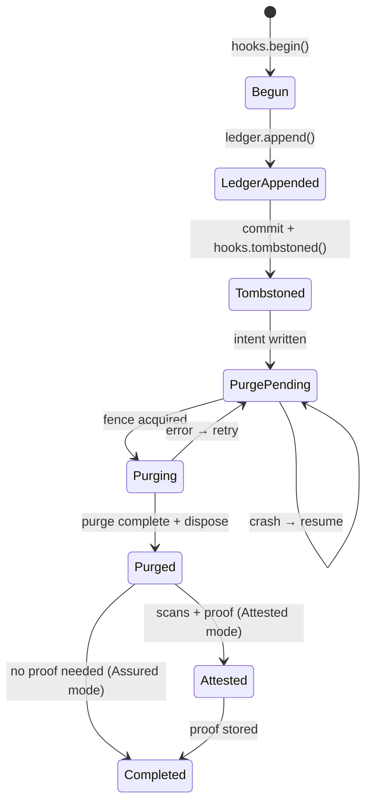
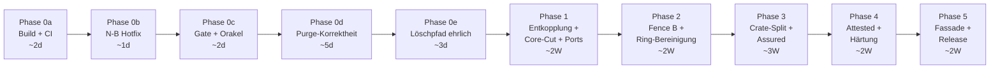

# Contextra — Architektur-Masterplan v2

**Version:** 2.0 · **Datum:** 14.10.2026  
**Verantwortlich:** Principal Senior Rust Architect  
**Basis:** Konsolidierung aller Planungsdokumente + Code-Analyse HEAD `500e9246`  
**Vorgänger:** `ARCHITECTURE_PLAN_v1.md`, `ARCHITEKTUR_OPTIMIERUNG_v1.md`, `docs/14-10-26/*`  
**Status:** Verbindliche Architekturgrundlage (Stufe 2 nach Grüne Gates & Code-Realität)

> [!IMPORTANT]
> Dieses Dokument **ersetzt und konsolidiert** alle vorherigen Architekturpläne. Es enthält alle Befunde, Entscheidungen und Spezifikationen der Vorgänger, ergänzt um bisher nicht berücksichtigte Aspekte und aufgelöste Widersprüche.

---

## Inhaltsverzeichnis

1. [Executive Summary](#1-executive-summary)
2. [Konsolidiertes Befundregister](#2-konsolidiertes-befundregister)
3. [Aufgelöste Widersprüche zwischen den Plänen](#3-aufgelöste-widersprüche-zwischen-den-plänen)
4. [Bisher nicht berücksichtigte Aspekte](#4-bisher-nicht-berücksichtigte-aspekte)
5. [Verbindliche Architektur-Doktrin](#5-verbindliche-architektur-doktrin)
6. [Optimierte Zielarchitektur](#6-optimierte-zielarchitektur)
7. [Löschnachweis als Zero-Cost-Plugin](#7-löschnachweis-als-zero-cost-plugin)
8. [Feature-Entkopplungsstrategie](#8-feature-entkopplungsstrategie)
9. [Geschäftslogik-Konsolidierung](#9-geschäftslogik-konsolidierung)
10. [Crate-Split und Migration](#10-crate-split-und-migration)
11. [Concurrency, MVCC und Determinismus](#11-concurrency-mvcc-und-determinismus)
12. [Algorithmen und mathematische Leitlinien](#12-algorithmen-und-mathematische-leitlinien)
13. [Crash-Konsistenz und Recovery](#13-crash-konsistenz-und-recovery)
14. [Qualitätssicherung und Gates](#14-qualitätssicherung-und-gates)
15. [Konsolidierter Phasenplan](#15-konsolidierter-phasenplan)
16. [ADR-Register (konsolidiert)](#16-adr-register-konsolidiert)
17. [Risikobewertung](#17-risikobewertung)
18. [Entscheidungsmatrix](#18-entscheidungsmatrix)

---

## 1. Executive Summary

### 1.1 Kerndiagnose

Contextra besitzt eine ambitionierte Ring-Architektur (Ring 0–4) mit 34+ Crates. Die Analyse aller vorherigen Planungsdokumente (10 Dokumente in `docs/14-10-26/`, zwei Architekturpläne, Spezifikationen) offenbart **drei kritische Cluster** und **sechs bisher nicht adressierte Defizite**:

| Cluster | Aus vorherigen Plänen | Bisher fehlend |
|---|---|---|
| **Architektur-Kopplung** | Löschnachweis im Kern, `contextra-core` tot, 101 unverdrahtete `pub fn` | Builder-Schalter-Audit, Graph-Entkopplung vollständig, Feature-Kombinations-Matrix |
| **Funktionale Defekte** | N-B, N-K, N-A, N-N, L1–L6 (Löschpfad) | DurabilityMode/ErasureMode Interaktion, KvDeleteMode Default, HNSW-Zeroisierung |
| **Design-Inkonsistenzen** | 6 Ring-Verletzungen, W1–W8 | Wiring-Validierung, MCP-Tool-Klassifikation als Sicherheitsgrenze, Egress-Audit-Lücke |

### 1.2 Leitmotiv

> **Jede Fähigkeit ist ein Plugin. Was nicht aktiviert wird, existiert nicht — weder im Binary noch zur Laufzeit. Der Löschnachweis ist das Kernversprechen, aber sein Preis ist opt-in.**

### 1.3 Endprodukt-Hierarchie

| ID | Produkt | Status | Kernversprechen |
|---|---|---|---|
| **EP1** | Contextra Memory | **Release 1.0** | Lokaler Speicher, Hybridsuche, Mandanten, Löschung |
| **EP2** | Contextra Proof | Nach K4 | Unabhängige Verifikation, Audit-Export |
| **EP3** | Contextra Retrieval+ | Jahr 2 | Graph-Beziehungen, PathRAG |
| **EP4** | Contextra Inference | Jahr 3 | Lokale Embedder, KV-Cache |
| **EP5** | Contextra Cognition | Experimentell | Konsolidierung, Routing |
| **EP6** | Contextra Guard | Nach Bedarf | Egress-Schutz, Sandbox |

---

## 2. Konsolidiertes Befundregister

### 2.1 Kritische Blocker (🔴)

Alle Pläne identifizieren dieselben Kern-Blocker. Hier konsolidiert mit Querverweis:

| ID | Befund | Quelle | Korrektur | Phase |
|---|---|---|---|---|
| **N-N** | Engine kompiliert nicht (`UnknownFreeSpace` Match-Arm) | Gesamtanalyse, ARCH_v1 | Match-Arm ergänzen | 0a |
| **N-O** | Fassade kompiliert nicht (Router-Wiring) | Gesamtanalyse, ARCH_v1 | `clock_instance` mit Fallback | 0a |
| **N-B** | `Collection::delete()` gibt immer `CapabilityUnsupported` | Alle Pläne | Downcast entfernen, `ErasureBackend`-Trait | 0b |
| **N-A** | Crash-Resume fail-open | Gesamtanalyse, ARCH_v1 | Scope aus Ledger, Storage-Aufbau zuerst | 0d |
| **N-K** | Purge trifft keine physischen Schlüssel | Alle Pläne | `PhysicalScope` als opaker Typ | 0d |
| **L1** | Ledger-Append fehlt vor Tombstone | Gesamtanalyse | `ErasureLedger::append` zwingend vor Commit | 0e |
| **L4** | Obsolete SSTables bleiben auf Platte | Gesamtanalyse, ARCH_v1 | `PurgeOutput.obsolete_files` + `scrub_and_remove` | 0d |
| **L5** | Lesefehler still verschluckt | Gesamtanalyse, ARCH_v1 | 3-Arm-Match | 0d |
| **L6** | SSTable-Positionsverlust nach Rewrite | Gesamtanalyse, ARCH_v1 | Rank/Seq-Grenzen übertragen | 0d |
| **S1** | Löschnachweis (~8.200 LOC) im Kern verwoben | OPT_v1 | Crate-Split in 3 Crates | 3 |

### 2.2 Hohe Schwachstellen (🟠)

| ID | Befund | Korrektur | Phase |
|---|---|---|---|
| **N-P** | Lockfile veraltet | Regenerieren | 0a |
| **N-E** | Eine Intent-Datei je Store → Kollision | Zufalls-IDs für Intents | 0d |
| **N-H** | Fehlende Fence im Schreibpfad | Option B: Atomic-Load + Leader-Check | 2 |
| **N-L** | Restore ohne modusabhängige Barriere | Guard nur bei ≥ Assured | 3 |
| **N-D** | Text/Relations-Zeugen nie ausgestellt | Echte Scans verdrahten | 0e |
| **E6** | `LayerWitness::issue` ist `pub` | `pub(crate)` im Plugin | 5 |
| **S4** | 6 Ring-Verletzungen | Ports + Ring-Ordnung korrigieren | 1–2 |
| **S5** | Builder-Optionen ohne Wirkung (7 Schalter) | Verdrahten oder entfernen | 1 |
| **S7** | 5 `downcast_ref::<LsmStorage>()` | Durch `ErasureBackend`-Trait ersetzen | 2 |
| **L8** | `None`-Probe = 0 Byte frei | `None` = unbekannt, konservativ starten | 0d |

### 2.3 Mittlere Schwachstellen (🟡)

| ID | Befund | Korrektur | Phase |
|---|---|---|---|
| **N-F** | Vec + doppeltes Lesen im Purge | Streaming-Rewrite | 0d |
| **N-G** | Orphan-GC ohne Scrubbing | `scrub_and_remove` | 0d |
| **N-I** | v3-Beweiserzeugung aktiv | Code entfernen, nur v4 | 0e |
| **N-J** | Failpoints per Umgebungsvariable | Nur unter `cfg(feature = "fault-injection")` | 0d |
| **N-M** | `purge_tenant` physisch wirkungslos | Umbenennen oder physisch implementieren | 0e |
| **N-C** | `forget_document` fabriziert Zeugen | Löschen, nur echte Scans | 0e |
| **E1** | `verify` statt `verify_strict` | `verify` deprecaten | 5 |
| **E2** | `bincode` im Signaturpfad | TLV für alle v4-Pfade | 5 |
| **S2** | `contextra-core` tote Fassade (110 Dateien) | Ersatzlos entfernen, mechanisch | 1 |
| **C2** | v3-Proof-Methoden noch aufrufbar | Entfernen | 0e |
| **C4** | `KvDeleteMode::default()` = `CryptoShred` | Ändern zu `TombstoneOnly` | 1 |
| **C5** | `deletion_proof_active` toter Schalter | Entfernen | 6 |

---

## 3. Aufgelöste Widersprüche zwischen den Plänen

Die vorherigen Planungsdokumente widersprechen sich an 8 Stellen. Hier die verbindliche Auflösung:

| # | Widerspruch | Plan A sagt | Plan B sagt | **Auflösung** |
|---|---|---|---|---|
| **W1** | Löschkette-Status | v6: "nicht angeschlossen" | v7: `delete()` → `erase_document` läuft | **v7 korrekt**, aber MCP liefert `proof: null`. Pfad existiert, Ergebnis wird verworfen |
| **W2** | `rank`-Zuordnung | Kernschnitt v6: EP3 | Plan v7: EP1 | **EP1** — RRF-Fusion ist Kernfunktion für Hybridsuche |
| **W3** | Hüllengröße | Diverse: 32 Crates | Plan v7: 26 (Default) | **Default-Features messen** als Gate, alle als Bericht |
| **W4** | Unwrap-Baseline | `ratchet.toml`: 502 | `unwrap_baseline.txt`: 786 | **Eine Quelle**: `ratchet.toml` als SSoT, Ratsche nur nach unten |
| **W5** | k-Path Status | Briefing: "fehlt" | Inventar: 321 Zeilen fertig | **Code existiert** (`path_rag/k_path.rs`), hat aber keinen Produktionsaufrufer. Exponieren oder `pub(crate)` |
| **W6** | DiBud-Belegstatus | Deep Research: Priorität 1 | Langfassung: nicht recherchiert | **Eigenableitung [E]** — nur mit synthetischem Ausreißertest |
| **W7** | SSI Read-Set Wiring | Briefing: "nicht verdrahtet" | Audit: "Commit-Pfad ruft SSI auf" | **Beide korrekt**: Commit-Pfad nutzt SSI, Lesepfad-Schnittstelle fehlt → Read-Set-Tracking ergänzen |
| **W8** | Ring-Gate CI-Status | Plan v7: "6 Verletzungen" | CI: PRs gehen durch | **CI-Status unklar**. Erste Aufgabe K0: messen. Gate ggf. nicht als Pflicht konfiguriert |

### 3.1 Widersprüche zwischen ARCH_v1 und OPT_v1

| Aspekt | ARCH_v1 | OPT_v1 | **Auflösung** |
|---|---|---|---|
| Phasenbezeichnung | K0–K5 | P0–P6 | **Unifiziert**: Phase 0a–0e, Phase 1–6 (dieser Plan) |
| `graph` Ring-Zuordnung | Ring 3 (Orchestration) | Ring 0 (Algorithmen) | **Ring 3** — CSR-Graph mit PathRAG-Traversierung ist Orchestration, nicht Foundation |
| `kvcache` Zuordnung | Ring 1 (Persistence) | Ring 3 (Plugin) | **Ring 1** — KV-Cache ist Persistenz-nahe, hinter Feature |
| `proof-verify` Ring | Ring 0 | Ring 4 (Facades) | **Ring 0** — Standalone-Verifier, keine Abhängigkeit auf Engine/Store |
| IMPL-Spez vs. Gesamtanalyse | Identische Dateien | — | **Identisch** — `IMPLEMENTIERUNGSSPEZIFIKATION.md` ist Kopie der Gesamtanalyse |

---

## 4. Bisher nicht berücksichtigte Aspekte

Die folgenden Themen fehlen in allen vorherigen Plänen und müssen adressiert werden:

### 4.1 Builder-Wiring-Validierung (NEU)

**Problem:** 7 Builder-Optionen (`with_privacy`, `with_adapt`, `with_kms`, `with_kv_shredding`, `with_checkpoint`, `with_avv_generator`, `with_audit_export`) speichern Werte, die nie abgefragt werden. Ein Nutzer, der `with_privacy(true)` setzt, erhält keine Garantie.

**Lösung:**
```rust
// In ContextraBuilder::build() — PFLICHT
fn verify_wiring(&self) -> Result<WiringReport, BuildError> {
    let mut report = WiringReport::new();
    
    // Jeder Schalter muss eine reale Auswirkung haben
    if self.privacy_enabled && self.egress_guard.is_none() {
        return Err(BuildError::IncompleteWiring {
            flag: "privacy",
            missing: "EgressGuard port not provided",
        });
    }
    
    if self.adapt_enabled && self.adaptive_controller.is_none() {
        return Err(BuildError::IncompleteWiring {
            flag: "adapt",
            missing: "AdaptiveController port not provided",
        });
    }
    
    // ... für jeden Schalter
    
    // Kein `let _ = flag;` mehr erlaubt
    Ok(report)
}
```

**Gate:** `cargo xtask check-builder-wiring` — kein `let _ =` für Builder-Werte.

### 4.2 DurabilityMode × ErasureMode Kompatibilitätsmatrix (NEU)

**Problem:** Zwei überlappende Konzepte steuern das Löschverhalten, aber ihre Interaktion war nicht spezifiziert.

**Verbindliche Matrix:**

| DurabilityMode | ErasureMode::Off | ErasureMode::Assured | ErasureMode::Attested |
|---|---|---|---|
| **Full** | ✅ | ✅ | ✅ |
| **WalNoHmac** | ✅ | ✅ (Warnung) | ❌ (HMAC-Chain nötig) |
| **MemoryOnly** | ✅ | ❌ (INV-DURABILITY-RING) | ❌ (INV-DURABILITY-RING) |

**Durchsetzung:** Im Builder zur Build-Zeit + im Store-Manifest zur Open-Zeit.

### 4.3 KvDeleteMode Default-Korrektur (NEU)

**Problem:** `KvDeleteMode::default()` = `CryptoShred` erzwingt Verschlüsselung auch ohne Feature.

**Entscheidung:** Default wird `TombstoneOnly`. `CryptoShred` nur mit Feature `encryption-at-rest`.

```rust
impl Default for KvDeleteMode {
    fn default() -> Self {
        // War: CryptoShred (C4)
        // Neu: TombstoneOnly — CryptoShred nur mit explizitem Feature
        Self::TombstoneOnly
    }
}
```

### 4.4 HNSW-Zeroisierung (NEU)

**Problem:** Die Gesamtanalyse listet unter §17.3 "HNSW-Zeroisierung: nicht verifiziert". Kein Plan adressiert, wie Vektordaten aus dem HNSW-Index physisch entfernt werden.

**Lösung:**
1. `remove_with_graph_repair` muss die Arena-Slots mit Nullen überschreiben, nicht nur den Zeiger entfernen
2. Feature `erasure-scan` im Vector-Crate: `HnswVectorScan` implementiert `LayerScan`
3. Scan prüft: kein Slot im HNSW-Graph referenziert noch die gelöschte Doc-ID

```rust
// crates/contextra-vector/src/layer_scan.rs
#[cfg(feature = "erasure-scan")]
pub struct HnswVectorScan<'a> {
    index: &'a HnswIndex,
}

#[cfg(feature = "erasure-scan")]
impl LayerScan for HnswVectorScan<'_> {
    fn layer(&self) -> LayerId { LayerId::HNSW_VECTOR }
    
    fn scan(&self, scope: &PhysicalScope) -> Result<LayerObservation, ScanError> {
        let doc_ids = scope.extract_doc_ids();
        let mut clean = true;
        let mut hasher = blake3::Hasher::new();
        hasher.update(b"contextra/layer/hnsw/v1");
        
        for doc_id in &doc_ids {
            // Arena-Slot-Prüfung: weder Zeiger noch Payload vorhanden
            if self.index.contains_doc_in_arena(*doc_id)? {
                clean = false;
            }
            // Graph-Nachbarschafts-Prüfung: keine Kante zeigt auf Doc
            if self.index.has_edges_to(*doc_id)? {
                clean = false;
            }
            hasher.update(&doc_id.to_le_bytes());
        }
        
        Ok(LayerObservation {
            layer: LayerId::HNSW_VECTOR,
            clean,
            state_digest: *hasher.finalize().as_bytes(),
            metadata: Default::default(),
        })
    }
}
```

### 4.5 MCP-Tool-Klassifikation als Sicherheitsgrenze (NEU)

**Problem:** `INV-MCP-CLASSIFY-1` verlangt, dass jedes MCP-Tool klassifiziert ist, aber die Pläne adressieren nicht, wie neue Tools bei Feature-Aktivierung sicher registriert werden.

**Lösung:** Tool-Registrierung wird Feature-gated:

```rust
// crates/contextra-mcp/src/tool_registry.rs
pub fn register_tools(registry: &mut ToolRegistry, features: &FeatureSet) {
    // EP1 Kern — immer verfügbar
    registry.register(ContextraSearch::new(), Classification::ReadOnly);
    registry.register(ContextraRemember::new(), Classification::WriteLocal);
    registry.register(ContextraForget::new(), Classification::WriteLocal);
    
    // Nur mit Feature `guard`
    #[cfg(feature = "guard")]
    if features.is_enabled("guard") {
        registry.register(ContextraCloudQuery::new(), Classification::EgressExternal);
    }
    
    // Nur mit Feature `graph`
    #[cfg(feature = "graph")]
    if features.is_enabled("graph") {
        registry.register(ContextraRelate::new(), Classification::WriteLocal);
        registry.register(ContextraExplain::new(), Classification::ReadOnly);
    }
}
```

### 4.6 Egress-Audit-Trail-Lücke (NEU)

**Problem:** `INV-EGRESS-AUDIT-1` verlangt hash-verketteten Audit-Trace, aber kein Plan spezifiziert dessen Integration in den Löschpfad.

**Lösung:** Egress-Events werden als zusätzlicher Layer-Scan behandelt:

```rust
// Neuer LayerId
impl LayerId {
    pub const EGRESS_AUDIT: Self = Self(40);
}

// Scan prüft: kein Audit-Eintrag referenziert gelöschte Daten im Klartext
#[cfg(feature = "erasure-scan")]
pub struct EgressAuditScan<'a> {
    audit_chain: &'a AuditChain,
}
```

### 4.7 `find_k_paths` Produktionsverdrahtung (NEU)

**Problem:** `find_k_paths` (321 LOC) ist fertig implementiert, hat aber keinen Produktionsaufrufer.

**Entscheidung:** 
- `find_k_paths` bleibt `pub(crate)` bis EP3
- `find_path` (Einzelpfad) wird über Feature `graph` in der Fassade exponiert
- MCP-Tool `contextra_explain` nutzt `find_path`, nicht `find_k_paths`

### 4.8 Snapshot-Isolation für Multi-Signal-Anfragen (NEU)

**Problem:** Invariante `Snapshot-Isolation` verlangt, dass alle Signale einer Anfrage denselben Sequenzstand lesen. Kein Plan spezifiziert, wie dies über Crate-Grenzen (Store, Vector, Text, Graph) durchgesetzt wird.

**Lösung:** `max_seq` wird als opakes Token durch den gesamten Lesepfad gereicht:

```rust
// In contextra-ports
pub struct ReadSnapshot {
    pub max_seq: TxId,
    pub created_at: Instant,
}

pub trait SnapshotReader: Send + Sync {
    fn read_at(&self, snapshot: &ReadSnapshot, key: &[u8]) -> Result<Option<Value>>;
}
```

### 4.9 Checkpoint-Determinismus (NEU)

**Problem:** `INV-CHECKPOINT-DETERMINISM-1` verlangt Checkpointing ohne Wall-Clock oder Random. Kein Plan spezifiziert, wie `contextra-checkpoint` die Ports nutzt.

**Lösung:** Checkpoint nutzt `Clock`- und `IdGenerator`-Ports aus `contextra-ports`:

```rust
// crates/contextra-checkpoint/src/lib.rs
pub struct CheckpointManager {
    clock: Arc<dyn Clock>,        // Kein SystemTime::now()
    id_gen: Arc<dyn IdGenerator>, // Kein rand::random()
    // ...
}
```

### 4.10 Sperrenhierarchie-Dokumentation (NEU)

**Problem:** AGENTS.md definiert die Sperrenhierarchie `collections → kv_locks → embedder`, aber kein Plan dokumentiert, wie dies bei der Erasure-Integration eingehalten wird.

**Lösung:** Erasure-Locks werden am Ende der Hierarchie eingefügt:

```
Sperrenhierarchie (erweitert):
  collections → kv_locks → embedder → erasure_ledger → erasure_gate

Keine Locks über .await — Fence-Erwerb ist unter commit_mutex (sync).
```

---

## 5. Verbindliche Architektur-Doktrin

Konsolidiert aus AGENTS.md, ARCH_v1 und OPT_v1. **Nummerierung unifiziert:**

### 5.1 Kernprinzipien

```
[P1]  Zero-Panic        Kein unwrap/expect/panic in Produktion (Ring 0 & Ring 1)
[P2]  Ring-DAG           Abhängigkeiten ausschließlich von höheren auf tiefere Ringe
[P3]  Determinismus      Clock, Rng, IdGenerator ausschließlich über Ports injiziert
[P4]  Unsafe-Inseln      Unsafe nur in simd, sys, wire mit 100% SAFETY-Kommentaren
[P5]  Single-Node        Keine Multi-Node-, Sharding-, Raft- oder Cluster-Logik
[P6]  Opt-in Kosten      Nicht aktivierte Features verursachen weder Code noch CPU-Overhead
```

### 5.2 Erasure-Prinzipien

```
[PE1] Erasure Opt-in     Ohne Feature 'erasure' keine Beweiser-Crates im Binary
[PE2] Ports-Only         Kern-Crates importieren nie contextra-crypto oder Plugins
[PE3] Fast-Path Zero     Schreibpfad: max 1 Atomic-Load (Acquire) je Batch
[PE4] Fail-Closed        Zeugen nur aus echten Scans; Fehler → kein Beweis
[PE5] Monotone Marke     ErasureMode ist Hochwassermarke im Store-Manifest
[PE6] Wirksamkeit        Kein Symbol ohne Produktionsaufrufer + E2E-Fassadentest
[PE7] Tenant-Matrix      Jeder Löschtest über LsmStorage UND TenantScopedStorage
```

### 5.3 Neue Prinzipien (v2)

```
[PV1] Builder-Ehrlichkeit   Kein Builder-Schalter ohne Wiring-Validierung
[PV2] Feature-Isolation     Jedes Feature kompiliert isoliert ohne andere Features
[PV3] Snapshot-Konsistenz   Multi-Signal-Lesepfade nutzen dasselbe ReadSnapshot
[PV4] Lock-Hierarchie       collections → kv_locks → embedder → erasure_*; keine Locks über .await
[PV5] Tool-Klassifikation   MCP-Tools sind Feature-gated und klassifiziert
```

---

## 6. Optimierte Zielarchitektur

### 6.1 Ring-Modell (unifiziert)

```mermaid
graph TD
    subgraph "Ring 0 — Foundation"
        types["contextra-types"]
        ports["contextra-ports<br/>(+erasure Modul)"]
        wire["contextra-wire<br/>(Unsafe Island)"]
        sys["contextra-sys<br/>(Unsafe Island)"]
        durable_fs["contextra-durable-fs"]
        simd["contextra-simd<br/>(Unsafe Island)"]
        mvcc["contextra-mvcc"]
        crypto_core["contextra-crypto-core<br/>(I/O-frei, ~5.800 LOC)"]
        proof_verify["contextra-proof-verify<br/>(Standalone Verifier)"]
    end

    subgraph "Ring 0 — Algorithmen"
        text["contextra-text<br/>(BM25, Inverted Index)"]
        rank["contextra-rank<br/>(RRF, Kalibrator)"]
        vector["contextra-vector<br/>(HNSW, Feature erasure-scan)"]
    end

    subgraph "Ring 0 — Crypto Extensions"
        crypto_kv["contextra-crypto-kv<br/>(Feature kv-encryption)"]
    end

    subgraph "Ring 1 — Persistence"
        store["contextra-store<br/>(LSM, WAL, Feature erasure)"]
        checkpoint["contextra-checkpoint"]
        kvcache["contextra-kvcache<br/>(Feature)"]
    end

    subgraph "Ring 2 — Execution Providers"
        infer_candle["contextra-infer-candle<br/>(Feature)"]
        infer_ollama["contextra-infer-ollama<br/>(Feature)"]
        infer_onnx["contextra-infer-onnx<br/>(Feature)"]
        sandbox["contextra-sandbox<br/>(Feature)"]
    end

    subgraph "Ring 3 — Orchestration"
        engine["contextra-engine<br/>(Feature erasure)"]
        db["contextra-db"]
        graph["contextra-graph<br/>(Feature, EP3)"]
        privacy["contextra-privacy<br/>(Feature)"]
    end

    subgraph "Ring 3 — Erasure Plugins"
        erasure["contextra-erasure<br/>(Plugin Assured)"]
        evidence["contextra-erasure-evidence<br/>(Plugin Attested)"]
    end

    subgraph "Ring 3 — EP5 Parkplatz"
        cognition["contextra-cognition"]
        adapt["contextra-adapt"]
        router["contextra-router"]
        agent["contextra-agent"]
    end

    subgraph "Ring 4 — Facades"
        facade["contextra<br/>(Composition Root)"]
        mcp["contextra-mcp<br/>(Stdio Server)"]
        py["contextra-py"]
        license["contextra-license"]
    end

    facade --> engine
    facade --> db
    facade -.->|"Feature erasure"| erasure
    facade -.->|"Feature erasure-evidence"| evidence
    mcp --> facade
    
    engine --> ports
    engine --> store
    engine --> vector
    engine --> text
    engine -.->|"Feature graph"| graph
    engine -.->|"Option<Arc<dyn ErasureHooks>>"| ports
    
    erasure --> ports
    erasure --> crypto_core
    erasure --> store
    evidence --> ports
    evidence --> crypto_core
    
    proof_verify --> crypto_core
    
    store --> crypto_core
    store --> durable_fs
    crypto_kv --> crypto_core
    crypto_kv --> durable_fs
    
    db --> engine
```

```

### 6.2 Crate- und Ring-Verzeichnis (Abgleich mit `capabilities.toml`)

`capabilities.toml` ist gemäß **P12** die verbindliche Quelle der Wahrheit für Ringe, Composition Roots und Unsafe-Inseln:

| Ring | Rolle | Registrierte Crates | Unsafe-Inseln & Begründung |
|---|---|---|---|
| **Ring 0** | Core Types & Error Handling (kein Async, I/O-frei) | `contextra-types`, `contextra-errors` (sowie nach Split: `contextra-crypto-core`, `contextra-proof-verify`) | Keine |
| **Ring 1** | Port-Traits (reine Abstraktionsgrenzen) | `contextra-ports` (+ `erasure`-Submodul) | Keine |
| **Ring 2** | Domain Logic (deterministische Pure-Algorithmen) | `contextra-text`, `contextra-vector`, `contextra-rank`, `contextra-graph`, `contextra-crypto`, `contextra-privacy`, `contextra-mvcc`, `contextra-checkpoint`, `contextra-adapt`, `contextra-cognition`, `contextra-kvcache` | `contextra-vector`: SIMD Intrinsics (ADR-007, `src/simd.rs`)<br>`contextra-kvcache`: Aligned Allocations für 2-Bit Quantized Cache (ADR-019, `src/aligned_alloc.rs`) |
| **Ring 3** | Infrastructure Adapters (Reale I/O & Persistenz) | `contextra-store`, `contextra-embedder`, `contextra-mcp` (sowie nach Split: `contextra-erasure`, `contextra-erasure-evidence`) | `contextra-store`: mmap I/O für WAL & SSTables (ADR-012, `src/mmap.rs`, `src/wal/mmap_segment.rs`) |
| **Ring 4** | Composition Root (Wiring & Lifecycle) | `contextra` (Hauptfassade), `contextra-engine` | Keine |

### 6.3 Ring-0-Ordnung (bereinigt)

```
types < errors < ports < wire < sys < durable-fs < simd < mvcc < crypto-core < text < rank < vector
```

**Neu gegenüber Vorgängern:** `durable-fs` explizit in die Ordnung aufgenommen. Löst V4 und V5.

### 6.4 Abhängigkeitsmatrix (Soll, konsolidiert)

| Crate | Darf abhängen von | Darf NICHT abhängen von |
|---|---|---|
| `contextra-store` | `crypto-core`, `ports`, `types`, `errors`, `durable-fs`, `sys` | `crypto` (alt), `erasure-evidence`, `license`, `core` |
| `contextra-vector` | `crypto-core`, `ports`, `types`, `errors`, `simd`, `durable-fs` | `crypto` (alt), `erasure-evidence`, `core` |
| `contextra-engine` | `ports`, `types`, `errors`, `store`, `vector`, `text` | `crypto` (alt/direkt), `erasure-evidence`, `license`, `core` |
| `contextra-kvcache` | `crypto-core`, `ports`, `types`, `errors` | `crypto` (alt), `core` |
| `contextra-db` | `engine`, `store`, `ports`, `types`, `errors` | `crypto` (alt), `cognition` (regulär), `core` |
| `contextra-erasure` | `ports`, `types`, `errors`, `crypto-core`, `store` | `crypto` (alt), `engine`, `license`, `core` |
| `contextra-erasure-evidence` | `ports`, `types`, `errors`, `crypto-core`, `durable-fs` | `store`, `engine`, `license`, `core` |
| `contextra-mcp` | `contextra` (Fassade), `ports`, `types`, `errors` | `crypto` (direkt), `erasure-evidence` (direkt), `core` |
| `contextra-graph` | `ports`, `types`, `errors`, `store` | `engine`, `crypto`, `core` |

### 6.5 Hüllen-Metriken

| Metrik | Ist | Ziel Phase 2 | Ziel Phase 6 |
|---|---|---|---|
| Hülle EP1 (Default) | ~26 | ≤ 18 | 18 |
| Kern→Parkplatz (regulär) | 10 | 0 | 0 |
| Ring-Verletzungen | 6 | 0 | 0 |
| Unverdrahtete `pub fn` in EP1 | 101 | ≤ 20 | 0 |

---

## 7. Löschnachweis als Zero-Cost-Plugin

> [!IMPORTANT]
> Die vollständige, mikrofeingranulare Systemspezifikation mit allen mathematischen Beweisen, exakten Rust-Signaturen, dem BSI TR-02102 7-Schichtenmodell, Purge v2 Streaming-Rewrite und Chaos-Matrizen ist in [`docs/spec/LOESCHNACHWEIS_SYSTEMSPEZIFIKATION_v2.md`](file:///home/freddy/Projekte/contextra/docs/spec/LOESCHNACHWEIS_SYSTEMSPEZIFIKATION_v2.md) normativ festgeschrieben.

### 7.1 Drei-Stufen-Modell: Off → Assured → Attested

| Eigenschaft | Off (Standard) | Assured | Attested |
|---|---|---|---|
| **Löschmethode** | Tombstone + Compaction | Ledger → Tombstone → Purge + Crypto-Erase | wie Assured |
| **Ledger** | — | ✅ Anti-Resurrection mit fsync | ✅ |
| **Fence** | — | ✅ Präfix-Fence (1 Atomic/Batch) | ✅ |
| **Resume** | — | ✅ Scope aus Ledger | ✅ |
| **Restore-Guard** | — (dokumentierte Nicht-Garantie) | ✅ Streamend | ✅ |
| **Zeugen** | — | — | ✅ 7-Layer BSI TR-02102 Scans |
| **Beweis** | — | — | ✅ v4-TLV/CBOR, Ed25519 |
| **Feature** | Kern | `erasure` | `erasure` + `erasure-evidence` |
| **Lizenz** | — | — | `Sovereign` |
| **Laufzeitkosten** | **Null** | 1 Ledger-Append + 1 Batch-Check | + Scans + Signatur |
| **Binärkosten** | **Null** | ~2 KB Gate-Logik | ~14 KB |

### 7.2 Nullkosten-Beweis

| Pfad | Feature deaktiviert | Feature aktiv, Modus Off | Assured idle | Assured + Purge |
|---|---|---|---|---|
| **Schreibpfad** | 0 (kein Code) | 1× `AtomicBool::load` | 1× `AtomicBool::load` | Atomic + Präfixmatch |
| **Löschpfad** | Tombstone | Tombstone | Ledger + Purge | + Scans + Proof |
| **Lesepfad** | 0 | 0 | 0 | 0 |
| **Startup** | 0 | 0 | Ledger laden (~50ms) | + Key laden (~100ms) |

### 7.3 Port-Spezifikation `contextra-ports::erasure`

Die vollständige Port-Spezifikation aus der Gesamtanalyse §5.1 wird **unverändert übernommen**. Kerntypen:

- `ErasureMode` (Off/Assured/Attested, `Default::Off`)
- `PhysicalScope` (opak, nur vom Backend erzeugbar → löst N-K)
- `ErasureBackend` (ersetzt alle 5 `downcast_ref` → löst S7)
- `ErasureHooks` (Plugin-Interface mit Default No-Op)
- `LayerScan` (fail-closed Scanner)
- `RestoreGuard` (streamender Anti-Resurrection-Filter)
- `FreeSpaceProbe` (`None` = unbekannt, nicht 0 → löst L8)

### 7.4 Hochwassermarke (PE5)

```rust
// Im Store-Manifest
pub struct ManifestHeader {
    // ...
    pub erasure_high_water_mark: ErasureMode,
}
```

**Invarianten:**
1. `open(mode)` mit `mode < high_water_mark` → `Err(PolicyViolation)`
2. Downgrade nur über `erasure_downgrade(AcknowledgeToken)` + signierter Audit-Eintrag
3. Modus je Öffnen unveränderlich

### 7.5 Zustandsmaschine (Löschpfad)



### 7.6 Sieben Layer-Scans (BSI TR-02102 konform)

| Layer | ID | Crate | Feature | Scan-Methode & Evidenz |
|---|---|---|---|---|
| **Layer 1: Logical Deletion** | 1 | `contextra-store` | `erasure-scan` | Tombstone-Marker in Metadaten: `Hash(tombstone_record \|\| timestamp)` |
| **Layer 2: Physical Data Zeroing** | 2 | `contextra-store` | `erasure-scan` | Null-Überschreibung & Scrubbing: `Hash(zero_region_checksum \|\| byte_range)` |
| **Layer 3: Index Entry Removal** | 3 / 20 / 21 / 26 | `store`, `text`, `graph`, `vector` | `erasure-scan` | Abwesenheitsbeweis in SSTables, BM25, CSR-Graph und HNSW-Arena |
| **Layer 4: WAL Entry Purge** | 4 | `contextra-store` | `erasure-scan` | Purge-Bestätigung im Log-Segment: `Hash(wal_segment \|\| purge_record)` |
| **Layer 5: Replica / Backup ACK** | 5 | `contextra-checkpoint` | `erasure-scan` | Bestätigung über Checkpoint-Filter: `Hash(replica_id \|\| deletion_ack)` |
| **Layer 6: Cryptographic Shredding** | 6 | `contextra-crypto-kv` | `kv-encryption` | BSI TR-02102 Key-Wipe: `Hash(key_id \|\| destruction_record \|\| kdf_params)` |
| **Layer 7: Audit Trail Chaining** | 7 | `contextra-erasure-evidence` | `erasure-evidence` | Hash-Verkettung: `Hash(prev_audit_hash \|\| this_layer_proofs \|\| timestamp)` |

### 7.7 BSI TR-02102 Schlüsselverwaltung & Krypto-Shredding

Gemäß BSI TR-02102-1 und TR-02102-2 gelten verbindlich folgende kryptografische Leitlinien:

1. **Algorithmen & Schlüssellängen:**
   - Symmetrische Verschlüsselung: **AES-256-GCM** (NIST SP 800-38D, BSI TR-02102-1 konform)
   - Audit-Verkettung: **HMAC-SHA-256** oder **BLAKE3-Keyed-Mode**
   - Key-Derivation: **HKDF-SHA-256** mit applikationsspezifischem Salt und Context-Tag
   - Signatur der Beweise: **Ed25519** mit deterministischem CSPRNG-Schlüsselmaterial
2. **Schlüssel-Hierarchie:**
   ```
   Master Key (HSM / Secure KMS)
     └── Key Encryption Key (KEK) [pro Mandant / Tenant]
           └── Data Encryption Key (DEK) [pro Collection / Dokument / Segment]
                 └── Verschlüsselt Chunks, Embeddings, KV-Cache & Graph-Attribute
   ```
3. **Krypto-Shredding Invarianten:**
   - Bei Löschung einer Collection oder eines Mandanten wird der DEK/KEK unwiderruflich zerstört.
   - Alle Schlüsseltypen implementieren `zeroize::Zeroize` und `zeroize::ZeroizeOnDrop`.
   - Schlüsseltypen implementieren **kein `Clone`**, um Streuung im Speicher zu verhindern.
   - Drop führt immer zur sicheren Nullung des Arbeitsspeichers.

### 7.8 Das 7-Layer DeletionProof v4 Modell & CBOR/TLV Export

```rust
// In contextra-erasure-evidence/src/proof.rs
use contextra_types::{DeterministicTimestamp, TenantId};
use zeroize::Zeroize;

#[derive(Debug, serde::Serialize, serde::Deserialize)]
pub struct DeletionProofV4 {
    pub version: u32,                       // Immer 4
    pub tenant_id: TenantId,
    pub target_id: [u8; 32],                // Eindeutige Scope- oder Doc-ID
    pub layers: [LayerProof; 7],            // Genau 7 Schichten nach BSI TR-02102
    pub aggregate_hash: [u8; 32],           // BLAKE3/SHA-256 über alle Layer-Proofs
    pub timestamp: DeterministicTimestamp,  // Injiziert über Clock-Port
    pub signature: Option<[u8; 64]>,        // Ed25519-Signatur für externe Auditoren
}

#[derive(Debug, Clone, serde::Serialize, serde::Deserialize)]
pub struct LayerProof {
    pub layer: u8,                          // 1..=7
    pub status: LayerStatus,
    pub evidence_hash: [u8; 32],
    pub metadata: Vec<u8>,
}

#[derive(Debug, Clone, Copy, PartialEq, Eq, serde::Serialize, serde::Deserialize)]
pub enum LayerStatus {
    Completed,
    Pending,
    NotApplicable,
}
```

**Externe Verifizierbarkeit:** Der Beweis wird als signiertes **CBOR**- oder **v4-TLV**-Dokument exportiert. Externe Wirtschaftsprüfer und Datenschutzbeauftragte nutzen `contextra-proof-verify`, um die Gültigkeit der Schichten und die Signatur unabhängig zu bestätigen, **ohne jemals Zugriff auf den Klartext der Anwendungsdaten zu benötigen**.

---

## 8. Feature-Entkopplungsstrategie

### 8.1 Feature-Matrix (Soll-Zustand)

```toml
# crates/contextra/Cargo.toml (Zielzustand)
[features]
default = ["fast"]

# Tier 1: Kern-Performance
fast = ["contextra-simd/default"]

# Tier 2: Erweiterungen (einzeln aktivierbar)
graph = ["contextra-engine/graph", "dep:contextra-graph"]
adapt = ["contextra-engine/adapt", "dep:contextra-adapt"]
kvcache = ["contextra-engine/kvcache", "dep:contextra-kvcache"]
cognition = ["dep:contextra-cognition"]
router = ["dep:contextra-router"]
agent = ["dep:contextra-agent"]

# Tier 3: Inference Backends
candle = ["dep:contextra-infer-candle"]
ollama = ["dep:contextra-infer-ollama"]
onnx = ["dep:contextra-infer-onnx"]

# Tier 4: Sicherheit und Compliance
privacy = ["dep:contextra-privacy"]
sandbox = ["dep:contextra-sandbox"]
guard = ["privacy"]
encryption-at-rest = ["contextra-store/encryption-at-rest"]

# Tier 5: Löschgarantie (Plugin-Architektur)
erasure = [
    "dep:contextra-erasure",
    "contextra-store/erasure",
    "contextra-engine/erasure",
]
erasure-evidence = [
    "erasure",
    "dep:contextra-erasure-evidence",
]

# Convenience-Bündel
sovereign = ["privacy", "erasure-evidence", "encryption-at-rest"]
compliance = ["sovereign", "audit-export", "avv-generator"]
```

### 8.2 Performance-Budgets je Feature

| Feature | Schreibpfad | Lesepfad | Startup |
|---|---|---|---|
| `graph` | 0 | ≤ 5% p99 | ≤ 200 ms |
| `adapt` | 0 | ≤ 1% p99 | ≤ 10 ms |
| `erasure` (Off) | 0 | 0 | 0 |
| `erasure` (Assured, idle) | ≤ 1% p99 | 0 | ≤ 50 ms |
| `erasure` (Assured, Purge) | ≤ 5% p99 | 0 | — |
| `erasure-evidence` | ≤ 1% p99 | 0 | ≤ 100 ms |
| `encryption-at-rest` | ≤ 3% p99 | ≤ 3% p99 | ≤ 50 ms |
| `privacy` | 0 | 0 | ≤ 20 ms |

### 8.3 Produkt-Manifest (NEU)

```toml
# products/ep1.toml
[product]
id = "EP1"
name = "Contextra Memory"
status = "release-1.0"
target_binary = "contextra-mcp"

[crates]
allowed = [
    "contextra-types", "contextra-ports", "contextra-sys", "contextra-wire",
    "contextra-simd", "contextra-durable-fs", "contextra-crypto-core",
    "contextra-mvcc", "contextra-text", "contextra-rank", "contextra-store",
    "contextra-vector", "contextra-checkpoint", "contextra-engine",
    "contextra-db", "contextra-license", "contextra", "contextra-mcp",
]

forbidden = [
    "contextra-graph", "contextra-cognition", "contextra-adapt",
    "contextra-router", "contextra-agent", "contextra-privacy",
    "contextra-sandbox", "contextra-infer-ollama", "contextra-infer-onnx",
    "contextra-core",
]

[features]
build = ["fast"]

[gate]
command = "cargo tree -p contextra-mcp -e normal --no-default-features --features fast"
max_crates = 18
```

---

## 9. Geschäftslogik-Konsolidierung

### 9.1 Vereinheitlichung `remember`/`recall` (D12)

MCP delegiert strikt an Fassade. Keine doppelte Verarbeitungslogik.

### 9.2 Fail-Closed Egress-Gateway

`contextra_cloud_query` nur hinter `#[cfg(feature = "guard")]`. Ohne Feature: Tool im MCP nicht sichtbar.

### 9.3 Builder-Validierung (NEU, §4.1)

`verify_wiring()` ist Pflicht in `build()`. Kein stilles Ignorieren.

### 9.4 `ForgetOptions` Eliminierung

`ForgetOptions` mit `assurance: S1` entfällt aus dem Kern. Parameter `_opts` in `erase_document` wird entfernt. Assurance ist kein Kern-Konzept, sondern Plugin-Konfiguration.

### 9.5 Toter Code (NEU)

| Symbol | Aktion |
|---|---|
| `DpiDeletionRuntime::open` | In Plugin `contextra-erasure` verschieben |
| `DpiPurgeDriver::new`/`run_physical` | In Plugin verdrahten |
| `forget_document` (Konstanten) | Löschen |
| `DeletionProof::create` (v3) | Löschen |
| `deletion_proof_active` | Löschen |
| `find_k_paths` | `pub(crate)` bis EP3 |

---

## 10. Crate-Split und Migration

### 10.1 `contextra-crypto` → 3 Crates

| Neues Crate | Ring | LOC | Inhalt |
|---|---|---|---|
| **`contextra-crypto-core`** | 0 | ~5.800 | KeyManager, KDF, AES-GCM-SIV, HMAC, WAL-Crypto, SecureBuf, Ed25519 |
| **`contextra-crypto-kv`** | 0 | ~3.400 | RevocationLog, KV-Segment-Verschlüsselung, KV-Shredding |
| **`contextra-erasure-evidence`** | 3 | ~8.200 | DeletionProof v4, TLV, Policy, Witnesses, Audit-Chain |

Dazu neue Crates:
- **`contextra-erasure`** (Ring 3, ~2.500 LOC): Coordinator, PurgeDriver, Ledger, RestoreGuard
- **`contextra-proof-verify`** (Ring 0, ~800 LOC): Standalone Ed25519-Verifier

### 10.2 `contextra-core` Entfernung

110 Dateien, ~300 Zeilen mechanische Migration:

| Bisheriger Import | Neuer Import |
|---|---|
| `use contextra_core::DocId` | `use contextra_types::DocId` |
| `use contextra_core::TxId` | `use contextra_types::TxId` |
| `use contextra_core::ContextraError` | `use contextra_types::ContextraError` |
| `use contextra_core::TxBuffer` | `use contextra_mvcc::TxBuffer` |
| `use contextra_core::WireFormat` | `use contextra_wire::WireFormat` |

3–4 mechanische PRs, nach Crate-Gruppen getrennt.

### 10.3 Backward-Kompatibilität

`contextra-crypto` bleibt als Shim-Fassade:

```rust
pub use contextra_crypto_core::*;
#[cfg(feature = "kv-encryption")]
pub use contextra_crypto_kv::*;
#[cfg(feature = "deletion-proof")]
#[deprecated(note = "Use contextra-erasure-evidence directly")]
pub mod deletion_proof { pub use contextra_erasure_evidence::deletion_proof::*; }
```

---

## 11. Concurrency, MVCC und Determinismus

### 11.1 Fence-Protokoll Option B

Entscheidung aus allen Plänen bestätigt. Implementierung über `AtomicBool` + `ArcSwap<Vec<PrefixFence>>`.

**Auflagen:**
1. Loom-Modell: 3 Threads, 2 Szenarien (Fence vor/nach Leader)
2. Leader-Eigen-Ops: Seq-Vergabe prüfen
3. Benchmark: p50/p99 ≤ 1% gegen Baseline

### 11.2 MVCC-Bereinigung

- `register()`/`register_at()` löschen → alle nutzen `acquire()`
- `recover_pending_intents` in `repair_on_open()` verdrahten
- SSI Read-Set-Tracking im Lesepfad ergänzen (W7)

### 11.3 Snapshot-Isolation (NEU, §4.8)

`ReadSnapshot` als opakes Token durch Store, Vector, Text, Graph reichen.

### 11.4 Sperrenhierarchie (NEU, §4.10)

```
collections → kv_locks → embedder → erasure_ledger → erasure_gate
```

Keine Locks über `.await`. Fence-Erwerb ist synchron unter `commit_mutex`.

---

## 12. Algorithmen und mathematische Leitlinien

Contextra setzt auf modernste, rigoros mathematisch belegte Algorithmen, die strikt unter den Nebenbedingungen **Determinismus**, **Zero-Panic** und **Single-Node-Effizienz** monomorphisiert werden.

---

### 12.1 KV-Cache Optimierung (KIVI 2-Bit Quantisierung, SnapKV Eviction & Tier-2 Spill)

**Crate:** `contextra-kvcache` (Ring 2 / Feature `kvcache`) · **Unsafe-Insel:** `src/aligned_alloc.rs` (ADR-019)

#### 1. KIVI Asymmetrische 2-Bit Quantisierung (Liu et al., 2024)
Schlüssel (Keys) und Werte (Values) im KV-Cache weisen stark asymmetrische Fehlertoleranzen auf:
- **Key-Cache:** Per-Channel Quantisierung (2-Bit bis 4-Bit), da Dimensionen quer über Token unterschiedliche Varianz aufweisen.
- **Value-Cache:** Per-Token Quantisierung (2-Bit), da einzelne Token-Vektoren homogen skalieren.
- **Group-Size $g$:** $g \in [32, 128]$ (Default 64) balanciert Genauigkeit und Metadaten-Overhead.
- **Residual Window:** Die letzten 128 bis 512 Token verbleiben in voller FP16/BF16 Präzision, um die Aufmerksamkeit auf unmittelbare lokale Kontexte verlustfrei zu halten.

**Quantisierungs- und Dequantisierungsformeln:**
Für einen Block $X$ der Gruppengröße $g$ mit $b = 2$ Bits:
$$\text{scale} = \frac{x_{\max} - x_{\min}}{2^b - 1} = \frac{x_{\max} - x_{\min}}{3}$$
$$\text{zero\_point} = \text{round}\left(-\frac{x_{\min}}{\text{scale}}\right)$$
$$X_q = \text{clamp}\left(\text{round}\left(\frac{X}{\text{scale}}\right) + \text{zero\_point},\; 0,\; 2^b - 1\right)$$
$$X_{\text{deq}} = \text{scale} \cdot (X_q - \text{zero\_point})$$

#### 2. SnapKV Attention-basierte Eviction (Li et al., 2024)
Statt einfachem FIFO oder uninformiertem LRU wird die semantische Bedeutung historischer Token ausgewertet:
- Ein kleines **Beobachtungsfenster (Observation Window $W \approx 32$)** analysiert die Aufmerksamkeitsgewichte der letzten generierten Token.
- Die Attention-Scores werden über $W$ pro Attention-Head gemittelt: $\bar{A}_h(j) = \frac{1}{W} \sum_{t=T-W+1}^T A_h(t, j)$.
- Für jeden Head werden unabhängig die **Top-$k$ Attention-Peaks** selektiert und mit einem **Sliding-Window** der jüngsten $L_{\text{recent}}$ Token vereinigt:
  $$\mathcal{K}_{\text{keep}} = \text{TopK}(\bar{A}_h, k = B - L_{\text{recent}}) \cup \{T - L_{\text{recent}} + 1, \dots, T\}$$
- Alle übrigen KV-Positionen werden freigegeben.

#### 3. Prefix-Trie & Refcount-Schutz
- Häufige System-Prompts und Dokumenten-Präfixe werden in einem Präfix-Radix-Baum (`PrefixTrie`) indexiert.
- Präfix-Einträge besitzen atomare Referenzzähler (`Arc<AtomicU32>`).
- **Invariante:** Kein Eintrag mit $\text{refcount} > 1$ darf jemals von der SnapKV-Eviction verdrängt werden.

#### 4. Tier-2 Spill & Speicherlayout
- **Tier-1 (RAM):** Hot Cache, FP16 Residuals + 2-Bit KIVI gepackt in SIMD-ausgerichteten Puffern (`aligned_alloc.rs`).
- **Tier-2 (NVMe / mmap):** Bei Erreichen des Tenant-Token-Budgets werden evicted KV-Blöcke mit **zstd Level 1** komprimiert und in ein dateibasiertes mmap-Segment gestreamt.
- **Cache-Miss Recovery:** Bei Wiederaufgreifen historischer Kontextstränge wird der Block dekomprimiert, dequantisiert und mit O(1) in Tier-1 promoviert.

---

### 12.2 Wissensgraph-Konstruktion & OpenIE-Pipeline

**Crate:** `contextra-graph` (Ring 2 / Feature `graph`)

#### 1. Deterministische Ingestion-Pipeline
```
Text-Chunk ──► Satz-Splitting ──► Regelbasierte NER ──► LLM-Validierung ──► Kanonisierung ──► CSR-Einfügung
```
1. **Regelbasierte NER:** Schnelle Vorfilterung über Regex (Datumsangaben, Nummern, E-Mails), Großschreibungs-Heuristiken (Eigennamen) und Wörterbuchabgleich.
2. **LLM-Validierung über Port:** Aufruf des `LlmExtractionPort` mit $\text{Temperature} = 0.0$ und festem Seed, um Bit-Determinismus zu garantieren.
3. **Relationsextraktion:** Extraktion von Subject-Predicate-Object (SPO) Tripeln: $(s, p, o) \in \mathcal{V} \times \mathcal{R} \times \mathcal{V}$.
4. **Hyperkanten für $n$-äre Relationen:** Relationen mit mehr als zwei beteiligten Entitäten ($n > 2$, z. B. Vertragsparteien mit Datum und Gültigkeitsbereich) werden als Hyperkanten $e = \{v_1, v_2, \dots, v_n\}$ in der CSR-Struktur abgebildet.

#### 2. Deterministische Kanonisierung und Sortierung
- Entitäten werden in Kleinbuchstaben normalisiert, lemmatisiert und auf eine eindeutige kanonische ID abgebildet.
- **Invariante Sortierung:**
  $$\text{Entities: } (canon\_id, span\_start) \quad\text{bzw.}\quad \text{Triples: } (subject\_id, predicate, object\_id)$$
- Graph-Updates erfolgen strikt inkrementell in die CSR-Adjazenzlisten ohne vollständigen Graph-Rebuild.

---

### 12.3 Conformal Fusion Calibration (Split Conformal & ACI)

**Crate:** `contextra-rank` (Ring 2)

#### 1. Motivation: Ablösung von PAVA und Platt-Scaling
PAVA (Isotonic Regression) und Platt-Scaling setzen spezifische Verteilungsannahmen voraus oder überanpassen auf kleinen Kalibrierungssets. Contextra ersetzt bzw. umhüllt diese Verfahren durch **Split Conformal Prediction**, das verteilungsfreie, exakte Überdeckungsgarantien für endliche Stichproben liefert.

#### 2. Mathematische Formulierung
Gegeben sei ein Kalibrierungsset $\{(X_i, Y_i)\}_{i=1}^n$ relevanter und irrelevanter Dokumente pro Kollektion:
- **Nonconformity-Score $s(d)$:** Für ein Dokument $d$ mit fusioniertem Score $f(d) \in [0, 1]$:
  $$s(d) = \begin{cases} 1 - f(d) & \text{wenn } Y = \text{relevant} \\ f(d) & \text{wenn } Y = \text{irrelevant} \end{cases}$$
- **Schwellwert $\hat{q}$:**
  $$\hat{q} = \text{Quantil}_{\left\lceil \frac{(1 - \alpha)(n + 1)}{n} \right\rceil} \left(\{s_1, \dots, s_n\}\right)$$
- **Konforme Vorhersagemenge $C(X_{\text{test}})$:**
  $$C(X_{\text{test}}) = \{d \in \mathcal{D} \mid s(d) \le \hat{q}\}$$
- **Garantie:**
  $$\mathbb{P}\left(Y_{n+1} \in C(X_{n+1})\right) \ge 1 - \alpha$$

#### 3. Adaptive Conformal Inference (ACI) bei Verteilungsdrift
Unter dynamischen Last- und Dokumentenänderungen passt sich $\alpha_t$ online an:
$$\alpha_{t+1} = \alpha_t + \gamma \cdot (\alpha - \text{err}_t)$$
wobei $\text{err}_t = 0$ falls $Y_t \in C(X_t)$, andernfalls $\text{err}_t = 1$. Die Schrittweite $\gamma$ wird dyadisch in Festkomma berechnet.

---

### 12.4 Sketched Contextual Bandits

**Crate:** `contextra-adapt` (Ring 2 / Feature `adapt`)

#### 1. Problem: Quadratischer Flaschenhals im Standard-LinUCB
Standard-LinUCB benötigt für einen Kontext-Vektor $x \in \mathbb{R}^d$ ein Sherman-Morrison Rank-1 Update der inversen Kovarianzmatrix $A_a^{-1}$:
$$A_a \leftarrow A_a + x_t x_t^T \implies \mathcal{O}(d^2) \text{ Multiplikationen pro Observation}$$
Bei hochdimensionalen Token- und Signal-Features führt dies zu untragbarer Latenz im Retrieval-Hotpath.

#### 2. Sketched Random Projection (Achlioptas Sparse JL)
Der Kontext $x \in \mathbb{R}^d$ wird über eine dünnbesetzte Johnson-Lindenstrauss-Matrix $S \in \mathbb{R}^{k \times d}$ in einen niederdimensionalen Raum $\mathbb{R}^k$ projiziert ($k = \mathcal{O}(\sqrt{d} \log d) \ll d$):
$$S_{i, j} = \sqrt{\frac{3}{k}} \cdot \begin{cases} +1 & \text{mit Wsk. } \frac{1}{6} \\ 0 & \text{mit Wsk. } \frac{2}{3} \\ -1 & \text{mit Wsk. } \frac{1}{6} \end{cases}$$
- **Projizierter Kontext:** $z = S \cdot x$ in $\mathcal{O}(\text{nnz}(S)) \approx \mathcal{O}(k \cdot d / 3)$.
- **Projektions-Matrix $A_a \in \mathbb{R}^{k \times k}$:** Sherman-Morrison Update reduziert sich von $\mathcal{O}(d^2)$ auf $\mathcal{O}(k^2)$.
- **UCB-Selektion:**
  $$\text{UCB}_a = z^T \hat{\theta}_a + \beta \sqrt{z^T A_a^{-1} z}$$
- **Re-Sketching:** Erkennt der `LyapunovDriftWatcher` einen signifikanten Verteilungsdrift, wird $S$ mit neuem Port-CSPRNG-Seed neu erzeugt und die Kovarianz re-projiziert.

---

### 12.5 Spektrale Hyperkanten-Deduplizierung

**Crate:** `contextra-cognition` (Ring 2 / Feature `cognition`)

#### 1. Hypergraph-Inzidenzmatrix & Brand's Incremental SVD
Gegeben sei die Inzidenzmatrix $H \in \{0, 1\}^{|V| \times |E|}$. Ein vollständiger SVD-Rebuild kostet $\mathcal{O}(|V| \cdot |E| \cdot k)$.
Contextra nutzt **Brand's Incremental Rank-1 SVD Update** beim Eintreffen einer neuen Hyperkante (Spalte $c$):
1. **Projektion:** $p = U_k^T c$
2. **Residual:** $r = c - U_k p$
3. **Normalisierung:** $q = \frac{r}{\|r\|_2}$ (falls $\|r\|_2 > \varepsilon$)
4. **Augmentierte Kernmatrix:**
   $$K = \begin{bmatrix} \Sigma_k & p \\ 0 & \|r\|_2 \end{bmatrix} \in \mathbb{R}^{(k+1) \times (k+1)}$$
5. **Diagonalisierung:** $K = U' \Sigma' V'^T$
6. **Aktualisierung:**
   $$U_{k+1} = [U_k, q] \cdot U', \quad \Sigma_{k+1} = \Sigma', \quad V_{k+1} = \text{diag}(V_k, 1) \cdot V'$$
Komplexität: $\mathcal{O}(k^2 |V|)$ statt $\mathcal{O}(|V| |E| k)$.

#### 2. Deduplizierung
Zwei Hyperkanten $e_1, e_2$ gelten als Duplikat, wenn ihre spektralen Einbettungen $v_1, v_2 = V_k^T c$ eine Cosinus-Ähnlichkeit oberhalb der Schwelle $\theta \approx 0.92$ aufweisen:
$$\text{sim}(e_1, e_2) = \frac{\langle v_1, v_2 \rangle}{\|v_1\|_2 \|v_2\|_2} > \theta \implies \text{Deduplizieren \& Kanten-Gewicht aggregieren}$$

---

### 12.6 PathRAG (Budgetierte k-Pfad-Diffusion)

**Crate:** `contextra-graph` (Ring 2 / Feature `graph`)

#### 1. Algorithmus: Budgeted-K-Path
Um "Graph-Drift" und unbeschränkte Graph-Traversierung zu verhindern, nutzt Contextra eine budgetierte Variante von Yen's k-Shortest-Paths:
- **Knotenbudget $B$:** Die Gesamtzahl distinkter besuchter Knoten über alle $k$ Pfade ist strikt durch $B$ begrenzt:
  $$\left|\bigcup_{i=1}^k \mathcal{V}(P_i)\right| \le B$$
- **PPR-Diffusions-Relevanz:** Relevanz eines Pfades $P = (v_1, \dots, v_m)$ basiert auf Personalized PageRank (Andersen-Chung-Lang Forward Push):
  $$\text{Rel}(P) = \frac{1}{|P|} \sum_{v \in P} \text{PPR}(v \mid \mathcal{Q})$$
- **Jaccard-Pfad-Diversität:** Um redundante Parallel-Pfade zu bestrafen, wird die minimale Jaccard-Distanz zu bereits gewählten Pfaden berechnet:
  $$\text{Div}(P, \{P_1, \dots, P_{m-1}\}) = \min_{j < m} \left(1 - \frac{|\mathcal{V}(P) \cap \mathcal{V}(P_j)|}{|\mathcal{V}(P) \cup \mathcal{V}(P_j)|}\right)$$
- **Kombinierter Pfad-Score:**
  $$\text{Score}(P) = \text{Rel}(P) \cdot w_{\text{rel}} + \text{Div}(P) \cdot w_{\text{div}}$$

---

### 12.7 DiBud (Budgeted Reciprocal Rank Fusion)

**Crate:** `contextra-rank` (Ring 2)

Zertifiziert deterministisch ein Top-$k$ Ranking über mehrere Retrieval-Kanäle (Dense Vector, Sparse BM25, Graph PathRAG) unter einem festen Zugriffskanal-Budget $B$ (arXiv:2609.15143).
- **Untere Schranke für Dokument $d$:**
  $$L(d) = \sum_{ch \in \text{Gelesen}} \frac{1}{60 + r_{ch}(d)}$$
- **Restwert für unvollständigen Kanal $ch$:**
  $$U_{ch} = \frac{1}{60 + n_{ch} + 1}$$
- **Obere Schranke für bekanntes $d$:**
  $$U(d) = L(d) + \sum_{ch \notin \text{Gelesen}(d)} U_{ch}$$
- **Zertifizierungs-Bedingung:** Ein Dokument wird sofort als Rang $m$ fixiert, wenn:
  $$L(d) > \max_{e \neq d} U(e) \quad \text{und} \quad L(d) \ge \sum_{ch} U_{ch}$$
- **Berechnung:** Strikt in Festkomma-Arithmetik (`FixedRankScore(pub u128)` im Q64.64 Format).

---

### 12.8 Gleitkomma-Determinismus & Zero-Panic Invarianten

Gemäß **P1** und **P3** gelten im gesamten mathematischen Code folgende Regeln:
1. **Vergleiche:** Ausschließliche Nutzung von `f64::total_cmp` bzw. `f32::total_cmp`. Die Verwendung von `partial_cmp` oder `<` / `>` auf rohen Floats in Sortierfunktionen ist per Clippy verboten.
2. **NaN-Semantik:** NaN wird durch `total_cmp` deterministisch als größter Wert behandelt und an das Ende von Rankings sortiert.
3. **Numerische Akkumulation:** In langen Vektorsummen (Cosine Distance, Attention-Pooling) wird **Kahan-Summation** verwendet, um Assoziativitäts- und Rundungsfehler über SIMD-Grenzen hinweg auszuschließen.
4. **Arithmetische Sicherheit:** Keine rohen Operatoren `+`, `*` bei Index- und Puffergrößen; obligatorische Verwendung von `checked_add`, `checked_mul` oder `saturating_*`.
5. **Zero-Panic:** Kein `unwrap()`, kein `expect()`, kein `panic!()` in Ring 0, Ring 1 und Ring 2. Array-Zugriffe erfolgen über `.get()` mit Fehlerpropagation via `Result<T, ContextraError>`.

---

### 12.9 Deterministisches v4-TLV Bytelayout

```
+-------------------------------------------------------------------------+
| Magic: "contextra/deletion-proof/v4\0\0\0\0\0\0" (32 B)                |
| Tag 0x0001 (Scope)  | Len 0x0020 | BLAKE3 Scope Digest (32 B)          |
| Tag 0x0002 (TxId)   | Len 0x0008 | u64 LE TxId                         |
| Tag 0x0003 (Time)   | Len 0x0008 | u64 LE Unix-Millis                  |
| Tag 0x0010 (Array)  | Len N      | [LayerId(u8) + Clean(u8) + Digest]  |
| Tag 0x00FE (PubKey) | Len 0x0020 | Ed25519 Public Key (32 B)           |
| Tag 0x00FF (Sign)   | Len 0x0040 | Ed25519 Signatur (64 B)             |
+-------------------------------------------------------------------------+
```

---

### 12.10 Verworfene Verfahren

Aus Gründen des Determinismus, der Single-Node-Doktrin oder fehlender Eignung wurden folgende Ansätze explizit verworfen:
- **BMSSP / FindPivots:** Parameter degenerieren bei kleinen/mittleren Wissensgraphen; Dijkstra/PPR ist auf Single-Nodes robuster.
- **HyperQuant:** Entwickelt für LLM-Weights, ungeeignet für asymmetrische dynamische KV-Caches.
- **Mixed-Precision Floating Point:** Verletzt Bit-Determinismus zwischen AVX2 und ARM NEON.
- **ML-basierte Compaction:** Zu hohe CPU-Varianz und Latenzspitzen im Speicher-Kern.

---

## 13. Crash-Konsistenz und Recovery

### 13.1 Crash-Matrix

| Szenario | Zeitpunkt | Erwartetes Recovery |
|---|---|---|
| **CRASH-01** | Nach Ledger, vor Tombstone | Re-Tombstone aus Ledger |
| **CRASH-02** | Während SSTable-Rewrite | `.purge_tmp` aufräumen, altes Manifest |
| **CRASH-03** | Nach SSTable, vor Manifest | Temp aufräumen, Intent-Resume |
| **CRASH-04** | Nach Manifest, vor Scrub | Resume führt `dispose()` aus |
| **CRASH-05** | Disk-Full während Purge | `InsufficientDiskSpace`, `PurgePending` |
| **CRASH-06** | I/O-Lesefehler (Bit-Rot) | `PurgeError::ReadError`, fail-closed |
| **CRASH-07** | Schreibkonflikt bei Rewrite | `WriteFenced` Ablehnung |
| **CRASH-08** | Restore aus altem Backup | `RestoreGuard` lehnt gelöschte Keys ab |

### 13.2 Resume nach Crash (N-A fix)

Resume erhält `&LsmStorage` (nicht `None`), Scope aus Ledger, Fence vor `Ok`, Rewrite als Background-Task.

### 13.3 Anti-Resurrection Ledger

Binärformat aus ARCH_v1 §17 wird übernommen: Magic `CTRALEDG`, HMAC-BLAKE3-verkettete Records, CRC32C.

---

## 14. Qualitätssicherung und Gates

### 14.1 Neue Gates

| Gate | Phase | Prüfung | Exit |
|---|---|---|---|
| `check-product-hull --product <ID>` | 2 | Hülle ≤ Manifest | 2 |
| `deletion-guarantee-gate` | 0–3 | Rohsweep + Marker-Prüfung | 2 |
| `check-builder-wiring` **(NEU)** | 1 | Kein `let _ =` für Builder-Werte | 2 |
| `check-feature-isolation` **(NEU)** | 2 | Jedes Feature kompiliert isoliert | 2 |
| `check-snapshot-consistency` **(NEU)** | 3 | Multi-Signal-Reads nutzen ReadSnapshot | 2 |

### 14.2 Prüfbare Abnahme

| Kategorie | Test | Phase |
|---|---|---|
| Entkopplung | `cargo tree` ohne Evidence/crypto-kv im Default-Build | 4 |
| Performance | Criterion p50/p99 ≤ 1% Abweichung (Off vs. Baseline) | 2 |
| Korrektheit | Differenztest (BTreeMap-Referenz), Rohsweep, Tenant-Matrix | 0d |
| Concurrency | Loom-Fence, 3 Threads, 2 Szenarien | 2 |
| Crash | 8 Crash-Szenarien (§13.1) | 3–4 |
| Evidenz | Tampering-Matrix (9 Felder), Mutationstest | 5 |
| Wiring | Jeder Builder-Schalter mit Test | 1 |

---

## 15. Konsolidierter Phasenplan

Die Phasenpläne aus ARCH_v1 (K0–K5), OPT_v1 (P0–P6) und Gesamtanalyse (Phase 0a–6) werden in **einen** Plan unifiziert:



### Phase 0 — Blocker und Korrektheit (~2 Wochen)

| Sub | Aufgabe | Gate |
|---|---|---|
| **0a** | N-N Match-Arm, N-O Router-Wiring, N-P Lockfile | `cargo check --locked` je Paket grün |
| **0b** | N-B: `delete()` ohne `CapabilityUnsupported` | `tenant_isolation_facade` grün |
| **0c** | `deletion-guarantee-gate` in CI, Rohsweep, Tenant-Matrix | Gate läuft |
| **0d** | L4, L5, L6, L8, L12, N-K, N-E, N-F, N-G, N-J | `zz_audit_*` Tests grün, Differenztest grün |
| **0e** | L1, L2, L3, N-C, N-D, N-I, N-M, C2 | Kein v3, kein fabrizierter Zeuge, Fehler propagiert |

### Phase 1 — Entkopplung, Core-Cut, Ports (~2 Wochen)

| AP | Aufgabe | Gate |
|---|---|---|
| 1.1 | `contextra-core` entfernen (3–4 mech. PRs) | `cargo check` ohne `contextra-core` |
| 1.2 | `engine` Default-Features: `graph`, `adapt`, `kvcache`, `candle` → optional | `cargo check -p contextra-engine --no-default-features` grün |
| 1.3 | Builder-No-Ops bereinigen (S5) + `verify_wiring` **(NEU)** | Kein `let _ =`, `check-builder-wiring` grün |
| 1.4 | `KvDeleteMode::default()` → `TombstoneOnly` **(NEU)** | Test: Default = kein CryptoShred |
| 1.5 | `erasure.rs` in `contextra-ports` erstellen | `cargo test -p contextra-ports` grün |
| 1.6 | Unwrap-Baseline konsolidieren (W4) | Eine Quelle |

### Phase 2 — Fence B, Ring-Bereinigung, Off-Pfad (~2 Wochen)

| AP | Aufgabe | Gate |
|---|---|---|
| 2.1 | Feature `erasure` im Store + `ErasureGate` | Conditional compilation |
| 2.2 | Fence-Check im Leader (Option B, §7.1) | Loom-Modell grün |
| 2.3 | Ring-0-Ordnung + Ring-3-Verletzungen auflösen | `check-ring-layering --strict` grün |
| 2.4 | `ErasureBackend` in Store (ersetzt 5 Downcasts) | Keine `downcast_ref` mehr |
| 2.5 | Engine-Löschpfad Off: keine Scans, keine Zeugen | Zähler-Mocks: 0 Overhead |
| 2.6 | Snapshot-Isolation **(NEU, §4.8)** | Multi-Signal-Tests |
| 2.7 | Produkt-Manifest EP1 + `check-product-hull` | Gate grün, Hülle ≤ 18 |

### Phase 3 — Crate-Split, Assured-Modus (~3 Wochen)

| AP | Aufgabe | Gate |
|---|---|---|
| 3.1 | `contextra-crypto-core` extrahieren | `cargo tree` ohne `deletion_proof` |
| 3.2 | `contextra-crypto-kv` extrahieren | Nur mit Feature `kv-encryption` |
| 3.3 | `contextra-erasure` erstellen | Plugin-Interface, Crash-Matrix |
| 3.4 | `contextra-erasure-evidence` erstellen | Kein Store-Import |
| 3.5 | `contextra-proof-verify` erstellen | Standalone, nur Ed25519 + TLV |
| 3.6 | `DeletionCoordinator` Zustandsmaschine | Crash-Matrix grün |
| 3.7 | Hochwassermarke im Manifest | Downgrade → `PolicyViolation` |
| 3.8 | `RestoreGuard` streamend | Restore ohne Resurrection |
| 3.9 | HNSW-Zeroisierung **(NEU, §4.4)** | Arena-Slots null nach Purge |
| 3.10 | DurabilityMode × ErasureMode **(NEU, §4.2)** | Kompatibilitätsmatrix durchgesetzt |

### Phase 4 — Attested-Härtung (~2 Wochen)

| AP | Aufgabe | Gate |
|---|---|---|
| 4.1 | Echte Layer-Scans (6+1 Schichten) | Keine fabrizierten Zeugen |
| 4.2 | `verify_strict` überall, `verify` entfernt | Kein `verify` mehr |
| 4.3 | TLV für alle v4-Pfade, `bincode` eliminiert | — |
| 4.4 | Tampering-Matrix (9 Felder) | Mutation → Ablehnung |
| 4.5 | Mutationstest: No-Op-Scanner | Proof rejected |
| 4.6 | Testvektoren (B19) im Verifier | Grenzfälle grün |
| 4.7 | Egress-Audit-Layer-Scan **(NEU, §4.6)** | Scan implementiert |

### Phase 5 — Fassade und Release (~2 Wochen)

| AP | Aufgabe | Gate |
|---|---|---|
| 5.1 | Feature-Definitionen finalisieren | Alle Features dokumentiert |
| 5.2 | Builder-API: `with_erasure_mode()`, `with_erasure_hooks()` | E2E je Modus |
| 5.3 | `deletion_proof_active` entfernen | 0 Treffer |
| 5.4 | `deletion-proof` Feature entfernen | 0 `cfg(feature)` Treffer |
| 5.5 | MCP-Tool-Klassifikation **(NEU, §4.5)** | `INV-MCP-CLASSIFY-1` erfüllt |
| 5.6 | End-to-End-Tests Off/Assured/Attested | 3 Modus-Suiten grün |

---

## 16. ADR-Register (konsolidiert)

Alle ADRs aus allen Plänen, unifiziert:

| ADR | Entscheidung | Status |
|---|---|---|
| **01** | Ports in `contextra-ports`, Plugins implementieren sie | ✅ |
| **02** | `dyn` im Löschpfad, `Option`/`cfg` im Schreibpfad | ✅ |
| **03** | Ledger zu Assured, nicht in den Kern | ✅ |
| **04** | Crypto-Erase in `crypto-kv`, Beleg im Plugin | ✅ |
| **05** | Eigener Verifier-Crate | ✅ |
| **06** | Compile-Feature + Laufzeitmodus, Standard Off | ✅ |
| **07** | Hochwassermarke, Downgrade nur explizit | ✅ |
| **08** | Crypto-Erase primär Collection/Tenant, Rewrite für Dokumente | ✅ |
| **09** | Plugins als eigene Crates | ✅ |
| **10** | Fence Option B (Atomic + Leader-Check), Vorbehalt Loom | ✅ |
| **11** | MVCC-Rescan als Prüfung, Fence als Prävention | ✅ |
| **12** | Purge v2 vor Crate-Split | ✅ |
| **13** | `delete()` im Kern ohne Assurance | ✅ |
| **14** | `PhysicalScope` als Port-Typ | ✅ |
| **15** | Resume nach Storage-Aufbau | ✅ |
| **16** | Failpoints nur per Feature | ✅ |
| **17** | Restore je Modus, Barriere nur bei ≥ Assured | ✅ |
| **18** | CI: Merge-Queue, Check je Paket + Feature-Matrix | ✅ |
| **19** | `KvDeleteMode::default()` = `TombstoneOnly` **(NEU)** | ✅ |
| **20** | Builder-Wiring-Validierung als Pflicht **(NEU)** | ✅ |
| **21** | Snapshot-Isolation über Port-Token **(NEU)** | ✅ |
| **22** | HNSW-Zeroisierung mit Arena-Slot-Nullung **(NEU)** | ✅ |
| **23** | Sperrenhierarchie erweitert um Erasure-Locks **(NEU)** | ✅ |
| **24** | MCP-Tool-Registrierung Feature-gated **(NEU)** | ✅ |
| **25** | DurabilityMode × ErasureMode Kompatibilitätsmatrix **(NEU)** | ✅ |
| **26** | `contextra-core` ersatzlos entfernen | ✅ |
| **27** | EP2 als eigenes Repository nach K4 | 🟡 zu bestätigen |

---

## 17. Risikobewertung

### 17.1 Technische Risiken

| Risiko | P | A | Mitigation |
|---|---|---|---|
| Fence Option B: Leader-Eigen-Ops | M | K | Loom MUSS vor Merge grün |
| Crate-Split bricht Externe | N | H | `pub use`-Shims |
| Purge v2 neue Fehler | M | H | Differenztest + Rohsweep + Crash-Matrix |
| Feature-Kombinations-Explosion | H | M | CI: `{off, erasure, evidence}` × `{default, graph}` |
| Crypto-Erase: Schlüsselverlust | N | K | Backup, Wartefrist 72h |
| HNSW-Zeroisierung unvollständig **(NEU)** | M | H | Arena-Scan + Nachbarschafts-Scan |
| Snapshot-Isolation über Crate-Grenzen **(NEU)** | M | M | `ReadSnapshot`-Token als Pflicht-Parameter |

### 17.2 Nicht abgedeckt (Ehrlichkeits-Klausel)

- Benchmarks, Loom, Crash-Matrix: noch nicht ausgeführt
- SSD-Remanenz (wear leveling, spare area)
- Prozessspeicher (Daten im RAM)
- Backups und externe Kopien
- Swap-Partitionen und Core-Dumps
- Rechtsbeurteilung: DSGVO Art. 17, § 371a ZPO offen

---

## 18. Entscheidungsmatrix

| # | Frage | Empfehlung | Status |
|---|---|---|---|
| **D1** | `contextra-core` entfernen? | Ja, ersatzlos | ✅ |
| **D2** | `contextra-crypto` aufsplitten? | Ja, 3 Crates | ✅ |
| **D3** | `rank` im Kern? | Ja (nur Fusion + Kalibrator) | ✅ |
| **D4** | Erasure als Plugin? | Ja, 2 Plugin-Crates | ✅ |
| **D5** | Fence-Protokoll? | Option B (Atomic + Leader) | ✅ |
| **D6** | Default-Features für `engine`? | `default = []` | ✅ |
| **D7** | `graph` für Hybridsuche? | Nein, hinter Feature | ✅ |
| **D8** | EP2 eigenes Repo? | Ja, nach K4 | 🟡 |
| **D9** | Hüllenmessung? | Default-Features als Gate | ✅ |
| **D10** | `DurabilityMode` + `ErasureMode`? | Getrennt + Kompatibilitätsmatrix | ✅ |
| **D11** | Legacy-WAL? | Entfernen | ✅ |
| **D12** | `remember`/`recall`? | Ein Weg: MCP → Fassade | ✅ |
| **D13** | ACI/SSN Rollout? | Nach K4 | ✅ |
| **D14** | Ring-Gate verpflichtend? | Ja, nach CI-Klärung | 🟡 |
| **D15** | `KvDeleteMode::default()`? | `TombstoneOnly` **(NEU)** | ✅ |
| **D16** | Builder-Wiring-Validierung? **(NEU)** | Pflicht in `build()` | ✅ |
| **D17** | Snapshot-Isolation? **(NEU)** | `ReadSnapshot`-Token | ✅ |
| **D18** | HNSW-Zeroisierung? **(NEU)** | Arena-Slot-Nullung | ✅ |
| **D19** | Sperrenhierarchie Erasure? **(NEU)** | Am Ende der Hierarchie | ✅ |

---

## 19. Synthese der Tiefenaudits vom 13./14.10. & Beseitigung der Schnittstellen-Lücken

Die Tiefenaudits (`docs/analysis/` und `logs/audits/`) sowie die statische Harness-Analyse (`cargo xtask find-unwired-gaps`) vom 14.10.2026 identifizierten **512 öffentliche Funktionen ohne Aufrufer** (`docs/gaps/pub_fn_ohne_aufrufer.csv`) und **1.057 undokumentierte Schnittstellen** (`docs/gaps/undokumentiert_streng.csv`). 

### 19.1 Kritische Befunde & Korrektur-Entscheidungen

| Subsystem / Crate | Befund-ID / Audit | Ursache & Risiko | Architektonische Entscheidung & Korrektur |
|---|---|---|---|
| **`contextra-engine`** | `ENG-FILTER-001` (`AUDIT_collection-...`) | `apply_temporal_validity_filter_at` castet Unix-Timestamp (`u64`) direkt in `TxId`, vermengt System- und Geschäftszeit | Signatur trennen: `as_of_tx: TxId` und `as_of_business: Option<u64>` als getrennte Parameter. |
| **`contextra-engine`** | `FINDING-ORPHAN-REAPERS` (`pub_fn_...`) | 4 Background-Reaper (`start_expiry_reaper`, `start_orphan_reaper`, `start_thermostat_reaper`, `start_kv_cache_eviction`) werden im `Contextra::open`-Pfad nie gestartet | Reapers in `EngineLifecycle`-Manager bündeln und kontrolliert mit Shutdown-Signal instanziieren. |
| **`contextra-engine`** | `FINDING-REVERSE-SWEEP` (`AUDIT_collection-...`) | `reverse_sweep` und `DpiPurgeDriver` sind verwaiste Code-Artefakte ohne Aufrufer | `DpiPurgeDriver` auf `pub(crate)` reduzieren; `reverse_sweep` in Purge v2 integrieren oder tilgen. |
| **`contextra-agent`** | `AGT-STATUS-001` (`AUDIT_collection-...`) | `pub status: AgentStatus` auf `AgentContext` erlaubt unkontrollierte Status-Mutationen von außen | Kapselung als privates Feld; Zustandsübergänge ausschließlich über typisierte Methoden der `OrchestratorEngine`. |
| **`contextra-crypto`** | `FINDING-CRYPTO-01` (`AUDIT_contextra-crypto`) | `KmsProvider` und `LocalKmsProvider` sind nirgends in Ring 4 verdrahtet | Im `ContextraBuilder` als Standard-KMS-Port registrieren (`with_kms(LocalKmsProvider::new(...))`). |
| **`contextra-crypto`** | `FINDING-KV-REVOCATION` (`AUDIT_contextra-crypto`) | Offenes TODO in `kv_shredding.rs:247` für Lock-freie Gruppen-Revokation | Ersetzen durch atomare Bitmaske (`AtomicU64`-Slices) für O(1) Zero-Lock Revokationsprüfungen. |
| **`contextra-mcp`** | `FINDING-MCP-BLOCKING` (`AUDIT_mcp_py_facade`) | `server_dispatch.rs` nutzt `tokio::task::block_in_place(|| rt.block_on(...))` in async-Kontext | JSON-RPC Dispatcher vollständig auf rein asynchrone Bearbeitung umstellen. |
| **`contextra-mcp`** | `FINDING-MCP-TENANT` (`AUDIT_mcp_py_facade`) | Feste Kodierung von `TenantId(1)` oder `TenantId::SYSTEM` in Tool-Handlern | Mandanten-ID aus RPC-Session-Header bzw. TLS-Token extrahieren und an `ContextraDb` durchreichen. |
| **`contextra-sandbox`** | `FINDING-SANDBOX-RING` (`AUDIT_governance_harness`) | Ring-Verletzung: `contextra-engine` und `contextra-store` binden `contextra-sandbox` (Ring 2) direkt ein | Entkopplung über Port-Trait `MergeOperatorFactory` in `contextra-ports`; Sandbox implementiert den Port. |
| **`contextra-durable-fs`** | `FINDING-JOURNAL-FLUSH` (`AUDIT_wal_durable_fs`) | `PendingDeleteJournal::process` verwirft `let _ = self.flush()` im Fehlerfall | Strikte Fehlerpropagation via `self.flush()?` (INV-FSYNC-1). |

### 19.2 Crate-Übergreifende Verdrahtungs-Doktrin

1. **Kein Shim ohne Konsument:** Öffentliche Symbole in `pub_fn_ohne_aufrufer.csv` werden entweder:
   - Im entsprechenden Composition Root (`contextra::builder` oder `contextra-mcp`) produktiv verdrahtet.
   - Auf `pub(crate)` bzw. `pub(in crate::...)` eingeschränkt.
   - Ersatzlos entfernt, wenn es sich um verwaiste Code-Duplikate handelt.
2. **Dokumentations-Pflicht:** Alle 1.057 Symbole aus `undokumentiert_streng.csv`, die öffentlich verbleiben, erhalten vollständige `///`-Dokumentation mit Fehler-, Panik- und Sicherheitsgarantien.
3. **Disjunktive Produkt-Spezifikationen:** Jedes Endprodukt (EP1 bis EP6) wird als disjunktives, mikrofeingranulares Implementierungsdokument in `docs/14-10-26/specs/` formalisiert.

---

## 20. Mikrofeingranulare Produkt-Spezifikationsmatrix (EP1–EP6)

Die Gesamtarchitektur wird in 6 disjunktive, unabhängig auditierbare Implementierungsspezifikationen zerlegt:

| ID | Dokumentenpfad | Produkt / Modul | Disjunktive Crates / Komponenten | Zielzustand |
|---|---|---|---|---|
| **EP1** | [`docs/14-10-26/specs/EP1_CONTEXTRA_MEMORY_SPEC.md`](file:///home/freddy/Projekte/contextra/docs/14-10-26/specs/EP1_CONTEXTRA_MEMORY_SPEC.md) | **Contextra Memory (Core 1.0)** | `types`, `ports`, `store`, `vector`, `text`, `rank`, `mvcc`, `durable-fs`, `simd`, `sys`, `engine` (Core), `contextra` (Facade), `mcp` (Core) | Lauffähige, hochperformante Hybrid-DB mit Mandantentrennung, Zero-Panic, Purge v2, HNSW-Zeroisierung und verifizierter Builder-API. |
| **EP2** | [`docs/14-10-26/specs/EP2_CONTEXTRA_PROOF_SPEC.md`](file:///home/freddy/Projekte/contextra/docs/14-10-26/specs/EP2_CONTEXTRA_PROOF_SPEC.md) | **Contextra Proof (Löschnachweis)** | `crypto`, `contextra-erasure`, `contextra-evidence`, `contextra-verify`, `audit-export`, `avv-generator` | Mathematisch unanfechtbare, rechtsverbindliche Löschung nach DSGVO Art. 17 / ZPO § 371a, v4-TLV Proofs, autonome Verifikation. |
| **EP3** | [`docs/14-10-26/specs/EP3_CONTEXTRA_RETRIEVAL_PLUS_SPEC.md`](file:///home/freddy/Projekte/contextra/docs/14-10-26/specs/EP3_CONTEXTRA_RETRIEVAL_PLUS_SPEC.md) | **Contextra Retrieval+ (Graph & PathRAG)** | `contextra-graph`, `engine` (Graph-Modul), `mcp` (`relate`, `explain`) | Wissensgraphen, Vorwärts-Push PPR, Hyperkanten, Dijkstra `find_path`, OpenIE Triple-Extraktion und kaskadierende Kanten-Invalidierung. |
| **EP4** | [`docs/14-10-26/specs/EP4_CONTEXTRA_INFERENCE_SPEC.md`](file:///home/freddy/Projekte/contextra/docs/14-10-26/specs/EP4_CONTEXTRA_INFERENCE_SPEC.md) | **Contextra Inference & KV-Cache** | `infer-candle`, `infer-onnx`, `infer-ollama`, `contextra-kvcache` | 2-Bit KIVI Quantisierung, SnapKV Attention Pooling, Irminsul Radix-Prefix-Baum mit Tier-2 NVMe/mmap-Spillover. |
| **EP5** | [`docs/14-10-26/specs/EP5_CONTEXTRA_COGNITION_ROUTER_SPEC.md`](file:///home/freddy/Projekte/contextra/docs/14-10-26/specs/EP5_CONTEXTRA_COGNITION_ROUTER_SPEC.md) | **Contextra Cognition & Agenten** | `contextra-adapt`, `contextra-router`, `contextra-cognition`, `contextra-agent` | PID Latency Controller, LinUCB/Thompson Sampling Routing, Konsolidierungsschlafzyklen, gekapselte Agent-State-Machine und DLQ. |
| **EP6** | [`docs/14-10-26/specs/EP6_CONTEXTRA_GUARD_SANDBOX_SPEC.md`](file:///home/freddy/Projekte/contextra/docs/14-10-26/specs/EP6_CONTEXTRA_GUARD_SANDBOX_SPEC.md) | **Contextra Guard & Sandbox** | `contextra-privacy`, `contextra-sandbox`, `contextra-license` | DLP Surrogate Vault, Fail-Closed Egress Gateway, WASI Merge-Operatoren mit Fuel/Timeout-Budget und kryptografische Lizenzprüfung. |

---

## Anhang A: Dokumenten-Genealogie

| Vorgänger | Abgedeckte Abschnitte | Status |
|---|---|---|
| `ARCHITECTURE_PLAN_v1.md` | §1–22 vollständig integriert | **Ersetzt** |
| `ARCHITEKTUR_OPTIMIERUNG_v1.md` | §1–11 vollständig integriert | **Ersetzt** |
| `Gesamtanalyse Architektur und Löschnachweis` | §1–17 vollständig integriert | **Ersetzt** |
| `IMPLEMENTIERUNGSSPEZIFIKATION.md` | Identisch mit Gesamtanalyse | **Redundant** |
| `Contextra_Endprodukt_Plan_v7.md` | §0–11 integriert | **Ersetzt** |
| `Contextra_Funktions_Inventar.md` | §1–6 als Befunde integriert | Referenz |
| `Ist-Stand_Briefing_intern.md` | Widersprüche als §3 aufgelöst | Referenz |
| `Contextra_Algorithmen_Spezifikation.md` | §12 integriert | Referenz |
| `Deep_Research_Bericht_v2_ueberarbeitet.md` | Algorithmen-Auswahl in §12 | Referenz |
| `retrieval_mechanismen_v2_langfassung.md` | Retrieval-Patterns in §12 | Referenz |

## Anhang B: Befund-nach-Phase-Index

| Phase | Befunde |
|---|---|
| 0a | N-N, N-O, N-P |
| 0b | N-B |
| 0c | (Gates) |
| 0d | L4, L5, L6, L8, L12, N-K, N-E, N-F, N-G, N-J |
| 0e | L1, L2, L3, N-C, N-D, N-I, N-M, C2 |
| 1 | S2, S5, C4, C5 |
| 2 | N-H, S4, S7 |
| 3 | S1, N-A, N-L |
| 4 | E1, E2, E6, N-D |
| 5 | C5 |

---

> [!NOTE]
> Dieses Dokument ist die verbindliche Arbeitsgrundlage für alle Phasen. Es konsolidiert alle vorherigen Pläne und ergänzt die 10 bisher nicht berücksichtigten Aspekte (§4). Änderungen erfordern Review durch den Principal Architect.
