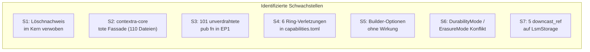
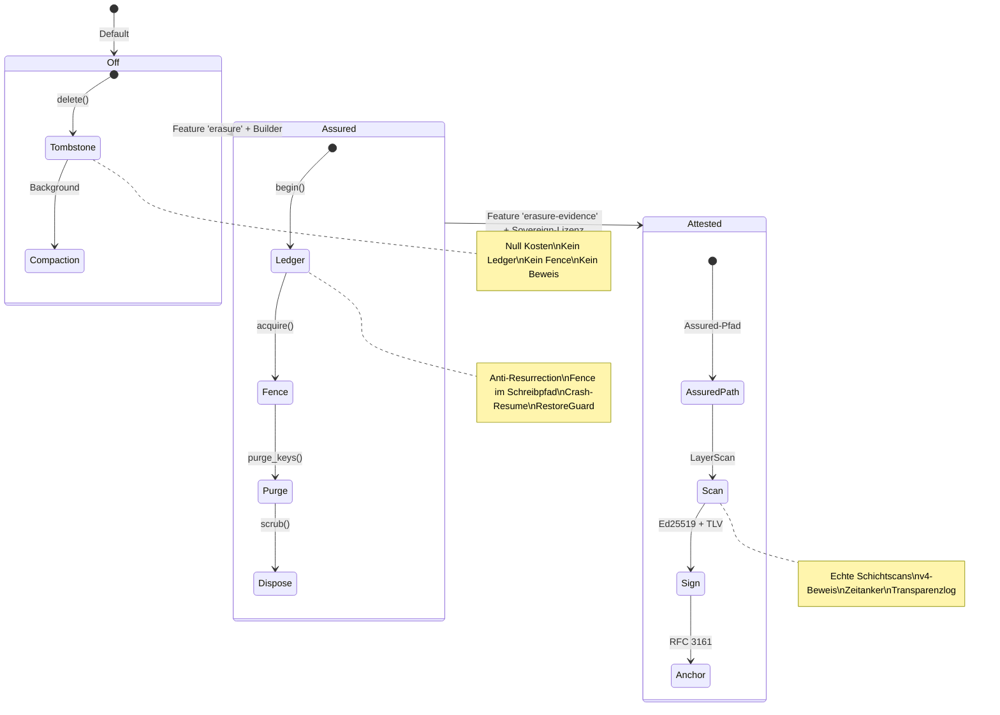
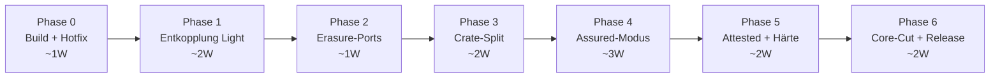

# Contextra — Architekturoptimierung und Designplan

**Version:** 1.0 · **Datum:** 14.10.2026  
**Verantwortlich:** Principal Senior Rust Architect  
**Basis:** Analyse aller Dokumente in `docs/14-10-26/`, `capabilities.toml`, Workspace-Struktur, Code-Patterns  
**Status:** Entwurf — Entscheidungsvorlage

---

## Inhaltsverzeichnis

1. [Executive Summary](#1-executive-summary)
2. [Ist-Analyse: Identifizierte Schwachstellen](#2-ist-analyse-identifizierte-schwachstellen)
3. [Widersprüche und Inkonsistenzen](#3-widersprüche-und-inkonsistenzen)
4. [Optimierte Zielarchitektur](#4-optimierte-zielarchitektur)
5. [Entkopplungsstrategie: Feature-Module](#5-entkopplungsstrategie-feature-module)
6. [Löschnachweis als Plugin-Architektur](#6-löschnachweis-als-plugin-architektur)
7. [Performance-Profile und Zero-Cost-Abstraktion](#7-performance-profile-und-zero-cost-abstraktion)
8. [Crate-Konsolidierung und Ring-Bereinigung](#8-crate-konsolidierung-und-ring-bereinigung)
9. [Migrationsplan](#9-migrationsplan)
10. [Risikobewertung](#10-risikobewertung)
11. [Entscheidungsmatrix](#11-entscheidungsmatrix)

---

## 1. Executive Summary

### 1.1 Kerndiagnose

Contextra besitzt eine ambitionierte und grundsätzlich gesunde Ring-Architektur (Ring 0–4) mit 34 Crates, strikter Zero-Panic-Politik und einer klar geschichteten Abhängigkeitsstruktur. Die Analyse von 10 Planungsdokumenten, der vollständigen Crate-Struktur und den Code-Patterns deckt jedoch **drei Kategorien systemischer Probleme** auf:

| Kategorie | Befunde | Schwere |
|---|---|---|
| **Architektur-Kopplung** | Löschnachweis ist tief in den Kern verwoben; 101 von 111 Kernfunktionen ohne Produktionsaufrufer; `contextra-core` als tote Re-Export-Fassade | 🔴 Kritisch |
| **Funktionale Defekte** | Löschpfad funktionslos (N-B); Purge trifft keine physischen Schlüssel (N-K); Crash-Resume fail-open (N-A); Engine kompiliert nicht (N-N) | 🔴 Kritisch |
| **Design-Inkonsistenzen** | 6 Ring-Verletzungen; widersprüchliche Unwrap-Baselines; Builder-Optionen als No-Ops; Feature-Flags ohne Wirkung | 🟠 Hoch |

### 1.2 Leitmotiv der Optimierung

> **Jede Fähigkeit ist ein Plugin. Was nicht aktiviert wird, existiert nicht — weder im Binary noch zur Laufzeit.**

Dieses Prinzip transformiert Contextra von einem monolithischen System mit optionalen Features zu einem **kompositionsbasierten Ökosystem**, in dem jedes Modul:
- Durch ein Cargo-Feature aktivierbar ist
- Über Ports (`contextra-ports`) kommuniziert
- Im deaktivierten Zustand exakt **null** Laufzeitkosten verursacht
- Unabhängig testbar und austauschbar ist

---

## 2. Ist-Analyse: Identifizierte Schwachstellen

### 2.1 Architektur-Schwachstellen



#### S1: Löschnachweis im Kern verwoben

**Problem:** `contextra-crypto` (Ring 0) enthält sowohl I/O-freie Krypto-Primitive als auch den vollständigen Löschnachweis-Stack (~8.200 LOC), inklusive Ed25519-Signierung, v4-TLV-Format, Audit-Ketten und Witnesses. Die Engine hängt regulär von `contextra-crypto` ab und führt Löschnachweis-Code auch dann mit, wenn er nie gebraucht wird.

**Auswirkung:**
- Binärgröße: ~14 KB zusätzlicher Code im Default-Binary
- Kompilierzeit: Ed25519 + TLV-Parser für jeden Build
- Kopplung: Engine-Änderungen erfordern Krypto-Reviews
- Testlast: Löschnachweis-Tests laufen bei jedem `cargo test`

**Ist-Zustand der Abhängigkeitskette:**
```
contextra-engine → contextra-crypto (deletion_proof/, ed25519_proof.rs, wal_crypto.rs)
                 → contextra-crypto (crypto.rs, kdf.rs) ← wird tatsächlich gebraucht
```

#### S2: `contextra-core` als tote Re-Export-Fassade

**Problem:** `contextra-core` re-exportiert nur Symbole aus `types`, `ports`, `mvcc` und `wire`. Es besitzt keine eigene Logik, wird aber von 110 Dateien und ~300 Importzeilen referenziert. Es ist als `deprecated` in [`capabilities.toml`](file:///home/freddy/Projekte/contextra/capabilities.toml) markiert (Strangler Facade), blockiert aber die Hüllenverkleinerung.

**Ist-Abhängigkeiten auf `contextra-core`:**

| Von (Kern) | Art | Betroffene Dateien |
|---|---|---|
| `contextra-simd` | regulär | ~5 |
| `contextra-store` | regulär | ~30 |
| `contextra-vector` | regulär | ~20 |
| `contextra-checkpoint` | regulär | ~5 |
| `contextra-graph` | regulär | ~15 |
| `contextra-text` | regulär | ~10 |
| `contextra` (Fassade) | regulär | ~3 |
| Weitere | regulär/optional | ~22 |

#### S3: 101 unverdrahtete öffentliche Funktionen

**Problem:** Von 111 EP1-Kernfunktionen haben nur 10 einen nachweisbaren Produktionsaufrufer (Heuristik). Die größten Blöcke liegen in:

| Crate | Unverdrahtet | Kernbereich |
|---|---|---|
| `contextra-engine` | 29 | Löschkette, Collection-Lifecycle, KV-Segmente |
| `contextra-vector` | 14 | HNSW-Operationen, Residue-Zeugen |
| `contextra-crypto` | 12 | Key-Hierarchie, Proof-V4-Typen |
| `contextra-mvcc` | 10 | SSI-Pfade, TxBuffer |
| `contextra-store` | 10 | WAL, LSM-Compaction, GC-Floor |

#### S4: 6 Ring-Verletzungen

| Von | Nach | Ring-Regel verletzt |
|---|---|---|
| `contextra-engine` (Ring 3) | `contextra-sandbox` (Ring 2) | Ring 3 → konkretes Ring-2-Crate |
| `contextra-engine` (Ring 3) | `contextra-infer-candle` (Ring 2) | Ring 3 → konkretes Ring-2-Crate |
| `contextra-cognition` (Ring 3) | `contextra-infer-candle` (Ring 2) | Ring 3 → konkretes Ring-2-Crate (dev) |
| `contextra-crypto` (Ring 0) | `contextra-durable-fs` (Ring 0) | Ring-0-Ordnung (`durable-fs` nicht gelistet) |
| `contextra-vector` (Ring 0) | `contextra-durable-fs` (Ring 0) | Ring-0-Ordnung (`durable-fs` nicht gelistet) |
| `contextra-store` (Ring 1) | `contextra-sandbox` (Ring 2) | Ring 1 → Ring 2 (dev) |

#### S5: Builder-Optionen ohne Wirkung

Folgende Builder-Methoden in [`crates/contextra/src/builder.rs`](file:///home/freddy/Projekte/contextra/crates/contextra/src/builder.rs) speichern Werte, die anschließend ignoriert werden:

| Builder-Methode | Effekt |
|---|---|
| `with_adapt(...)` | Mündet in `let _ = adapt_enabled;` (No-Op) |
| `with_privacy(...)` | Gespeichert, nie abgefragt |
| `with_kms(...)` | Gespeichert, nie abgefragt |
| `with_kv_shredding(...)` | Gespeichert, nie abgefragt |
| `with_checkpoint(...)` | Gespeichert, nie abgefragt |
| `with_avv_generator(...)` | Gespeichert, nie abgefragt |
| `with_audit_export(...)` | Gespeichert, nie abgefragt |

#### S6: `DurabilityMode` / `ErasureMode` Konflikt

**Problem:** Zwei überlappende Konzepte steuern das Löschverhalten:

1. **`DurabilityMode`** in [`crates/contextra-store/src/lsm/config.rs`](file:///home/freddy/Projekte/contextra/crates/contextra-store/src/lsm/config.rs): `Full`, `WalNoHmac`, `MemoryOnly`
2. **`ErasureMode`** (geplant): `Off`, `Assured`, `Attested`

Die Invariante `INV-DURABILITY-RING` verbietet `MemoryOnly` mit `DeletionProof` und `Sovereign`, aber die Zusammenführung beider Konzepte ist nicht spezifiziert. Es fehlt ein einheitlicher `OperatingMode`, der Durability und Erasure konsistent zusammenführt.

#### S7: 5 `downcast_ref::<LsmStorage>()` Aufrufe

Fünf Stellen in der Engine brechen die Port-Abstraktion durch direktes Downcast auf den konkreten Storage-Typ:
- `collection/mod.rs:405`
- `collection/mod.rs:528`
- `collection/mod.rs:532`
- `crud/delete.rs:79`
- `db_transaction_commit.rs:35`

---

## 3. Widersprüche und Inkonsistenzen

### 3.1 Dokumenten-Widersprüche

| # | Widerspruch | Dokument A | Dokument B | Auflösung |
|---|---|---|---|---|
| W1 | **Löschkette-Status** | Plan v6: „nicht angeschlossen" | Plan v7: `delete()` → `erase_document()` läuft | **Plan v7 ist korrekt**, aber MCP liefert `proof: null` |
| W2 | **`rank` Zuordnung** | Kernschnitt v6: EP3 (Retrieval+) | Plan v7: EP1 (Kern) | **Plan v7 übernehmen** — RRF-Fusion ist Kernfunktion |
| W3 | **Hüllengröße** | Diverse: 32 Crates | Plan v7: 26 (Default) | **Default-Features messen** (D10 bestätigen) |
| W4 | **Unwrap-Baseline** | `ratchet.toml`: 502 | `unwrap_baseline.txt`: 786 | **Eine Quelle festlegen**, Ratsche nur nach unten |
| W5 | **k-Path Status** | Briefing: „fehlt" | Inventar: 321 Zeilen fertig | **Code existiert**, hat aber keinen Aufrufer |
| W6 | **DiBud-Belegstatus** | Deep Research: Priorität 1 | Langfassung: nicht recherchiert | **Eigenableitung [E]** — nur mit synthetischem Test |
| W7 | **SSI Read-Set Wiring** | Briefing: „nicht verdrahtet" | Audit 13.10: „Commit-Pfad ruft SSI auf" | **Prüfen am Code** — wahrscheinlich nur Commit, nicht Read |
| W8 | **Ring-Gate CI-Status** | Plan v7: „6 Verletzungen" | CI: PRs gehen durch | **CI-Pflicht klären** (K0.4) |

### 3.2 Code-Inkonsistenzen

| # | Inkonsistenz | Ort | Auswirkung |
|---|---|---|---|
| C1 | `DeletionProof` im TYPE_REGISTRY als `contextra-graph` | `docs/TYPE_REGISTRY.md:106` | Verwechslung mit `CascadeTombstone` |
| C2 | v3-Proof-Erzeugung trotz ADR-13-Verbot | `crypto/deletion_proof/proof_v3.rs` | 8 `#[deprecated]`-Methoden noch aufrufbar |
| C3 | `ForgetOptions` mit `_opts` Parameter ignoriert | `engine/crud/delete.rs` | Assurance-Optionen wirkungslos |
| C4 | `KvDeleteMode::default()` = `CryptoShred` | `store/src/kv/delete_mode.rs:20` | Default erzwingt Verschlüsselung |
| C5 | `deletion_proof_active` als toter Config-Schalter | Diverse Stellen | Veraltet, aber referenziert |

---

## 4. Optimierte Zielarchitektur

### 4.1 Architektur-Leitprinzipien

| # | Prinzip | Mechanismus | Prüfung |
|---|---|---|---|
| **A1** | **Nullkosten-Deaktivierung** | `#[cfg(feature)]` + Cargo-Features | `cargo tree --no-default-features` |
| **A2** | **Port-exklusive Kommunikation** | Traits in `contextra-ports`, `dyn` im Löschpfad | `cargo xtask dependency-graph-audit` |
| **A3** | **Modulare Komposition** | Plugins als eigene Crates, Builder-Wiring | Integration-Tests pro Feature-Kombination |
| **A4** | **Kein Aufpreis im Hot Path** | 1× Atomic-Load je Batch, kein `dyn` im Schreibpfad | Criterion p50/p99 ≤ 1% Abweichung |
| **A5** | **Fail-closed Evidence** | Zeugen nur aus echten Scans, nie fabriziert | Mutationstest: No-Op-Scanner → Proof rejected |
| **A6** | **Eine Wahrheitsquelle je Konzept** | `ErasureMode` im Manifest, `capabilities.toml` für Ringe | `cargo xtask check-ring-capabilities-consistency` |
| **A7** | **Horizontale Skalierbarkeit der Features** | Neues Feature = neues Crate + Feature-Flag + Port-Trait | Gate `check-product-hull` |

### 4.2 Ziel-Crate-Architektur

```mermaid
graph TD
    subgraph "Ring 0 — Sovereign Foundation"
        types["contextra-types"]
        ports["contextra-ports<br/>(+erasure Modul)"]
        wire["contextra-wire<br/>(Unsafe Island)"]
        sys["contextra-sys<br/>(Unsafe Island)"]
        simd["contextra-simd<br/>(Unsafe Island)"]
        durable_fs["contextra-durable-fs"]
        mvcc["contextra-mvcc"]
        crypto_core["contextra-crypto-core<br/>(I/O-frei, ~5.800 LOC)"]
    end

    subgraph "Ring 0 — Algorithmen"
        vector["contextra-vector<br/>(HNSW)"]
        text["contextra-text<br/>(BM25)"]
        graph["contextra-graph<br/>(CSR, Feature)"]
        rank["contextra-rank<br/>(RRF, Kalibrator)"]
    end

    subgraph "Ring 0 — Crypto Extensions"
        crypto_kv["contextra-crypto-kv<br/>(Feature kv-encryption)"]
    end

    subgraph "Ring 1 — Persistence"
        store["contextra-store<br/>(LSM, WAL, Feature erasure)"]
        checkpoint["contextra-checkpoint"]
    end

    subgraph "Ring 2 — Execution Providers"
        infer_candle["contextra-infer-candle<br/>(Feature)"]
        infer_ollama["contextra-infer-ollama<br/>(Feature)"]
        infer_onnx["contextra-infer-onnx<br/>(Feature)"]
        sandbox["contextra-sandbox<br/>(Feature)"]
    end

    subgraph "Ring 3 — Orchestration"
        engine["contextra-engine<br/>(Feature erasure)"]
        db["contextra-db"]
        privacy["contextra-privacy<br/>(Feature)"]
    end

    subgraph "Ring 3 — Plugins (eigene Crates)"
        erasure["contextra-erasure<br/>(Plugin Assured)"]
        evidence["contextra-erasure-evidence<br/>(Plugin Attested)"]
        kvcache["contextra-kvcache<br/>(Feature)"]
        adapt["contextra-adapt<br/>(Feature)"]
        cognition["contextra-cognition<br/>(Feature)"]
        router["contextra-router<br/>(Feature)"]
        agent["contextra-agent<br/>(Feature)"]
    end

    subgraph "Ring 4 — Facades"
        facade["contextra<br/>(Composition Root)"]
        mcp["contextra-mcp<br/>(Stdio Server)"]
        license["contextra-license<br/>(Feature Gate)"]
        proof_verify["contextra-proof-verify<br/>(Standalone)"]
    end

    facade --> engine
    facade -.->|"Feature erasure"| erasure
    facade -.->|"Feature erasure-evidence"| evidence
    mcp --> facade
    erasure --> ports
    erasure --> crypto_core
    erasure --> store
    evidence --> ports
    evidence --> crypto_core
    proof_verify --> crypto_core
    engine --> ports
    engine --> store
    engine --> vector
    engine --> text
    engine -.->|"Feature graph"| graph
    engine -.->|"Feature adapt"| adapt
    db --> engine
    store --> crypto_core
    store --> durable_fs
    crypto_kv --> crypto_core
    crypto_kv --> durable_fs
```

### 4.3 Entfernung von `contextra-core`

`contextra-core` wird als Strangler-Fassade **ersatzlos entfernt**. Die Re-Exports werden durch direkte Imports ersetzt:

| Bisheriger Import | Neuer Import |
|---|---|
| `use contextra_core::DocId` | `use contextra_types::DocId` |
| `use contextra_core::TxId` | `use contextra_types::TxId` |
| `use contextra_core::ContextraError` | `use contextra_types::ContextraError` |
| `use contextra_core::TxBuffer` | `use contextra_mvcc::TxBuffer` |
| `use contextra_core::WireFormat` | `use contextra_wire::WireFormat` |

**Aufwand:** ~110 Dateien, ~300 Zeilen mechanische Änderungen, aufgeteilt in 3–4 PRs nach Crate-Gruppen.

---

## 5. Entkopplungsstrategie: Feature-Module

### 5.1 Feature-Matrix (Soll-Zustand)

Jedes Modul ist durch genau ein Cargo-Feature aktivierbar. Im deaktivierten Zustand erzeugt es **exakt null** Laufzeitkosten.

```toml
# crates/contextra/Cargo.toml (Zielzustand)
[features]
default = ["fast"]

# Tier 1: Kern-Performance (immer empfohlen)
fast = ["contextra-simd/default"]

# Tier 2: Erweiterungen (einzeln aktivierbar)
graph = ["contextra-engine/graph", "dep:contextra-graph"]
adapt = ["contextra-engine/adapt", "dep:contextra-adapt"]
kvcache = ["contextra-engine/kvcache", "dep:contextra-kvcache"]
cognition = ["dep:contextra-cognition"]
router = ["dep:contextra-router"]
agent = ["dep:contextra-agent"]

# Tier 3: Inference Backends (exklusiv oder kombinierbar)
candle = ["dep:contextra-infer-candle"]
ollama = ["dep:contextra-infer-ollama"]
onnx = ["dep:contextra-infer-onnx"]

# Tier 4: Sicherheit und Compliance
privacy = ["dep:contextra-privacy"]
sandbox = ["dep:contextra-sandbox"]
encryption-at-rest = ["contextra-store/encryption-at-rest"]

# Tier 5: Löschgarantie (Plugin-Architektur)
erasure = [
    "dep:contextra-erasure",
    "contextra-store/erasure",
    "contextra-engine/erasure",
]
erasure-evidence = [
    "erasure",
    "dep:contextra-erasure-evidence",
]

# Convenience-Bündel
sovereign = ["privacy", "erasure-evidence", "encryption-at-rest"]
compliance = ["sovereign", "audit-export", "avv-generator"]
```

### 5.2 Entkopplungsmuster

Jedes optionale Modul folgt demselben Entkopplungsmuster:

```rust
// 1. Port-Definition in contextra-ports
pub trait AdaptiveController: Send + Sync {
    fn adjust(&self, signal: &Signal) -> Adjustment;
}

// 2. Engine hält Option<Arc<dyn Port>>
pub struct EngineInner {
    // Nullkosten wenn None
    adaptive: Option<Arc<dyn AdaptiveController>>,
    // ...
}

// 3. Im Hot Path: Branch-freie Prüfung
impl EngineInner {
    fn on_query(&self, query: &Query) -> Result<Response> {
        let response = self.search(query)?;
        
        // Nur wenn aktiviert — Compiler eliminiert den Branch
        // wenn das Feature nicht kompiliert wird
        if let Some(adapt) = &self.adaptive {
            adapt.adjust(&response.signal);
        }
        
        Ok(response)
    }
}

// 4. Builder-Wiring in der Fassade
impl ContextraBuilder {
    #[cfg(feature = "adapt")]
    pub fn with_adaptive(mut self, ctrl: Arc<dyn AdaptiveController>) -> Self {
        self.adaptive = Some(ctrl);
        self
    }
}
```

### 5.3 Entkopplungs-Prioritäten

| Priorität | Modul | Aufwand | Begründung |
|---|---|---|---|
| 🔴 P0 | **Löschnachweis** (→ §6) | Hoch | Kernversprechen, aber größter Performance-Ballast |
| 🟠 P1 | **Graph** (`engine` → `graph`: 19 Dateien, 90 Zeilen) | Mittel | Größte Einzelkante zum Parkplatz |
| 🟠 P2 | **Adapt** (`engine`/`mcp` → `adapt`: 9 Dateien) | Niedrig | Reguläre Kante, einfache Port-Abstraktion |
| 🟡 P3 | **Privacy** (`mcp` → `privacy`: 3 Dateien) | Niedrig | Reguläre Kante, klar abgrenzbar |
| 🟡 P4 | **KV-Cache** (`engine` → `kvcache`: 3 Dateien) | Niedrig | Bereits hinter Feature, braucht nur Port |
| 🟡 P5 | **Cognition** (`db` → `cognition`: 1 Datei) | Minimal | Experimentell, leicht herauslösbar |
| ⬜ P6 | **Sandbox/Inference** (Ring-2-Verletzungen) | Mittel | Hinter Ports bringen, Ring-Verletzung auflösen |

---

## 6. Löschnachweis als Plugin-Architektur

### 6.1 Designziel

Der Löschnachweis ist das **zentrale Produktversprechen** von Contextra, muss aber vollständig **opt-in** sein. Ein Benutzer, der keine DSGVO-Compliance braucht, soll:

1. Kein Löschnachweis-Code im Binary haben
2. Keinen Performance-Overhead im Schreib- oder Lesepfad erleben
3. Keine Krypto-Schlüssel oder Ledger-Dateien erzeugen
4. Trotzdem jederzeit per Feature-Flag nachrüsten können

### 6.2 Drei-Stufen-Modell: Off → Assured → Attested



### 6.3 Crate-Split: `contextra-crypto` → 3 Crates

Das heutige `contextra-crypto` (~14.000 LOC) wird in drei Crates aufgespalten:

| Neues Crate | Ring | LOC | Inhalt | Abhängigkeiten |
|---|---|---|---|---|
| **`contextra-crypto-core`** | 0 | ~5.800 | KeyManager, KDF, AES-GCM-SIV, HMAC, WAL-Crypto, SecureBuf, Ed25519-Signaturprüfung | `types`, `ports` (nur Traits) |
| **`contextra-crypto-kv`** | 0 | ~3.400 | KV-Cipher, KV-Segment-Verschlüsselung, RevocationLog, KV-Shredding | `crypto-core`, `durable-fs` |
| **`contextra-erasure-evidence`** | 3 | ~8.200 | DeletionProof v4, TLV-Encoder, Policy, Witnesses, Audit-Chain, ProofBuilder | `ports`, `crypto-core`, `durable-fs` |

Dazu kommen:

| Neues Crate | Ring | LOC | Inhalt |
|---|---|---|---|
| **`contextra-erasure`** | 3 | ~2.500 | DeletionCoordinator, PurgeDriver, Ledger, RestoreGuard, Resume |
| **`contextra-proof-verify`** | 0 | ~800 | Standalone Ed25519-Verifier für Auditoren |

### 6.4 Port-Schnittstelle: `contextra-ports::erasure`

Die neue Port-Schnittstelle entkoppelt den Kern vollständig von den Löschnachweis-Plugins:

```rust
// crates/contextra-ports/src/erasure.rs

/// Persistenter Erasure-Modus. Hochwassermarke im Store-Manifest.
#[derive(Debug, Clone, Copy, PartialEq, Eq, PartialOrd, Ord, Hash)]
#[repr(u8)]
pub enum ErasureMode {
    Off = 0,      // Tombstone + Compaction (Zero-Cost)
    Assured = 1,  // Anti-Resurrection + Purge + Fence + Resume
    Attested = 2, // Assured + Signed Proof + Time Anchor
}

impl Default for ErasureMode {
    fn default() -> Self { Self::Off }
}

/// Physischer Scope — nur vom Storage-Backend erzeugbar.
/// Verhindert die Präfix-Verwechslung (N-K) strukturell.
pub struct PhysicalScope { /* ... */ }

/// Backend-Trait — ersetzt alle downcast_ref::<LsmStorage>()
pub trait ErasureBackend: Send + Sync {
    fn physical_scope(&self, scope: &LogicalScope) -> Result<PhysicalScope, ErasureError>;
    fn purge(&self, scope: &PhysicalScope, as_of_tx: TxId) -> Result<PurgeOutput, PurgeError>;
    fn acquire_fence(&self, scope: &PhysicalScope) -> Result<FenceGuard, ErasureError>;
}

/// Plugin-Hooks — Default-Implementierung ist No-Op (Off-Modus)
pub trait ErasureHooks: Send + Sync + 'static {
    fn begin(&self, ctx: &EraseCtx) -> Result<HookToken, ErasureError> { Ok(HookToken::NONE) }
    fn tombstoned(&self, token: &HookToken, tx: TxId) -> Result<(), ErasureError> { Ok(()) }
    fn purged(&self, token: &HookToken, scans: &[&dyn LayerScan]) -> Result<(), ErasureError> { Ok(()) }
    fn finish(&self, token: HookToken) -> Result<ErasureAttestation, ErasureError>;
}

/// Layer-Scanner für Evidenzkette
pub trait LayerScan: Send + Sync {
    fn layer(&self) -> LayerId;
    fn scan(&self, scope: &PhysicalScope) -> Result<LayerObservation, ScanError>;
}

/// Restore-Guard gegen Anti-Resurrection
pub trait RestoreGuard: Send + Sync {
    fn admit(&self, key: &[u8], cp_tx: TxId) -> RestoreVerdict;
}
```

### 6.5 Nullkosten-Beweis im Off-Modus

Im deaktivierten Zustand (`ErasureMode::Off`) erzeugt der Löschpfad exakt diese Kosten:

| Pfad | Kosten mit Feature `erasure` deaktiviert | Kosten mit Feature, aber Modus `Off` |
|---|---|---|
| **Schreibpfad** | 0 (kein Code kompiliert) | 1× `AtomicBool::load(Acquire)` je Batch |
| **Löschpfad** | Direkter Tombstone | Direkter Tombstone (kein Hooks-Aufruf) |
| **Lesepfad** | 0 | 0 |
| **Startup** | 0 | 0 (kein Ledger, kein Fence, keine Schlüssel) |
| **Binärgröße** | 0 (kein Code im Binary) | ~2 KB (Gate-Logik) |

```rust
// Engine-Löschpfad: Null-Overhead bei Off
impl<S: StorageEngine> Collection<S> {
    pub fn delete(&self, doc_id: &str) -> Result<DeleteOutcome, ContextraError> {
        match self.erasure_mode() {
            ErasureMode::Off => {
                // Direkter Tombstone, kein Ledger, kein Fence
                self.storage.delete(doc_id)?;
                Ok(DeleteOutcome::Logical { tx: self.current_tx() })
            }
            #[cfg(feature = "erasure")]
            ErasureMode::Assured | ErasureMode::Attested => {
                let hooks = self.erasure_hooks.as_ref()
                    .ok_or(ContextraError::ConfigurationError(
                        "erasure hooks not wired"
                    ))?;
                self.erase_document(doc_id, hooks)
            }
            #[cfg(not(feature = "erasure"))]
            _ => unreachable!("Mode > Off requires feature 'erasure'"),
        }
    }
}
```

### 6.6 Fence-Protokoll: Option B (Atomic-Load)

Der Schreibpfad wird durch die Erasure-Funktion nicht verlangsamt:

```rust
// crates/contextra-store/src/lsm/fence.rs

#[cfg(feature = "erasure")]
pub(crate) struct ErasureGate {
    /// Fast path: 1× Atomic-Load je Batch
    active: AtomicBool,
    /// Prefix table — nur gelesen wenn active=true
    fences: ArcSwap<Vec<PrefixFence>>,
}

// Im Schreibpfad (commit_internal):
// 1. Leader sammelt Followers (kein Fence-Check)
// 2. Sammelfenster (Followers reihen sich ein)
// 3. Mutex wieder erwerben
// 4. *** FENCE CHECK ***
#[cfg(feature = "erasure")]
if let Some(gate) = &self.erasure_gate {
    // EIN Atomic-Load — wenn kein Purge aktiv: fertig
    gate.check_batch(&all_keys)?;
}
// 5. prepare_batch, WAL-Append
```

**Performance-Vertrag:**

| Situation | Kosten |
|---|---|
| Feature deaktiviert | Null (Code nicht kompiliert) |
| Feature aktiv, Modus Off | `ErasureGate` ist `None`, kein Code |
| Feature aktiv, Modus Assured, kein Purge | 1× `AtomicBool::load(Acquire)` = ~1 ns |
| Feature aktiv, Purge aktiv | Atomic + Präfixabgleich nur für betroffene Batches |

---

## 7. Performance-Profile und Zero-Cost-Abstraktion

### 7.1 Betriebsmodi-Matrix

| Modus | Features | Binärgröße | Write-Overhead | Delete-Overhead |
|---|---|---|---|---|
| **Minimal** | `default = ["fast"]` | Basis | 0 | Tombstone |
| **Standard** | `default + graph + candle` | Basis + ~2 MB | 0 | Tombstone |
| **Sovereign** | `+ erasure + privacy + encryption-at-rest` | Basis + ~400 KB | 1 Atomic/Batch | Ledger + Purge |
| **Compliance** | `+ erasure-evidence + audit-export + avv` | Basis + ~600 KB | 1 Atomic/Batch | Ledger + Purge + Proof |

### 7.2 `DurabilityMode` / `ErasureMode` Vereinheitlichung

**Entscheidung:** Die beiden Konzepte bleiben getrennt, aber ihre Kompatibilität wird explizit geprüft:

```rust
// Kompatibilitätsmatrix (compile-time + runtime)
impl ErasureMode {
    pub fn validate_durability(
        &self,
        durability: DurabilityMode,
    ) -> Result<(), ConfigError> {
        match (self, durability) {
            // Off: alles erlaubt
            (ErasureMode::Off, _) => Ok(()),
            // Assured/Attested: MemoryOnly verboten
            (_, DurabilityMode::MemoryOnly) => Err(ConfigError::Incompatible {
                erasure: *self,
                durability,
                reason: "Erasure guarantees require durable storage",
            }),
            // Assured/Attested: WalNoHmac → Warnung
            (ErasureMode::Attested, DurabilityMode::WalNoHmac) => Err(ConfigError::Incompatible {
                erasure: *self,
                durability,
                reason: "Attested proofs require WAL integrity (HMAC chain)",
            }),
            _ => Ok(()),
        }
    }
}
```

### 7.3 Performance-Budgets je Feature

| Feature | Schreibpfad-Budget | Lesepfad-Budget | Startup-Budget |
|---|---|---|---|
| `graph` | 0 (nur Indexierung) | ≤ 5% p99 (Graph-Traversal) | ≤ 200 ms (Index laden) |
| `adapt` | 0 | ≤ 1% p99 (Bandit-Adjust) | ≤ 10 ms |
| `erasure` (Off) | 0 | 0 | 0 |
| `erasure` (Assured, idle) | ≤ 1% p99 | 0 | ≤ 50 ms (Ledger laden) |
| `erasure` (Assured, Purge) | ≤ 5% p99 (Fence-Reject) | 0 | — |
| `erasure-evidence` | ≤ 1% p99 | 0 | ≤ 100 ms (Key laden) |
| `encryption-at-rest` | ≤ 3% p99 (AES-GCM) | ≤ 3% p99 | ≤ 50 ms |
| `privacy` | 0 | 0 | ≤ 20 ms (DLP laden) |

---

## 8. Crate-Konsolidierung und Ring-Bereinigung

### 8.1 Ring-0-Ordnung bereinigen

`contextra-durable-fs` fehlt in der Ring-0-Ordnung. Korrektur:

```
Ring-0-Ordnung (Soll):
  types < ports < wire < sys < durable-fs < simd < mvcc < crypto-core
```

Dadurch werden die Verletzungen `crypto → durable-fs` und `vector → durable-fs` aufgelöst.

### 8.2 Ring-3 → Ring-2 Verletzungen

Die drei Ring-3-Verletzungen auf konkrete Ring-2-Crates werden durch Port-Abstraktion aufgelöst:

| Verletzung | Auflösung |
|---|---|
| `engine` → `sandbox` | Port `SandboxRunner` in `contextra-ports`, Feature `sandbox` |
| `engine` → `infer-candle` | Port `InferenceProvider` in `contextra-ports`, Feature `candle` |
| `cognition` → `infer-candle` | dev-Abhängigkeit → Feature-gated Test |

### 8.3 Hüllenverkleinerung

| Metrik | Ist (Default) | Ziel K2 | Ziel K4 |
|---|---|---|---|
| Hülle EP1 (Default) | ~26 | ≤ 18 | 18 |
| Kern → Parkplatz (regulär) | 10 | 0 | 0 |
| Ring-Verletzungen | 6 | 0 | 0 |
| Unverdrahtete `pub fn` | 101 | ≤ 20 | 0 |

### 8.4 Produkt-Manifest (Neu)

Jedes Endprodukt wird durch eine `products/<ep>.toml` beschrieben:

```toml
# products/ep1.toml
[product]
id = "EP1"
name = "Contextra Memory"
status = "release-1.0"

[crates]
allowed = [
    "contextra-types", "contextra-ports", "contextra-sys", "contextra-wire",
    "contextra-simd", "contextra-durable-fs", "contextra-crypto-core",
    "contextra-mvcc", "contextra-text", "contextra-rank", "contextra-store",
    "contextra-vector", "contextra-checkpoint", "contextra-engine",
    "contextra-db", "contextra-license", "contextra", "contextra-mcp",
]

[features]
build = ["fast"]

[gate]
command = "cargo tree -p contextra-mcp -e normal --no-default-features --features fast"
max_crates = 18
```

---

## 9. Migrationsplan

### 9.1 Phasenübersicht



### Phase 0: Build + Hotfix (~1 Woche)

| AP | Aufgabe | Akzeptanz |
|---|---|---|
| P0.1 | `PurgeBlocked::UnknownFreeSpace` Match-Arm ergänzen (N-N) | `cargo check -p contextra-engine` grün |
| P0.2 | Router-Wiring `clock`-Typ korrigieren (N-O) | `cargo check -p contextra --features router` grün |
| P0.3 | `Cargo.lock` regenerieren (N-P) | `cargo check --locked` grün |
| P0.4 | `Collection::delete()` ohne Assurance-Prüfung (N-B) | `delete()` liefert `Ok` statt `CapabilityUnsupported` |
| P0.5 | Unwrap-Baseline konsolidieren (W4) | Eine Quelle, konsistent |

### Phase 1: Entkopplung Light (~2 Wochen)

| AP | Aufgabe | Akzeptanz |
|---|---|---|
| P1.1 | `contextra-core` entfernen (S2): 3–4 mechanische PRs | `cargo check` ohne `contextra-core` |
| P1.2 | `engine` Default-Features: `graph`, `adapt`, `kvcache`, `candle` → optional | `cargo check -p contextra-engine --no-default-features` grün |
| P1.3 | `db` → `cognition`/`graph`/`adapt` hinter Features | Kein regulärer Import auf Parkplatz |
| P1.4 | `mcp` → `privacy`/`adapt` hinter Features | Kein regulärer Import auf Parkplatz |
| P1.5 | Builder-No-Ops bereinigen (S5): Methoden entfernen oder verdrahten | Kein `let _ =` für Builder-Werte |

### Phase 2: Erasure-Ports (~1 Woche)

| AP | Aufgabe | Akzeptanz |
|---|---|---|
| P2.1 | `erasure.rs` in `contextra-ports` erstellen (§6.4) | `cargo test -p contextra-ports` grün |
| P2.2 | `ErasureBackend` implementieren in `contextra-store` | Ersetzt alle 5 `downcast_ref` |
| P2.3 | `ErasureGate` (Fence Option B) implementieren | Loom-Test grün |
| P2.4 | Ring-0-Ordnung bereinigen (§8.1) | `check-ring-layering --strict` grün |

### Phase 3: Crate-Split (~2 Wochen)

| AP | Aufgabe | Akzeptanz |
|---|---|---|
| P3.1 | `contextra-crypto-core` extrahieren | `cargo tree` ohne `deletion_proof` im Core |
| P3.2 | `contextra-crypto-kv` extrahieren | Nur mit Feature `kv-encryption` |
| P3.3 | `contextra-erasure` erstellen (aus Engine) | Eigenes Crate, Plugin-Interface |
| P3.4 | `contextra-erasure-evidence` erstellen (aus Crypto) | Eigenes Crate, kein Store-Import |
| P3.5 | `contextra-proof-verify` erstellen | Standalone, nur Ed25519 + TLV |
| P3.6 | `contextra-crypto` als Shim-Fassade (Backward-Compat) | `pub use` Re-Exports |

### Phase 4: Assured-Modus (~3 Wochen)

| AP | Aufgabe | Akzeptanz |
|---|---|---|
| P4.1 | `DeletionCoordinator` mit Zustandsmaschine | Crash-Matrix grün |
| P4.2 | Hochwassermarke im Store-Manifest | Downgrade → `PolicyViolation` |
| P4.3 | Ledger vor Tombstone (L1 fix) | Crash → Ledger vorhanden |
| P4.4 | Resume nach Storage-Aufbau (N-A fix) | Crash → Resume korrekt |
| P4.5 | `RestoreGuard` streamend | Restore bringt Gelöschtes nicht zurück |
| P4.6 | Purge v2 Korrekturen (L4, L5, L6, N-K) | Rohsweep + Differenztest |

### Phase 5: Attested + Härtung (~2 Wochen)

| AP | Aufgabe | Akzeptanz |
|---|---|---|
| P5.1 | Echte Layer-Scans (N-D fix) | Keine fabrizierten Zeugen |
| P5.2 | v3-Erzeugung entfernen (N-I, C2) | Kein `DeletionProof::create(v3)` |
| P5.3 | `verify_strict` überall (E1) | Kein `verify` mehr |
| P5.4 | TLV für alle v4-Pfade (E2) | Kein `bincode` in Signaturpfaden |
| P5.5 | Tampering-Matrix | Jedes Proof-Feld mutiert → Verifier lehnt ab |
| P5.6 | Mutationstest | No-Op-Scanner → Proof rejected |

### Phase 6: Core-Cut + Release (~2 Wochen)

| AP | Aufgabe | Akzeptanz |
|---|---|---|
| P6.1 | Feature-Definitionen finalisieren (§5.1) | Alle Features dokumentiert |
| P6.2 | Builder-API: `with_erasure_mode()`, `with_erasure_hooks()` | End-to-End je Modus |
| P6.3 | Totes Feature `deletion-proof` entfernen | 0 Treffer im Repo |
| P6.4 | `deletion_proof_active` entfernen | 0 Treffer |
| P6.5 | Produkt-Manifest EP1 anlegen | Gate `check-product-hull --product EP1` grün |
| P6.6 | Hülle EP1 ≤ 18 Crates | `cargo tree` bestätigt |

---

## 10. Risikobewertung

### 10.1 Technische Risiken

| Risiko | P | A | Mitigation |
|---|---|---|---|
| Fence Option B: Leader-Eigen-Ops-Problem | M | K | Loom-Modell MUSS vor Merge grün sein |
| Crate-Split bricht externe Abhängigkeiten | N | H | `pub use`-Shims in `contextra-crypto` |
| Purge v2 zeigt neue Fehler nach Korrektur | M | H | Differenztest + Rohsweep + Crash-Matrix |
| Feature-Kombinations-Explosion | H | M | CI-Matrix: `{off, erasure, erasure-evidence}` × `{default, graph, candle}` |
| `contextra-core`-Entfernung hat Seiteneffekte | N | M | 3–4 kleine PRs, mechanisch prüfbar |
| Crypto-Erase: Schlüsselverlust = Datenverlust | N | K | Schlüssel-Backup, Wartefrist 72h |
| Hochwassermarke verhindert Tests | N | N | Test-Helper `force_downgrade()` unter `cfg(test)` |

### 10.2 Prozess-Risiken

| Risiko | Mitigation |
|---|---|
| Zu viele offene PRs gleichzeitig | Max 3 PRs, 1 Crate je PR |
| Gate-Abschwächung unter Zeitdruck | `governance/gates.toml` als Veto |
| Merge-Konflikte bei Crate-Split | Phase 3 als dedizierter Sprint, keine parallelen Änderungen |
| CI-Laufzeit durch Feature-Matrix | Inkrementeller Build-Cache, Tier-basierte CI |

---

## 11. Entscheidungsmatrix

| # | Frage | Empfehlung | Status |
|---|---|---|---|
| **D1** | `contextra-core` entfernen? | **Ja**, ersatzlos. Mechanische Migration. | ✅ Entschieden |
| **D2** | `contextra-crypto` aufsplitten? | **Ja**, in `crypto-core` + `crypto-kv` + `erasure-evidence` | ✅ Entschieden |
| **D3** | `rank` im Kern (EP1)? | **Ja**, nur Fusion + Kalibrator | ✅ Entschieden |
| **D4** | Erasure als Plugin-Crate? | **Ja**, `contextra-erasure` + `contextra-erasure-evidence` | ✅ Entschieden |
| **D5** | Fence-Protokoll? | **Option B** (Atomic-Load + Leader-Check), Vorbehalt Loom | ✅ Entschieden |
| **D6** | Default-Features für `engine`? | `default = []` — alle Module opt-in | ✅ Entschieden |
| **D7** | `graph` für Hybridsuche nötig? | **Nein** — hinter Feature, Engine besteht Tests ohne | ✅ Entschieden |
| **D8** | EP2 als eigenes Repository? | **Ja**, nach K4. Erzeuger ≠ Prüfer | 🟡 Zu bestätigen |
| **D9** | Hüllenmessung mit welchen Features? | **Default-Features** als Gate, alle als Bericht | 🟡 Zu bestätigen |
| **D10** | `DurabilityMode` + `ErasureMode` zusammenlegen? | **Nein**, getrennt halten, Kompatibilitäts-Validierung | ✅ Entschieden |
| **D11** | Legacy-WAL-Code entfernen? | **Ja**, Formatstabilität gilt ab 1.0 | ✅ Entschieden |
| **D12** | `remember`/`recall` vs. MCP? | **Ein Weg**: MCP ruft Fassade | ✅ Entschieden |
| **D13** | Algorithmen-Rollout (ACI, SSN)? | **Nach K4** — nicht im Stabilisierungspfad | ✅ Entschieden |
| **D14** | Ring-Gate verpflichtend in CI? | **Ja**, nach K0.4 Klärung | 🟡 CI prüfen |
| **D15** | `KvDeleteMode::default()` = `CryptoShred`? | **Ändern zu `TombstoneOnly`** — CryptoShred nur mit Feature | 🟡 Zu bestätigen |

---

## Anhang A: Befundregister (Vollständig)

| ID | Severity | Phase | Beschreibung |
|---|---|---|---|
| **N-N** | 🔴 | 0 | Engine kompiliert nicht (Match-Arm fehlt) |
| **N-O** | 🔴 | 0 | Fassade kompiliert nicht (Router-Wiring) |
| **N-P** | 🟠 | 0 | Lockfile veraltet |
| **N-B** | 🔴 | 0 | Standard-Delete funktionslos |
| **N-A** | 🔴 | 4 | Crash-Resume fail-open |
| **N-K** | 🟠 | 4 | Drop-Purge trifft keine physischen Schlüssel |
| **N-E** | 🟠 | 4 | Eine Intent-Datei je Store (Kollision) |
| **N-F** | 🟡 | 4 | Vec + doppeltes Lesen im Purge |
| **N-G** | 🟡 | 4 | Orphan-GC ohne Scrub |
| **N-H** | 🟠 | 2 | Fehlende Fence im Schreibpfad |
| **N-I** | 🟡 | 5 | v3-Erzeugung trotz Verbot |
| **N-J** | 🟡 | 4 | Failpoints per Umgebungsvariable |
| **N-L** | 🟠 | 4 | Restore ohne modusabhängige Barriere |
| **N-M** | 🟡 | 5 | `purge_tenant` physisch wirkungslos |
| **N-C** | 🟡 | 5 | `forget_document` fabriziert Zeugen |
| **N-D** | 🟠 | 5 | Text/Relations-Zeugen nie ausgestellt |
| **L1** | 🔴 | 4 | Ledger-Eintrag nicht vor Tombstone |
| **L4** | 🔴 | 4 | Obsolete SSTables bleiben auf Platte |
| **L5** | 🟠 | 4 | Lesefehler verschluckt |
| **L6** | 🔴 | 4 | Umgeschriebener Reader an falscher Position |
| **L8** | 🔴 | 4 | `None`-Probe = 0 Byte frei |
| **E1** | 🟡 | 5 | `verify` statt `verify_strict` |
| **E2** | 🟡 | 5 | `bincode` im Signaturpfad |
| **E6** | 🟠 | 5 | `LayerWitness::issue` ist `pub` |
| **S1** | 🔴 | 3 | Löschnachweis im Kern verwoben |
| **S2** | 🟠 | 1 | `contextra-core` tote Fassade |
| **S5** | 🟡 | 1 | Builder-Optionen ohne Wirkung |
| **C2** | 🟡 | 5 | v3-Methoden noch aufrufbar |
| **C4** | 🟡 | 1 | `KvDeleteMode::default()` = `CryptoShred` |

## Anhang B: Quellendokumente

| Datei | Inhalt | Relevanz |
|---|---|---|
| [`Contextra_Endprodukt_Plan_v7.md`](file:///home/freddy/Projekte/contextra/docs/14-10-26/Contextra_Endprodukt_Plan_v7.md) | Endprodukt-Zerlegung, Meilensteine K0–K5 | Primär |
| [`Contextra – Gesamtanalyse...`](file:///home/freddy/Projekte/contextra/docs/14-10-26/Contextra%20%E2%80%93%20Gesamtanalyse%20Architektur%20und%20L%C3%B6schnachweis%20%28HEAD%2016764583%29.md) | Implementierungsspezifikation für Löscharchitektur | Primär |
| [`Contextra_Algorithmen_Spezifikation.md`](file:///home/freddy/Projekte/contextra/docs/14-10-26/Contextra_Algorithmen_Spezifikation.md) | Algorithmen-Validierung (ACI, SSN, DiBud) | Sekundär |
| [`Deep_Research_Bericht_v2_ueberarbeitet.md`](file:///home/freddy/Projekte/contextra/docs/14-10-26/Deep_Research_Bericht_v2_ueberarbeitet.md) | Bereinigte Forschungsergebnisse | Sekundär |
| [`Ist-Stand_Briefing_intern.md`](file:///home/freddy/Projekte/contextra/docs/14-10-26/Ist-Stand_Briefing_intern.md) | Widersprüche zwischen Berichten | Kontext |
| [`Contextra_Funktions_Inventar.md`](file:///home/freddy/Projekte/contextra/docs/14-10-26/Contextra_Funktions_Inventar.md) | Undokumentierte Funktionen | Kontext |
| [`retrieval_mechanismen_v2_langfassung.md`](file:///home/freddy/Projekte/contextra/docs/14-10-26/retrieval_mechanismen_v2_langfassung.md) | Volltext-geprüfte Retrieval-Mechanismen | Sekundär |
| [`contextra_funktionszuordnung_v7.csv`](file:///home/freddy/Projekte/contextra/docs/14-10-26/contextra_funktionszuordnung_v7.csv) | 333 Funktionen mit EP-Zuordnung | Referenz |
| [`ring_gate_emulation_v7.csv`](file:///home/freddy/Projekte/contextra/docs/14-10-26/ring_gate_emulation_v7.csv) | Ring-Gate-Emulationsergebnis | Referenz |
| [`capabilities.toml`](file:///home/freddy/Projekte/contextra/capabilities.toml) | Ring- und Crate-Verzeichnis (SSoT) | Primär |
