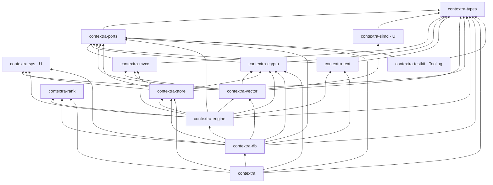

# Contextra – Architekturübersicht

<!-- doc-stamp: 2026-10-30 | Nicht normativ. Normativ: docs/SPEC.md Fassung 4.0 -->

Dieses Dokument beschreibt den **Ist-Zustand nach der Reduktion vom 30.10.2026**. Es erklärt, wie die verbleibenden Crates zusammenhängen. Verbindlich sind die Regeln in `docs/SPEC.md` (§4 Ringmodell, §3 Regeln). Bei Abweichungen gilt die SPEC.

---

## 1. Überblick

Contextra ist eine eingebettete Rust-Bibliothek für lokale Such- und Speicheraufgaben. Sie kombiniert:

- einen **LSM-Speicher** mit Write-Ahead-Log, MemTable, SSTables und Kompaktion,
- **MVCC-Transaktionen** mit Serializable-Snapshot-Isolation,
- einen **HNSW-Vektorindex** mit SIMD-Distanzen,
- einen **BM25-Textindex** mit deutscher Morphologie,
- eine **Fusion** der Ranglisten mit Kalibrierung,
- **Mandantentrennung** und **Verschlüsselung at rest**.

Alles läuft in einem Prozess auf einem Rechner. Es gibt keinen Netzwerkdienst.

---

## 2. Ringe und Abhängigkeiten



(U) = Unsafe-Insel. Der Graph stammt aus den `[dependencies]` der Manifeste (Stand 30.10.2026).

| Ring | Crates | Regel |
|---|---|---|
| 0 | `types`, `ports`, `sys`, `simd`, `mvcc`, `crypto`, `vector`, `text`, `rank` | Keine Abhängigkeit auf Ring 1 oder höher |
| 1 | `store` | Nur Ring 0 |
| 2 | `engine` | Ring 0 und 1 |
| 3 | `db` | Ring 0 bis 2 |
| 4 | `contextra` | Alle, aber nur Fassaden-Typen durchreichen |
| Tooling | `testkit`, `bench` | Darf alles, wird nur als Dev-Abhängigkeit eingebunden |

---

## 3. Die Schichten im Einzelnen

### 3.1 Fundament (Ring 0)

- **`contextra-types`**: Kanonische Typen: `DocId`, `TenantId`, `TxId`, `RequestContext`, `DistanceMetric`, Budgets, Filter, Fehlertyp `ContextraError`.
- **`contextra-ports`**: Trait-Verträge. Zeit (`Clock`), Zufall (`Rng`), IDs (`IdGen`), Dateisystem (`Vfs`), Speicher (`StorageEngine`-Ports), Indizes (`VectorIndex`, `TextIndex`).
- **`contextra-sys`** (Unsafe-Insel): `mmap`, `mlock`, POSIX-Aufrufe, Dauerhaftigkeits-Primitive (`fsync`-Varianten), Vault, Windows-ACL.
- **`contextra-simd`** (Unsafe-Insel): Distanzkerne mit Laufzeit-Dispatch auf die verfügbare CPU-Erweiterung.
- **`contextra-mvcc`**: Sequenzlog, Snapshot-Registry mit RAII-Lease, Transaktionspuffer, SSI-Validierung.
- **`contextra-crypto`**: AEAD-Blockverschlüsselung, HKDF, WAL-Verschlüsselung, Audit-Kette, Anti-Tamper. Schlüsselmaterial wird beim Verwerfen gelöscht.
- **`contextra-vector`**: HNSW, SQ8-Quantisierung, partieller Rebuild, gefilterte Suche.
- **`contextra-text`**: BM25, invertierter Index, WAND-Top-K, Tokenizer, Stoppwörter, Komposita-Zerlegung, Domänenwörterbücher (Recht, Medizin).
- **`contextra-rank`**: Fusion, isotone und Platt-Kalibrierung, Drift-Erkennung, Erklärbarkeit.

### 3.2 Persistenz (Ring 1)

**`contextra-store`** ist ein LSM-Baum.

- **WAL**: Anfügen, HMAC-Verkettung, CRC32, Replay. Jeder Commit ist durch einen Flush gesichert.
- **MemTable**: Skip-Liste mit Sequenznummern. Tombstones für Löschungen.
- **SSTable**: Blöcke mit Bloom-Filter, Index, CRC32 und Kompression. Block-Cache.
- **Manifest**: Transaktionale Liste der SSTable-Generationen.
- **Kompaktion**: Hintergrundprozess, der SSTables zusammenführt und Tombstones physisch entfernt.
- **`tenant_codec`**: Schlüssel-Präfixe pro Mandant.

### 3.3 Orchestrierung (Ring 2)

**`contextra-engine`** verbindet Speicher, Indizes und Transaktionen zu Collections.

- **Collections**: Dokumente mit Mandant, Metadaten und Indexeinträgen.
- **Query-Builder**: Baut eine hybride Suchanfrage aus Vektor- und Textteil, Filtern und Gewichten.
- **Chunker**: Zerlegt Text in Abschnitte, Fenster oder Blöcke.
- **Hintergrundarbeiter**: Kompaktion, Wartung (Feature `background-maintenance`).
- **Öffnen**: `repair_on_open` prüft und repariert den Zustand, bevor Anfragen angenommen werden.

### 3.4 Fassade (Ring 3 und 4)

- **`contextra-db`** (Ring 3): Prelude mit der stabilen Kern-API (`Contextra`, `Collection`, `SearchResult`, `EmbeddingBackend`). Modul `advanced` für erweiterte Schnittstellen.
- **`contextra`** (Ring 4): Composition Root mit `builder`, `open` und `open_with_config`. Verdrahtet die Ports mit den konkreten Implementierungen.

---

## 4. Datenpfade

### 4.1 Schreiben

```
Client → Collection (engine) → TxBuffer (mvcc)
       → WAL (store)         → MemTable (store)
       → Index-Update        (vector: HNSW · text: BM25)
       → Commit (SSI-Prüfung in mvcc)
       → später: SSTable (store) → Kompaktion (store)
```

Die Reihenfolge ist fest: Was persistent werden soll, geht zuerst über das WAL (Regel 4). Ein Commit gilt erst nach erfolgreichem Flush. Fehler beim Flush werden propagiert, nie verschluckt (Regel 5).

### 4.2 Hybride Suche

```
Anfrage (engine, Query-Builder)
  ├─ Vektorsuche   (vector: HNSW, SIMD-Distanz, Filter)
  ├─ Textsuche     (text: BM25, WAND)
  └─ Fusion        (rank: RRF, Kalibrierung)
→ Ergebnisliste mit Erklärung (rank::explain)
```

Mandantenfilter greifen vor der Indexabfrage, nicht danach (VETO-F10).

### 4.3 Löschen

Löschen setzt einen Tombstone im Speicher. Der Index markiert den Eintrag. Physisch entfernt wird er bei der Kompaktion (Speicher) bzw. beim Rebuild (HNSW, VETO-F02). Die Zusicherungen dazu stehen in `docs/SPEC.md` §9.

---

## 5. Querschnittsthemen

- **Mandanten**: Der Mandant kommt aus dem `RequestContext` und wird in jeder Schicht als Schlüsselpräfix oder Filter geführt.
- **Fehler**: Ein gemeinsamer Fehlertyp (`ContextraError`, definiert in `contextra-types`). Keine `unwrap`-Abkürzungen (Clippy-Lint in Workspace, Regel 2).
- **Zeit und Zufall**: Nur über `Clock`, `Rng`, `IdGen`. Tests verwenden `ManualClock` aus `contextra-testkit`.
- **Unsafe**: Ausschließlich in `contextra-sys` und `contextra-simd`. Jeder Block trägt `// SAFETY:`.
- **Telemetrie**: Über die Ports `metrics` und `observability`. Keine eigene Ausgabeschicht.

---

## 6. Tests und Benchmarks

- Unit- und Integrationstests je Crate unter `crates/<name>/tests/`.
- Workspace-Tests unter `tests/`: Ringregeln (`layering.rs`), Unsafe-Inseln (`unsafe_islands.rs`).
- Testwerkzeuge in `contextra-testkit`: deterministische Uhr, In-Memory-Speicher, fehlerinjizierendes Dateisystem (`FaultVfs`), Referenzmodell, Konformitätssuiten.
- Benchmarks in `benchmarks/contextra-bench`: ANN-Benchmarks, BEIR, Pfad-RAG, Regressions-Gate.

---

## 7. Was in dieser Architektur fehlt

Die Reduktion hat folgende Bereiche aus dem Vorzustand entfernt: Inferenz-Backends, Agenten-Laufzeit, Router, Graph-Index und Konsolidierung, MCP- und Python-Schnittstellen, Dokumenten-Ingestion, PII-Filter, KV-Cache, DiskANN und die Löschkette. Details und Wiederherstellungspunkt stehen in `docs/SPEC.md` §5.2.

Wenn Teile davon zurückkehren sollen, geschieht das über einen eigenen Plan (`docs/PLAN.md` Phase R6), nicht durch Wiederherstellen einzelner Dateien.
