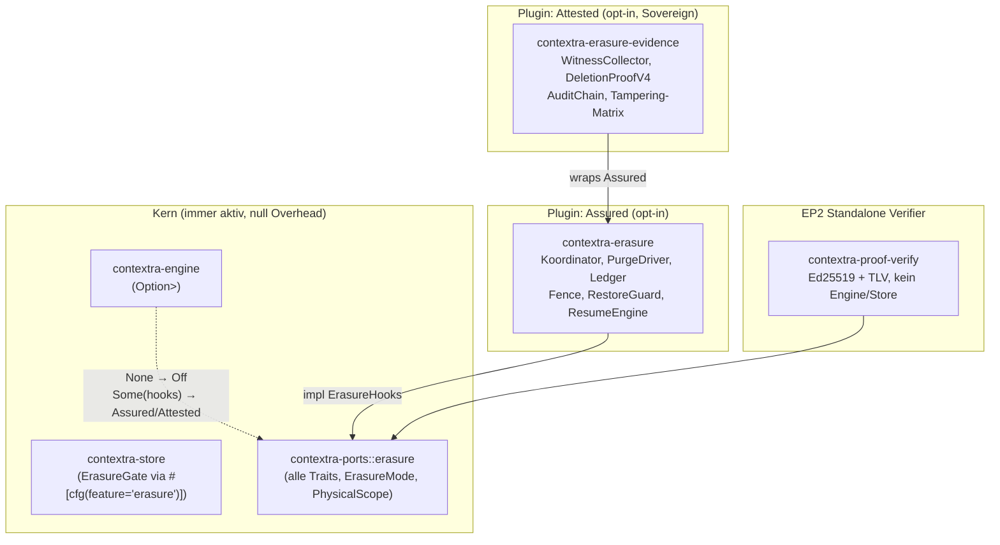
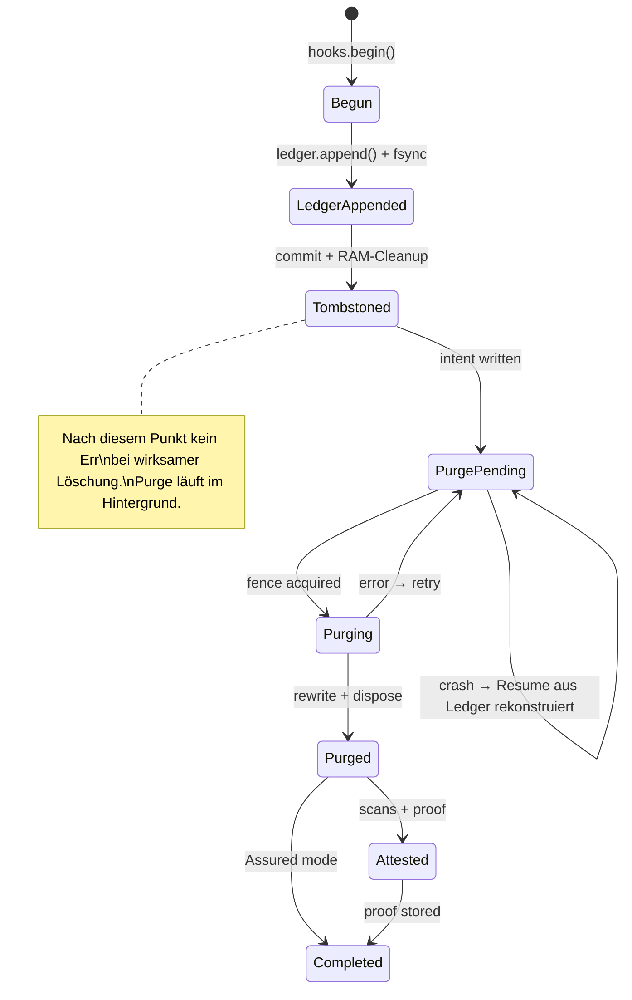
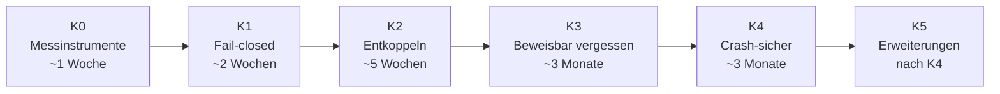

# Contextra — Architektur- und Designplan v1

**Datum:** 2026-10-14 · **Stand:** HEAD nach PR #4785 (`500e9246`) · **Verfasst von:** Principal Senior Rust Architect  
**Basis:** `docs/14-10-26/`, alle AUDIT_*_DEEP-Berichte, `capabilities.toml`, `WORKING_STATE.md`, Quelltext-Inspektion  
**Status:** Verbindliche Architekturgrundlage. Ergänzt die Produktspezifikation.

> [!IMPORTANT]
> Dieser Plan ist die Architektur-Wahrheitsquelle für alle laufenden und zukünftigen Implementierungs-Sessions. Jede Abweichung erfordert ein ADR. Alle genannten Schwachstellen sind nach Priorität geordnet und mit konkreten Maßnahmen versehen.

---

## Inhaltsverzeichnis

1. [Systemzweck und Produktversprechen](#1-systemzweck-und-produktversprechen)
2. [Ist-Zustand: Kritische Befunde](#2-ist-zustand-kritische-befunde)
3. [Architekturprinzipien (verbindlich)](#3-architekturprinzipien-verbindlich)
4. [Ring-Modell: Ist vs. Soll](#4-ring-modell-ist-vs-soll)
5. [Schwachstellen und Inkonsistenzen](#5-schwachstellen-und-inkonsistenzen)
6. [Zielarchitektur: Plugin-basierter Löschnachweis](#6-zielarchitektur-plugin-basierter-löschnachweis)
7. [Feature-Entkopplung: Aktivier-/Deaktivierungsmatrix](#7-feature-entkopplung-aktivier-deaktivierungsmatrix)
8. [Crate-Schnitt: Kern vs. Parkplatz vs. Plugins](#8-crate-schnitt-kern-vs-parkplatz-vs-plugins)
9. [Geschäftslogik-Korrekturen](#9-geschäftslogik-korrekturen)
10. [Migrations- und Phasenplan](#10-migrations--und-phasenplan)
11. [Qualitätsgates und Invarianten](#11-qualitätsgates-und-invarianten)
12. [Algorithmen-Auswahl und -Empfehlungen](#12-algorithmen-auswahl-und--empfehlungen)
13. [Risiken und offene Entscheidungen](#13-risiken-und-offene-entscheidungen)
14. [ADR-Register](#14-adr-register)

---

## 1. Systemzweck und Produktversprechen

Contextra ist eine **einbettbare, Single-Node-Speicher-Engine** für autonome Agenten in Rust. Das zentrale Versprechen:

> Lokaler, persistenter Speicher für KI-Agenten mit verifizierbarer Löschung, Hybridsuche (Vektor + BM25 + Graph) und DSGVO-konformem Datenaustritt.

### 1.1 Endprodukt-Hierarchie (verbindlich)

| ID | Produkt | Kernversprechen | Status |
|---|---|---|---|
| **EP1** | Contextra Memory | Dokumente, Hybridsuche, Mandanten, Löschung mit Nachweis | **Einziges Ziel bis Release 1.0** |
| **EP2** | Contextra Proof | Unabhängige Nachweis-Verifikation, Audit-Export | Nach K4, eigenes Repository |
| **EP3** | Contextra Retrieval+ | Graph-Beziehungen, Domänenvokabulare | Jahr 2 |
| **EP4** | Contextra Inference | Lokale Embedder, Reranker, KV-Cache | Jahr 3 |
| **EP5** | Contextra Cognition | Konsolidierung, Vergessen, Routing | Experimentell |
| **EP6** | Contextra Guard | Kontrollierter Cloud-Datenaustritt | Jahr 3 oder nach Bedarf |

> [!CAUTION]
> EP2–EP6 sind **eingefroren** bis EP1/K4 abgeschlossen ist. Kein neuer Code für Parkplatz-Crates.

---

## 2. Ist-Zustand: Kritische Befunde

### 2.1 Blocker (Build und Korrektheit) — Priorität 1

| ID | Severity | Befund | Datei | Phase |
|---|---|---|---|---|
| **N-N** | 🔴 | Match-Arm `PurgeBlocked::UnknownFreeSpace` fehlt → Engine kompiliert nicht | `engine/src/deletion/purge_driver.rs:172` | 0a |
| **N-O** | 🔴 | Fassade kompiliert nicht unter Feature `router` (clock-Typ, `RouterWiringDeps: Default` fehlt) | `contextra/src/builder.rs:675-676` | 0a |
| **N-P** | 🟠 | Lockfile veraltet, `--locked`-Builds blockiert | `Cargo.lock` | 0a |
| **N-B** | 🔴 | `Collection::delete()` gibt immer `CapabilityUnsupported` zurück | `engine/src/crud/delete.rs` | 0b |
| **N-A** | 🔴 | Crash-Resume fail-open: `OrxHooks::default()` → kein Scope → Intent gelöscht ohne Wirkung | `store/src/lsm/purge/resume.rs` (recovery.rs:525) | 0d |
| **N-K** | 🟠 | Drop-Purge trifft keine physischen Schlüssel (logische ≠ physische Präfixe, Mandantenkodierung fehlt) | `ops/purge.rs` | 0d |

### 2.2 Löschnachweis-Defekte (Sicherheits-kritisch) — Priorität 1

| ID | Befund | Auswirkung |
|---|---|---|
| **L1** | `ErasureLedger::append` NICHT vor Tombstone-Commit → fabrizierter `[0u8;32]`-Eintrag | Nachweis nicht belastbar |
| **L4** | `dispose()` liefert `Vec::new()` statt `obsolete_files` → physische Entfernung entfällt | Daten physisch erhalten |
| **L6** | Reader verliert nach SST-Rewrite Position → Schlüsselreihenfolge kaputt | Datenkonsistenz verletzt |
| **L8** | `None`-Probe = `Some(0)` Byte → Purge verhindert bei unbekanntem Platz | Semantik-Fehler |
| **E1** | `verify` statt `verify_strict` | Schwächere Validierung |
| **E2** | `bincode` im Signaturpfad für v4 (statt TLV) | Nicht format-stabil |
| **E6** | `LayerWitness::issue` ist `pub` statt `pub(crate)` | Externe Fabrikation möglich |
| **N-C** | `forget_document` erzeugt Zeuge mit Konstanten statt echtem Scan | Fabrizierte Evidenz |
| **N-D** | Text-Index- und Relationen-Zeugen (Layer 20, 21) werden nie ausgestellt | Unvollständige Evidenzkette |
| **N-I** | v3-Löschnachweis wird noch erzeugt, obwohl verboten | Veraltetes Format aktiv |

**Zeugen-Ist-Zustand (4 von 6 Layer defekt):**

| Layer | ID | Ist-Zustand | Soll-Zustand |
|---|---|---|---|
| LSM-Manifest | 1 | ✅ Echt (A05) | Beibehalten |
| LSM-SSTable-All | 3 | ❌ `\|\| Ok(true)` ohne Scan | Rohsweep nach Marker-Bytes |
| Ledger | 30 | ❌ `[0u8;32]`, `entry_confirmed: true` | Aus echtem `ErasureLedger::append` |
| Text-Index | 20 | ❌ `None` → nie ausgestellt | Echter Scan via `TextIndexScan` |
| Relations-Graph | 21 | ❌ nie ausgestellt | Echter Scan via `GraphRelationsScan` |
| HNSW-Vektor | 26 | ❌ `forget_document` mit Konstanten | Echter Scan oder entfernen |

### 2.3 Purge-Defekte (Datenkorrektheit) — Priorität 2

| ID | Befund | Auswirkung |
|---|---|---|
| **L2** | `if let Ok` verschluckt Fehler still | Unentdeckte Fehler |
| **L3** | `ConcurrentModification`-Err nach wirksamer Löschung | API-Kontrakt verletzt |
| **L5** | `while let Ok(Some(..))` verschluckt Lesefehler | Unentdeckte Korruption |
| **N-E** | Eine Intent-Datei je Store → parallele Purges unmöglich | Funktionslücke |
| **N-F** | `Vec` + doppeltes Lesen → O(SST) Speicher im Purge | Speicher-Problem |
| **N-G** | Orphan-GC ohne Scrub → Marker bleiben | Physische Datenlücke |
| **N-J** | Failpoints lesen `std::env::var` im Produktionspfad | Sicherheitslücke |

### 2.4 Architektur-Inkonsistenzen — Priorität 2

| ID | Befund | Auswirkung |
|---|---|---|
| **K1** | `contextra-core` re-exportiert nur (123 LOC), 110 Dateien importieren sie | Falsche Abhängigkeit |
| **K4** | 5× `downcast_ref::<LsmStorage>()` in Engine, DB, Collection | Ring-Verletzung, Typ-Kupplung |
| **B1** | Cloud-Egress ohne Guard aktiv (kein `with_egress_guard` im Produktionspfad) | Sicherheitslücke |
| **B2** | `verify_wiring()` nie im Startpfad aufgerufen | Wiring-Fehler unentdeckt |
| **B6** | MCP registriert Werkzeuge aus Parkplatz-Crates ohne Feature-Gate | Scope-Verletzung |
| **B9** | Zwei parallele Pfade für `remember`/`recall` | Inkonsistente Daten |
| **W-adapt** | `with_adapt(...)` wird ignoriert (`let _ = adapt_enabled`) | Schalter ohne Wirkung |
| **W-builder** | Builder-Felder werden nach Speicherung nie gelesen | Konfiguration ohne Effekt |

### 2.5 Was funktioniert (Audit-Ergebnisse)

- **`contextra-store`** (Ring 1): PASS — alle Tests grün. Leserreihenfolge, Snapshot-Retention, Tombstone-Semantik, atomare Manifest-Änderungen, WAL-HMAC korrekt.
- **`contextra-vector`** (Ring 0): PASS — 0 kritische Befunde. Recall@10 ≥ 0.97, VETO-F02/F10 eingehalten, 64-Byte SIMD-Alignment korrekt.
- **`contextra-mvcc`** (Ring 0): PASS mit MVCC-S02/S03 behoben. SSI über `SequenceLogSsiValidator` aktiv, fail-closed.
- **Unsafe-Inseln** (`simd`, `sys`, `wire`): PASS — 100% SAFETY-Abdeckung, SIMD-Parität < 2.38×10⁻⁷.
- **Ed25519-Signatur** mit CSPRNG-Schlüssel, v4-TLV-Format mit Domain-Tag, Ring-Architektur und DAG-Invariante grundsätzlich intakt.

---

## 3. Architekturprinzipien (verbindlich)

### 3.1 Kern-Prinzipien

| # | Prinzip | Gate |
|---|---|---|
| **P1** | **Zero-Panic in Produktion.** Kein `unwrap`, `expect`, `panic!` außerhalb von `#[cfg(test)]` | `cargo xtask doctrine-scan` |
| **P2** | **Ring-DAG-Integrität.** Kanten nur abwärts oder gleicher Ring (explizite Ausnahmen im ADR) | `cargo xtask check-ring-layering-full` |
| **P3** | **Determinismus via Ports.** `Clock`, `Rng`, `IdGenerator` aus `contextra-ports`, nie direkt | `cargo xtask determinism-check` |
| **P4** | **Unsafe nur in deklarierten Inseln.** Drei Inseln: `contextra-simd`, `contextra-sys`, `contextra-wire` | `cargo xtask check-unsafe-islands` |
| **P5** | **Keine Single-Node-Verletzung.** Kein Multi-Node, kein Sharding, kein P2P-Sync | Code-Review |
| **P6** | **Feature-Kosten opt-in.** Kein Feature ohne Aktivierung: null Laufzeit- und Binary-Kosten | `cargo tree --no-default-features` |

### 3.2 Löschnachweis-Prinzipien (verbindlich, nicht abschwächbar)

| # | Prinzip | Gate |
|---|---|---|
| **P-E1** | **Kosten sind opt-in.** Kein Erasure-Code ohne Feature `erasure` im Binary | `cargo tree -e normal --no-default-features` |
| **P-E2** | **Kern-Crates sprechen nur via `contextra-ports`.** Kein `use contextra_crypto::*` in Store, Engine, Vector | `cargo xtask dependency-graph-audit` |
| **P-E3** | **Kein Aufpreis im Normalbetrieb.** Schreibpfad: höchstens 1× `AtomicBool::load` je Batch | Criterion p50/p99 ≤ 1% |
| **P-E4** | **Fail-closed, keine fabrizierte Evidenz.** Zeugen nur aus echten Scans. Fehler = sichtbarer Fehler | Mutationstest: Scanner=No-op → Beweis abgelehnt |
| **P-E5** | **Eine Wahrheitsquelle für ErasureMode:** Manifest als Hochwassermarke | `open(mode < high_water_mark)` → `PolicyViolation` |
| **P-E6** | **Gemergt ≠ wirksam.** Jedes Symbol braucht Produktionsaufrufer + E2E-Test über Fassade | `cargo xtask deletion-guarantee-gate` |
| **P-E7** | **Jeder Löschtest über `LsmStorage` UND `TenantScopedStorage<LsmStorage>`** | Tenant-Matrix in Tests |

---

## 4. Ring-Modell: Ist vs. Soll

### 4.1 Ring-Verstöße (aktuell, mit Behebungsphase)

| ID | Von | Nach | Art | Phase |
|---|---|---|---|---|
| V1 | `contextra-engine` | `contextra-sandbox` | normal, optional | K2a |
| V2 | `contextra-engine` | `contextra-infer-candle` | normal, optional | K2a |
| V3 | `contextra-cognition` | `contextra-infer-candle` | dev | K2a |
| V4 | `contextra-crypto` | `contextra-durable-fs` | normal (Ring-0-Ordnung) | K2a (nach Crypto-Split) |
| V5 | `contextra-vector` | `contextra-durable-fs` | normal (Ring-0-Ordnung) | K2a (nach Crypto-Split) |
| V6 | `contextra-store` | `contextra-sandbox` | dev | K2a |
| V7 | `contextra-license` | Ring-Inkonsistenz: Ring 4 in capabilities, aber semantisch fehlplatziert | — | K0 |
| V8 | `contextra-graph` | Ring 0, aber Graph-Orchestrierung | semantisch falsch | K2 |
| V9 | `contextra-adapt` | Ring 0, aber EP5-Parkplatz | falsche Zuordnung | K2 |

### 4.2 Soll-Architektur (Crate-Topologie)

```mermaid
graph TD
    subgraph "Ring 0 — Foundation"
        types["contextra-types"]
        ports["contextra-ports\n(+erasure Modul)"]
        wire["contextra-wire (unsafe island)"]
        sys["contextra-sys (unsafe island)"]
        simd["contextra-simd (unsafe island)"]
        durable_fs["contextra-durable-fs"]
        mvcc["contextra-mvcc"]
        text["contextra-text"]
        rank["contextra-rank"]
        crypto_core["contextra-crypto-core\n(I/O-frei, ~5.800 LOC)"]
        crypto_kv["contextra-crypto-kv\n(Feature kv-encryption)"]
        verify["contextra-proof-verify\n(EP2 Standalone)"]
    end

    subgraph "Ring 1 — Persistence"
        store["contextra-store\n(Feature erasure)"]
        checkpoint["contextra-checkpoint"]
        kvcache["contextra-kvcache"]
    end

    subgraph "Ring 2 — External Adapters"
        candle["contextra-infer-candle"]
        ollama["contextra-infer-ollama"]
        onnx["contextra-infer-onnx"]
        sandbox["contextra-sandbox"]
    end

    subgraph "Ring 3 — Orchestration"
        engine["contextra-engine\n(Feature erasure)"]
        db["contextra-db"]
        graph["contextra-graph"]
        adapt["contextra-adapt"]
        cognition["contextra-cognition"]
        privacy["contextra-privacy"]
        router["contextra-router"]
        agent["contextra-agent"]
        erasure["contextra-erasure\n(Plugin Assured)"]
        evidence["contextra-erasure-evidence\n(Plugin Attested)"]
    end

    subgraph "Ring 4 — Composition Root"
        facade["contextra (Fassade)"]
        mcp["contextra-mcp"]
        py["contextra-py"]
        license["contextra-license"]
    end

    engine -.->|"Option<Arc<dyn ErasureHooks>>"| ports
    erasure -->|"impl ErasureHooks"| ports
    erasure -->|"impl ErasureBackend via Feature"| store
    evidence -->|"wraps"| erasure
    verify -->|"nur crypto-core"| ports
    mcp --> facade
    facade --> erasure
    facade --> evidence
```

### 4.3 Ring-Quelleninkonsistenz (K0 beheben)

Ring-Zugehörigkeit ist an drei Stellen definiert, muss auf eine reduziert werden:
1. **`capabilities.toml`** (Primärquelle, verbindlich) — `ring = "Ring X"`
2. `Cargo.toml` — `[package.metadata.contextra].ring`
3. Hartkodiert im Gate — `ring0_crate_order`, `ring3_crate_order`

**Maßnahme K0.2:** Gate generiert seine Ordnungslisten aus `capabilities.toml`. Quelle 3 entfällt.

---

## 5. Schwachstellen und Inkonsistenzen

### 5.1 Architektur-Schwachstellen

#### SW-1: `contextra-core` als technische Schuld
`contextra-core` (123 LOC) re-exportiert nur Symbole aus `types`, `ports`, `mvcc`, `wire`. **110 Dateien** importieren diese Fassade statt die Quell-Crates direkt. Das erzeugt eine falsche Abhängigkeit, die den Crate-Schnitt blockiert.

**Maßnahme:** K2a Schritt 5 — mechanische Migration in 3–4 PRs (je Modul: store, vector, simd, checkpoint).

#### SW-2: Fünf direkte Downcasts auf `LsmStorage`
In `collection/mod.rs:405,528,532`, `crud/delete.rs:79`, `db_transaction_commit.rs:35` werden direkte `downcast_ref::<LsmStorage>()` durchgeführt. Das koppelt Ring-3-Code fest an Ring-1-Implementierungsdetails.

**Maßnahme:** `ErasureBackend`-Trait in `contextra-ports::erasure` (Phase 1). Alle fünf Downcasts → `StorageErasureExt::erasure_backend()`.

#### SW-3: Konfigurationsschalter ohne Wirkung
Builder-Felder (`with_adapt`, `with_kms`, `with_privacy`, `with_kv_shredding`, `with_checkpoint`, `with_avv_generator`, `with_audit_export`) werden gespeichert aber nie gelesen. Nutzer erhalten keine Garantie über Subsystem-Aktivierung.

**Maßnahme:** Builder-Validierung in `verify_wiring()` — Schalter muss Subsystem aktivieren oder Fehler liefern. `verify_wiring()` im Startpfad (nicht nur in Tests) aufrufen.

#### SW-4: Zwei parallele Pfade für `remember`/`recall`
MCP verarbeitet `remember` direkt **und** die Fassade hat eigene Logik.

**Maßnahme:** Ein Weg (D6): MCP ruft ausschließlich die Fassade auf.

#### SW-5: Cloud-Egress ohne Guard
`contextra_cloud_query` ist im MCP ohne `with_egress_guard` registriert.

**Maßnahme:** K1.1 — nur mit Feature `guard` registrieren. Im EP1-Build: „Werkzeug nicht verfügbar".

### 5.2 Geschäftslogik-Inkonsistenzen

#### GL-1: `ForgetOptions` ohne Wirkung
`_opts` in `erase_document` wird nicht gelesen. Assurance- und Purge-Optionen haben keine Wirkung.

**Maßnahme:** Phase 0b — `_opts` lesen oder Parameter entfernen. `ForgetOptions` wandert in Plugin `contextra-erasure`.

#### GL-2: `contextra_forget` gibt `proof: null`
Selbst bei vollständig funktionierender Löschkette ist der Beweis für den Nutzer unsichtbar.

**Maßnahme:** K1.3 — `belegt`/`nicht_belegt` mit Schichtenliste, nie `null`.

#### GL-3: Nachweis-Stack ohne Produktionsaufrufer
`DpiDeletionRuntime::open`, `DpiPurgeDriver::new`, `generate_kv_deletion_proof`, `KeyRegistry::open_durable`: alle nur in Tests.

**Maßnahme:** Phase 3 (Assured) und Phase 5 (Attested).

#### GL-4: SSI Read-Set-Widerspruch
Laut Berichten fehlt das Read-Set-Tracking im Lesepfad. Audit zeigt SSI aktiv im Commit-Pfad (`SequenceLogSsiValidator`).

**Maßnahme:** SSI-Tests (Write-Skew, Delete/Insert, Self-Write) gegen bestehenden Validator laufen lassen. Widerspruch auflösen vor SSN-Entscheidung.

---

## 6. Zielarchitektur: Plugin-basierter Löschnachweis

### 6.1 Drei-Modi-Modell

`ErasureMode` ist persistent im Store-Manifest als Hochwassermarke (nur aufwärts änderbar):

| Modus | Aktivierung | Kosten | Garantie |
|---|---|---|---|
| **Off** (Standard) | Default | **Null** | Tombstone + Compaction, kein physisches Versprechen |
| **Assured** | Feature `erasure` + Builder | +1 AtomicBool je Schreib-Batch | Physische Löschung, Crash-Resume, Anti-Resurrection-Ledger |
| **Attested** | Feature `erasure` + `erasure-evidence` + Sovereign-Lizenz | +Scans + Ed25519 (nur im Löschpfad) | Wie Assured + kryptografischer Nachweis |

**Hochwassermarke-Invariante:** `open(mode)` mit `mode < high_water_mark` → `Err(PolicyViolation)`. Downgrade nur über `erasure_downgrade(AcknowledgeToken)` mit signiertem Audit-Eintrag.

### 6.2 Plugin-Architektur



### 6.3 Port-Schnittstelle `contextra-ports::erasure`

| Typ/Trait | Implementiert von | Zweck |
|---|---|---|
| `ErasureMode` | (Enum, Ord) | Persistente Hochwassermarke |
| `ErasureHooks` | `contextra-erasure`, `evidence` | Lifecycle: begin/tombstoned/purged/finish |
| `ErasureBackend` | `LsmStorage` (Feature `erasure`) | Physische Scope-Translation + Purge-Ausführung |
| `StorageErasureExt` | `LsmStorage`, `TenantScopedStorage` | Capability-Discovery (ersetzt alle Downcasts) |
| `PhysicalScope` | **Nur** durch `ErasureBackend::physical_scope()` | Strukturelle Verhinderung von N-K |
| `LayerScan` | Store, Text, Vector, Graph (Feature `erasure-scan`) | Zeugen-Scanner je Index |
| `RestoreGuard` | `LedgerRestoreGuard` in `contextra-erasure` | Anti-Resurrection-Barriere bei Restore |
| `FreeSpaceProbe` | `StavfsFreeSpaceProbe` in `contextra-sys` | Disk-Platz-Probe (None = unbekannt, nicht 0) |
| `DeleteOutcome` | (Enum in ports) | Rückgabewert von `Collection::delete()` |

**Schlüsseldesign für N-K:** `PhysicalScope::new()` hat **kein `pub`**. Er ist nur durch `ErasureBackend::physical_scope()` konstruierbar, das immer mandantenkodierte Präfixe erzeugt.

### 6.4 Löschpfad je Modus (vereinfacht)

**Modus Off (null Overhead):**
```
Collection::delete(doc_id) → storage.delete(doc_id) → Tombstone
→ Ok(DeleteOutcome::Logical { tx })
Physische Entfernung: bei nächster Compaction (keine Garantie)
```

**Modus Assured:**
```
1. hooks.begin() → Coordinator-State: Begun
2. ErasureLedger::append(scope, tx) + fsync  [VOR Tombstone-Commit: L1-Fix]
3. Tombstone-Commit + RAM-Index-Bereinigung
4. Intent-Datei: purge/<purge_id>.intent  [N-E-Fix: 16-Byte Zufalls-ID]
5. [Hintergrund] Fence erwerben → physical_scope() → Streaming-Rewrite → dispose(obsolete_files)  [N-K, L4, N-F-Fix]
6. Fence freigeben, Intent löschen, Ledger "completed"
→ Ok(DeleteOutcome::Assured { tx, purge_handle })
Resume nach Crash: aus Ledger, nicht aus Default  [N-A-Fix]
```

**Modus Attested (zusätzlich nach Schritt 5):**
```
6. WitnessCollector::collect() → echte LayerScan-Implementierungen
7. DeletionProofV4::create_and_sign() mit verify_strict()-Selbstprüfung
8. Optional: RFC 3161 Zeitanker, RFC 9162 Transparenzlog
→ Ok(DeleteOutcome::Attested { tx, purge_handle })
```

### 6.5 Zustandsmaschine



---

## 7. Feature-Entkopplung: Aktivier-/Deaktivierungsmatrix

### 7.1 Aktivierungsregeln (alle drei müssen erfüllt sein)

1. **Hinter einem Cargo-Feature** (`default = []` für Rand-Module)
2. **Im Produkt-Manifest** gelistet oder nicht
3. **Ohne Feature kompilierbar** (kein Fehler)

### 7.2 Feature-Matrix

| Feature | Default EP1 | Aktiviert | Performance-Impact | Gate |
|---|---|---|---|---|
| *(keins)* | ✓ | Hybridsuche, BM25, HNSW, MVCC, WAL | Basis | — |
| `erasure` | ✗ | `ErasureGate`, Ledger, Fence-Prüfung, Resume | +1 AtomicBool/Batch | `cargo tree` ohne Erasure-Crates |
| `erasure-scan` | ✗ | `LayerScan` in Store/Text/Vector/Graph | Scan-Overhead nur im Löschpfad | impliziert `erasure` |
| `kv-encryption` | ✗ | `contextra-crypto-kv` (Crypto-Erase) | +Crypto-Overhead beim Schreiben | impliziert `erasure` |
| `guard` | ✗ | Cloud-Egress-Tool, `contextra-privacy` | +Egress-Overhead | K1.1 |
| `candle` | ✓ (EP1) | Lokale Embedding-Inferenz | +Binary-Größe | abschaltbar via EP1-Manifest |
| `router` | ✗ | Lyapunov-Drift-Router (EP5) | +Router-Overhead | EP5 |
| `graph` | ✗ | Graph-Traversal (EP3) | +Graph-Overhead | EP3 |

### 7.3 Produkt-Manifest (EP1)

```toml
# products/ep1.toml (anzulegen, K2-Meilenstein)
[product]
id = "EP1"
name = "Contextra Memory"
status = "release-1.0"

[crates]
allowed = [
  "contextra-types", "contextra-ports", "contextra-sys", "contextra-wire",
  "contextra-simd", "contextra-durable-fs", "contextra-crypto-core", "contextra-mvcc",
  "contextra-text", "contextra-rank", "contextra-store", "contextra-vector",
  "contextra-checkpoint", "contextra-engine", "contextra-db", "contextra-license",
  "contextra", "contextra-mcp",
]

[features]
build = []
```

Gate: `cargo xtask check-product-hull --product EP1` — schlägt fehl bei unerlaubten Crates in `cargo tree`.

### 7.4 Entkoppelbarkeit des Löschnachweises

| Ebene | Mechanismus | Performance-Impact |
|---|---|---|
| **Compile-Zeit aus** | Kein `erasure`-Feature → keine Erasure-Crates | **Null** |
| **Laufzeit Off** | `ErasureMode::Off` → kein Ledger, kein Fence | **Null** |
| **Laufzeit Assured** | `ErasureMode::Assured` | < 1% (1× AtomicBool/Schreib-Batch) |
| **Laufzeit Attested** | `ErasureMode::Attested` | Messbar (nur im Löschpfad) |

> [!NOTE]
> Auch wenn der kryptografische Nachweis (`Attested`) deaktiviert ist, bleibt das physische Löschversprechen durch `ErasureMode::Assured` erhalten. Nur die Attestierung ist wirklich optional.

---

## 8. Crate-Schnitt: Kern vs. Parkplatz vs. Plugins

### 8.1 EP1-Kern

| Crate | Ring | Status | Anmerkung |
|---|---|---|---|
| `contextra-types` | 0 | ✅ Kern | |
| `contextra-ports` | 0 | ✅ Kern | +`erasure`-Modul (Phase 1) |
| `contextra-sys` | 0 | ✅ Kern | Unsafe-Insel |
| `contextra-wire` | 0 | ✅ Kern | Unsafe-Insel |
| `contextra-simd` | 0 | ✅ Kern | Unsafe-Insel |
| `contextra-durable-fs` | 0 | ✅ Kern | |
| `contextra-mvcc` | 0 | ✅ Kern | |
| `contextra-text` | 0 | ✅ Kern | |
| `contextra-rank` | 0 | ✅ Kern (nur Fusion + Kalibrator) | |
| `contextra-crypto` | 0 | ✅ Kern → **Split** (Phase 4) | → `crypto-core` + `crypto-kv` |
| `contextra-store` | 1 | ✅ Kern | +Feature `erasure` |
| `contextra-checkpoint` | 1 | ✅ Kern | |
| `contextra-vector` | 0 | ✅ Kern | |
| `contextra-engine` | 3 | ✅ Kern | +Feature `erasure`, ohne `graph`/`candle` als Default |
| `contextra-db` | 3 | ✅ Kern | ohne `cognition`/`graph`/`adapt` als Default |
| `contextra-license` | 4 | ✅ Kern (Sicherheits-Port) | |
| `contextra` | 4 | ✅ Kern (Fassade) | |
| `contextra-mcp` | 4 | ✅ Kern | |

### 8.2 Erasure-Plugins (neu, Phase 3–5)

| Crate | Ring | Aktivierung | Inhalt |
|---|---|---|---|
| `contextra-erasure` | 3 | Feature `erasure` in Fassade | Coordinator, PurgeDriver, Ledger, Fence, RestoreGuard |
| `contextra-erasure-evidence` | 3 | Feature `erasure-evidence` | WitnessCollector, DeletionProofV4, AuditChain |
| `contextra-proof-verify` | 0 | Standalone / EP2 | Ed25519-Verifier, TLV-Parser, kein Engine/Store |

### 8.3 Parkplatz (EP3–EP6, eingefroren bis K4)

| Crate | Ziel-EP | Aktion vor K2b |
|---|---|---|
| `contextra-core` | (deprecated) | Entfernen in K2a |
| `contextra-graph` | EP3 | `park/ep3/v1` taggen |
| `contextra-cognition` | EP5 | `park/ep5/v1` taggen |
| `contextra-adapt` | EP5 | `park/ep5/v1` taggen |
| `contextra-router` | EP5 | `park/ep5/v1` taggen |
| `contextra-agent` | EP5 | `park/ep5/v1` taggen |
| `contextra-privacy` | EP6 | `park/ep6/v1` taggen |
| `contextra-sandbox` | EP6 | `park/ep6/v1` taggen |
| `contextra-kvcache` | EP4 | `park/ep4/v1` taggen |
| `contextra-infer-candle` | EP4 | `park/ep4/v1` taggen |
| `contextra-infer-ollama` | EP4 | `park/ep4/v1` taggen |
| `contextra-infer-onnx` | EP4 | `park/ep4/v1` taggen |
| `contextra-audit-export` | EP2 | `park/ep2/v1` taggen |
| `contextra-avv-generator` | EP2 | `park/ep2/v1` taggen |

### 8.4 Hüllen-Ziele

| Metrik | Ist | Ziel K2 | Ziel K4 |
|---|---|---|---|
| Workspace-Crates in `cargo tree` (EP1, Default) | ~26 | ≤ 18 | 18 |
| Kern→Parkplatz-Kanten (regulär) | 10 | 0 | 0 |
| Ring-Verstöße | 6 (emuliert) | 0 | 0 |
| Unverdrahtete `pub fn` in EP1 | ~101 (Heuristik) | 0 | 0 |

---

## 9. Geschäftslogik-Korrekturen

### 9.1 Purge-Korrekturen (Reihenfolge verbindlich)

1. **L5** — `while let Ok(Some(..))` → explizites 3-Arm-Match. Jeder Lesefehler → `Err(PurgeError::ReadError { file, offset, source })`
2. **L4** — `PurgeOutput.obsolete_files` befüllen; Orchestrator übergibt an `dispose(obsolete_files, scrub: true)`
3. **L6** — Umgeschriebener SST übernimmt `rank` + `seq_range` des Originals
4. **L8** — `None` = unbekannt (konservativ 1 SST gleichzeitig), `Some(0)` = kein Platz → `Err(InsufficientDiskSpace)`
5. **N-K** — `PhysicalScope` nur durch `ErasureBackend::physical_scope()` konstruierbar
6. **N-A** — Resume erhält `&LsmStorage` + `&ErasureLedger`; Scope aus `ledger.reconstruct_scope()`
7. **N-E** — `purge/<purge_id>.intent` mit `purge_id = random [u8; 16]`
8. **N-F** — Streaming-Rewrite: ein Iterator-Durchlauf, kein Voll-Vec
9. **N-G** — Orphan-GC nutzt `durable_remove` mit echtem Scrub
10. **N-J** — Failpoints nur unter `#[cfg(feature = "fault-injection")]`

### 9.2 Nachweis-Korrekturen (Reihenfolge verbindlich)

1. Echte Scans verdrahten (P-E4): SSTable-Rohsweep, Text-Index, Relations-Graph, HNSW
2. `ErasureLedger::append` VOR Tombstone-Commit (L1)
3. `forget_document` löschen (N-C) — kein Code mit Konstanten-Zeugen
4. v3-Erzeugung entfernen (N-I) — nur noch v4-TLV
5. `verify_strict` überall (E1) — `verify` entfernen
6. TLV statt `bincode` im Signaturpfad (E2)
7. `LayerWitness::issue` → `pub(crate)` (E6)
8. Tampering-Matrix: jedes Feld des v4-Beweises mutieren → Verifier muss ablehnen

### 9.3 Builder-Korrekturen

- Alle Schalter (`with_kms`, `with_privacy`, etc.) aktivieren tatsächlich das Subsystem
- `verify_wiring()` läuft im Produktions-Startpfad (nicht nur in Tests)
- Fehlende Sicherheits-Ports → Startfehler (fail-closed)

### 9.4 MCP-Korrekturen

- Ein Pfad für `remember`/`recall`: MCP → Fassade (D6)
- `contextra_cloud_query` nur mit Feature `guard` (B1)
- `contextra_forget` gibt `belegt`/`nicht_belegt` zurück (K1.3)

### 9.5 Offene MVCC-Punkte

- `recover_pending_intents` in `cleanup.rs` ist toter Code → in `Collection::repair` verdrahten oder löschen (MVCC-S05)
- `register()` / `register_at()` sind deprecated → externe Aufrufer auf `acquire()` migrieren (MVCC-S04)
- SSI vs. SSN: erst bestehenden `validate_ssi_gate` gegen Write-Skew/Delete-Insert/Self-Write testen, dann entscheiden

---

## 10. Migrations- und Phasenplan

### 10.1 Übersicht



### 10.2 Detailphase 0a–0e (Blocker beheben, ~2 Wochen)

| AP | Aufgabe | Datei | Abnahme |
|---|---|---|---|
| **Q-01a** | Match-Arm `PurgeBlocked::UnknownFreeSpace` | `engine/deletion/purge_driver.rs:172` | `cargo check -p contextra-engine` grün |
| **Q-01b** | Router-Wiring: clock-Typ + `RouterWiringDeps: Default` | `contextra/src/builder.rs:675-676` | `cargo check -p contextra --features router` grün |
| **Q-01c** | Lockfile aktualisieren und committen | `Cargo.lock` | `cargo check --locked` grün |
| **Q-02a** | `Collection::delete()` ohne `CapabilityUnsupported` | `engine/src/crud/delete.rs` | Alle Collections löschbar |
| **Q-02c** | E2E-Test über Fassade mit Tenant-Wrapper | `crates/contextra/tests/` | `tenant_isolation_facade` grün |
| **P-01** | L5: `while let` → 3-Arm-Match | `store/lsm/ops/purge.rs` (2 Stellen) | I/O-Fehler → `Err` |
| **P-02** | L4: `PurgeOutput.obsolete_files` + `dispose()` | `ops/purge.rs`, Orchestrator | Rohsweep: keine Marker nach Purge |
| **P-03** | L6: Positionserhalt im SST-Rewrite | `ops/purge.rs` | BTreeMap-Differenztest |
| **P-04a** | L8: `StavfsFreeSpaceProbe` via `statvfs` | `contextra-sys/src/` | `None` ≠ `Some(0)` |
| **Q-04** | N-A: Resume nach Storage-Aufbau + Scope aus Ledger | `purge/resume.rs` | `na_resume_after_crash` grün |
| **Q-03** | N-K: `PhysicalScope` via Backend | `ops/purge.rs`, Engine | `zz_audit_h3_l6` grün |
| **P-08a** | L1: `ErasureLedger::append` VOR Tombstone-Commit | `engine/src/crud/delete.rs` | Ledger-Eintrag vorhanden |
| **Q-09a** | N-C: `forget_document` löschen | `contextra-crypto/src/` | Kein Konstanten-Zeuge |
| **Q-09b** | N-I: v3-Erzeugung entfernen | `deletion_proof/` | Nur v4 |

### 10.3 K0 — Wahrheit (~1 Woche, geschützte Pfade)

| Nr | Aufgabe | Akzeptanz |
|---|---|---|
| K0.1 | `check-dag`: Zyklen als Verstoß (nicht verschlucken) | Negativtest → rot |
| K0.2 | Ring-Gate aus `capabilities.toml` generieren | `ring0_crate_order` aus Datei |
| K0.3 | `contextra-durable-fs` in Ring-0-Ordnung | V4+V5 nicht mehr im Gate |
| K0.4 | Ring-Gate `--strict` in CI | Status dokumentiert |
| K0.5 | Eine Unwrap-Baseline (ratchet.toml vs. baseline.txt) | Eine Quelle, nur abwärts |
| K0.6 | `governance/security_ports.toml` anlegen | Gate in CI |
| K0.7 | Hülle messen und als Gate-Output festschreiben | Reproduzierbare Zahl |
| K0.8 | Toolchain 1.89.0 fixieren | `cargo xtask harness-list` läuft |

### 10.4 K1 — Fail-closed (~2 Wochen)

| Nr | Aufgabe | Akzeptanz |
|---|---|---|
| K1.1 | `contextra_cloud_query` nur mit Feature `guard` | Werkzeug fehlt im EP1-Build |
| K1.2 | `verify_wiring` mit echten Ports im Startpfad | Start ohne Port → Fehler |
| K1.3 | `contextra_forget` gibt `belegt`/`nicht_belegt` zurück | MCP-Test, nie `null` |
| K1.4 | `erase_document` liest `_opts` | Option ändert Ergebnis |
| K1.5 | Krypto-Review (Nonce-Länge, Testvektoren B19) | Befund-Liste dokumentiert |

### 10.5 K2 — Entkoppeln (~5 Wochen)

**K2a: Kanten schneiden (je PR ≤ 400 Zeilen)**

| Schritt | Änderung | Hülle danach |
|---|---|---|
| 1 | `engine`: `default = []`, ohne `graph`/`candle`/`sandbox`/`kvcache` als Default | -4 Crates |
| 2 | `db`: `cognition`/`graph`/`adapt` hinter Feature | -3 Crates |
| 3 | `mcp`: `privacy`/`adapt` hinter Feature oder Port | -2 Crates |
| 4 | `contextra` (Fassade): `candle` aus Default | -1 Crate |
| 5 | `contextra-core` entfernen: 3–4 mechanische PRs | Keine Core-Kanten |
| 6 | `default-members` auf EP1 + LAB | Saubere Hülle |

**K2b:** Erst wenn Hülle ≤ 18 und Ring-Gate grün: Parkplatz taggen, aus Workspace entfernen.

### 10.6 K3 — Beweisbar vergessen (~3 Monate)

**Reihenfolge verbindlich:**
1. Krypto-Befunde aus K1.5 schließen
2. Rohträger-Test schreiben (vom Spec, nicht Implementierer) — zunächst rot
3. Nachweis-Ausstellung verdrahten: `DpiDeletionRuntime` im Startpfad
4. Purge verdrahten: `DpiPurgeDriver::run_physical`
5. KV-Nachweis verdrahten: `generate_kv_deletion_proof`, `KeyRegistry::open_durable`
6. Lineage-Kaskade (F07): Quelllöschung → abgeleitete Daten entfernen
7. `proof` wird erst `belegt`, wenn Rohträger-Test grün

### 10.7 K4 — Crash-sicher (~3 Monate) → Release v0.1.0

Compaction+MANIFEST, HMAC-Zustand, Group-Commit-Liveness, Checkpoint-Indizes, `put_if_absent`. Fault-Injection und Loom als Pflicht-Gates.

---

## 11. Qualitätsgates und Invarianten

### 11.1 Bestehende Invarianten (verbindlich)

| ID | Invariante | Prüfbefehl |
|---|---|---|
| P2 | Zero-Panic in Produktion | `cargo xtask doctrine-scan` |
| P5 | Ring-DAG nur abwärts | `cargo xtask dependency-graph-audit` |
| P12 | `capabilities.toml` einzige Ring-Quelle | `cargo xtask check-ring-capabilities-consistency` |
| P26 | Ring 0 kein `tokio` in Produktion | `cargo xtask check-ring0-async-purity` |
| P28 | Determinismus via Ports | `cargo xtask determinism-check` |
| INV-TENANT-1 | `TenantId::try_new(0)` → Err | `cargo test -p contextra-types` |
| INV-WAL-TRUNCATION-1 | WAL-Truncation-Schutz | `cargo test -p contextra-store` |
| INV-MVCC-SSI-1 | SSI Read-Set-Tracking aktiv | `cargo test -p contextra-mvcc` |
| INV-DELETION-1/2 | `DeletionProof::create()` nur nach physischer Bereinigung | `cargo test -p contextra-crypto` |

### 11.2 Neue Invarianten (aus diesem Plan)

| ID | Invariante | Prüfbefehl |
|---|---|---|
| **INV-ERASURE-1** | `ErasureMode < high_water_mark` → `PolicyViolation` | `cargo test -p contextra-store --test erasure_downgrade` |
| **INV-ERASURE-2** | Kein Zeuge ohne echten Scan | Mutationstest: Scanner=No-op → Beweis abgelehnt |
| **INV-ERASURE-3** | `PhysicalScope` nur durch `ErasureBackend::physical_scope()` | Typ-System (kein `pub new()`) |
| **INV-ERASURE-4** | Assured: `RestoreGuard` Pflicht; fehlend → Startfehler | `cargo test --test restore_without_guard` |
| **INV-PRODUCT-1** | EP1-Build enthält keine Parkplatz-Crates | `cargo xtask check-product-hull --product EP1` |
| **INV-WIRING-1** | `verify_wiring()` im Startpfad; fehlende Ports → Startfehler | Integrationstest Startpfad |
| **INV-MCP-EGRESS-1** | `contextra_cloud_query` ohne Feature `guard` → nicht registriert | `cargo test -p contextra-mcp` |
| **INV-BUILDER-1** | Alle Builder-Schalter aktivieren tatsächlich das Subsystem | Wiring-Report-Test je Schalter |
| **INV-FENCE-1** | Schreibvorgänge in Fence-Scope → `FencedWrite`-Fehler | Loom-Test: ≥3 Threads |

### 11.3 Neue Gates (zu implementieren)

| Gate | Befehl | Phase | Prüft |
|---|---|---|---|
| Deletion-Guarantee | `cargo xtask deletion-guarantee-gate` | K0 | Vollständigkeit Löschpfad, Zeugen aus echten Scans |
| Product-Hull | `cargo xtask check-product-hull --product <ep>` | K2 | Keine Parkplatz-Crates im EP-Build |
| Product-Scope | `cargo xtask check-product-scope` | K2 | PR ändert nur erlaubte Pfade |
| Builder-Wiring | `cargo xtask check-builder-wiring` | K1 | Alle Schalter haben Wirkung |

---

## 12. Algorithmen-Auswahl und -Empfehlungen

> [!NOTE]
> Statuslegende: [A] Abstract geprüft · [V] Volltext gelesen · [E] Eigenableitung · [G] Gegenprüfung durch Sekundärbericht

### 12.1 Empfohlene Algorithmen

| ID | Algorithmus | Quelle | Status | Empfehlung |
|---|---|---|---|---|
| **B.1** | DiBud: Budgetierte exakte RRF-Präfixe | arXiv:2609.15143 | [A] | Implementieren; Ausreißertest Pflicht vor Hot-Path |
| **ACI** | Adaptive Conformal Inference | arXiv:2106.00170 | [V] | Für Konfidenz-Komponenten mit Labels; Dyadik-Festkomma für Determinismus |
| **SSN** | Serial Safety Net (Wang et al.) | arXiv:1605.04292 | [V] | Erst SSI-Validator testen, dann als Ersatz oder Ergänzung entscheiden |
| **F.1** | Extended Serial Safety Net | arXiv:2511.22956 | [A] | Volltext lesen, dann Abgleich mit SSI-Validator |

### 12.2 Zurückgestellt / Verworfen

| Algorithmus | Quelle | Grund |
|---|---|---|
| BMSSP/FindPivots | arXiv:2504.17033 | Keine Messung, degenerierte Parameter, globaler Umbau. Nur Offline. |
| HyperQuant | arXiv (Domb et al.) | LLM-Gewichte, keine ANN-Distanzen — falsche Domäne |
| Mixed-Precision (Chandra) | [G] | Stimmbiomarker, nicht Embeddings — falsche Domäne |
| ML-Compaction (Cutura) | arXiv | Iceberg-Lakehouse, nicht LSM-Tree — falsche Domäne |
| Conformal Risk Control (G.2) | arXiv:2606.29054 | Negatives Ergebnis: bei Verteilungsverschiebung nicht stabil |

### 12.3 Systemvorgaben für alle Algorithmen

| # | Vorgabe |
|---|---|
| V1 | Bit-Reproduzierbarkeit: gleiche Eingabe + Seed → identische Ausgabe auf allen Plattformen |
| V2 | Totale Ordnung: jeder Tie-Break hat Ordnung (Standard: `u64` Dokument-ID) |
| V3 | Keine Hash-Reihenfolge als Ausgabevertrag: `BTreeMap` oder sortierte `Vec` |
| V4 | Gleitkomma: `total_cmp`, kein `partial_cmp().unwrap()` |
| V5 | Keine Panics: Überläufe als `Result`, `checked_add` |
| V7 | Budgets vor Ausführung: Obergrenzen für Zugriffe, Speicher, Zeit |

---

## 13. Risiken und offene Entscheidungen

### 13.1 Technische Risiken

| ID | Risiko | W'lichkeit | Impact | Maßnahme |
|---|---|---|---|---|
| R1 | `engine`-Default-Umschalten deckt Kompilierfehler auf (19 Dateien `→ graph`) | Hoch | K2a-Verzögerung | Eigener PR, Fehler erwarten |
| R2 | SSI-Widerspruch (Lesepfad vs. Commit-Pfad) ungelöst | Mittel | Isolation-Garantie unklar | SSI-Tests in K0 |
| R3 | Loom-Test deckt Race im Fence-Protokoll auf | Mittel | K2-Verzögerung | Loom-Modell in Phase 2 Pflicht |
| R4 | Crypto-Split bricht externe API | Niedrig | Migration | `pub use`-Shims |
| R5 | CI-Status Ring-Gate unklar (emuliert: 6 Verstöße) | Hoch | Unentdeckte Verstöße in main | K0.4 klärt |
| R6 | Toolchain 1.89.0 in Agent-Umgebungen nicht verfügbar | Mittel | Nicht reproduzierbare Builds | K0.8: Spiegel oder CI-Umgebung |
| R7 | 96 offene KI-Tags/DEBT-Einträge (WORKING_STATE) | Mittel | Versteckte Schulden | Triage in K0 |

### 13.2 Offene Entscheidungen

| # | Frage | Vorschlag | Dringlichkeit |
|---|---|---|---|
| **D1** | `contextra_cloud_query` in EP1? | Nein, nur mit Feature `guard` | **Sofort** |
| **D2** | Legacy-WAL entfernen? | Ja, ab 1.0 | K4 |
| **D5** | `graph` für Hybridsuche nötig? | Nein, Test in K2a | K2a |
| **D6** | Ein Pfad für `remember`/`recall`? | Ja, immer via Fassade | **K1** |
| **D7** | Parkplatz-Crates: eigenes Repository oder löschen? | Tags setzen, Entscheidung vor K2b | K2b |
| **D9** | EP2 als eigenes Repository? | Ja — Erzeuger und Prüfer dürfen keinen Code teilen | Nach K4 |
| **D10** | Feature-Konfiguration für Hüllenmessung? | Default-Features als Gate, alle Features als Bericht | **K0** |
| **D11** | Agent-Begrenzung? | Max. 3 offene PRs, 1 Crate je PR | **Sofort** |
| **D12** | Ring-Gate: Pflicht oder beobachten? | Erst CI-Status klären (K0.4) | **K0** |
| **D13** | `contextra-graph` in Ring 0 oder Ring 3? | Ring 3 (Orchestrierung, nicht Foundation) | K2 |
| **D14** | `contextra-adapt` in Ring 0 oder Parkplatz? | Parkplatz EP5 | K2 |
| **D15** | `contextra-license` Ring-Korrektur? | Ring 4 (`capabilities.toml`) korrekt; `ARCHITECTURE.md` korrigieren | K0 |

---

## 14. ADR-Register

### ADR-01: Plugin-Architektur für Löschnachweis

**Status:** Angenommen  
**Entscheidung:** Kern spricht nur über Traits aus `contextra-ports::erasure`. Drei Plugins: `contextra-erasure` (Assured), `contextra-erasure-evidence` (Attested), `contextra-proof-verify` (Verifier, EP2).  
**Begründung:** P-E1 (Kosten opt-in), P-E2 (Kern nur via Ports), Entkoppelbarkeit ohne Performance-Einbuße.  
**Konsequenz:** Alle 5× `downcast_ref::<LsmStorage>()` → `StorageErasureExt::erasure_backend()`.

### ADR-02: `PhysicalScope` als opaker Typ

**Status:** Angenommen  
**Entscheidung:** `PhysicalScope` hat kein `pub new()`. Einzig konstruierbar durch `ErasureBackend::physical_scope()`.  
**Begründung:** N-K (logische ≠ physische Präfixe) strukturell unmöglich durch Typ-System.  
**Konsequenz:** Alle Purge-Operationen nehmen `&PhysicalScope`, nie rohe Strings/Bytes.

### ADR-03: `ErasureMode` als Hochwassermarke im Manifest

**Status:** Angenommen  
**Entscheidung:** Persistent im Store-Manifest. Downgrade ohne `AcknowledgeToken` → `PolicyViolation`. Downgrade archiviert Ledger und erzeugt signierten Audit-Eintrag.  
**Begründung:** P-E5 — verhindert versehentlichen Verlust von Löschgarantien.  
**Konsequenz:** `ManifestHeader` bekommt Feld `erasure_high_water_mark: ErasureMode`.

### ADR-04: Fence-Protokoll Option B

**Status:** Angenommen  
**Entscheidung:** `ErasureGate` mit `AtomicBool` (Fast-Path) + `ArcSwap<Vec<PrefixFence>>`. Acquire/Release unter `commit_mutex`. Fence-Prüfung nach Mutex-Wiedererwerb, vor Follower-Batch-Commit.  
**Begründung:** Nutzt existierenden `commit_mutex` als Serialisierungspunkt. Option A hätte höhere Komplexität.  
**Konsequenz:** Loom-Modell (≥3 Threads, 2 Szenarien: Fence vor/nach Leader-Erwerb) Pflicht vor Freigabe. Benchmark ≤ 1% Abweichung.

### ADR-05: `contextra-crypto`-Split

**Status:** Geplant (Phase 4)  
**Entscheidung:** → `contextra-crypto-core` (I/O-frei, ~5.800 LOC) + `contextra-crypto-kv` (Crypto-Erase, ~3.400 LOC). `contextra-crypto` bleibt als Backward-Compat-Fassade.  
**Begründung:** `contextra-crypto` → `contextra-durable-fs` verletzt Ring-0-Ordnung (V4). I/O-freier Kern muss trennbar sein.  
**Konsequenz:** `pub use`-Shims in `contextra-crypto/src/lib.rs` für Migrationsperiode.

### ADR-06: EP2 als eigenes Repository

**Status:** Vorgeschlagen (nach K4)  
**Entscheidung:** `contextra-proof-verify` und EP2-Stack in eigenes Repository.  
**Begründung:** Erzeuger und Prüfer dürfen keinen Code teilen. Unabhängiger Verifier ohne vollständige Engine compilierbar.  
**Konsequenz:** `contextra-proof-verify` hängt nur von `contextra-crypto-core` ab.

### ADR-07: Resume nach Storage-Aufbau

**Status:** Angenommen  
**Entscheidung:** `resume_pending_purges()` erhält `&LsmStorage` + `&ErasureLedger`. Scope aus `ledger.reconstruct_scope()`. Fence aktiviert bevor `open()` `Ok` meldet. Rewrite als Hintergrund-Task.  
**Begründung:** N-A — `OrxHooks::default()` erzeugt leeren Scope, Intent gilt als erledigt ohne Wirkung.  
**Konsequenz:** Resume darf nicht in der Recovery-Phase stattfinden (Storage noch nicht aufgebaut).

---

## Anhang A: Kritischer Pfad

```
Sofort:  Q-01a (N-N) → Q-01b (N-O) → Q-01c (Lockfile) → Q-02a (N-B)
K0:      Gate-Wahrheit, Ring-Quelle aus capabilities.toml, Unwrap-Baseline, CI-Status Ring-Gate
K1:      Fail-closed (Egress, Wiring, Forget-Response, Builder-Schalter)
Phase 0d/0e: Purge-Korrektheit, Zeugen ehrlich verdrahten
K2a:     Kanten schneiden (engine, db, mcp, contextra-core entfernen)
K2b:     Parkplatz taggen und entfernen
K3:      Nachweis ehrlich: Krypto → Rohträger-Test → Purge → Attested
K4:      Crash-Sicherheit, Fault-Injection, Loom → v0.1.0
```

## Anhang B: Verweise

- [`capabilities.toml`](file:///home/freddy/Projekte/contextra/capabilities.toml) — Ring- und Crate-Wahrheitsquelle
- [`docs/14-10-26/IMPLEMENTIERUNGSSPEZIFIKATION.md`](file:///home/freddy/Projekte/contextra/docs/14-10-26/IMPLEMENTIERUNGSSPEZIFIKATION.md) — Vollständige Lösch-Implementierungsspezifikation
- [`docs/14-10-26/Contextra_Endprodukt_Plan_v7.md`](file:///home/freddy/Projekte/contextra/docs/14-10-26/Contextra_Endprodukt_Plan_v7.md) — Endprodukt-Zerlegung und Verdrahtungsplan
- [`docs/14-10-26/Contextra_Algorithmen_Spezifikation.md`](file:///home/freddy/Projekte/contextra/docs/14-10-26/Contextra_Algorithmen_Spezifikation.md) — Algorithmen-Spezifikation
- [`ARCHITECTURE.md`](file:///home/freddy/Projekte/contextra/ARCHITECTURE.md) — Bestehende Architekturbeschreibung
- [`WORKING_STATE.md`](file:///home/freddy/Projekte/contextra/WORKING_STATE.md) — Aktueller Arbeitsstand
