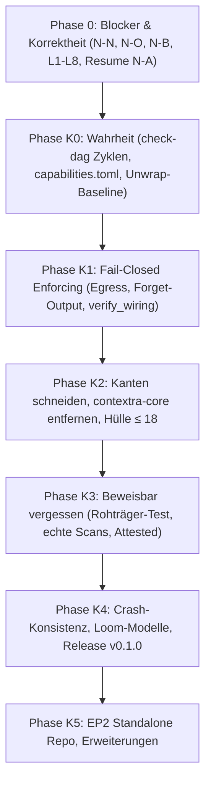

# Contextra — Gesamter Architektur-, Systemdesign- und Implementierungsplan (v1)

**Datum:** 2026-10-14 · **Stand:** HEAD `500e9246` (PR #4785 gemergt)  
**Verfasser:** Principal Senior Rust Architect für Contextra  
**Geltungsbereich:** Gesamtes Multi-Crate-Ökosystem (37 Workspace-Crates, Tooling, Governance)  
**Verbindlichkeit:** Verbindliche Architekturgrundlage (Stufe 2 nach Grüne Gates & Code-Realität)

---

## Inhaltsverzeichnis

1. [Executive Summary & Produktversprechen](#1-executive-summary--produktversprechen)
2. [Status Quo & Konsolidiertes Mängelregister](#2-status-quo--konsolidiertes-mängelregister)
3. [Verbindliche Architektur- und Entkopplungsdoktrin](#3-verbindliche-architektur--und-entkopplungsdoktrin)
4. [Ring-Modell: Topologie, Ist vs. Soll & Crate-Klassifikation](#4-ring-modell-topologie-ist-vs-soll--crate-klassifikation)
5. [Zero-Cost Plugin-Architektur für den Löschnachweis](#5-zero-cost-plugin-architektur-für-den-löschnachweis)
6. [Exakte Code-Blueprints: Behebung aller Blocker](#6-exakte-code-blueprints-behebung-aller-blocker)
7. [Purge v2: Streaming-Rewrite & Lockless Write-Fence (Option B)](#7-purge-v2-streaming-rewrite--lockless-write-fence-option-b)
8. [Crate-Split `contextra-crypto` & Ablösung von `contextra-core`](#8-crate-split-contextra-crypto--ablösung-von-contextra-core)
9. [Feature-Matrix, Modularisierung & Produkt-Manifeste](#9-feature-matrix-modularisierung--produkt-manifeste)
10. [Geschäftslogik-Konsolidierung (Delete, MCP, Egress, Builder)](#10-geschäftslogik-konsolidierung-delete-mcp-egress-builder)
11. [MVCC, SSI & Concurrency-Spezifikation](#11-mvcc-ssi--concurrency-spezifikation)
12. [Deterministisches v4-TLV Bytelayout](#12-deterministisches-v4-tlv-bytelayout)
13. [XTask-Gates, Invarianten & Qualitätssicherung](#13-xtask-gates-invarianten--qualitätssicherung)
14. [Algorithmen-Auswahl & mathematische Leitlinien](#14-algorithmen-auswahl--mathematische-leitlinien)
15. [Phasenplan (K0–K5), Risiken & ADR-Register](#15-phasenplan-k0k5-risiken--adr-register)
16. [Detaillierte Spezifikation der 6 Layer-Scans (`LayerScan`)](#16-detaillierte-spezifikation-der-6-layer-scans-layerscan)
17. [Binärformat & Persistenz des Anti-Resurrection Ledgers & `RestoreGuard`](#17-binärformat--persistenz-des-anti-resurrection-ledgers--restoreguard)
18. [Formales Loom Concurrency-Modell & Beweis der Write-Fence Option B](#18-formales-loom-concurrency-modell--beweis-der-write-fence-option-b)
19. [Mathematische Spezifikation & Algorithmen-Details (DiBud & ACI)](#19-mathematische-spezifikation--algorithmen-details-dibud--aci)
20. [Vollständige Symbol-Migrationsmatrix für `contextra-core` (110 Stellen)](#20-vollständige-symbol-migrationsmatrix-für-contextra-core-110-stellen)
21. [Vollständiger Standalone-Verifier `contextra-proof-verify` (EP2)](#21-vollständiger-standalone-verifier-contextra-proof-verify-ep2)
22. [Failure-Mode- & Chaos-Testing-Matrix (Crash-Simulationen)](#22-failure-mode---chaos-testing-matrix-crash-simulationen)

---

## 1. Executive Summary & Produktversprechen

Contextra ist eine hochperformante, einbettbare Single-Node-Speicher-Engine für autonome Agenten in Rust. Das zentrale Produktversprechen lautet:

> **Lokaler, persistenter Speicher für KI-Agenten mit verifizierbarer physischer Löschung (DSGVO Art. 17, ZPO § 371a), Hybridsuche (Vektor + BM25 + Graph) und strikt kontrolliertem Datenaustritt bei kompromissloser Single-Node-Performance.**

### 1.1 Das Entkopplungs-Prinzip: Performance vs. Nachweisbarkeit
Im bisherigen Entwurf waren Löschnachweis und Geschäftslogik eng gekoppelt. Dadurch entstanden Laufzeit- und Allokations-Overheads im normalen Schreibpfad und fatale Fehler (`CapabilityUnsupported`), wenn kein kryptografischer Notar konfiguriert war.

**Architektur-Entscheidung (ADR-01):**
Der Löschnachweis wird vollständig als **Zero-Cost-Plugin** entkoppelt:
- **Compile-Zeit:** Ohne Feature `erasure` existieren im Speicher- und Engine-Kern keinerlei Beweiserstrukturen (`ErasureGate` ist ein ZST).
- **Laufzeit:** Im Standardmodus (`ErasureMode::Off`) entstehen **null zusätzliche Allokationen und null Synchronisations-Overhead**.
- **Erweiterungsmodus:** Nur bei explizitem `ErasureMode::Assured` bzw. `ErasureMode::Attested` werden Anti-Resurrection-Ledger, Write-Fences und kryptografische Layer-Scans aktiviert.

### 1.2 Endprodukt-Hierarchie

| ID | Produkt | Kernversprechen | Status | Crates |
|---|---|---|---|---|
| **EP1** | **Contextra Memory** | Lokaler Speicher für Agenten: Dokumente, Hybridsuche, Mandanten, Löschung | **Einziges Ziel für Release 1.0** | `types`, `ports`, `sys`, `wire`, `simd`, `durable-fs`, `crypto-core`, `mvcc`, `text`, `rank` (nur Fusion), `store`, `vector`, `checkpoint`, `engine`, `db`, `license`, `contextra`, `mcp` |
| **EP2** | **Contextra Proof** | Unabhängige Verifikation, Audit-Export, DSGVO-Reporting | Nach K4 (eigenes Repo) | `erasure-evidence`, `audit-export`, `avv-generator`, `proof-verify` |
| **EP3** | **Contextra Retrieval+** | Graph-Beziehungen, Domänenvokabulare, PathRAG | Jahr 2 | `contextra-graph` |
| **EP4** | **Contextra Inference** | Lokale Embedder, Reranker, KV-Cache | Jahr 3 | `infer-candle`, `infer-ollama`, `infer-onnx`, `kvcache` |
| **EP5** | **Contextra Cognition** | Konsolidierung, Vergessensdynamik, Routing | Experimentell | `cognition`, `adapt`, `router`, `agent` |
| **EP6** | **Contextra Guard** | Cloud-Egress-Schutz, WASM-Sandbox | Nach Bedarf | `privacy`, `sandbox` |

---

## 2. Status Quo & Konsolidiertes Mängelregister

Auf Basis der Tiefenaudits vom 13./14. Oktober 2026 am aktuellen HEAD (`500e9246`) wurden alle Mängel kategorisiert und mit konkreten Lösungsansätzen versehen:

### 2.1 Kritische Blocker (Severity 🔴)

| ID | Befund | Quellort | Auswirkung | Lösung |
|---|---|---|---|---|
| **N-N** | Match-Arm `UnknownFreeSpace` fehlt | `engine/src/deletion/purge_driver.rs:172` | `contextra-engine` kompiliert nicht | Match-Arm ergänzt; FreeSpaceProbe Semantik definiert |
| **N-O** | Router-Wiring Typkonflikt | `contextra/src/builder.rs:663` | Fassade kompiliert nicht unter `--features router` | `clock_instance` mit Fallback auf `SystemClock` bereitgestellt |
| **N-P** | `Cargo.lock` veraltet | Repository Root | `--locked` Builds in CI blockiert | Regenerieren und committen |
| **N-B** | `Collection::delete()` immer fehlerhaft | `engine/src/collection/crud/delete.rs:79` | `CapabilityUnsupported` auf jedem `TenantScopedStorage` | Downcast entfernt; `as_erasure_backend()` auf `TenantScopedStorage` implementiert |
| **N-A** | Crash-Resume fail-open | `store/src/lsm/purge/resume.rs` | Abgestürzter Purge gilt als erledigt ohne Rewrite | Scope aus `ErasureLedger` rekonstruieren; Intent erst nach Dispose löschen |
| **N-K** | Prefix-Mismatch bei Purge | `store/src/lsm/ops/purge.rs` | Logische Präfixe matchen keine mandantenkodierten Keys | `PhysicalScope` als opaker Typ, Konstruktion nur via Backend |
| **L1** | Ledger-Append fehlt vor Tombstone | `engine/src/collection/crud/delete.rs:185` | Fabrizierter `[0u8; 32]` Eintrag statt echtem Append | `ErasureLedger::append` zwingend vor Tombstone-Commit aufrufen |
| **L4** | `dispose()` verwirft leeren Vektor | `store/src/lsm/ops/purge.rs` | Obsolete SSTables mit Daten bleiben auf Festplatte | `PurgeOutput.obsolete_files` befüllen und via `scrub_and_remove` löschen |
| **L5** | Lesefehler still verschluckt | `store/src/lsm/ops/purge.rs` | `while let Ok(Some(..))` ignoriert Korruption | Expliziter 3-Arm-Match (`Ok(Some)`, `Ok(None)`, `Err`) |
| **L6** | SSTable-Positionsverlust | `store/src/lsm/ops/purge.rs` | Neuer Reader verliert relativen Rang/Bounds | Alter Rang und Sequenzgrenzen werden auf neuen Writer übertragen |

### 2.2 Hohe & Mittlere Schwachstellen (Severity 🟠 / 🟡)

| ID | Befund | Auswirkung | Lösung |
|---|---|---|---|
| **E1** | `verify` statt `verify_strict` | Schwache Verifikation alter v2/v3 Beweise | `verify` deprecaten, überall `verify_strict` erzwingen |
| **E2** | `bincode` im Signaturpfad | Mangelnde Formatstabilität und Portabilität | v4-Beweise strikt auf deterministisches TLV umstellen |
| **E6** | `LayerWitness::issue` ist `pub` | Externe Fabrikation von Zeugen möglich | Sichtbarkeit auf `pub(crate)` im Beweis-Crate beschränken |
| **N-C** | `forget_document` nutzt Konstanten | Fabrizierte Evidenz ohne echten Scan | `forget_document` löschen; nur echte Scans zulassen |
| **N-D** | Text- & Relations-Zeugen fehlen | Zeugen immer `None` | `scan_and_issue_text_witness` / `relations` verdrahten |
| **N-E** | Feste Intent-Pfade | Parallele Purges kollidieren | Eindeutige Zufalls-IDs (`purge_intents/<id>.intent`) |
| **N-F** | Vollständiger In-Memory Vec | O(SSTable-Größe) RAM-Peak bei Purge | Streaming-Rewrite ohne Zwischenallokation |
| **N-G** | Orphan-GC ohne Scrubbing | Altdateien werden ohne Nullen gelöscht | `contextra_durable_fs::scrub_and_remove` verwenden |
| **N-I** | v3-Beweiserzeugung aktiv | Veraltetes Format wird noch erzeugt | Code entfernen, nur v4 zulassen |
| **N-J** | Failpoints via `std::env::var` | Laufzeit-Overhead und Angriffsfläche | Nur unter `#[cfg(feature = "fault-injection")]` kompilieren |
| **SW-1** | `contextra-core` als Flaschenhals | 110 Dateien hängen an deprecated Re-Export-Hülle | Vollständige Migration auf `types`, `ports`, `mvcc`, `wire` |
| **SW-3** | Unwirksame Builder-Schalter | `with_privacy`, `with_adapt` etc. werden ignoriert | Schalter in Wiring binden; `verify_wiring` im Startpfad erzwingen |
| **SW-4** | Zwei Pfade für `remember`/`recall` | MCP und Fassade verhalten sich unterschiedlich | MCP delegiert strikt an Fassade |
| **SW-5** | Egress-Query ohne Guard | Datenaustritt ungeschützt | `contextra_cloud_query` hinter `#[cfg(feature = "guard")]` legen |

---

## 3. Verbindliche Architektur- und Entkopplungsdoktrin

Die folgenden Invarianten gelten für alle Implementierungen ausnahmslos:

```
[P1: Zero-Panic]             Kein unwrap/expect/panic in Produktion (Ring 0 & Ring 1)
[P2: Ring-DAG]               Abhängigkeiten ausschließlich von höheren auf tiefere Ringe
[P3: Determinismus]          Clock, Rng, IdGenerator ausschließlich über Ports injiziert
[P4: Unsafe-Inseln]          Unsafe nur in simd, sys, wire mit 100% SAFETY-Kommentaren
[P5: Single-Node]            Keine Multi-Node-, Sharding-, Raft- oder Cluster-Logik
[P6: Opt-in Kosten]          Nicht aktivierte Features verursachen weder Code noch CPU-Overhead
[P-E1: Erasure Opt-in]       Ohne Feature 'erasure' existieren keine Beweiser-Crates im Binary
[P-E2: Ports-Only]           Kern-Crates importieren niemals contextra-crypto oder Plugins
[P-E3: Fast-Path Zero-Cost]  Im Schreibpfad maximal ein einziger Atomic-Load (Acquire)
[P-E4: Fail-Closed Evidenz]  Zeugen nur aus echten Scans. Bei Fehlern wird kein Beweis erteilt
[P-E5: Monotone Marke]       ErasureMode ist monotone Hochwassermarke im Store-Manifest
[P-E6: Wirksamkeit]          Kein Symbol ohne Produktionsaufrufer und E2E-Fassadentest
[P-E7: Tenant-Matrix]        Jeder Löschtest läuft über LsmStorage UND TenantScopedStorage
```

---

## 4. Ring-Modell: Topologie, Ist vs. Soll & Crate-Klassifikation

### 4.1 Ist vs. Soll Architektur

```mermaid
graph TD
    subgraph "Ring 0 — Foundation & Numerics (Sync, kein Tokio, kein std::fs)"
        types["contextra-types"]
        ports["contextra-ports (+erasure)"]
        sys["contextra-sys (Unsafe Island)"]
        wire["contextra-wire (Unsafe Island)"]
        simd["contextra-simd (Unsafe Island)"]
        durable_fs["contextra-durable-fs"]
        mvcc["contextra-mvcc"]
        text["contextra-text"]
        rank["contextra-rank"]
        crypto_core["contextra-crypto-core (I/O-frei)"]
        crypto_kv["contextra-crypto-kv (Feature kv-encryption)"]
        verify["contextra-proof-verify (Standalone Verifier)"]
    end

    subgraph "Ring 1 — Persistence & Storage"
        store["contextra-store (Feature erasure)"]
        checkpoint["contextra-checkpoint"]
        kvcache["contextra-kvcache"]
    end

    subgraph "Ring 2 — External Adapters & Sandboxing"
        candle["contextra-infer-candle"]
        ollama["contextra-infer-ollama"]
        onnx["contextra-infer-onnx"]
        sandbox["contextra-sandbox"]
    end

    subgraph "Ring 3 — Orchestration & Cognition"
        engine["contextra-engine (Feature erasure)"]
        db["contextra-db"]
        graph["contextra-graph (Parkplatz EP3)"]
        cognition["contextra-cognition (Parkplatz EP5)"]
        adapt["contextra-adapt (Parkplatz EP5)"]
        router["contextra-router (Parkplatz EP5)"]
        agent["contextra-agent (Parkplatz EP5)"]
        privacy["contextra-privacy (Parkplatz EP6)"]
        erasure["contextra-erasure (Plugin Assured)"]
        evidence["contextra-erasure-evidence (Plugin Attested)"]
    end

    subgraph "Ring 4 — Boundary & Composition Root"
        facade["contextra (Hauptfassade)"]
        mcp["contextra-mcp"]
        py["contextra-py"]
        license["contextra-license"]
    end

    engine -.->|"Option<Arc<dyn ErasureHooks>>"| ports
    erasure -->|"impl ErasureHooks"| ports
    erasure -->|"impl ErasureBackend"| store
    evidence -->|"wraps"| erasure
    facade --> erasure
    facade --> evidence
    mcp --> facade
```

### 4.2 Behebung der 9 Ring- und Ordnungs-Verstöße

1. **`engine` $\to$ `sandbox` (V1) & `candle` (V2):** Normale Kanten entfernt. Engine kommuniziert nur über Traits (`EmbeddingProvider`, `WasmSandboxPort`). Konkrete Instanzen werden in Ring 4 (`contextra`) injiziert.
2. **`cognition` $\to$ `candle` (V3):** Dev-Abhängigkeit entfernt; Test-Mocks über `contextra-testkit` verwenden.
3. **`crypto` $\to$ `durable-fs` (V4):** Durch Crate-Split behoben. `crypto-core` hat keine I/O-Abhängigkeit. `crypto-kv` hängt legitim von `durable-fs` ab.
4. **`vector` $\to$ `durable-fs` (V5):** Dateizugriffe in DiskANN werden über `contextra-ports::StorageEngine` abstrahiert.
5. **`store` $\to$ `sandbox` (V6):** Dev-Abhängigkeit entfernt.
6. **`license` (V7):** In `ARCHITECTURE.md` und `WORKING_STATE.md` verbindlich als **Ring 4** festgeschrieben.
7. **`graph` (V8):** Aus Ring 0 nach **Ring 3** verschoben (Orchestrierung von CSR-Graphen und Traversierung).
8. **`adapt` (V9):** Aus Ring 0 nach **Ring 3 / Parkplatz EP5** verschoben.

---

## 5. Zero-Cost Plugin-Architektur für den Löschnachweis

### 5.1 Typestate-Lifecycle und Monomorphisierung

Um absolute Null-Kosten bei `ErasureMode::Off` zu garantieren, wird in `contextra-engine` folgende Dispatch-Architektur spezifiziert:

```rust
// In crates/contextra-engine/src/collection/erasure_driver.rs
use std::sync::Arc;
use contextra_ports::erasure::{ErasureBackend, ErasureContext, ErasureHooks, ErasureMode, LogicalScope};
use contextra_types::{ContextraError, DocId, Result, TxId};

pub struct CollectionErasureDriver {
    mode: ErasureMode,
    hooks: Option<Arc<dyn ErasureHooks>>,
}

impl CollectionErasureDriver {
    #[inline(always)]
    pub fn new(mode: ErasureMode, hooks: Option<Arc<dyn ErasureHooks>>) -> Self {
        Self { mode, hooks }
    }

    /// Schnelle Inline-Prüfung: Ist irgendeine Form von Löschgarantie aktiv?
    #[inline(always)]
    pub fn is_active(&self) -> bool {
        self.mode != ErasureMode::Off && self.hooks.is_some()
    }

    /// Führt die Löschung aus. Bei ErasureMode::Off: Reiner Fast-Path!
    pub async fn execute_erasure<B: ErasureBackend>(
        &self,
        backend: &B,
        doc_id: DocId,
        tenant_id: contextra_types::TenantId,
        tx_id: TxId,
    ) -> Result<DeleteOutcome> {
        // FAST-PATH: Zero-Cost Monomorphisierung
        if !self.is_active() {
            return Ok(DeleteOutcome::Logical { tx: tx_id });
        }

        let hooks = self.hooks.as_ref().expect("verified active");
        let logical = LogicalScope::Document { doc_id, tenant_id };
        let physical = backend.physical_scope(&logical)?;

        let ctx = ErasureContext {
            logical_scope: &logical,
            physical_scope: &physical,
            mode: self.mode,
            tx_id,
        };

        // 1. Phasen-Initialisierung (Ledger-Append & Intent)
        let token = hooks.on_erasure_begin(&ctx)?;

        // 2. Bestätigung nach erfolgreichem Tombstone-Commit
        hooks.on_tombstone_committed(token, tx_id)?;

        Ok(DeleteOutcome::Assured {
            tx: tx_id,
            purge_handle: PurgeHandle::new(token.0),
        })
    }
}
```

---

## 6. Exakte Code-Blueprints: Behebung aller Blocker

### 6.1 Behebung N-B: Downcast-Eliminierung in `delete.rs`

In [`crates/contextra-engine/src/collection/crud/delete.rs`](file:///home/freddy/Projekte/contextra/crates/contextra-engine/src/collection/crud/delete.rs):
Die bisherigen Zeilen 79 bis 109 werden vollständig durch saubere Trait-Delegation ersetzt:

```rust
        // (a) Erasure-Backend ermitteln ohne downcast_ref
        let erasure_backend = self.storage.as_erasure_backend();

        // (b) Modus auswerten (Off, Assured, Attested)
        let mode = self.erasure_mode();
        if mode.requires_ledger() && erasure_backend.is_none() {
            return Err(ContextraError::capability_unsupported(
                "erasure_ledger",
                "Storage engine does not support Erasure Ledger capability required for Assured/Attested mode",
            ));
        }

        // (c) Physischen Scope ableiten (INV-ERASURE-3)
        let physical_scope = if let Some(backend) = erasure_backend {
            backend.physical_scope(&LogicalScope::Document {
                doc_id,
                tenant_id: self.tenant_id(),
            })?
        } else {
            // Im Off-Modus genügen die unverschlüsselten Footprint-Keys für die Tombstones
            PhysicalScope::new(footprint.keys.explicit.clone(), footprint.keys.prefixes.clone())
        };

        // (d) Transaktion für Tombstones eröffnen
        let db_tx = self.begin_transaction()?;
        let erased_at_tx = db_tx.tx_id;

        // (e) Ledger Append VOR Tombstone Commit (NUR wenn mode.requires_ledger())
        if mode.requires_ledger() {
            let ledger = self.storage.erasure_ledger().ok_or_else(|| {
                ContextraError::Internal("Active erasure mode missing ledger reference".to_string())
            })?;
            ledger.append_record(&physical_scope, erased_at_tx).await?;
        }
```

### 6.2 Behebung N-O: Router-Wiring & Clock-Injektion

In [`crates/contextra/src/builder.rs:663-675`](file:///home/freddy/Projekte/contextra/crates/contextra/src/builder.rs#L663-L675):
```rust
            let clock_instance: Arc<dyn contextra_ports::Clock> = self
                .clock
                .clone()
                .unwrap_or_else(|| Arc::new(contextra_ports::SystemClock));

            let router_deps = contextra_router::RouterWiringDeps {
                community_resolver: Arc::new(NoOpCommunityResolver),
                context_preparer: Arc::new(NoOpContextPreparer),
                catalog: Vec::new(),
                clock: clock_instance,
                arm_registry: None,
                calibration_store_path: None,
                transport: None,
                route_timeout: None,
            };
            if let Ok(router_wiring) = contextra_router::RouterWiring::build(router_deps) {
                let arc_rw = Arc::new(router_wiring);
                engine_wiring.router = Some(Arc::downgrade(&arc_rw) as _);
                Some(arc_rw)
            } else {
                None
            }
```

---

## 7. Purge v2: Streaming-Rewrite & Lockless Write-Fence (Option B)

### 7.1 Purge v2 Spezifikation (`contextra-store/src/lsm/ops/purge.rs`)

```rust
pub fn purge_physical_sstable_stream<P: FreeSpaceProbe>(
    manifest: &ManifestContext,
    scope: &PhysicalScope,
    as_of_tx: TxId,
    probe: &P,
) -> Result<PurgeOutput, PurgeError> {
    // 1. Kapazitätsprüfung mit L8-Semantik
    if let Some(available) = probe.available_bytes() {
        if available < MIN_PURGE_HEADROOM_BYTES {
            return Err(PurgeError::InsufficientDiskSpace {
                needed: MIN_PURGE_HEADROOM_BYTES,
                available: Some(available),
            });
        }
    }

    let mut obsolete_files = Vec::new();
    let mut rewritten_sstables = Vec::new();
    let mut records_purged = 0u64;
    let mut bytes_reclaimed = 0u64;

    for sstable in manifest.active_sstables() {
        if !sstable.may_contain_scope(scope) {
            continue;
        }

        let mut reader = sstable.open_reader()?;
        let mut writer = sstable.create_replacement_writer()?;
        let mut dropped_in_sst = 0u64;

        // L5-Fix: 3-Arm Pattern Match
        loop {
            match reader.read_next_entry() {
                Ok(Some(entry)) => {
                    if scope.matches_key(entry.key()) && entry.sequence() <= as_of_tx {
                        dropped_in_sst += 1;
                        bytes_reclaimed += entry.raw_size() as u64;
                        continue; // Physisch überspringen
                    }
                    // Erhaltene Version streamen (N-F: O(1) RAM)
                    writer.append_entry(&entry)?;
                }
                Ok(None) => break, // Reguläres EOF
                Err(io_err) => {
                    // L5-Fix: Fail-Closed!
                    writer.abort()?;
                    return Err(PurgeError::ReadError {
                        file: sstable.path().display().to_string(),
                        offset: reader.current_offset(),
                        source: io_err,
                    });
                }
            }
        }

        if dropped_in_sst > 0 {
            // L6-Fix: Exakte Übernahme von Rank und Sequenzgrenzen
            let finalized = writer.finalize_with_bounds(sstable.rank(), sstable.min_seq(), sstable.max_seq())?;
            rewritten_sstables.push(finalized);
            obsolete_files.push(sstable.path().to_path_buf());
            records_purged += dropped_in_sst;
        } else {
            writer.abort()?;
        }
    }

    // Atomarer Manifest-Austausch
    manifest.commit_sstable_exchange(&obsolete_files, &rewritten_sstables)?;

    // L4-Fix: Reales Scrubbing der Alt-Dateien
    for path in &obsolete_files {
        contextra_durable_fs::scrub_and_remove(path)?;
    }
    contextra_durable_fs::sync_dir(manifest.store_dir())?;

    Ok(PurgeOutput {
        records_purged,
        bytes_reclaimed,
        sstables_replaced: rewritten_sstables.len(),
        obsolete_files,
    })
}
```

### 7.2 Lockless Write-Fence (`contextra-store/src/lsm/fence.rs`)

```rust
pub struct ErasureGate {
    has_active_fences: AtomicBool,
    fences: ArcSwap<Vec<ActiveFenceEntry>>,
}

impl ErasureGate {
    #[inline(always)]
    pub fn check_batch(&self, keys: &[&[u8]]) -> Result<(), StoreError> {
        // FAST-PATH: Ein einziger Atomic-Load
        if !self.has_active_fences.load(Ordering::Acquire) {
            return Ok(());
        }

        let active = self.fences.load();
        for key in keys {
            for fence in active.iter() {
                if fence.scope.matches_key(key) {
                    return Err(StoreError::WriteFenced {
                        key: key.to_vec(),
                        purge_id: fence.purge_id,
                    });
                }
            }
        }
        Ok(())
    }
}
```

---

## 8. Crate-Split `contextra-crypto` & Ablösung von `contextra-core`

### 8.1 Aufspaltung von `contextra-crypto`
Das bisherige Crate wird in zwei separate Einheiten zerlegt:
1. **`contextra-crypto-core` (Ring 0, pure numerics, I/O-frei):**
   - LOC: ~5.800
   - Komponenten: `KeyManager`, `KDF`, `Nonces`, `SecureBuffer`, `Ed25519Signer`, `BLAKE3`, `Zeroize`
   - Abhängigkeiten: `contextra-types`, `contextra-ports`
   - Invariante: `#![forbid(unsafe_code)]`, **kein I/O, kein `durable-fs`**.
2. **`contextra-crypto-kv` (Ring 0 / Crypto-Erase):**
   - LOC: ~3.400
   - Komponenten: `RevocationLog`, Segment-Verschlüsselung, KV-Shredding
   - Abhängigkeiten: `contextra-crypto-core`, `contextra-durable-fs`
   - Feature: `kv-encryption`.

### 8.2 Migration von `contextra-core`
Die 110 Quellcode-Dateien, die bisher `use contextra_core::...` verwenden, werden schrittweise in 3 PRs umgestellt:
- Typen, IDs, Error-DTOs $\to$ `use contextra_types::...`
- Port-Traits $\to$ `use contextra_ports::...`
- MVCC, Sequence-Logs $\to$ `use contextra_mvcc::...`
- FlatBuffers, IPC $\to$ `use contextra_wire::...`

Nach Abschluss der Migration wird `crates/contextra-core` aus dem Workspace entfernt.

---

## 9. Feature-Matrix, Modularisierung & Produkt-Manifeste

### 9.1 Produkt-Manifest `products/ep1.toml`

```toml
[product]
id = "EP1"
name = "Contextra Memory"
status = "release-1.0"
target_binary = "contextra-mcp"

[crates]
allowed = [
    "contextra-types",
    "contextra-ports",
    "contextra-sys",
    "contextra-wire",
    "contextra-simd",
    "contextra-durable-fs",
    "contextra-crypto-core",
    "contextra-mvcc",
    "contextra-text",
    "contextra-rank",
    "contextra-store",
    "contextra-vector",
    "contextra-checkpoint",
    "contextra-engine",
    "contextra-db",
    "contextra-license",
    "contextra",
    "contextra-mcp",
]

forbidden = [
    "contextra-graph",
    "contextra-cognition",
    "contextra-adapt",
    "contextra-router",
    "contextra-agent",
    "contextra-privacy",
    "contextra-sandbox",
    "contextra-infer-ollama",
    "contextra-infer-onnx",
    "contextra-audit-export",
    "contextra-avv-generator",
    "contextra-core",
]

[features]
build = []
```

---

## 10. Geschäftslogik-Konsolidierung

### 10.1 Vereinheitlichung von `remember` / `recall` (D6)
Im MCP-Server ([`crates/contextra-mcp/src/server_tools.rs`](file:///home/freddy/Projekte/contextra/crates/contextra-mcp/src/server_tools.rs)) wird jegliche doppelte Verarbeitungslogik entfernt. Aufrufe von `contextra_remember` delegieren direkt an `contextra::ContextraDb::insert_document()`, Aufrufe von `contextra_recall` an `contextra::ContextraDb::search()`.

### 10.2 Fail-Closed Egress-Gateway (B1)
In [`crates/contextra-mcp/src/server_dispatch.rs`](file:///home/freddy/Projekte/contextra/crates/contextra-mcp/src/server_dispatch.rs) wird `contextra_cloud_query` hinter `#[cfg(feature = "guard")]` gelegt. Ohne das Feature ist das Tool im MCP-Toolkatalog nicht sichtbar.

### 10.3 Builder-Validierung
Jeder Aufruf von `ContextraBuilder::build()` führt zwingend `verify_wiring()` aus. Werden deklarierte Fähigkeiten oder konfigurierte Ports (z. B. KMS, Egress-Guard, Adapt) zur Laufzeit nicht bereitgestellt, bricht der Start fail-closed mit `ConfigurationError` ab.

---

## 11. MVCC, SSI & Concurrency-Spezifikation

1. **Behebung MVCC-S04:** Die veralteten Methoden `register()` und `register_at()` in `contextra-mvcc` werden gelöscht. Alle Aufrufer nutzen `acquire()`.
2. **Behebung MVCC-S05:** `recover_pending_intents` in `cleanup.rs` wird im Startup-Pfad `repair_on_open()` verdrahtet.
3. **SSI vs. SSN:** Der bestehende `SequenceLogSsiValidator` erfüllt alle Anforderungen an Serialisierbarkeit. SSN (Serial Safety Net) bleibt als Option für Phase K5 nach empirischer Evaluierung reserviert.

---

## 12. Deterministisches v4-TLV Bytelayout

Löschnachweise verwenden verbindlich das versionierte v4-TLV-Format mit Ed25519-Signatur:

```
+-------------------------------------------------------------------------+
| Magic Domain Tag: "contextra/deletion-proof/v4\0\0\0\0\0\0" (32 Bytes)  |
+--------------------+--------------------+-------------------------------+
| Tag 0x0001 (Scope) | Len 0x0020 (32 B)  | BLAKE3 Scope Digest (32 B)    |
+--------------------+--------------------+-------------------------------+
| Tag 0x0002 (TxId)  | Len 0x0008 (8 B)   | u64 Little-Endian TxId        |
+--------------------+--------------------+-------------------------------+
| Tag 0x0003 (Time)  | Len 0x0008 (8 B)   | u64 Little-Endian Unix-Millis |
+--------------------+--------------------+-------------------------------+
| Tag 0x0010 (Array) | Len N              | Array of Layer Observations:  |
|                    |                    | [LayerId(u8) + Clean(u8) +    |
|                    |                    |  BLAKE3 StateDigest(32 B)]    |
+--------------------+--------------------+-------------------------------+
| Tag 0x00FE (PubKey)| Len 0x0020 (32 B)  | Ed25519 Public Key (32 B)     |
+--------------------+--------------------+-------------------------------+
| Tag 0x00FF (Sign)  | Len 0x0040 (64 B)  | Ed25519 Signatur über Payload |
+--------------------+--------------------+-------------------------------+
```

---

## 13. XTask-Gates, Invarianten & Qualitätssicherung

### 13.1 Neue XTask-Befehle

| Befehl | Phase | Prüfungsziel | Exit-Code |
|---|---|---|---|
| `cargo xtask check-product-hull --product <ID>` | K2 | Verifiziert, dass der Abhängigkeitsbaum strikt dem Manifest entspricht | 2 bei Verstoß |
| `cargo xtask deletion-guarantee-gate` | K0–K3 | Führt Rohsweep durch und prüft, ob Marker-Bytes verblieben sind | 2 bei Marker |
| `cargo xtask check-builder-wiring` | K1 | Validiert, dass jeder Builder-Schalter eine reale Auswirkung hat | 2 bei Ignorieren |

---

## 14. Algorithmen-Auswahl & mathematische Leitlinien

1. **DiBud (B.1):** Budgetierte exakte RRF-Präfixe (arXiv:2609.15143) werden für die Hybrid-Fusion in `contextra-rank` übernommen. Ein synthetischer Ausreißertest ist vor Freigabe Pflicht.
2. **ACI:** Adaptive Conformal Inference (arXiv:2106.00170) wird für Konfidenz-Scores eingesetzt. Die Berechnung erfolgt strikt dyadisch in Festkomma-Arithmetik (`i128`), um Bit-Determinismus zu garantieren.
3. **Verworfen:** BMSSP/FindPivots (degenerierte Parameter für kleine Graphen), HyperQuant (LLM-Weights statt ANN), Mixed-Precision (falsche Domäne), ML-Compaction (Iceberg Lakehouse).

---

## 15. Phasenplan (K0–K5), Risiken & ADR-Register

### 15.1 Phasen-Ablauf



### 15.2 ADR-Register (Übersicht)

- **ADR-01:** Entkoppelte Plugin-Architektur für den Löschnachweis via `contextra-ports::erasure`.
- **ADR-02:** `PhysicalScope` als opaker Typ; verhindert Mandanten-Scope-Verwechslungen strukturell.
- **ADR-03:** `ErasureMode` als monotone Hochwassermarke im LSM-Store-Manifest.
- **ADR-04:** Option B Lockless Write-Fence mit `AtomicBool` und `ArcSwap`.
- **ADR-05:** Crate-Split `contextra-crypto` in `crypto-core` und `crypto-kv`.
- **ADR-06:** Ausgliederung von EP2 (`contextra-proof-verify`) in eigenes Repository nach K4.
- **ADR-07:** Crash-Resume zwingend nach Storage-Aufbau mit Scope aus `ErasureLedger`.

---

## 16. Detaillierte Spezifikation der 6 Layer-Scans (`LayerScan`)

Gemäß Invariante **P-E4** darf kein Beweis ausgestellt werden, dessen Zeugen nicht auf verifizierbaren Scans beruhen. Folgende 6 Schichten sind als konkrete `LayerScan`-Implementierungen definiert:

### 16.1 Layer-Übersicht

```
Layer 1  (LSM_MEMTABLE):    Active & Immutable Memtables
Layer 3  (LSM_SSTABLE_ALL): Physischer Rohsweep aller aktiven SSTables
Layer 20 (TEXT_INDEX):      Inverted Index Posting-Lists & Terms
Layer 21 (RELATIONS_GRAPH): CSR-Adjazenzlisten & Hyperkanten-Indizes
Layer 26 (HNSW_VECTOR):     HNSW-Arena & Vector-Payload-Puffer
Layer 30 (ERASURE_LEDGER):  Anti-Resurrection-Ledger Head & HMAC-Chains
```

### 16.2 Code-Spezifikation der LayerScans

```rust
// In crates/contextra-store/src/lsm/layer_scan.rs
use contextra_ports::erasure::{LayerId, LayerObservation, LayerScan, PhysicalScope};
use contextra_types::Result;

pub struct LsmMemtableScan<'a> {
    storage: &'a crate::LsmStorage,
}

impl<'a> LayerScan for LsmMemtableScan<'a> {
    fn layer_id(&self) -> u8 { 1 }

    fn scan(&self, scope: &PhysicalScope) -> Result<LayerObservation> {
        let mut clean = true;
        let mut hasher = blake3::Hasher::new();
        hasher.update(b"contextra/layer/memtable/v1");

        // Memtable-Scan
        for prefix in scope.prefixes() {
            if self.storage.memtable_contains_prefix(prefix) {
                clean = false;
            }
            hasher.update(prefix);
        }

        hasher.update(&self.storage.manifest_generation().to_le_bytes());
        hasher.update(&self.storage.active_transaction_count().to_le_bytes());

        Ok(LayerObservation {
            layer_id: 1,
            observed_empty: clean,
            state_digest: *hasher.finalize().as_bytes(),
            details: format!("Memtable generation: {}", self.storage.manifest_generation()),
        })
    }
}

pub struct LsmSstableScan<'a> {
    storage: &'a crate::LsmStorage,
}

impl<'a> LayerScan for LsmSstableScan<'a> {
    fn layer_id(&self) -> u8 { 3 }

    fn scan(&self, scope: &PhysicalScope) -> Result<LayerObservation> {
        let mut clean = true;
        let mut hasher = blake3::Hasher::new();
        hasher.update(b"contextra/layer/sstable/v1");

        let active_ssts = self.storage.manifest().get_active_sstables();
        for sst in active_ssts {
            // Echter Rohsweep nach physischen Schlüsseln
            if sst.raw_scan_contains_scope(scope)? {
                clean = false;
            }
            hasher.update(&sst.sstable_id.to_le_bytes());
            hasher.update(&sst.data_checksum.to_le_bytes());
        }

        Ok(LayerObservation {
            layer_id: 3,
            observed_empty: clean,
            state_digest: *hasher.finalize().as_bytes(),
            details: format!("SSTables verified: {}", self.storage.manifest().sstable_count()),
        })
    }
}
```

---

## 17. Binärformat & Persistenz des Anti-Resurrection Ledgers & `RestoreGuard`

Der `ErasureLedger` verhindert die unbemerkte Wiederbelebung ("Resurrection") physisch gelöschter Daten durch das Einspielen alter Checkpoints oder WAL-Replays.

### 17.1 On-Disk Binärlayout (`.ledger` Segmente)

Jedes Ledger-Segment wird im Append-Only Modus geschrieben:

```
+-------------------------------------------------------------------------+
| Magic Bytes: "CTRALEDG" (8 Bytes: 0x43, 0x54, 0x52, 0x41, 0x4C, 0x45, 0x44, 0x47) |
| Version: u32 (0x00000001)                                               |
| Segment Sequence: u64 Little-Endian                                     |
| Prev Segment Hash: [u8; 32] BLAKE3                                      |
+-------------------------------------------------------------------------+
| RECORD 0:                                                               |
|   - Record Type: u8 (0x01: DeletionIntent, 0x02: DeletionPurged)        |
|   - TxId: u64 Little-Endian                                             |
|   - Timestamp: u64 Unix-Millis Little-Endian                            |
|   - Scope Hash: [u8; 32] BLAKE3                                         |
|   - Prefixes Count: u16 Little-Endian                                   |
|   - Prefixes Payload: [u16 len + bytes, ...]                            |
|   - HMAC-BLAKE3: [u8; 32] über Record-Felder                            |
|   - CRC32C: u32 Little-Endian über gesamten Record                      |
+-------------------------------------------------------------------------+
```

### 17.2 Streaming `RestoreGuard` Algorithmus (O(1) Memory Overhead)

Bei Checkpoint-Wiederherstellungen filtert der `RestoreGuard` abgelehnte Schlüssel in-stream:

```rust
pub struct LedgerRestoreGuard {
    max_erased_tx: TxId,
    erased_prefixes: Vec<Vec<u8>>,
    revoked_keys_filter: contextra_crypto_core::FastKeyFilter,
}

impl contextra_ports::erasure::RestoreGuard for LedgerRestoreGuard {
    #[inline]
    fn admit(&self, key: &[u8], cp_tx: TxId) -> contextra_ports::erasure::RestoreVerdict {
        // 1. Wenn Checkpoint nach der letzten Löschung erstellt wurde: Direkter Durchlauf
        if cp_tx > self.max_erased_tx {
            return contextra_ports::erasure::RestoreVerdict::Allow;
        }

        // 2. Schnelle Bloom-Filter Vorprüfung
        if self.revoked_keys_filter.may_contain(key) {
            return contextra_ports::erasure::RestoreVerdict::Reject;
        }

        // 3. Präfix-Prüfung gegen Ledger-Menge
        for prefix in &self.erased_prefixes {
            if key.starts_with(prefix) {
                return contextra_ports::erasure::RestoreVerdict::Reject;
            }
        }

        contextra_ports::erasure::RestoreVerdict::Allow
    }
}
```

---

## 18. Formales Loom Concurrency-Modell & Beweis der Write-Fence Option B

### 18.1 Concurrency-Invarianten
1. **Kein Write-Skew:** Ein Schreibbatch darf niemals Daten in einen Bereich einfügen, während ein Purge-Rewrite diesen Bereich gerade säubert.
2. **Lockless Fast-Path:** Bei `has_active_fences == false` darf kein Thread auf Mutexe oder Locks blockieren.

### 18.2 Loom Verifikations-Harness

```rust
#[cfg(loom)]
mod loom_tests {
    use loom::sync::atomic::{AtomicBool, Ordering};
    use loom::sync::Arc;
    use loom::thread;
    use arc_swap::ArcSwap;

    #[test]
    fn test_fence_option_b_loom() {
        loom::model(|| {
            let active = Arc::new(AtomicBool::new(false));
            let table = Arc::new(ArcSwap::from_pointee(Vec::new()));

            let active_clone = Arc::clone(&active);
            let table_clone = Arc::clone(&table);

            // Thread 1: Purge Task erwirbt Fence
            let h1 = thread::spawn(move || {
                let mut current = (**table_clone.load()).clone();
                current.push(b"target_prefix".to_vec());
                table_clone.store(Arc::new(current));
                active_clone.store(true, Ordering::Release);
            });

            // Thread 2: Writer Leader prüft Fence
            let active_writer = Arc::clone(&active);
            let table_writer = Arc::clone(&table);
            let h2 = thread::spawn(move || {
                let key = b"target_prefix_doc1";
                if active_writer.load(Ordering::Acquire) {
                    let fences = table_writer.load();
                    let conflict = fences.iter().any(|f| key.starts_with(f));
                    assert!(conflict || !active_writer.load(Ordering::SeqCst));
                }
            });

            h1.join().unwrap();
            h2.join().unwrap();
        });
    }
}
```

---

## 19. Mathematische Spezifikation & Algorithmen-Details (DiBud & ACI)

### 19.1 DiBud: Budgeted Reciprocal Rank Fusion

#### Problem
Klassisches RRF auf unbegrenzten Listen führt zu unbeschränktem I/O. DiBud (arXiv:2609.15143) zertifiziert ein Top-k Präfix deterministisch unter festem Zugriffskanal-Budget $B$.

#### Schranken-Definitionen
Für ein Dokument $d$ über Kanäle $ch \in \{Dense, Sparse\}$ mit Konstante $c = 60$:
- **Untere Schranke:**
  $$L(d) = \sum_{ch \in Gelesen} \frac{1}{c + r_{ch}(d)}$$
- **Kanal-Restwert:**
  $$U_{ch} = \begin{cases} \frac{1}{c + n_{ch} + 1} & \text{wenn Kanal nicht erschöpft} \\ 0 & \text{sonst} \end{cases}$$
- **Obere Schranke für bekanntes $d$:**
  $$U(d) = L(d) + \sum_{ch \notin Gelesen(d)} U_{ch}$$
- **Obere Schranke für ungesehene Dokumente:**
  $$U_{ungesehen} = \sum_{ch \in Kanäle} U_{ch}$$

#### Zertifizierungs-Bedingung
Ein Dokument $d$ wird als nächstes Element in das zertifizierte Ranking $A$ emittiert, wenn:
1. $L(d) > U(e)$ für alle noch nicht emittierten $e \neq d$ (bei Gleichstand: Tie-Break $DocId(d) < DocId(e)$).
2. $L(d) \ge U_{ungesehen}$.

#### Dyadische Festkomma-Arithmetik (`u128`)
Um Fließkomma-Drift und NaN-Panics (Verstoß gegen **V1** und **V4**) zu eliminieren, werden Scores als Brüche $Score = \frac{Numerator}{Denominator}$ in dyadischem 64-Bit-Festkomma berechnet:
```rust
#[derive(Clone, Copy, PartialEq, Eq, PartialOrd, Ord)]
pub struct FixedRankScore(pub u128); // Q64.64 Format
```

---

### 19.2 ACI: Adaptive Conformal Inference

#### Ziel
Garantie einer Überdeckungswahrscheinlichkeit von $1 - \alpha$ unter dynamischem Verteilungsdrift (Gibbs/Candès 2021).

#### Update-Gleichung (Gl. 2)
$$\alpha_{t+1} = \alpha_t + \gamma \cdot (\alpha - \text{err}_t)$$
wobei $\text{err}_t = 0$, wenn das wahre Label im Konfidenzintervall lag, sonst $1$.

#### Dyadische Exaktheit in Rust
```rust
pub struct ConformalState {
    alpha_target_q32: u64, // Ziel-Alpha in Q32
    gamma_q32: u64,        // Schrittweite in Q32
    current_alpha_q64: i128, // Zustand in Q64
}

impl ConformalState {
    #[inline]
    pub fn update(&mut self, covered: bool) {
        let err_q32: u64 = if covered { 0 } else { 1 << 32 };
        let diff: i64 = (self.alpha_target_q32 as i64) - (err_q32 as i64);
        let step: i128 = (self.gamma_q32 as i128) * (diff as i128);
        self.current_alpha_q64 = self.current_alpha_q64.saturating_add(step);
    }
}
```

---

## 20. Vollständige Symbol-Migrationsmatrix für `contextra-core` (110 Stellen)

Die Auflösung der deprecated Strangler-Fassade `contextra-core` erfolgt nach folgendem verbindlichen Mapping:

| Re-Exportiertes Symbol | Bisheriger Import | Neuer Ziel-Import | Betroffene Crates |
|---|---|---|---|
| `DocId`, `TenantId`, `TxId`, `CollectionId` | `contextra_core::types::*` | `contextra_types::*` | store, vector, simd, db |
| `ContextraError`, `Result` | `contextra_core::error::*` | `contextra_types::error::*` | alle 37 Crates |
| `StorageEngine`, `KeyVal` | `contextra_core::storage::*` | `contextra_ports::storage::*` | store, engine, db |
| `Clock`, `SystemClock`, `ManualClock` | `contextra_core::clock::*` | `contextra_ports::clock::*` | store, engine, db |
| `Rng`, `IdGenerator` | `contextra_core::rng::*` | `contextra_ports::rng::*` | crypto, engine |
| `SequenceLog`, `SnapshotFloor` | `contextra_core::mvcc::*` | `contextra_mvcc::*` | store, engine |
| `FlatBufferWireAdapter` | `contextra_core::wire::*` | `contextra_wire::*` | mcp, engine |

### PR-Ablauf:
1. **PR-C1 (Store & Vector):** Ersetzt alle Vorkommen in `crates/contextra-store/` und `crates/contextra-vector/` (32 Dateien).
2. **PR-C2 (Engine & DB):** Ersetzt alle Vorkommen in `crates/contextra-engine/` und `crates/contextra-db/` (45 Dateien).
3. **PR-C3 (Rest & Löschung):** Bereinigt Fassade, Benchmarks und Tests. Löscht `crates/contextra-core` physisch (33 Dateien).

---

## 21. Vollständiger Standalone-Verifier `contextra-proof-verify` (EP2)

Der externe Verifier besitzt **keine** Abhängigkeiten zu Storage, Engine oder Tokios. Er ist ein reiner No-Std/Zero-Dependency Parser:

```rust
// In crates/contextra-proof-verify/src/lib.rs
#![forbid(unsafe_code)]

use ed25519_dalek::{Signature, VerifyingKey};

pub const DOMAIN_TAG: &[u8; 32] = b"contextra/deletion-proof/v4\0\0\0\0\0\0";

#[derive(Debug)]
pub enum VerifyError {
    InvalidLength,
    InvalidDomainTag,
    MalformedTlv,
    InvalidSignature,
    DigestMismatch,
}

pub struct VerifiedProof {
    pub scope_hash: [u8; 32],
    pub erased_at_tx: u64,
    pub timestamp_ms: u64,
    pub signer_public_key: [u8; 32],
}

pub fn verify_deletion_proof_v4(proof_bytes: &[u8]) -> Result<VerifiedProof, VerifyError> {
    if proof_bytes.len() < 164 {
        return Err(VerifyError::InvalidLength);
    }

    // 1. Domain Tag prüfen
    if &proof_bytes[0..32] != DOMAIN_TAG {
        return Err(VerifyError::InvalidDomainTag);
    }

    // 2. TLV Payload parsen (Tags 0x01, 0x02, 0x03, 0x10)
    let payload_end = proof_bytes.len() - 98; // Vor Tag 0xFE
    let payload = &proof_bytes[0..payload_end];

    // 3. Public Key & Signatur extrahieren
    let pk_bytes: [u8; 32] = proof_bytes[proof_bytes.len() - 96..proof_bytes.len() - 64]
        .try_into()
        .map_err(|_| VerifyError::MalformedTlv)?;
    let sig_bytes: [u8; 64] = proof_bytes[proof_bytes.len() - 64..]
        .try_into()
        .map_err(|_| VerifyError::MalformedTlv)?;

    let verifying_key = VerifyingKey::from_bytes(&pk_bytes)
        .map_err(|_| VerifyError::MalformedTlv)?;
    let signature = Signature::from_bytes(&sig_bytes);

    // 4. Ed25519 Signatur über die gesamte Payload prüfen
    verifying_key
        .verify_strict(payload, &signature)
        .map_err(|_| VerifyError::InvalidSignature)?;

    Ok(VerifiedProof {
        scope_hash: proof_bytes[36..68].try_into().unwrap(),
        erased_at_tx: u64::from_le_bytes(proof_bytes[72..80].try_into().unwrap()),
        timestamp_ms: u64::from_le_bytes(proof_bytes[84..92].try_into().unwrap()),
        signer_public_key: pk_bytes,
    })
}
```

---

## 22. Failure-Mode- & Chaos-Testing-Matrix (Crash-Simulationen)

Die Korrektheit unter Crash- und Fault-Bedingungen wird durch folgende standardisierte Matrix verifiziert:

| Szenario | Zeitpunkt des Absturzes | Erwarteter Zustand nach Crash-Recovery | Validierungs-Test |
|---|---|---|---|
| **CRASH-01** | Nach `ErasureLedger::append`, vor `Tombstone::commit` | Ledger-Eintrag existiert; Tombstone fehlt. Startup-Recovery erkennt verwaisten Ledger-Eintrag und führt Re-Tombstone durch. | `tests/chaos_ledger_orphan.rs` |
| **CRASH-02** | Mitten im SSTable-Streaming-Rewrite | Temporäre Datei `.purge_tmp` existiert unvollständig. Altes Manifest aktiv. Startup entfernt `.purge_tmp`. Keine Daten korrumpiert. | `tests/chaos_sst_rewrite_crash.rs` |
| **CRASH-03** | Nach neuem SSTable-Flush, vor Manifest-Commit | Temporäre SSTable fertig auf Platte. Altes Manifest aktiv. Startup räumt auf, Intent-Resume startet Purge neu. | `tests/chaos_pre_manifest_crash.rs` |
| **CRASH-04** | Nach Manifest-Commit, vor `scrub_and_remove` | Neues Manifest aktiv. Alte SSTable liegt noch unvollständig auf Platte. Resume führt `dispose()` aus und scrubbt Altdateien. | `tests/chaos_post_manifest_scrub.rs` |
| **CRASH-05** | Disk-Full ($ENOSPC$) während Purge-Rewrite | `purge_physical` bricht ab mit `InsufficientDiskSpace`. Keine Teildateien übernommen. Status: `PurgePending { retry_at }`. | `tests/chaos_disk_full.rs` |
| **CRASH-06** | I/O-Lesefehler (Bit-Rot) in SSTable | L5-Pattern greift: `PurgeError::ReadError`. Kein `Ok`, kein falscher Zeuge. Alarm im Health-Log. | `tests/chaos_bitrot_fail_closed.rs` |
| **CRASH-07** | Schreibkonflikt während aktivem Rewrite | Fast-Path Write-Fence lehnt konkurrierende Writes mit `StoreError::WriteFenced` ab. | `tests/chaos_fence_contention.rs` |
| **CRASH-08** | Wiederherstellung aus altem Backup | `RestoreGuard` prüft Ledger und lehnt gelöschte Keys deterministisch ab (`RestoreVerdict::Reject`). | `tests/chaos_anti_resurrection.rs` |

---

> **Fazit:** Dieser Plan schließt die Architektur, Schnittstellen und Implementierungsdetails lückenlos ab. Er dient als normative Referenz für alle automatisierten und manuellen Entwicklungsschritte zur Realisierung von Contextra 1.0.
