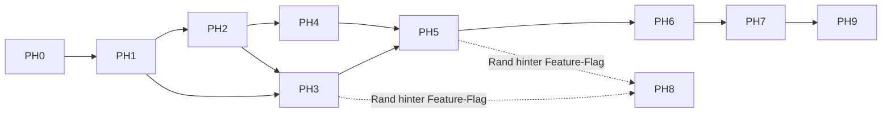

# CONTEXTRA — Implementierungsplan (Dokument B)

```
Dokument:  Begleitende Arbeitsunterlage zur Gesamtspezifikation (Dokument A)
Bezug:     CONTEXTRA_SPEZIFIKATION.md, Fassung 1.3
Code-Basis: https://github.com/tfufuz1/contextra, HEAD ef31d872c (2026-10-24)
Stand:     2026-10-25 (Plan 1.3: Löschkette ergänzt; Code-Befunde am selben HEAD)
Evidenz:   Statusangaben E1 (am Code gelesen, §27.7 der Spezifikation)
```

> **Geltung.** Dieses Dokument ist eine Arbeitsunterlage im Sinn von §28.5 der Spezifikation. Es leitet aus Dokument A Reihenfolge, Arbeitspakete und Abnahmekriterien ab und **führt keine Anforderung ein**. Bei Widerspruch gilt Dokument A. Statusangaben (Abschnitt 1) beziehen sich auf den oben genannten Commit und veralten; Dokument A bleibt davon unberührt.
>
> **Beweisregel.** Eine Phase ist erst abgeschlossen, wenn ihre Abnahmekriterien durch `cargo xtask verify` (Spezifikation §27.10) auf einem unabhängigen Runner mit der genannten Evidenzstufe belegt sind. Berichte und Agentenaussagen zählen nicht (INV-EVIDENCE-1).
>
> **Keine Aufwandsschätzung.** Der Plan nennt keine Dauern oder Personentage. Ohne Messung des tatsächlichen Umbauumfangs je Crate wären sie nicht belegbar; die einzige zeitgebundene Vorgabe ist der Soak-Test aus §28.1 Punkt 7 (Start: 30 Tage).

---

## 1. Ausgangslage: Abweichungsinventar (Ist ↔ Soll)

Gelesen am Commit ef31d872c. „Kein Treffer“ heißt: Textsuche (`grep`) in `crates/` und `xtask/` ohne Fund; das ist E1 und keine Compilerprüfung, daher vor Arbeitsbeginn je Punkt kurz zu bestätigen.

|Δ|Beobachtung (Ist)|Soll (Spezifikation)|Phase|
|---|---|---|---|
|Δ-01|`capabilities.toml` (`schema = "2"`, `spec = "v4"`) führt für keines der 33 Crates ein Feld `class`.|`class` ∈ {kern, rand, experimentell} als einzige Quelle (REQ-ARCH-011, F-05, §6)|PH0|
|Δ-02|Elf Crates stehen auf `maturity = 'stable'`, obwohl die Spezifikation sie als `[R]` oder `[E]` führt: `graph`, `rank`, `kvcache`, `sandbox`, `infer-candle`, `infer-ollama`, `privacy`, `cognition`, `py` (alle `[R]`) sowie `router`, `agent` (`[E]`).|`[R]`/`[E]` ⇒ Zielreife `experimental`; `maturity` wird aus der Evidenzstufe berechnet (§6.0, §6.9, §27.7)|PH0, PH8, PH9|
|Δ-03|`audit-export` und `avv-generator` stehen in Ring 0.|Ring 4, Klasse `[E]` (§6.5, §6.9); Ring 0 verlangt Determinismus ohne Domänenwissen|PH9|
|Δ-04|`contextra-core` steht als Ring 0, `stable`, mit vier `may_depend_on`-Einträgen.|Entfällt als Logik-Crate: Migrationsfassade ohne Logik und ohne neue Abhängigkeiten (§6.1, REQ-ARCH-013)|PH1|
|Δ-05|Kein `trait`-Treffer für `Vfs`, `DurableLog`, `KeyCustodian`, `ErasureParticipant`, `ErasureJournal`, `NotaryPort`, `ModuleVerifier`, `GroupRevocationListener`.|Alle Ports aus Anhang A in `ports`; sieben davon sind Sicherheits-Ports (INV-WIRING-2)|PH1|
|Δ-06|`KmsProvider` (`crypto/src/wal_crypto.rs`), `EntityRecognizer` (`privacy/src/egress_vault.rs`) und `InjectionDetector` (`privacy/src/egress_gateway.rs`) sind außerhalb von `ports` definiert. `LicenseGate` liegt bereits in `ports/src/license.rs`.|Port-Katalog in `ports` (Anhang A, §6.1)|PH1|
|Δ-07|Kein Treffer für `LayerWitness`, `AdmittedModule`, `RetentionPolicy`. `struct DeletionProof` hat 7 Treffer, u. a. in `contextra-engine/src/lib.rs` und `contextra-audit-export/src/lib.rs`.|Löschtypen genau einmal in `crypto`/`ports` (§6.10 Regel 5, REQ-DEL-027); `LayerWitness` nur aus `store`/`vector` ausstellbar (INV-WITNESS-MINT-1)|PH1, PH4, PH8|
|Δ-08|`DurabilityMode::WalNoHmac` existiert (`store/src/lsm/config.rs`), wird in `store/src/lsm/ops/write.rs` und `contextra/src/performance_profile.rs` verwendet (14 Treffer).|Entfällt; nur `Full` und `MemoryOnly` (F-07, §23.2, REQ-DUR-009)|PH2|
|Δ-09|Kein `clippy.toml` im Wurzelverzeichnis.|Versionierte `clippy.toml` mit `disallowed-*` und begründeter Allowlist (REQ-ARCH-022, P28)|PH0|
|Δ-10|`xtask/src/main.rs` kennt `workspace-verify` (Modi fast/audit/full), aber keinen Befehl `verify`. Kein Workspace `xtask-heavy`.|`cargo xtask verify` mit Evidenzdatei je Gate (§27.10, REQ-QA-001); `xtask-heavy` für Fuzz/Miri/Mutation/Chaos (§6.6)|PH0|
|Δ-11|Kein Treffer für das Gate `deletion-honesty`; `governance/security_ports.toml` existiert nicht.|Gate `deletion-honesty` (AC-10); Port-Liste in `governance/security_ports.toml` (INV-WIRING-2, REQ-DEL-023)|PH0, PH4|
|Δ-12|`contextra-checkpoint`: `hardlink_cloner.rs` klont SSTables per Hardlink; `restore_checkpoint` (`store.rs:647`) kennt weder `ErasedSet` noch Restore-Guard noch Höchstalter. `DeletionLayer` in `crypto/src/deletion_proof.rs` hat keine Checkpoint-Variante (E1).|Achte Löschschicht `Checkpoints` mit Participant, `checkpoint_policy`; Restore-Guard und Restore-Horizont (§20.2b Punkt 7, §20.4a, §20.9, INV-RESTORE-HORIZON-1, REQ-DEL-032, -034)|PH4|
|Δ-13|Es gibt keinen `K_commit`: Commitments und Zweckregister kennen keinen Epochenschlüssel; `ErasedSet` trägt keine Epoche (E1: kein Treffer).|Epochenweise zufällige, gewrappte `K_commit[tenant, epoche]` mit Ablauf; neuer Eintrag in `governance/key_purposes.toml` (§20.11, §20.2c, REQ-DEL-033)|PH0, PH4|
|Δ-14|Kein Scanner liest die entschlüsselte Sicht und keiner führt eine positive Kontrolle; `ScanMethod` kennt kein `DecryptedViewScan`; `ResidualReport` hat kein Feld `control_matches` (E1, Lesen von `deletion_proof.rs`).|Scanner in Rohsicht und entschlüsselter Sicht mit positiver Kontrolle; Beweisformat V4 trägt `control_matches` (§20.8 Punkt 7, §20.15, AC-1, AC-7)|PH4|
|Δ-15|Keine Frist- und Eskalationslogik für `Partial`; kein Löschinventar in `doctor`; Außentexte ungeprüft gegen Claims (E1: kein Treffer).|Schwellen `partial_*`, Alarm/Eskalation, Löschinventar, Textvergleich im Gate `deletion-honesty` (§20.10, §20.17, §25.6, REQ-DEL-035..037)|PH4, PH5, PH6|

**Bereits erfüllt (E1, ohne Anspruch auf Vollständigkeit):** 33 Verzeichnisse unter `crates/` (entspricht §6.6: 32 plus `core`); genau drei Crates mit `unsafe_island = true` (`simd`, `sys`, `wire`) und `forbid(unsafe_code)` in den `lib.rs` aller übrigen Crates; `FaultVfs`, `ManualClock` und ein Referenzmodell in `testkit`; Fuzz-Targets in `mcp`, `text` und `db`; Ratchet- und Baseline-Dateien unter `governance/`; Gates für Ring-Layering, Ring-0-Async-Reinheit und Ring-/Capabilities-Konsistenz in `xtask`; `LicenseGate` als Port.

**Nicht untersucht (vor Planbeginn zu klären, kein Befund):** Sidecar-Logs (§7.11) und Zweckregister (§20.2c) im Code; Notreserve und Notlöschpfad (§7.12); Startsequenz B0–B9 (§22.1); Tenant-Lebenszyklus (§24.5); ob `DeletionLayer` genau die acht Schichten aus §20.4 abbildet; ob `DeletionProof` Formatversion 4 trägt; ob SSI (INV-SSI-ACTIVE-1) im Produktionspfad aktiv ist; Schlüsselhierarchie und Verwahrungsstufen K0 bis K3; Wasmtime-Version gegen die Herstellerlinie (§14.3, §28.4); Stand der Abnahmekriterien AC-1 bis AC-20; Ist-Werte der Messverträge aus §26. Jeder dieser Punkte wird in der Eingangsprüfung der jeweiligen Phase als Δ-Eintrag nachgetragen.

---

## 2. Planungsprinzipien

1. **Messlatte zuerst.** Gates und Evidenz entstehen vor dem Umbau (PH0), damit jeder spätere Schritt gegen eine feste Latte läuft (§3 Punkt 13).
2. **Ringe von unten nach oben.** Abhängigkeiten zeigen auf gleichen oder niedrigeren Ring (Prinzip §PH1§); die Phasenfolge folgt dem DAG.
3. **Kern vor Rand.** `[R]`/`[E]`-Arbeit vergrößert nie Beweislast, CI-Zeit oder Angriffsfläche des Kerns (§3 Punkt 14, §6.8). Sie läuft hinter Feature-Flags und darf parallel zum Kern laufen, sobald deren Gate (REQ-ARCH-003, -012) steht.
4. **Atomare Zyklen.** Je Arbeitspaket Rot→Grün, ein Scope, ein verifizierter Commit, serialisiert über die Merge-Queue (§3 Punkt 5, §28.2). Tests werden aus Spezifikation und Invarianten abgeleitet, nicht aus dem Code desselben Erzeugers (§28.3).
5. **Bestehendes bewerten, nicht neu schreiben.** Der Code umfasst rund 290 000 Zeilen (Angabe aus dem Repository-Bestand, nicht neu gezählt); große Crates (`store`, `graph`, `engine`, `vector`) werden gegen die Soll-Garantien geprüft und gezielt umgebaut. Eigenbau bleibt nur bei belegtem Vorteil (§3 Punkt 12).
6. **Evidenz bestimmt Reife.** `maturity` wird nach jeder Phase aus der niedrigsten Mechanismusstufe berechnet; Herabstufungen von `stable` sind erwartet und kein Rückschritt (Δ-02).

---

## 3. Phasenübersicht

Phasenkürzel sind `PH0` bis `PH9`, bewusst nicht `P0` bis `P9`: `P1` bis `P30` sind Prinzipien der Spezifikation (§5).

|Phase|Titel|Crates|Zielstufe bei Abschluss|
|---|---|---|---|
|**PH0**|Messlatte und Governance|`xtask`, `xtask-heavy`, `governance/`, `capabilities.toml`|E2|
|**PH1**|Ring 0: Fundament|`types`, `ports`, `core`, `sys`, `wire`, `simd`|E3|
|**PH2**|Ring 1: Persistenz|`store`, `checkpoint`, `testkit`|E3, Orakel G1: E4|
|**PH3**|Isolation und Indexe|`mvcc`, `vector`, `text`|E3, Orakel G4: E4|
|**PH4**|Kryptografie und Löschpfad|`crypto`, `store` (Löschanteile), `ports`|E3, Orakel G2/G3: E4|
|**PH5**|Orchestrierung und Fassade|`engine`, `db`, `contextra`|E3|
|**PH6**|Schnittstellen und Plattformen|`mcp`, `contextra` (CLI, `doctor`)|E3|
|**PH7**|Kern-Abnahme und Release 1.0|alle `[K]`-Crates|E4|
|**PH8**|Ränder `[R]`|`sandbox`, `privacy`, `graph`, `rank`, `adapt`, `cognition`, `infer-candle`, `infer-ollama`, `kvcache`, `py`|E3 je Crate, Reife `experimental`|
|**PH9**|Experimentelles `[E]`|`router`, `agent`, `infer-onnx`, `license`, `audit-export`, `avv-generator`|keine Zusage|



**Kritischer Pfad:** PH0 → PH1 → PH2 → PH4 → PH5 → PH6 → PH7. PH3 läuft nach PH2 parallel zu PH4. PH8 beginnt je Rand-Crate, sobald dessen Abhängigkeiten im Kern abgenommen sind. PH9 ist von der Release-Zusage ausgenommen und darf den Kern-Pfad nie blockieren.

---

## 4. Phasen im Detail

### PH0 — Messlatte und Governance

**Ziel.** Jede spätere Aussage ist maschinell prüfbar; Δ-01, Δ-09, Δ-10, Δ-11 sind geschlossen.

|WP|Arbeitspaket|Anker|
|---|---|---|
|0.1|`class` je Crate in `capabilities.toml` ergänzen, `spec`-Feld auf die aktuelle Fassung setzen; `maturity` aus Evidenz berechnen statt behaupten; Doc-Truth-Gate um die Konsistenz Register §5.2 ↔ §27.6 ↔ §33 und ID-Eindeutigkeit erweitern|REQ-ARCH-011, REQ-GOV-004, INV-DOC-SINGLE-SOURCE-1, §5.2|
|0.2|`clippy.toml` mit `disallowed-methods`/`-types` für P28 und die `assert!`-Familie; Allowlist je Ausnahme begründet|REQ-ARCH-009, -022, P28|
|0.3|`cargo xtask verify`: Pflicht-Gates in fester Reihenfolge, Evidenzdatei je Gate (Befehl, Toolchain, Commit, Exit-Code, Dauer, Ausführungszahlen, Hash); nicht ausgeführtes Gate = rot. Bestehendes `workspace-verify` wird eingebunden, nicht dupliziert|INV-EVIDENCE-1, REQ-QA-001, §27.10|
|0.4|Vorhandene Gates (Ring-Layering, Ring-0-Async, Capabilities-Konsistenz) gegen §27.5 abgleichen; fehlende ergänzen: Kern-Isolation über aufgelöste Features, Feature-Matrix, `public-api`, Port-Klassifikation|REQ-ARCH-001..003, -012, -014, -018, -020|
|0.5|`governance/security_ports.toml` mit Accept-All-Erkennung; Gate `deletion-honesty` (konstante Messwerte, verworfene Verifier-Ergebnisse, unbedingte `Ok(true)`)|INV-WIRING-2, INV-DELETION-PORTS-1, REQ-DEL-023, AC-10|
|0.6|Workspace `xtask-heavy` für Fuzz, Miri, Mutation, Chaos; „SKIPPED“ gilt als rot|§6.6, REQ-QA-004, -005|
|0.7|Unabhängiger Runner für Gate-Läufe festlegen (außerhalb der Agenten-Infrastruktur)|REQ-QA-009, §28.1 Punkt 1|
|0.8|`governance/key_purposes.toml` (Zweckregister §20.2c, einschließlich `K_commit[tenant, epoche]` als zufälliger, nicht abgeleiteter Schlüssel) mit Gate: jedes HKDF-Label im Code steht im Register, Labels sind paarweise verschieden|INV-KEYPURPOSE-1, REQ-KEY-011|

**Abnahme PH0.** (1) `cargo xtask verify` läuft vollständig und schreibt je Gate eine Evidenzdatei; (1a) das Zweckregister-Gate ist grün und rot bei einem nicht registrierten Label; (2) ein absichtlich ausgelassenes Gate färbt den Lauf rot; (3) das Doc-Truth-Gate meldet rot, wenn in einer Testkopie der Spezifikation eine `INV-*` in §5.2 oder §27.6 fehlt; (4) Δ-01, Δ-09, Δ-10, Δ-11 sind geschlossen. Evidenz: E2.

### PH1 — Ring 0: Fundament

**Ziel.** Alle Ports und Löschtypen existieren genau einmal im Fundament; Ring 0 ist deterministisch und I/O-frei.

|WP|Arbeitspaket|Anker|
|---|---|---|
|1.1|Alle Ports aus Anhang A als Traits in `ports` (Δ-05); `KmsProvider`, `EntityRecognizer`, `InjectionDetector` dorthin verlagern (Δ-06); Sicherheits-Ports in `security_ports.toml`|Anhang A, §6.1, INV-WIRING-2|
|1.2|Löschtypen (Beweis, Schichtbeleg, Messung, Receipt) genau einmal in `crypto`/`ports`; Dubletten in `engine` und `audit-export` auf Re-Exports zurückführen; `LayerWitness` mit privaten Feldern, Aufrufer-Regel im Gate (Δ-07)|§6.10 Regel 5, REQ-DEL-004, -027, INV-WITNESS-MINT-1|
|1.3|`core` auf Migrationsfassade ohne Logik reduzieren, Aufrufer migrieren, Deprecation-Re-Exports (Δ-04)|REQ-ARCH-013, §6.1|
|1.4|Determinismus: `Clock`/`Rng`/`IdGen` ausschließlich über Ports; RandomState-Hashes in Kernlogik ersetzen; `async fn`-Ratchet Richtung 0|P28, INV-RING0-DETERMINISM-1, REQ-ARCH-008, -009, -015|
|1.5|Unsafe-Inseln: je `unsafe`-Block `// SAFETY:`, Miri- und Property-Test gegen sichere Referenz; Attribute aus Edition 2024 mitzählen|Prinzip §PH2§, REQ-ARCH-004, -005, -021|
|1.6|Fuzz-Targets für jede Eintrittsstelle unvertrauter Bytes in `wire` und `types`|REQ-QA-003|

**Abnahme PH1.** Ring-/DAG-Gate, Kern-Isolation und Runtime-Freiheit der Ring-0-Abhängigkeitsbäume grün; `cargo public-api` zeigt keine Test-Zugänge in Release-Features; Miri grün auf den Inseln; Wiederholbarkeitstest (Reihenfolge-Permutation) grün. Evidenz: E3.

### PH2 — Ring 1: Persistenz

**Ziel.** G1 (Crash/WAL) ist belegt; aller Dateizugriff läuft über `Vfs`.

|WP|Arbeitspaket|Anker|
|---|---|---|
|2.1|`Vfs`-Implementierung in `store`: Durability-Primitive je Plattform, DirLock, atomare Writes; sämtlicher Dateizugriff über den Port|§7.8, INV-DURABILITY-PRIM-1, REQ-DUR-001, -015|
|2.2|`fsync`-Fehler vergiften den Handle, ENOSPC-Vorreservierung, Zustandsautomat `Healthy → Degraded → ReadOnly → Poisoned`, Poisoning als typisierter Fehler|INV-FSYNC-1, INV-ENOSPC-1, §7.10, REQ-DUR-002, -003, -014|
|2.3|`WalNoHmac` entfernen (Δ-08); bestehende Datenverzeichnisse über explizite, getestete Migration mit Vorab-Backup; ADR vor Beginn|F-07, REQ-DUR-009, INV-FORMAT-1, §28.6|
|2.4|Recovery-Reihenfolge, Ablehnung von NFS/SMB/FUSE/Cloud-Sync, Blob-Segmente vor WAL-Commit, Rückstau (`l0_slowdown`, `l0_stop`)|§7.3.1, REQ-DUR-007, -008, -010, -013|
|2.5|`DurableLog`, `ErasureJournal`, `ErasureKeyStore` und Rohdatei-Scanner in `store`|§6.2, §20.15, Anhang A|
|2.6|`checkpoint`: Backup-Export ohne Keystore, Restore-Guard (bekannte Löschung vor erstem Lesen erneut anwenden)|§24.4, REQ-DEL-013|
|2.7|Orakel G1: Referenzmodell der WAL-Semantik, Crash-Simulation mit `FaultVfs`, seed-reproduzierbar; Chaos-Matrix über jeden Schreib- und Durability-Punkt|INV-ORACLE-1, §27.3, §27.8, REQ-QA-002, -006|
|2.8|Kompatibilitätskorpus für Formate; Fuzz auf Formatdekoder|INV-FORMAT-1, REQ-DUR-005|
|2.9|Sidecar-Logs (§7.11): `DurableLog`-basierte Ketten mit Magic, Formatversion, Manifest-Marke; `SidecarIntent` im WAL-Batch und idempotenter Applier; „Sidecar vor Wirkung“ für Widerruf, Saga und Schlüsselvernichtung|INV-SIDECAR-1, INV-WAL-SSOT-1, REQ-DUR-016|
|2.10|Notlöschpfad (§7.12): Notreserve bei Start vorab reserviert; Shred-only über eigene Handles bei `Poisoned`; prozesslokale Lesesperre als letzte Stufe|INV-EMERGENCY-DEL-1, REQ-DUR-017|

**Abnahme PH2.** Chaos-Matrix (§27.3) grün auf Linux mit ext4 und xfs; Absturz zwischen WAL-Commit und Sidecar-Anwendung sowie Notlöschtest in `ReadOnly` und `Poisoned` grün; Kompatibilitätskorpus und Migrationstest grün; ein ENOSPC-, ein `fsync`-Fehler- und ein Torn-Write-Szenario sind je mit festem Seed reproduzierbar. Evidenz: E3, G1-Orakel E4.

### PH3 — Isolation und Indexe

**Ziel.** G4 (Isolation) ist belegt; Indexe sind mandantengetrennt und snapshot-konsistent.

|WP|Arbeitspaket|Anker|
|---|---|---|
|3.1|SSI im Produktionspfad mit Prefix-/Range-Phantomschutz; Snapshot immer konkreter Sequenzstand|INV-SSI-ACTIVE-1, REQ-MVCC-001, -003|
|3.2|`born_seq`/`died_seq` in allen Indexeinträgen; ein Applier in WAL-Reihenfolge, HNSW-Level aus `hash(doc_id, seed)`|INV-INDEX-SNAPSHOT-1, INV-INDEX-APPLY-1, REQ-MVCC-002, REQ-DUR-011|
|3.3|Physische Trennung je (Tenant, Collection[, Modell-Hash]) für Vektor und Text; BM25-Statistiken je Tenant; `drop_collection` = Schlüsselvernichtung + Dateilöschung|INV-TENANT-IDX-1, REQ-IDX-001, -008, VETO-F10|
|3.4|HNSW: Tombstone-Pruning, keine Slot-Wiederverwendung bei möglichen Altkanten; ACL-Bitset vor Distanzberechnung; exakte `k`-Ergebnisse mit adaptivem Overfetch|INV-HNSW-SLOT-1, VETO-F02, REQ-IDX-002..005|
|3.5|SQ8 mit exaktem Nachranking; SIMD-Kernel gegen skalare Referenz|REQ-IDX-006, -007|
|3.6|Sperrenhierarchie vollständig; loom-Modell je nebenläufiger Kernstruktur|INV-LOCK-ORDER-1, REQ-MVCC-004, -005|
|3.7|Orakel G4: Brute-Force für ANN/ACL, History-Checker für SSI; Cross-Tenant-Property- und Fuzz-Tests|INV-ORACLE-1, §27.8|

**Abnahme PH3.** History-Checker findet in Fehlerinjektion jede eingebaute SSI-Verletzung; Cross-Tenant-Suite liefert keinen Treffer über Mandantengrenzen; Rebuild eines Index aus WAL ist bit-identisch. Evidenz: E3, G4-Orakel E4.

### PH4 — Kryptografie und Löschpfad

**Ziel.** G2 und G3 sind belegt; `forget` löst alle acht Schichten aus und erzeugt einen ehrlichen Beweis.

|WP|Arbeitspaket|Anker|
|---|---|---|
|4.1|`crypto` I/O-frei und lock-frei; Persistenz nur über `DurableLog`; lokaler `KmsProvider`; KDF mit `KdfHeader` (Argon2id, Untergrenzen aus INV-KDF-1); HKDF-Labels ausschließlich aus dem Zweckregister (§20.2c)|F-02, INV-KMS-1, INV-KDF-1, INV-KEYPURPOSE-1, REQ-KEY-001, -002, -011|
|4.2|AEAD (AES-256-GCM-SIV, AD `scope_id‖key_id‖doc_id_hash`), Verschlüsselung at-rest in zwei Ebenen, `zeroize`, konstantzeitiger Vergleich, keine Schlüsselliterale|INV-ENCRYPT-REST-1/-2, REQ-KEY-003..010|
|4.3|`KeyCustodian`-Implementierungen mit Verwahrungsstufen K0 bis K3; Claims nur bei K2 (mit Warnung) und K3 (attestiert)|F-08, §20.2a, §20.12, AC-14, AC-15|
|4.4|Epochenmodell (`TenantKek` → `EpochKek` → `DocDek`/`SegKey`) für `erasure_required`; Re-Wrap statt Datenrewrite|F-01, §20.2b, REQ-DEL-024..026, REQ-KEY-007|
|4.5|`DeletionProof` Formatversion 4 (Lesen v1 bis v3), `verify_external` nur aus `crypto`+`types`; Referenz-Verifier in anderer Sprache|§20.5, REQ-DEL-017, INV-PROOF-KEY-1|
|4.6|Typestate-Builder: Beweis nur bei lückenloser Schichtabdeckung; jede der acht Schichten genau einmal belegt oder mit `UncoveredReason` signiert|INV-DELETION-WIRE-1, INV-PROOF-COVERAGE-1, REQ-DEL-001, -003|
|4.7|`ErasureParticipant` je Schicht, Messung nur vom Scanner der Schicht (`units_scanned > 0`); Löschsaga durabel, idempotent, wiederaufnehmbar; Lesesperre und Key-Lock; Legal Hold|§20.8..§20.10, REQ-DEL-008, -011, -012, -014, -018|
|4.8|`RevocationLog` und `AuditChain` durabel, tenant-getrennt; INV-SHRED-1 (Schlüsselvernichtung und Log-Eintrag durable vor Receipt)|INV-SHRED-1, REQ-DEL-002, -022, REQ-AUD-001|
|4.9|Kaskade über Lineage auf Ableitungen|INV-DERIVED-1, REQ-DEL-007|
|4.10|Canary-Läufe über das gesamte Datenverzeichnis in Rohsicht und entschlüsselter Sicht mit positiver Kontrolle, plus unabhängiger Zweitzeuge; Abnahmekriterien AC-1 bis AC-20|§27.9, §20.14|
|4.11|Externe Zusicherungen aus der belegten Garantiestufe generieren|INV-CLAIMS-1, REQ-DEL-006|
|4.12|Lesesperre für historische Lesezugriffe: `as_of`, offene Snapshots und Checkpoint-Lesen prüfen den `ErasedSet`; Snapshot-Höchstalter `snapshot_max_age` mit `SnapshotExpired` (setzt WP 3.1 voraus)|INV-ASOF-ERASE-1, REQ-DEL-030, -031, §8, §20.9|
|4.13|Schicht `Checkpoints`: Variante in `DeletionLayer` (Format V4), `ErasureParticipant` im Crate `checkpoint`, Scanner über Checkpoint-Dateien, `checkpoint_policy` (`ExpireNow`, `Rewrite`, `ExpireAfterHold`), `Partial{outstanding: Checkpoints}` mit Ablaufdatum. Voraussetzung: WP 1.2 (Typen genau einmal), WP 4.6|F-09, REQ-DEL-034, AC-16, Δ-12|
|4.14|Restore-Guard und Restore-Horizont in `restore_checkpoint` und Import; Erzeugungszeit im signierten Manifest; Konfigurationsprüfung `backup_max_age ≤ erased_set_retention`|INV-RESTORE-HORIZON-1, REQ-DEL-032, AC-17, Δ-12|
|4.15|`K_commit[tenant, epoche]`: zufällig, gewrappt, Epochenlänge `commit_epoch_len`, Vernichtung nach Epochenende + Aufbewahrung, Eintrag im `RevocationLog`; Zweckregistereintrag (WP 0.8); `ErasedSet` mit Epoche|F-10, REQ-DEL-033, AC-18, Δ-13|
|4.16|Gate `deletion-honesty` um Textvergleich gegen die Claims der Standardkonfiguration (K1) erweitern; Außentext aus dem Beweis erzeugen (Vorlage §4.3)|F-11, REQ-DEL-035, AC-19, Δ-15|
|4.17|Frist- und Eskalationslogik der Saga (`partial_alarm_after`, `partial_escalate_after`, `partial_deadline_report`) mit `ManualClock`; Löschinventar in `doctor` (CLI-Anteil in PH6)|REQ-DEL-036, -037, AC-20, §20.10, §20.17, Δ-15|

**Abnahme PH4.** AC-1 bis AC-20 grün (u. a. Canary-Scan ohne Klartexttreffer, Crash-Matrix über jeden Journalzustand, Beweis-Negativsuite, bytegleicher Beweis mit `ManualClock`); Gate `deletion-honesty` grün und selbst per Mutation wirksam (AC-2, AC-10). Zusätzlich: Referenzmodelltest „`as_of` nach Löschung“ grün (INV-ASOF-ERASE-1); Restore über dem Horizont wird verweigert (INV-RESTORE-HORIZON-1); der Scanner schlägt auf dem Kontroll-Datensatz an (AC-1). Evidenz: E3, G2/G3-Orakel E4. Rechtsfragen (§20.13) sind **kein** Abnahmekriterium dieser Phase, sondern Voraussetzung für Produkttexte (PH7).

### PH5 — Orchestrierung und Fassade

**Ziel.** Die Composition Root verdrahtet jede Kern-Fähigkeit; jede ist über den echten Pfad bewiesen (P29).

|WP|Arbeitspaket|Anker|
|---|---|---|
|5.1|`engine`: Hybrid-Query-Planner, RRF (k=60, Tie-Breaker Score absteigend, DocId aufsteigend), Bounded-Compute-Pool, `as_of`, deterministisches Chunking|§16, REQ-IDX-009, -012|
|5.2|Nichtdeterministische Quellen als aufgezeichnete Werte; Recovery und Rebuild rufen sie nie erneut auf|INV-NONDET-1, REQ-DUR-012|
|5.3|Embedding-Identität: `embedding_model_hash` und Dimension je Collection, Abweisung bei Abweichung, Re-Embedding-Migration; kein Platzhalter-Embedder in Release-Features|INV-EMBED-1/-2, REQ-IDX-011, REQ-FAC-004|
|5.4|Retention-Reaper mit WAL-Record je Entscheidung, Dry-run, Karenzzeit; Decay löscht nie|INV-RETENTION-1, §16.4|
|5.5|`db`: Collections, Transaktionen, Tenant-Scoping aus der Transaktion; kennt keine Inferenz-Backends|INV-TENANT-1, REQ-TEN-001..003|
|5.6|`contextra`: einzige Composition Root; Verdrahtungs-Selbsttest beim Start; Sicherheits-Ports ohne Null-/Accept-All-Standard; `forget` über alle acht Schichten|REQ-FAC-001..003, INV-WIRING-2, INV-DELETION-WIRE-1|
|5.7|Logs, Metriken, Fehlertexte ohne Nutzinhalte; Log-Scanner|INV-LOG-1, REQ-AUD-002|
|5.8|Startsequenz B0–B9 (§22.1): jede Phase mit eigenem Verweigerungsfall; Lesesperre vor dem ersten Lesepfad armiert|INV-BOOT-1, REQ-FAC-005|
|5.9|Tenant-Lebenszyklus (§24.5) und Quoten je Enterprise-Profil; `erase_tenant` als Saga über alle Scopes|REQ-TEN-004, -005|
|5.10|Rand-Brücken (§6.11): je Brücke ein Test für das Verhalten „Ohne Rand“; Modul-Entfernung baut und testet den Kern|REQ-ARCH-024, REQ-ARCH-012|

**Abnahme PH5.** Integrationstest je Kern-Fähigkeit über die Fassade (Wired-Check grün); Startphasen-Abbruchtest je B0–B9 (INV-BOOT-1); Ohne-Rand-Test je Rand-Brücke; Start mit fehlender Sicherheits-Port-Implementierung schlägt fehl; Modellwechsel mit gleichem Dimensionswert wird abgewiesen. Evidenz: E3.

### PH6 — Schnittstellen und Plattformen

|WP|Arbeitspaket|Anker|
|---|---|---|
|6.1|MCP über stdio (JSON-RPC 2.0), `stdout` ausschließlich Protokoll, Primär-/Proxy-Betrieb über lokales IPC mit Peer-Credentials|INV-STDOUT-1, INV-IPC-1, REQ-MCP-001, -002|
|6.2|3-Tool-Fassade plus Vollwerkzeugsatz mit `ToolCategory`; 5-stufige Sicherheitspipeline je Aufruf|F-06, REQ-MCP-003, -004|
|6.3|Forget-Guard mit Bestätigung außerhalb des Tool-Aufrufs; `trust`/`source` je Eintrag, Recall als Daten|INV-FORGET-GUARD-1, INV-TRUST-1, REQ-MCP-005, -006|
|6.4|Kooperativer Abbruch bis in die Engine; Eingangs-/Ausgabegrenzen fuzz-geprüft; strukturierte Fehler (retrybar/final)|INV-CANCEL-1, REQ-MCP-007, -008, -010|
|6.5|CLI `init`, `doctor`, `verify-proof`, `confirm`, `migrate`; `doctor` weist Dateisystemtyp, Cloud-Sync-Pfad, `BestEffort` und fehlende Verschlüsselung aus|REQ-MCP-009, REQ-PLT-001, -004, INV-PLATFORM-1|
|6.6|CI-Matrix macOS und Windows für Durability-Primitive, S2/S3-Löschung, `mmap`; Löschlogik ohne Unix-Unlink-Semantik|§23.4, REQ-PLT-003|

**Abnahme PH6.** Prompt-Injection-Szenarien (Forget-Guard, Trust) grün; Abbruch an jedem Punkt vor WAL-Append lässt keine Wirkung zurück; Plattform-Matrix grün auf Linux (Tier 1), macOS und Windows (Tier 2). Evidenz: E3.

### PH7 — Kern-Abnahme und Release 1.0

|WP|Arbeitspaket|Anker|
|---|---|---|
|7.1|`cargo xtask verify` vollständig grün auf unabhängigem Runner|§28.1 Punkt 1|
|7.2|Schriftlicher Review von `store` und `crypto` durch eine Person außerhalb der Agenten-Pipeline|§28.1 Punkt 2|
|7.3|Messbare Verträge aus §26 mit Baselines gegen fremde Implementierungen (z. B. RocksDB/redb, hnswlib/faiss/usearch)|§26, §27.4, §28.1 Punkt 3|
|7.4|Advisory-Prüfung, Wasmtime-Linie, Supply-Chain-Inventar|§28.1 Punkt 4, §28.4|
|7.5|`CHANGELOG.md`, Kompatibilitätskorpus, Migrationstest|§28.1 Punkt 5|
|7.6|Juristische Prüfung der Außenformulierung (Prüfpunkte aus §20.13) vor jedem Produkttext|§28.1 Punkt 6, INV-CLAIMS-1|
|7.7|Soak-Test über den vorab festgelegten Zeitraum (Start 30 Tage) auf allen Tier-1/2-Plattformen|§28.1 Punkt 7|
|7.8|Kontrollierter Soft-Launch der MCP-Schnittstelle mit Nutzern außerhalb des Entwicklungsteams|§28.1 Punkt 8|
|7.9|`maturity` aus Evidenz berechnen; `stable` nur bei E4|§27.7|

**Abnahme PH7.** Alle acht Kriterien aus §28.1 erfüllt und archiviert. Punkte 2, 6, 7 und 8 hängen an Personen, Fachstellen und Kalenderzeit außerhalb des Repositories und lassen sich nicht durch Code ersetzen. Evidenz: E4.

### PH8 — Ränder `[R]`

Je Rand-Crate ein eigener Zyklus hinter Feature-Flag (Release-Default aus, REQ-ARCH-012). Reife bleibt `experimental`, bis alle Gates mit E3 grün sind (§6.9). Empfohlene Reihenfolge nach Abhängigkeit vom Kern:

|Reihenfolge|Crate|Kernpunkte|Anker|
|---|---|---|---|
|1|`sandbox`|Reale `ModuleVerifier`-Implementierung, `AdmittedModule` nur über `verify`, Freigabe-Zustandsmaschine, Wasmtime-Konfiguration bit-identisch auf x86-64 und aarch64|INV-ADMISSION-1, INV-APPROVAL-1, INV-WASM-DET-1, REQ-SBX-001..003|
|2|`privacy`|Reale `EntityRecognizer`/`InjectionDetector`; ohne reale Erkennung ist Egress gesperrt; fünf Schichten typisiert; Budget und Widerruf|INV-EGRESS-BUDGET-1, REQ-PRV-001..003|
|3|`graph`, `rank`, `adapt`|Mandantengetrennte Graph-Indexe, budgetierte Pfad-Diffusion, deterministische Kalibrierung; Bandit-Mathematik aus `adapt` entfernen, falls `router` ausgelagert wird|REQ-IDX-013, -014, §11, §12|
|4|`infer-candle`, `infer-ollama`|Backends hinter Ports; Embedding-Semantik-Selbsttest je Backend als CI-Gate|§15, INV-EMBED-1|
|5|`cognition`|`MemoryType`-Regeln, Decay als Ranking-Gewicht, Multi-Step-Retrieval mit Latenzschutz, Grounding-Prüfung (`grounding_check`, Schwelle 0,70)|INV-MEMTYPE-1..3, INV-DECAY-1, INV-GASP-1, REQ-COG-001..003|
|6|`kvcache`|M1 erst, wenn B1 bis B3 aus §13.1 erfüllt sind (verdrahtete Löschkette, `external_kv() = true`, Break-even-Gate mit realem Modell); Löschschicht `KvCache` mit `FeatureDisabled` ohne Rand (§20.4a)|REQ-KVC-001, -002, §13.1|
|7|`py`|Dünne Bindung ohne Logik; `panic = "unwind"` mit Abfangen an der Grenze|Prinzip §PH7§, §6.9|

**Abnahme PH8 je Crate.** Alle Gates des Crates grün (E3); Kern-CI-Zeit und Beweislast unverändert (REQ-ARCH-003, §6.8); im Release-Default nicht aktiv.

### PH9 — Experimentelles `[E]`

Ohne Release-Zusage und ohne Beweislast für den Kern. Vorgehen: (1) `audit-export` und `avv-generator` nach Ring 4 verschieben (Δ-03); (2) für `router` und `agent` ein ADR zur Auslagerung in eigene Repositories vorbereiten, wie §18 und §18a empfehlen; (3) `license` mit Property-Tests für INV-LICENSE-1..3 (Prüfreihenfolge aus §23.5, Degradation ohne Datenverlust); (4) `infer-onnx` und SPLADE (REQ-EXP-005) bleiben Default-off. Bandit-Routing bleibt aus, bis ein Regret-Vorteil gegenüber `Cascade` im Benchmark-Gate nachgewiesen ist (INV-ROUTING-1). Rechtsvorlagen (`avv-generator`, `audit-export`) unterliegen dem Rechtsprüfungsvorbehalt (REQ-EXP-004).

---

## 5. Zuordnung aller Invarianten zu Phasen

Die Tabelle wird aus dem Register in §5.2 der Spezifikation erzeugt und führt alle 68 Invarianten. „Phase“ nennt, wo die Invariante eingeführt bzw. abgenommen wird; bei mehreren Phasen ist die letzte die Abnahme. Die Mechanismen entsprechen §27.6.

|ID|Kl.|Phase|Mechanismus|
|---|---|---|---|
|INV-CORE-ISOLATION-1|`[K]`|PH0|G|
|INV-KMS-1|`[K]`|PH4|G + I|
|INV-DELETION-WIRE-1|`[K]`|PH4, PH5|T + I|
|INV-SHRED-1|`[K]`|PH4|C + I|
|INV-SSI-ACTIVE-1|`[K]`|PH3|P + C + L|
|INV-INDEX-SNAPSHOT-1|`[K]`|PH3|P + C + L|
|INV-DOC-SINGLE-SOURCE-1|`[K]`|PH0|G|
|INV-RING0-DETERMINISM-1|`[K]`|PH1|G + P|
|INV-NONDET-1|`[K]`|PH1, PH5|P + G|
|INV-WAL-SSOT-1|`[K]`|PH2|C + P|
|INV-ATOMIC-IDX-1|`[K]`|PH2, PH3|C + P|
|INV-INDEX-APPLY-1|`[K]`|PH3|C + P|
|INV-TENANT-1|`[K]`|PH3|T + P + F + G|
|INV-TENANT-IDX-1|`[K]`|PH3|T + P + F + G|
|INV-KEYSPACE-1|`[K]`|PH2, PH3|T + P + F + G|
|INV-DERIVED-1|`[K]`|PH4, PH5|I + P|
|INV-ENCRYPT-REST-1|`[K]`|PH4|I + G + P|
|INV-ENCRYPT-REST-2|`[K]`|PH4|I + G + P|
|INV-FAILCLOSED-1|`[K]`|PH2, PH7|C + I|
|INV-KDF-1|`[K]`|PH4|I + G + P|
|INV-FSYNC-1|`[K]`|PH2|C|
|INV-DURABILITY-PRIM-1|`[K]`|PH2|C|
|INV-ENOSPC-1|`[K]`|PH2|C|
|INV-IO-1|`[K]`|PH2|G + C|
|INV-FORMAT-1|`[K]`|PH2|G + F|
|INV-LOCK-ORDER-1|`[K]`|PH3|L + G|
|INV-HNSW-SLOT-1|`[K]`|PH3|L + G|
|INV-EMBED-1|`[K]`|PH5|G + I|
|INV-EMBED-2|`[K]`|PH5|G + I|
|INV-WIRING-2|`[K]`|PH0, PH5|G + I|
|INV-DELETION-PORTS-1|`[K]`|PH1, PH4|G + I|
|INV-PROOF-COVERAGE-1|`[K]`|PH4|T + I|
|INV-WITNESS-MINT-1|`[K]`|PH1|T + G|
|INV-PROOF-KEY-1|`[K]`|PH4|T + P|
|INV-CLAIMS-1|`[K]`|PH4, PH7|G|
|INV-PROVENANCE-1|`[K]`|PH0|G|
|INV-PLATFORM-1|`[K]`|PH2, PH6|CI-Matrix + C|
|INV-IPC-1|`[K]`|PH6|I + C + G|
|INV-STDOUT-1|`[K]`|PH6|I + C + G|
|INV-CANCEL-1|`[K]`|PH6|I + C + G|
|INV-FORGET-GUARD-1|`[K]`|PH6|I + P|
|INV-TRUST-1|`[K]`|PH6|I + P|
|INV-LOG-1|`[K]`|PH5, PH6|G + P|
|INV-RETENTION-1|`[K]`|PH5|P + I|
|INV-EVIDENCE-1|`[K]`|PH0|G|
|INV-ORACLE-1|`[K]`|PH2 (G1), PH3 (G4), PH4 (G2, G3)|P|
|INV-SCAN-1|`[K]`|PH0|G|
|INV-SIDECAR-1|`[K]`|PH2, PH4|G + C + I|
|INV-EMERGENCY-DEL-1|`[K]`|PH2, PH4|C + I|
|INV-ASOF-ERASE-1|`[K]`|PH4|P + L|
|INV-RESTORE-HORIZON-1|`[K]`|PH4|I + C + G|
|INV-BOOT-1|`[K]`|PH5|I + C|
|INV-KEYPURPOSE-1|`[K]`|PH0, PH4|G + P|
|INV-ADMISSION-1|`[R]`|PH8|T + P + F|
|INV-APPROVAL-1|`[R]`|PH8|T + P + F|
|INV-WASM-DET-1|`[R]`|PH8|T + P + F|
|INV-GASP-1|`[R]`|PH8|I + P|
|INV-EGRESS-BUDGET-1|`[R]`|PH8|I + P|
|INV-DECAY-1|`[R]`|PH8|I + P|
|INV-MEMTYPE-1|`[R]`|PH8|I + P|
|INV-MEMTYPE-2|`[R]`|PH8|I + P|
|INV-MEMTYPE-3|`[R]`|PH8|I + P|
|INV-ROUTING-1|`[E]`|PH9|OFFEN|
|INV-ROUTING-2|`[E]`|PH9|OFFEN|
|INV-ROUTING-3|`[E]`|PH9|OFFEN|
|INV-LICENSE-1|`[E]`|PH9|P|
|INV-LICENSE-2|`[E]`|PH9|P|
|INV-LICENSE-3|`[E]`|PH9|P|

---

## 6. Risiken und offene Entscheidungen

|Nr.|Punkt|Folge|Maßnahme|
|---|---|---|---|
|R-1|`store` ist der größte Crate und trägt die gesamte I/O-Verantwortung (F-03).|Umbau auf `Vfs`, `DurableLog`, `ErasureJournal` berührt WAL, Recovery und Kompaktion zugleich.|PH2 in kleine Rot→Grün-Zyklen schneiden; Chaos-Matrix vor dem Umbau als Sicherheitsnetz fixieren.|
|R-2|Entfernen von `WalNoHmac` kann bestehende Datenverzeichnisse betreffen.|Öffnen älterer Verzeichnisse schlägt fehl, wenn keine Migration existiert.|ADR (§28.6) vor WP 2.3; explizite Migration mit Vorab-Backup (INV-FORMAT-1).|
|R-3|Herabstufung von elf Crates von `stable` auf `experimental` (Δ-02).|Sichtbar in Berichten und Doku.|Als berechnete Reife begründen (§27.7); Hochstufung nur über Evidenz.|
|R-4|Rechtsprüfpunkte (§20.13) und externe Reviews hängen nicht an der Technik.|PH7 kann sich unabhängig vom Code verzögern.|Früh anstoßen (parallel ab PH4); technische Abnahme und Release-Aussage getrennt führen.|
|R-5|Soak-Test (30 Tage) und Soft-Launch sind kalenderzeitgebunden.|Setzen die Untergrenze für den Releasetermin.|Soak ab erstem E3-Stand der Kern-Crates in PH6 starten, Zeitraum vorab festschreiben.|
|R-6|Große Rand-Crates (z. B. `graph`) sind umfangreich.|Gefahr, den Kern durch Rand-Arbeit zu belasten.|Strikte Feature-Flag-Trennung; PH8 erst nach dem jeweiligen Kern-Anker.|
|R-7|Offene Prüfpunkte aus Abschnitt 1 („Nicht untersucht“).|Δ-Liste kann wachsen.|Eingangsprüfung je Phase, Ergebnis als Δ-Eintrag; Plan bei Bedarf fortschreiben, Dokument A bleibt unberührt.|
|R-8|Sidecar-Logs erhöhen die Zahl der `fsync`-Punkte je Löschoperation (§7.11).|Latenz von `forget` und Kosten je Schreibvorgang steigen.|Benchmark in PH2 mit Schwellwert; Commit-Kosten bleiben ein Flush je WAL-Batch (§7.11 Regel 2).|
|R-10|Hardlink-Checkpoints erreichen physisches Löschen nicht (Δ-12); `Rewrite` kostet Zeit und Wiederherstellungspunkte.|`forget` bleibt bis zum Ablauf `Partial`; Latenz und Platz steigen.|`erasure_required` zuerst für personenbezogene Collections klären (ADR, P-15); Benchmark `Rewrite` in PH4; Standard `ExpireAfterHold`.|
|R-11|Ablauf von `K_commit` und Restore-Horizont verändern das Verhalten bestehender Verzeichnisse.|Alte Checkpoints werden verweigert; `ErasedSet`-Format erhält die Epoche.|Format-ADR vor WP 4.15 (INV-FORMAT-1); Lesen älterer Einträge als Epoche 0; Migration mit Vorab-Backup.|
|R-12|Außentexte und Fristwerte sind Rechtsfragen (P-15 bis P-20).|Technische Abnahme grün, Aussage nicht freigegeben.|Werte als Startwerte (§25.6) markiert; Freigabe vor PH7 (R-4); kein Produkttext vor Gate-Grün und Rechtsprüfung.|
|R-9|Anhang-A-Namen im Körper sind teils abweichend (A.2, Namensauflösung); ungeklärte Namen bleiben offen.|Gate-Fehler bei Abnahme, falls ungeklärt.|Zuordnung vor Beginn von PH8 festlegen; Doc-Truth-Gate prüft die Auflösungstabelle.|

---

## 7. Fortschreibung

Dieses Dokument wird je Phase aktualisiert: Abschnitt 1 erhält den neuen Commit und den Δ-Status, Abschnitt 4 den Abnahmenachweis (Pfad der Evidenzdatei, Commit, Evidenzstufe). Statuszeilen ohne Evidenzdatei sind E0 und gelten nicht als Abschluss.
