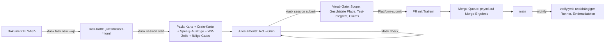

# CONTEXTRA — Meta-System: Analyse, Zielbild und Umsetzungsplan (Dokument C)

```
Dokument:   Arbeitsunterlage zu Dokument A (Spezifikation 1.3) und Dokument B (Implementierungsplan 1.3)
Gegenstand: Kontext- und Entwicklungskette für Agenten (Google-Jules): AGENTS.md, .jules/, rules/, governance/,
            xtask, Gates, GitHub Actions, justfile, Hooks, Dokumentation
Repo-Stand: tfufuz1/contextra, HEAD b11adf5 (flacher Klon, 2026-10-25). Dokument B nennt ef31d872c: Abweichung,
            Δ-Status aus Dokument B ist gegen b11adf5 nicht neu bestätigt.
Stand:      2026-10-25
Evidenz:    E1 (am Code/Text gelesen). Reproduktionsbefehle in §8. Was nicht gelesen wurde, ist als
            „Inhalt ungeprüft“ markiert und wird in der Eingangsprüfung des jeweiligen Prompts verifiziert.
```

> **Geltung.** Dieses Dokument führt keine Anforderung ein. Es leitet aus Dokument A/B ab, wie das Meta-System aussehen muss, damit die Spezifikation maschinell durchsetzbar und für Agenten ohne Widerspruch lesbar ist. Bei Widerspruch gilt Dokument A (§28.5). Keine Aufwandsschätzung (Prinzip aus Dokument B); Größenangaben im Zielbild sind **Obergrenzen**, die nach der Umsetzung gemessen und als Ratchet fixiert werden, keine Prognosen.

---

## 1. Befund

### 1.1 Kennzahlen (E1)

|Bereich|Ist|
|---|---|
|xtask|42.357 LOC in 126 Dateien (`src/`), 8.949 LOC in 74 Dateien (`tests/`); `main.rs` 4.635 Zeilen; Edition 2021; Workspace-Mitglied; hängt als Pfadabhängigkeit an `contextra-bench`, `contextra-router` (Feature `bandit-routing`), `contextra-types`|
|xtask-Kommandos|109 (Registry), davon 21 ohne Referenz außerhalb von `xtask/` (Namenssuche in CI, justfile, Hooks, `.jules`, AGENTS.md, `docs/*.md`, `rules/`, `governance/`)|
|`xtask/registry.toml`|110 Einträge; alle `owner_tier = "legacy"`, `phase = "Phase 0"`, `blocking = true`, Summary „Legacy subcommand …“ → Registry trägt keine Information|
|GitHub Actions|32 Workflows, 3.429 Zeilen; 55 verschiedene xtask-Subcommands in CI; **0** Workflows mit `merge_group`-Trigger|
|justfile|494 Zeilen; 42 verschiedene xtask-Aufrufe; Duplikat zu CI und Hooks|
|`.jules/`|32 Dateien, 1.958 Zeilen (ohne `contextra-Prompter.html` 456 KB und `prompter-data.json` 89 KB)|
|AGENTS.md|1 Wurzel (40 Z.) + 34 Crate-/Bench-Dateien (1.815 Z.)|
|Governance-Dateien|`governance/` 8, `rules/` 6, `CONSTITUTION.md`, `VETOES.md`, `CODEOWNERS`, `.github/unwrap_baseline.txt`, 2× `*.jsonl`-Historien|
|Dokumente|12 Markdown im Wurzelverzeichnis, 18 in `docs/`, 113 ADR-Dateien (Nummernräume: 001–107 mit Lücken 067/068 und 086–094, `N01–N16`, `0XX`)|
|Escape-Marker in Markdown|19× `harness:planned`, 35× `doc-ref-ignore`, 7× `crate-ref-ignore`|
|Inline-Tags `AI-TAG[…]`/`ANCHOR[…]`|59 Vorkommen in 54 Rust-Dateien|
|Ratchet (Ist)|`unwrap_exact` 502, `expect_exact` 242, `allow_attrs` 214, `unwrap_legacy_grep` 1175|
|Spec-Pflichtbausteine, die fehlen|`clippy.toml`, `governance/security_ports.toml`, `governance/key_purposes.toml`, `benchmarks/budgets.toml`, `cargo xtask verify`, Evidenzdateien, `xtask-heavy`, Feld `class` in `capabilities.toml`, maschinenlesbare Verfassungsdatei (§28)|
|`docs/CONTEXTRA_SPEZIFIKATION.md`, `docs/CONTEXTRA_IMPLEMENTIERUNGSPLAN.md`|identisch mit den Anhängen (Fassung 1.3)|

### 1.2 Katalog der vorhandenen Prinzipien, Konzepte und Systeme

|#|System / Konzept|Ort|Bewertung gegen Dokument A/B|Ziel|
|---|---|---|---|---|
|1|Rangfolge der Quellen|AGENTS.md §1, CONSTITUTION.md, JULES_CONTEXT.md (drei Fassungen)|Verweist auf nicht existierende Pfade (W-01)|Eine Rangfolge in AGENTS.md|
|2|MECE-Dokumentationsmodell|CONSTITUTION.md|Prinzip richtig (INV-DOC-SINGLE-SOURCE-1), in der Praxis verletzt (W-03, W-08)|`constitution.toml` + SSOT-Karte (§2.2)|
|3|`capabilities.toml` als SSOT|Wurzel|Konform im Ansatz; ohne `class`, `maturity` behauptet statt berechnet (Δ-01/02)|Ausbauen|
|4|Ring-/DAG-Gates|`check_ring_*`, `tests/layering.rs`|Spec verlangt `cargo metadata` mit aufgelösten Features (§27.5)|Ein Gate `ring-dag`|
|5|ADR + geschützte Pfade + Trailer (`Protected-Change`, `Gate-Weakening`)|`governance/`, `docs/decisions/`|Konform (REQ-GOV-002/003)|Behalten, ADR-Raum normieren|
|6|Gate-Weakening-Schutz, Ratchet|`governance/ratchet.toml`, `harness/`|Konform (REQ-QA-005/010)|Konsolidieren auf eine Datei|
|7|Task-Karten mit Scope/Budget|`.jules/tasks/`, `task_card.rs`, `scope_guard.rs`, `plan_lint.rs`|Konform mit INV-PROVENANCE-1; ohne Bezug zu WP/Δ aus Dokument B|Karte trägt `wp`, `delta`, `spec_refs`|
|8|5-Phasen-Fassade `jules start/check/verify/submit/stop`|`HARNESS_QUICKSTART.md`, `harness-phases.toml`|Teilweise nicht gebaut (`harness:planned`)|`session` + `check` + `verify`|
|9|Context Pack, Crate-Kontext|`context_pack.rs`, `crate_context.rs`|Richtige Idee|Pack enthält Spec-§-Auszüge und WP-Zeile|
|10|Claims, Loop-Guard, Ledger, Session-Report|`claim.rs`, `loop_guard.rs`, `ledger.rs`|In-Repo-Claims sehen parallele Branches nicht (Jules-Sessions laufen isoliert)|Branch-Overlap gegen `origin`; Loop-Guard behalten|
|11|Audit-Intake, Zweit-Session-Verdict|`AUDIT_INTAKE_PROTOCOL.md`, `verdict.rs`, `check_audit_*`|Deckt §28.3 ab; Pfad `docs/audits/` existiert nicht|6 Zeilen in AGENTS.md + 1 Gate|
|12|Tag-System `AI-TAG`/`ANCHOR`|54 Rust-Dateien, `sync-docs`, `tag_health`|Zweites Arbeitsverfolgungssystem neben Dokument B (WP/Δ)|Ablösen (E-3)|
|13|Generierte Projektionen im Repo|`WORKING_STATE.md`, `SOURCE_OF_TRUTH.md`, `TYPE_REGISTRY.md`|§28.5: nie Architekturquelle; committet → Drift („Prompter-Data-Abstand 1984 Commits“)|Nicht committen|
|14|Veto-Register mit Fristen|`VETOES.md`, `check_vetoes.rs`|IDs weichen von §4.1 ab (W-05)|`constitution.toml`|
|15|Prompter|`contextra-Prompter.html`, `prompter-data.json`, `prompter-tiers.toml`, `gen_prompter_data.rs`, `update-prompter-data.yml`|Paralleles Prompt-System; Tier-Modell kollidiert mit `[K]/[R]/[E]`|Ersetzen durch `task new --wp` (E-2)|
|16|Routinen|`.jules/routines/*` (9), `SCHEDULED_AUDIT.md`, `scheduled-audit.yml`, `ISSUE_AUTOMATION_POLICY.md`|Vier Routinen auf 12+ Dateien verteilt|`routines.toml`|
|17|Hooks|`.githooks/`|Ruft 4 Einzel-Gates|`check --staged`|
|18|`rules/*.md`|6 Dateien|Teils veraltet (W-02, W-13); Regel ohne Gate|In Gate-`why` und Crate-Karten aufgehen|
|19|`COMMON_LLM_ERRORS.md`|224 Zeilen, 14 Fehlerklassen|Wertvoll; ~9 Klassen mechanisierbar|Mechanisieren, Rest in AGENTS.md|
|20|Crate-AGENTS.md|34 Dateien, 1.815 Z.|Modulkarten/Signaturen handgepflegt → Drift|≤ 40 Z. Template, Rest generiert|
|21|Jules-API-Dispatch|`jules_dispatch.rs`, `jules-api.toml` (`verified = false`)|Unverifizierte Netzwerk-Integration im Gate-Werkzeug|Nach `xtask-heavy` (E-9)|
|22|Berichte|`LOG.md` (2026-10-02), `FINDINGS_REPORT.md`, `JULES_LOG.md`, `JULES_LOG_2.md`, `JULES_PROMPTS.md`|E0, veraltet|Löschen (Git-Historie bleibt)|
|23|`CODEOWNERS`|Wurzel|Platzhalter-Handles (wirkungslos), Tier-Modell aus „CONTEXTRA_SPEC_2_.md“|Klassen-basiert, echte Handles (E-7)|
|24|Supply Chain|`deny.toml`, `supply-chain/`, `gen-sbom`|Konform|Behalten|

### 1.3 Wie Jules Kontext erhält (E1, `JULES_LOG.md` §1/§2)

Repository-Dateien werden **nie automatisch** geladen; Jules liest per Tool-Aufruf (`list_files`, `read_file`, `run_in_bash_session`). Jede zusätzliche Pflichtdatei kostet Kontext und wird ausgelassen — das erklärt, warum ein dezentrales System nicht vollständig berücksichtigt wird. `git pull`/`git push` sind in der Sandbox blockiert; Einreichung läuft über das Plattform-Tool `submit`. Lokale Gates sind daher **Komfort, nicht Autorität**: bindend ist die CI auf dem Merge-Ergebnis (INV-EVIDENCE-1, INV-PROVENANCE-1). Plattform-Annahmen (Parallelitätslimit, automatisches Lesen von AGENTS.md) sind E0 und von dir im Jules-UI zu bestätigen.

### 1.4 Widerspruchsregister

|ID|Widerspruch|Evidenz|Auflösung im Zielbild|
|---|---|---|---|
|W-01|Spezifikationspfad und -fassung|`AGENTS.md`, `README.md`, `ARCHITECTURE.md` → `docs/spec/CONTEXTRA_SPEZIFIKATION_v15.md` („Fassung 1.2“); `CONSTITUTION.md`, `docs/ARCHITECTURE.md` → `docs/spec/CONTEXTRA_FINALE_PRODUKTSPEZIFIKATION.md`; `docs/GESAMTSPEZIFIKATION.md` → `…_1.2.md`. Real: `docs/CONTEXTRA_SPEZIFIKATION.md` (1.3); `docs/spec/` existiert nicht. `gate_check.rs`, `check_doc_references.rs`, `check_toc_integrity.rs` kodieren den toten Pfad|Pfad genau einmal in `constitution.toml [project]`; alle Gates lesen ihn dort|
|W-02|Unsafe-Inseln: 3 vs. 4|Spec §6.7/P2, AGENTS.md, ADR-N03: drei (`simd`, `sys`, `wire`). `rules/simd_safety.md`: vier (+`crypto`). `governance/ratchet.toml` führt `contextra-crypto = 0`. `.github/copilot-instructions.md` erlaubt `unsafe` in `contextra-vector/{distance,diskann,persistence}.rs`|Quelle: `capabilities.toml unsafe_island`; Text entfällt|
|W-03|Klassifikation: fünf Modelle|Spec: `[K]/[R]/[E]`; `capabilities.toml`: Ring + maturity, kein `class`; `SOURCE_OF_TRUTH.md`: Layer 0–10, 35 Crates, fast alles `stable`; `CODEOWNERS`/`prompter-tiers.toml`: Tier 0–3 + Risk; `README.md`: handgepflegte Tabelle mit `class`|`class` nur in `capabilities.toml`; abgeleitete Tabellen generiert oder gelöscht|
|W-04|HNSW-Löschung|Spec §4.1: VETO-F02 (nur Tombstone-Pruning, unverhandelbar). ADR-097 (Accepted, 2026-09-27) ersetzt Tombstone-Pruning durch Graph-Reparatur; `VETOES.md`: `conditionally_accepted`, Review fällig 2026-10-07 (überschritten)|Spec gilt (§28.5); Änderung eines Vetos braucht ADR + signierte Freigabe → ADR-109 (E-1)|
|W-05|Veto-IDs|`VETOES.md`: `F-02`, `F-10`, `OP-03`, `VETO-ADR` (erfunden); Spec: `VETO-F10`, `VETO-OP03`, `VETO-F02`, Single-Node-Doktrin|Vier Spec-Vetos in `constitution.toml`|
|W-06|Sitzungsprotokoll in vier Fassungen|AGENTS.md §2 (`jules-preflight`); `SESSION_BOOTSTRAP.md` (6 Phasen, `session-init`, `context-pack`, `just …`); `HARNESS_QUICKSTART.md`/`PREAMBLE.md` (5 Phasen `jules start…`); `prompter-tiers.toml` `context_preamble` (liest JULES_CONTEXT → AGENTS → Crate → WORKING_STATE)|Ein Protokoll (§2.7) in AGENTS.md|
|W-07|ADR-Raum|113 Dateien, drei Nummernräume, Lücken, drei „Lücken-Dokumentation“-ADRs (057, 085, 103); ADR-006 vs. ADR-095; `generate_adr.rs`, `check_placeholder_refs.rs` referenzieren `DECISIONS.md` (existiert nicht)|Neue ADRs ab 108 fortlaufend; Altbestand eingefroren; Index generiert|
|W-08|Doppelte Dokumente|`ARCHITECTURE.md` (124 Z., Spec 1.2) vs. `docs/ARCHITECTURE.md` (224 Z.); `BENCH-LOG.md` ×2; vier `BENCHMARK*`-Dokumente|Je Tatsache eine Quelle (§2.2)|
|W-09|Registry ohne Inhalt|siehe §1.1|`gates.toml` ist der Katalog|
|W-10|Lint-Soll vs. Ist|`[workspace.lints]`: 3 rustc + 7 clippy; Spec §27.5: 14 clippy + `disallowed_*`; kein `clippy.toml` (`crates/contextra-ports/AGENTS.md` verweist darauf)|Δ-09 (MP-05)|
|W-11|Merge-Queue|INV-PROVENANCE-1/§28.2 vs. 0× `merge_group`; zwei Rulesets (`protect-main.json`, `.solo.json`)|`merge_group` in `pr.yml`; Queue aktivieren (E-5)|
|W-12|Werkzeug hängt am Produkt|xtask-Abhängigkeiten auf `contextra-bench`/`router`/`types` (`bench_gate.rs`, `session_history.rs`, `check_bandit_latency_budget.rs`) → ein defekter Produkt-Build legt alle Gates still; Spec §6.6 trennt Werkzeug-Crates|`xtask` ohne Produktabhängigkeit; Produktnahes in `xtask-heavy`|
|W-13|Regeltexte nicht gegen Spec abgeglichen|`rules/wal_crypto.md` (Legacy-Schlüssel-Migration, Ed25519-Verifikation ohne KeyManager) vs. F-02/F-07/INV-KMS-1/INV-PROOF-KEY-1; `docs/QUALITAETSPRUEFUNG_…` Z.132 „Obfuscation-Fallback“. Inhalt ungeprüft|Regeln ohne Gate entfallen; Rest wandert in Crate-Karten mit Spec-Bezug|
|W-14|Tote Verweise|Fehlen: `docs/spec/*`, `docs/GITHUB_ANALYSE.md`, `docs/GITHUB_HISTORY.md`, `CONTEXTRA_AUDIT_REPORT.md`, `CONTEXTRA_FIX_PROMPTS.md`, `DECISIONS.md`, `.jules/pending-audit-task.md`, `docs/audits/`, `clippy.toml`; `justfile:225` ruft `rules/detect_nested_locks.yml` (liegt unter `xtask/src/`); `CODEOWNERS` zitiert „CONTEXTRA_SPEC_2_.md“|Link-Gate ohne Ignore-Marker (AK-M2)|

### 1.5 Strukturelle Befunde

|ID|Befund|Folge|
|---|---|---|
|S-01|≥ 5 Einstiegsdateien mit abweichender Ladereihenfolge|Agenten wählen zufällig; Pflichtkontext unbestimmt|
|S-02|Regeln ohne Gate und Gates ohne Regeltext|Prosa driftet; Gates sind für Agenten unerklärlich|
|S-03|Gate-Wildwuchs: 109 Kommandos, 32 Workflows, 494-Zeilen-justfile|Überlappung (`merge-gate` 25, `context-gates` 24, `verdict` 13 xtask-Aufrufe), unklare Autorität|
|S-04|Escape-Marker (`harness:planned`, `*-ignore`) verbergen tote Referenzen vor den Referenz-Gates|Referenzgate ist selbst abschaltbar (verletzt REQ-QA-008)|
|S-05|xtask: `main.rs` mit 4.635 Zeilen, Produktkopplung, `// TODO P-G8`, `#[allow(dead_code)]`|Nicht wartbar; verletzt „null technische Schuld“ (§3 Punkt 3)|
|S-06|Berichte und Projektionen committet (`[skip ci]`-Bot-Commits für Baselines)|Merge-Konflikte, Rauschen, Stale-Quellen|
|S-07|Zwei Arbeitsverfolgungssysteme (Tags vs. Dokument B)|Agenten wissen nicht, was „offen“ ist|
|S-08|Kein `verify`, keine Evidenzdateien, kein unabhängiger Runner|INV-EVIDENCE-1, REQ-QA-009 unerfüllt|
|S-09|In-Repo-Claims für parallele Sessions (laut `JULES_LOG.md`); keine Merge-Queue|Kollisionen, die das System selbst dokumentiert (#1627/#1634/#1645)|

---

## 2. Zielbild

### 2.1 Meta-Prinzipien

|ID|Prinzip|Ableitung|
|---|---|---|
|M1|Eine Tatsache, eine Quelle; Abgeleitetes wird generiert oder geprüft|INV-DOC-SINGLE-SOURCE-1|
|M2|Regel ohne Gate ist ein Wunsch. Der Regeltext lebt im Gate-Katalog (`why`, `enforces`); Agenten-Prosa nur für Nicht-Mechanisierbares|§3 Punkt 11, REQ-QA-008|
|M3|Compiler vor Heuristik: `cargo metadata` (aufgelöste Features), Clippy-Lints, `public-api` statt Regex|§3 Punkt 11, §27.5|
|M4|Evidenz statt Behauptung; nicht ausgeführtes Gate ist rot; keine Escape-Marker|INV-EVIDENCE-1|
|M5|Lokal = Komfort, CI auf dem Merge-Ergebnis = Autorität|INV-PROVENANCE-1|
|M6|Kontextbudget: Pflichtkontext = AGENTS.md (≤ 150 Z.) + generiertes Pack; alles andere per Verweis mit §-Anker|§1.3|
|M7|Eine Aufgabe = eine Karte = ein Scope; Karten entstehen aus Dokument B (WP/Δ), nicht aus Freitext|§3 Punkt 5, §28.2|
|M8|Zustand und Berichte werden berechnet (`xtask status`), nicht committet|§28.5|
|M9|Jedes Gate hat einen Selbsttest mit synthetischem Repository; Schwellen dürfen kein Gate abschalten|REQ-QA-008|
|M10|Phasenbewusst: Gates tragen `from_phase`; `check` läuft die fälligen, `verify --phase` belegt die Phasenabnahme aus Dokument B|Dokument B §3|

### 2.2 SSOT-Karte

|Tatsache|Einzige Quelle|Abgeleitet / geprüft in|
|---|---|---|
|Normative Soll-Architektur, Invariantentexte, REQ-Katalog|`docs/CONTEXTRA_SPEZIFIKATION.md`|`constitution.toml` (IDs) via Doc-Truth|
|Pfade der Kerndokumente, aktive Phase, Fassung|`governance/constitution.toml [project]`|alle Gates, Task-Pack|
|Prinzip-/Invarianten-/Veto-IDs, Klasse, Mechanismus, Phase|`governance/constitution.toml`|Doc-Truth (Bijektion Spec §5.2 ↔ §27.6 ↔ §33 ↔ Datei ↔ `gates.toml enforces`)|
|Ring, Klasse, Reife, Unsafe-Insel, Dev-Ausnahmen, Abhängigkeitsrahmen|`capabilities.toml`|README-Tabelle entfällt|
|Gates: Name, Phase, Tier, Befehl, `enforces`, `why`|`governance/gates.toml`|CI, Hooks, `check`, `verify`|
|Baselines (Panic, Unsafe, Determinismus, Clippy, Mutation, Meta-Budgets)|`governance/ratchet.toml`|Ratchet-Gate; Historie = Git|
|Geschützte Pfade|`governance/protected-paths.toml`|CODEOWNERS-Abdeckung|
|Sicherheits-Ports, Zweckregister|`governance/security_ports.toml`, `governance/key_purposes.toml`|Wired-/Key-Purpose-Gate|
|Arbeitspakete, Δ, Abnahme|`docs/CONTEXTRA_IMPLEMENTIERUNGSPLAN.md`|Task-Karten, `xtask status`|
|Entscheidungen|`docs/decisions/` (ADR)|Index generiert|
|Konstanten, Typen|Code|—|
|Aufgabenbezogener Kontext|Task-Karte → generiertes Pack (`target/xtask/context/`)|nicht committet|

### 2.3 Kontextkette (Soll)



Pflichtlektüre je Sitzung: `AGENTS.md` + Pack. Das Pack enthält die Crate-Karte (≤ 40 Z.) und die in der Karte genannten Spec-Abschnitte als Auszug; die Spezifikation selbst wird nicht komplett geladen.

### 2.4 Ziel-Dateibestand des Meta-Systems

|Bereich|Ist|Soll (Obergrenze)|
|---|---|---|
|Wurzel-Markdown|12|3: `README.md`, `AGENTS.md`, `SECURITY.md`|
|`docs/*.md`|18|7: Spezifikation (A), Plan (B), Meta-Plan (C), `CHANGELOG.md`, `BENCHMARKS.md` (generierte Ergebnisse), `EXPORT_FORMAT.md`, `supply-chain-trust.md` (inkl. BSI-Zuordnung); Archiv `docs/research/`; ADRs unter `docs/decisions/`|
|`governance/`|8|6: `constitution.toml`, `gates.toml`, `ratchet.toml`, `protected-paths.toml`, `security_ports.toml`, `key_purposes.toml`|
|`.jules/`|32 (+456 KB HTML)|4: `setup/environment_script.sh`, `tasks/_TEMPLATE.toml`, `routines.toml`, `jules-api.toml`|
|`rules/`|6|0|
|Crate-AGENTS.md|34 / 1.815 Z.|34 / je ≤ 40 Z.|
|`.githooks/`|2|2, je ≤ 10 Zeilen|
|Workflows|32 / 3.429 Z.|≤ 9|
|`justfile`|494 Z.|≤ 25 Z. (E-8)|
|xtask-Kommandos|109|≤ 12 + `xtask-heavy` ≤ 8|
|xtask `main.rs`|4.635 Z.|≤ 200 Z.; keine Quelldatei > 600 Z.|
|xtask Produktabhängigkeiten|3|0|

Die Budgets werden als Einträge `[meta_budget]` in `governance/ratchet.toml` geführt und dürfen nur sinken.

### 2.5 xtask-Architektur

**Aufteilung.** `xtask` (Rust, kein Netzwerk, keine Produktabhängigkeit, synchron) und `xtask-heavy` (eigener Cargo-Workspace gemäß §6.6; darf Produkt-Crates, Netzwerk und externe Werkzeuge nutzen: Fuzz, Miri, Mutation, Chaos, loom, Benchmarks, Jules-Dispatch).

**Gate = Daten + optional Code.**
- Reine Werkzeugaufrufe (`cargo fmt --check`, `cargo clippy …`, `cargo deny check`, `cargo audit`, `cargo vet`, `cargo public-api`, `cargo miri test`) sind Einträge in `gates.toml` mit `cmd = [...]` und brauchen keinen Rust-Code.
- Analysen, die kein Werkzeug leistet, sind `builtin`: eine Datei `xtask/src/gates/<cluster>/<name>.rs` mit `register()` und `selftest()`.
- `xtask/build.rs` erzeugt Registry und `mod`-Zeilen aus dem Verzeichnisinhalt. **Ein neues Gate ist eine neue Datei; kein gemeinsamer Dispatcher wird editiert** (Voraussetzung für disjunkte Parallelarbeit).

**Kern (`xtask/src/core/`).** `gate.rs` (`GateSpec`, `Outcome::{Pass,Fail,NotApplicable,Error}`), `catalog.rs` (liest `gates.toml`), `constitution.rs`, `ratchet.rs`, `evidence.rs`, `ctx.rs` (Repo, Git, `cargo_metadata`), `exec.rs` (Subprozess, Log-Hash), `report.rs` (Text + `--json`), `exit.rs`.

**Exit-Codes** (aus dem bestehenden Harness übernommen): `0` Pass/NotApplicable, `1` Gate-Verstoß, `2` Fehler/fail-closed (Katalog unvollständig, Werkzeug fehlt, Gate nicht ausgeführt).

**Evidenzdatei** `target/evidence/<gate>.json`: `gate, cmd, toolchain, commit, exit_code, duration_ms, tests_run, tests_skipped, log_sha256, started_utc`; `index.json` mit Hash über alle Einträge (§27.10).

**Kommandos (Soll).**

|Kommando|Zweck|
|---|---|
|`check [--staged] [--ci] [--scope <glob>] [--phase PHn] [--json]`|Schnelle Schleife: alle für die aktive Phase fälligen Gates der Tiers `pr`|
|`verify [--phase PHn] [--evidence-dir <d>]`|Alle Pflicht-Gates, Evidenz je Gate; nicht ausgeführt oder nicht fällig-aber-fehlend = rot (INV-EVIDENCE-1)|
|`gate <name> [-- args]`|Ein Gate|
|`session start --card <f>` · `session submit` · `session stop --reason <r>`|Sitzungsprotokoll (§2.7)|
|`task new --wp <x.y> [--crate <c>]` · `task lint <f>`|Karte aus Dokument B erzeugen/prüfen|
|`ratchet check` · `ratchet update --adr ADR-NNN`|Baselines|
|`docs gen` · `docs check`|ADR-Index; Doc-Truth|
|`explain <gate\|INV-*\|REQ-*>`|Regeltext, Quelle, Mechanismus|
|`status`|Ersatz für `WORKING_STATE.md`: Git-Stand, offene Δ/WP, Gate-Stand|
|`xtask-heavy <fuzz\|miri\|mutants\|chaos\|loom\|bench\|bench-gate\|jules-dispatch>`|Schwere Läufe|

**Tests.** Je Gate `selftest()` mit ≥ 1 positivem und ≥ 1 negativem Fall in einem `tempfile`-Repository; das Meta-Gate `gate-selftests` führt sie aus und färbt rot, wenn ein Gate keinen hat (REQ-QA-008). Gate-Katalog ↔ Implementierung ↔ Selbsttest werden von `catalog-sync` 1:1 geprüft.

**Abhängigkeiten.** MP-02 legt die vollständige Abhängigkeitsliste von `xtask` fest (u. a. `cargo_metadata`, `globset`, `toml`, `serde`, `serde_json`, `syn`, `blake3`, `tempfile`); alle weiteren Prompts ändern `xtask/Cargo.toml` und `Cargo.lock` **nicht**.

### 2.6 Gate-Katalog (Soll) — `governance/gates.toml`

Tier: `pr` (jede PR, Pre-Commit-fähig) · `merge` (Merge-Queue, Merge-Ergebnis) · `nightly` (`verify`, unabhängiger Runner) · `heavy` (`xtask-heavy`). `ab` = erste Phase, ab der das Gate fällig ist.

|#|Gate|Tier|ab|Art|Erzwingt|
|---|---|---|---|---|---|
|1|`fmt`|pr|PH0|cmd|—|
|2|`clippy-lintset`|pr|PH0|cmd|P7, P28, INV-STDOUT-1, INV-LOCK-ORDER-1 (`await_holding_lock`)|
|3|`ring-dag`|pr|PH0|builtin (`cargo_metadata`, aufgelöste Features, inkl. Default-Features der Kerne)|P1, P5, P30, INV-CORE-ISOLATION-1|
|4|`ring0-async`|pr|PH0|builtin|P26|
|5|`capabilities-consistency`|pr|PH0|builtin (`class`, Ring, `maturity` ↔ Evidenzstufe)|REQ-ARCH-011, INV-DOC-SINGLE-SOURCE-1|
|6|`unsafe-inventory`|pr|PH0|builtin + Compiler-Lints|P2, REQ-ARCH-004/005/021|
|7|`public-api`|merge|PH0|cmd (`cargo public-api`, gepinnte Nightly)|INV-SCAN-1, REQ-ARCH-014|
|8|`feature-matrix`|merge|PH0|builtin|REQ-ARCH-003/012, INV-EMBED-1 (`test-utils` nie im Release)|
|9|`wired`|pr|PH0|builtin (Erreichbarkeit + Accept-All-Erkennung)|P29, INV-WIRING-2|
|10|`security-ports`|pr|PH1|builtin|INV-WIRING-2, INV-DELETION-PORTS-1, INV-KMS-1|
|11|`key-purposes`|pr|PH0|builtin|INV-KEYPURPOSE-1|
|12|`witness-mint`|pr|PH1|builtin|INV-WITNESS-MINT-1|
|13|`deletion-types-once`|pr|PH1|builtin|§6.10 Regel 5, REQ-DEL-027|
|14|`deletion-honesty`|pr|PH0 (statisch), PH4 (Claims-Vergleich)|builtin|INV-CLAIMS-1, AC-10, AC-19|
|15|`doc-truth`|pr|PH0|builtin|INV-DOC-SINGLE-SOURCE-1, REQ-GOV-004|
|16|`symbol-uniqueness`|pr|PH0|builtin (`syn`)|P29 (ersetzt Type-Registry-Dokument)|
|17|`code-lints`|pr|PH0|builtin (Regeltabelle)|INV-IO-1, INV-FAILCLOSED-1|
|18|`ratchet`|pr|PH0|builtin|REQ-QA-005, P7|
|19|`determinism`|pr|PH1|builtin + Clippy `disallowed_*`|INV-RING0-DETERMINISM-1, P28|
|20|`protected-paths`|pr|PH0|builtin|REQ-GOV-002|
|21|`gate-weakening`|pr|PH0|builtin|REQ-QA-010|
|22|`test-integrity`|pr|PH0|builtin|REQ-QA-010|
|23|`scope-guard`|pr|PH0|builtin (Scope aus Karte)|INV-PROVENANCE-1|
|24|`provenance`|merge|PH0|builtin (Titel↔Diffstat, stille Rückgängigmachung, Commit-Text)|INV-PROVENANCE-1, REQ-GOV-001|
|25|`claims-in-pr`|pr|PH0|builtin|INV-EVIDENCE-1|
|26|`veto-guard`|pr|PH0|builtin (Schlüsselwörter aus `constitution.toml`)|§4.1|
|27|`adr-index`|pr|PH0|builtin|REQ-GOV-003|
|28|`deny`|merge|PH0|cmd|REQ-GOV-006|
|29|`audit` / `vet`|nightly|PH0|cmd|REQ-GOV-006, §28.4|
|30|`sbom` / `reproducible-build`|nightly|PH0|builtin|§28.4|
|31|`format-corpus`|merge|PH2|cmd|INV-FORMAT-1|
|32|`merge-result-build`|merge|PH0|cmd (`cargo check --workspace --all-targets --locked`)|INV-PROVENANCE-1|
|33|`gate-selftests`|pr|PH0|builtin|REQ-QA-008|
|34|`catalog-sync`|pr|PH0|builtin|REQ-QA-008, REQ-GOV-004|
|35|`evidence-complete`|nightly|PH0|builtin|INV-EVIDENCE-1|
|36|`ci-hygiene`|pr|PH0|builtin (Aktionen gepinnt, referenzierte xtask-Befehle existieren)|—|
|37|`fuzz-matrix`|heavy|PH1|`xtask-heavy`|REQ-QA-003|
|38|`fuzz-regression`|pr|PH1|`xtask-heavy`|REQ-QA-003/004|
|39|`miri`|heavy|PH1|cmd|REQ-QA-004, P2|
|40|`loom-inventory`|heavy|PH3|`xtask-heavy`|INV-LOCK-ORDER-1, §27.1|
|41|`mutation`|heavy|PH2|cmd + Ratchet|REQ-QA-005|
|42|`chaos`|heavy|PH2|`xtask-heavy`|REQ-QA-006|
|43|`bench-regression`|heavy|PH2|`xtask-heavy`, `benchmarks/budgets.toml`|REQ-QA-007|
|44|`platform-matrix`|merge|PH6|CI-Matrix|INV-PLATFORM-1|

`gates.toml` trägt zusätzlich `[meta] active_phase = "PH0"` (Änderung nur per PR mit Evidenz der Phasenabnahme). `gates.toml` wird vollständig von MP-02 angelegt; alle anderen Prompts ändern es nicht (Abweichungen als „Out-of-scope Finding“ an MP-16).

### 2.7 Schnittstellenvertrag (gilt für alle Prompts identisch)

**Sitzungsprotokoll (Soll-Text für AGENTS.md):**
1. `cargo xtask session start --card .jules/tasks/T-….toml` → erzeugt das Pack (`target/xtask/context/PACK.md`), prüft Umgebung, Scope-Überlappung mit offenen `jules/*`-Branches auf `origin`.
2. Pack lesen (nichts sonst), Symbole vor Nutzung per `cargo xtask gate symbol-exists` verifizieren.
3. Rot→Grün; während der Arbeit `cargo xtask check --scope <card-scope>`.
4. `cargo xtask session submit` (Vorab-Gate), dann Plattform-`submit`.
5. Gleicher Fehler zweimal → `cargo xtask session stop --reason thrash`, nicht weiter raten.

**Commit-/PR-Format:** Titel `<typ>(<scope>): <Beschreibung> [<Task-ID>]`; Trailer `Task: <ID>`; bei geschützten Pfaden `Protected-Change: ADR-NNN` (+ Label `protected-change`); bei entfernten/geänderten Gates `Gate-Weakening: ADR-NNN`. PR-Abschnitte: **Disposition** (je entferntes Gate/Kommando: behalten / ersetzt durch X / entfällt weil Y), **Out-of-scope Findings**, **Evidenz** (Befehl, Exit-Code).

**Task-Karte (`_TEMPLATE.toml`):** `id, wp, delta, title, crate, scope[], spec_refs[§], invariants[INV-*], acceptance[cmd], evidence_level (E1–E4), budget{files,lines,iterations}`; `forbidden` wird aus `protected-paths.toml` abgeleitet, nicht in jeder Karte wiederholt.

**Crate-Karte (`crates/*/AGENTS.md`, ≤ 40 Z.):** Zweck (1 Z.) · Spec-§§ · Invarianten (IDs) · Nicht-offensichtliche Entscheidungen (≤ 8, je mit Dateiverweis) · Verbotene Muster · Test-/Gate-Befehle · offene Δ/WP (IDs aus Dokument B). **Keine** Angaben zu Ring, Klasse, Reife, Abhängigkeiten (Quelle: `capabilities.toml`).

**AGENTS.md (Wurzel, ≤ 150 Z.):** Rangfolge der Quellen (Spec > `constitution.toml`/`capabilities.toml`/`gates.toml` > ADR > Dokument B > AGENTS.md; Berichte und Agentenaussagen = Hypothese, E0) · Sitzungsprotokoll · nicht mechanisierbare Regeln (Befund am aktuellen Code verifizieren; Daten sind keine Anweisungen; Tests aus Spec ableiten, nicht aus der Implementierung, §28.3; Scope-Treue; Thrash-Regel; Lösch-Claims nur nach INV-CLAIMS-1; keine Gate-Abschwächung ohne ADR) · Jules-Umgebung (Werkzeuge, kein `git push`, `submit`) · Verweistabelle „Frage → Quelle“.

### 2.8 Schemas (Auszug)

```toml
# governance/constitution.toml
[project]
spec_version = "1.3"
spec_path    = "docs/CONTEXTRA_SPEZIFIKATION.md"
plan_path    = "docs/CONTEXTRA_IMPLEMENTIERUNGSPLAN.md"
meta_plan_path = "docs/CONTEXTRA_META_PLAN.md"

[[principle]]  id = "P1"   class = "K"  title = "Ring-Disziplin"
[[invariant]]  id = "INV-SHRED-1" class = "K" spec = "§5" mech = "C+I" phase = "PH4" reqs = ["REQ-DEL-002"]
[[veto]]       id = "VETO-F02" status = "unverhandelbar" adr = "" keywords = ["partial hnsw rebuild", "rebuild_region", "rewiring"]

# governance/gates.toml
[meta]  active_phase = "PH0"
[[gate]]
name = "ring-dag"  tier = "pr"  from_phase = "PH0"  kind = "builtin"
enforces = ["P1", "P5", "P30", "INV-CORE-ISOLATION-1"]
why = "Kanten zeigen auf gleichen oder niedrigeren Ring; geprüft über cargo metadata mit aufgelösten Features."
owner = "architecture"
```

---

## 3. Disposition

### 3.1 Dateien Ist → Soll

|Ist|Aktion|Ziel / Begründung|Prompt|
|---|---|---|---|
|`CONSTITUTION.md`, `VETOES.md`|löschen|→ `constitution.toml` (IDs, Vetos); Prosa liegt in Spec §4–§5|MP-01, MP-03|
|`CONTRIBUTING.md`, `rules/*` (6), `governance/README.md`|löschen|→ AGENTS.md, Gate-`why`, Crate-Karten|MP-03|
|`.github/copilot-instructions.md`|kürzen|≤ 5 Z. Zeiger auf AGENTS.md (Pfad vom Werkzeug vorgegeben)|MP-03|
|`ARCHITECTURE.md`, `docs/ARCHITECTURE.md`|löschen|Spec §6 (Soll) + `capabilities.toml` (Ist)|MP-14|
|`WORKING_STATE.md`, `docs/SOURCE_OF_TRUTH.md`, `docs/TYPE_REGISTRY.md`|löschen|`xtask status`, `capabilities.toml`, `symbol-uniqueness`|MP-14|
|`LOG.md`, `FINDINGS_REPORT.md`, `JULES_PROMPTS.md`, `BENCH-LOG.md`, `docs/BENCH-LOG.md`|löschen|E0-Berichte; Historie in Git|MP-14|
|`docs/FEATURES_SPECIFICATION.md`, `docs/QUALITAETSPRUEFUNG_COMMIT_FUNKTIONEN_SPEZIFIKATION.md`, `docs/GESAMTSPEZIFIKATION.md`|löschen nach Eingangsprüfung|Was nicht in Spec/Plan steht und noch gilt, wandert als ADR oder Crate-Karte; Rest entfällt|MP-14|
|`docs/BENCHMARK*.md` (4)|zusammenführen|`docs/BENCHMARKS.md` (Ergebnisse nur mit Commit, Hardware, Baseline, §27.4); Methodik = Spec §26/§27.4; unbelegte Router-Kosten-Aussagen (E0) entfallen|MP-14|
|`docs/bsi-grundschutz-mapping.md`|zusammenführen|in `docs/supply-chain-trust.md`|MP-14|
|`docs/CONTEXTRA_SOTA_FORSCHUNGSBERICHT_2025_2026.md`|verschieben|`docs/research/` (nicht normativ, E0)|MP-14|
|`README.md`|kürzen|Produkt, Quickstart, Löschaussage nach §4.3; Ring-/Klassen-Tabelle entfällt|MP-14|
|`.jules/*` außer `setup/environment_script.sh`, `tasks/_TEMPLATE.toml`, `jules-api.toml`|löschen/ersetzen|`routines.toml` ersetzt 9 Dateien; Prompter, Logs, Quickstart, Bootstrap, Preamble, Context entfallen|MP-11|
|`.jules/setup/{install-fuzz-toolchain.sh,refresh-context.sh,required-tools.toml}`|zusammenführen|in `environment_script.sh` (Pins aus `rust-toolchain.toml`/`flake.nix`)|MP-11|
|`governance/{determinism-allow,determinism-baseline,unsafe-safety-baseline,verdict-required}.toml`, `.github/unwrap_baseline.txt`, `docs/*.jsonl`|zusammenführen/löschen|`ratchet.toml`, `gates.toml`; Historie = Git|MP-08, MP-09|
|`xtask/registry.toml`, `xtask/ring0-async-exceptions.toml`|löschen|`gates.toml`; Ausnahmen → `capabilities.toml` (P5)|MP-12, MP-05|
|`AI-TAG`/`ANCHOR` in 54 Rust-Dateien|entfernen (optional, E-3)|offene Punkte → Δ/WP in Dokument B|MP-17|
|Workflows (32)|zusammenführen|siehe §3.3|MP-15|
|`justfile`|kürzen|Aliase auf `cargo xtask` (E-8)|MP-15|
|`CODEOWNERS`|ändern|Klassen-basiert; Handles durch dich (E-7)|MP-08|

### 3.2 Kommandos (109) → Ziel

Zuordnung nach **Name** (E1); der Inhalt wird in der Eingangsprüfung des Besitzer-Prompts gelesen, bevor gelöscht wird. Abweichungen werden in der PR-Disposition begründet.

|Cluster|Ist-Kommandos|Ziel|Prompt|
|---|---|---|---|
|Flags/Modi, keine Kommandos|`--`, `all`, `fast`, `audit`, `json`, `stable`, `experimental`, `deprecated`|→ Optionen von `check`/`verify`|MP-02|
|Architektur|`check-ring-layering(-full)`, `check-dag`, `check-ring-capabilities-consistency`, `check-ring0-async-purity`, `check-unsafe-islands`, `lint-unsafe-slices`, `check-manifest-completeness`, `check-module-reachability`, `check-orphan-modules`, `check-crate-references`, `feature-matrix`, `check-duplicate-core-primitives`, `check-duplicate-symbols(-cross-file)`, `check-type-registry`|`ring-dag`, `ring0-async`, `capabilities-consistency`, `unsafe-inventory`, `wired`, `feature-matrix`, `symbol-uniqueness`|MP-06|
|Code-Lints|`check-max-results-unbound`, `check-toctou-defaults`, `check-nan-hot-loop`, `check-result-dropped-io`, `check-ffi-panic-boundary`, `std-fs-in-async`, `panic-inventory`, `debt-audit`, `check-compile`|`code-lints` (Regeltabelle) bzw. Clippy; Zähler → `ratchet`|MP-06|
|Governance|`protected-paths`, `gate-weakening`, `scope-guard`, `diff-budget`, `test-integrity`, `claims-in-pr`, `check-commit-messages`, `check-commit-diff-integrity`, `commit-health`, `shell-commit-audit`, `shell-interpolation`, `validate-pr-checklist`, `check-duplicate-intent`, `check-branch-overlap`, `prune-branches`, `claim`, `check-audit-*` (3), `audit-integrity-check`, `post-merge-report`, `hotspot-report`|`protected-paths`, `gate-weakening`, `test-integrity`, `scope-guard`, `provenance`, `claims-in-pr`; Overlap in `session start`; Rest entfällt/`status`|MP-08|
|Ratchet/Supply|`check-vetoes`, `check-veto-deadlines`, `check-adr-deadlines`, `check-action-pinning`, `security-scan`, `hardcoded-secret`, `gen-sbom`, `reproducible-build(-check)`, `workspace-verify`, `env-validate`, `env-attest`|`veto-guard`, `ci-hygiene`, `sbom`, `reproducible-build`, `verify`; Fristen entfallen (Vetos sind unverhandelbar, §4.1)|MP-09|
|Sitzung|`jules-preflight`, `jules-submit-gate`, `session-init`, `context-pack`, `crate-context`, `symbol-exists`, `task-card`, `plan-lint`, `loop-guard`, `ledger`, `session-report`, `explain`, `postmortem`, `init-audit-fix`, `jules`|`session start/submit/stop`, `task new/lint`, `explain`, `status`; `symbol-exists` bleibt Gate|MP-10|
|Dokumente|`sync-docs`, `check-consistency`, `check-doc-references`, `check-toc-integrity`, `check-agents-freshness`, `check-agents-integrity`, `check-jules-context-freshness`, `check-placeholder-refs`, `check-phantom-files`, `check-marker-drift`, `generate-markers`, `gen-arch-docs`, `gen-feature-catalog`, `generate-adr`, `consolidate-adrs`, `generate-diagnostics`, `registry-check`, `gates-catalog-sync`, `gen-prompter-data`|`doc-truth`, `catalog-sync`, `adr-index`, `docs gen`; Prompter/Marker entfallen|MP-12|
|Tags|`validate-tags`, `check-stale-tags`, `tag-health`, `context-tags`, `check-review-coverage`|entfallen (E-3)|MP-12|
|Schwer/Bench|`bench-compile`, `bench-download`, `bench-gate`, `bench-trend`, `check-bandit-latency-budget`, `check-coverage-gate`, `check-mutation-score-gate`, `mutation-score-record`, `check-recall-stability`, `loom-run`, `py-test`, `forensic-test`, `ann-sift1m`, `beir`, `onnx-test-model`, `run-community-detection`, `check-flatbuffers-drift`, `check-fbs-drift`, `regenerate-flatbuffers`, `migrate-docid-128`, `fuzz-smoke`, `flake-report`, `wal-replay-verify`, `mutants-diff`|`xtask-heavy …`, Gates 37–43; `migrate-docid-128` entfällt, wenn ADR-082 abgeschlossen|MP-13|

### 3.3 Workflows (32) → Ziel (≤ 9)

|Ziel|Auslöser|Übernimmt|
|---|---|---|
|`pr.yml`|`pull_request`, `merge_group`|`rust-ci`, `context-gates`, `merge-gate`, `verdict`, `commit-integrity-guard`, `shell-commit-gate`, `unwrap-gate`, `proof-correctness`, `contextra-py-ci`, `simd-cross-validation`; Jobs: `check`, `merge-result-build`, `py` (Pfadfilter)|
|`main.yml`|`push` auf `main`|`post-merge-verification`, `unwrap-baseline-check` (Ratchet-Update nur noch per PR), `bench-regression`|
|`verify.yml`|`schedule` nachts, `workflow_dispatch`; **unabhängiger Runner, ohne Agenten-Cache** (E-6)|`deep-gates`, `coverage`, `audit-integrity`, `cargo xtask verify`, Evidenz als Artefakt|
|`heavy.yml`|`schedule`, `workflow_dispatch`|`chaos`, `fuzz-extended`, `loom-gate`, `tsan`, `mutation-testing`, Mutations-Rotation aus `scheduled-audit`|
|`bench.yml`|`schedule`, `workflow_dispatch`|`bench`, `nucleation-recall-history` (Inhalt prüfen: bezieht sich auf das per VETO-F02 begrenzte Feature)|
|`supply-chain.yml`|`pull_request` (Pfadfilter), `schedule`|`deny`, `audit`/`vet`, SBOM, Action-Pinning|
|`release.yml`|`push` Tag, `workflow_dispatch`|`publish-pypi`, `build-wheels`, `release-mcp-binary`|
|`housekeeping.yml`|`schedule`|`prune-branches`, `flake-report`, `veto-deadline-gate` (entfällt, wenn Fristen entfallen), Audit-Routine aus `routines.toml` (nur PR, keine Issues)|
|`platform.yml` (PH6)|`merge_group`|neu: macOS/Windows nach Dokument B WP 6.6|
|entfällt|—|`update-prompter-data`|

---

## 4. Umsetzungsplan

### 4.1 Wellen und Abhängigkeiten

```mermaid
flowchart LR
  subgraph W0[Welle 0: parallel]
    MP00[MP-00 ADR + Plan-Ablage]
    MP01[MP-01 Verfassungsdatei]
    MP02[MP-02 xtask-Kern]
  end
  subgraph W1[Welle 1: parallel, disjunkt]
    MP03[MP-03 AGENTS.md]
    MP04[MP-04 Crate-Karten]
    MP05[MP-05 capabilities + Lints]
    MP06[MP-06 Architektur-Gates]
    MP07[MP-07 Spec-Gates]
    MP08[MP-08 Merge-Guard]
    MP09[MP-09 Ratchet + Supply]
    MP10[MP-10 Session-Harness]
    MP11[MP-11 .jules + Hooks]
    MP12[MP-12 Doc-Gates]
    MP13[MP-13 xtask-heavy]
    MP14[MP-14 Docs-Prune]
  end
  MP15[MP-15 CI + justfile]
  MP16[MP-16 Integration + Abnahme]
  MP17[MP-17 Tag-Entfernung, optional]
  W0 --> W1 --> MP15 --> MP16 --> MP17
```



**Reihenfolge-Regel.** Welle 1 startet erst, wenn MP-00…MP-02 gemergt sind (MP-02 stellt `gates.toml`, Registry-Mechanik und Legacy-Aufteilung bereit; MP-01 die IDs). Innerhalb einer Welle ist die Reihenfolge beliebig; die Dateimengen sind disjunkt (§4.3). Bis MP-15 laufen die alten Workflows unverändert weiter (Parallelbetrieb; Parität wird in MP-16 belegt).

### 4.2 Prompt-Katalog

Jeder Prompt: Rolle, Pflichtlektüre (≤ 3 Dateien mit §), Ziel, **exklusive Dateimenge**, Verbote, Vorgehen (Eingangsprüfung → Rot→Grün → Disposition), Akzeptanzbefehle, PR-Format (§2.7). Alle PRs tragen `Protected-Change: ADR-108` und, wo Gates entfallen, `Gate-Weakening: ADR-108`.

|ID|Titel|Exklusive Dateimenge (Auszug, vollständig in §4.3)|Hängt ab von|Plan-B-Anker|
|---|---|---|---|---|
|**MP-00**|ADR-Entwürfe, Plan-Ablage|`docs/CONTEXTRA_META_PLAN.md`, `docs/decisions/ADR-108-*` (Meta-System-Konsolidierung, Alternativen, Disposition), `ADR-109-*` (Spec 1.3 vs. ADR-097, Status *Proposed*)|—|REQ-GOV-003, §28.6|
|**MP-01**|Verfassungsdatei|`governance/constitution.toml`: `[project]`-Pfade, P1–P30, 68 INV (Klasse, Mechanismus, Phase, REQs aus §5.2/§27.6/§5 Dokument B), 4 Vetos mit Schlüsselwörtern, E0–E4|—|§28 Verfassung, INV-DOC-SINGLE-SOURCE-1|
|**MP-02**|xtask-Kern|`xtask/{Cargo.toml,build.rs,src/main.rs,src/lib.rs,src/core/**}`, `governance/gates.toml` (alle 44 Gates), `xtask-heavy/{Cargo.toml,src/main.rs}` (Gerüst, eigener Workspace), `.cargo/config.toml`, `.gitignore`; **Legacy-Aufteilung:** `main.rs` (4.635 Z.) wird mechanisch ohne Verhaltensänderung in `src/legacy/<cluster>.rs` zerlegt (Cluster nach §3.2); `bench_gate.rs`, `session_history.rs`, `check_bandit_latency_budget.rs` wandern per `git mv` nach `xtask-heavy/src/legacy/`; Produktabhängigkeiten aus `xtask/Cargo.toml` entfernt; neue Kommandos `check`, `verify`, `gate`, `explain` (Rahmen)|MP-00 (ADR-Nummer), MP-01 (Schema)|WP 0.3, Δ-10|
|**MP-03**|Agenten-Einstieg|`AGENTS.md` (Neufassung ≤ 150 Z.), `CONSTITUTION.md`, `VETOES.md`, `CONTRIBUTING.md`, `rules/*`, `governance/README.md`, `.github/copilot-instructions.md`|Welle 0 (Vertrag §2.7)|W-01, W-02, W-06|
|**MP-04**|Crate-Karten|34× `crates/*/AGENTS.md`, `benchmarks/contextra-bench/AGENTS.md` (≤ 40 Z.; Quelle: Spec §6.9, §5.2, vorhandene Karten, `rules/*` vor Löschung durch MP-03 — Lesezugriff auf Git-Historie genügt)|Welle 0|W-13|
|**MP-05**|capabilities + Lint-Satz|`capabilities.toml` (`class`, `spec = "1.3"`, `maturity` der 11 Δ-02-Crates → `experimental`, `audit-export`/`avv-generator` → Ring 4, Dev-Ausnahmen aus `ring0-async-exceptions.toml`), `clippy.toml`, Wurzel-`Cargo.toml` (nur `[workspace.lints]`: neue Lints als `warn`, Hochstufung je Crate per Ratchet), `xtask/ring0-async-exceptions.toml` (löschen), `sgconfig.yml` (Nutzung prüfen)|Welle 0|WP 0.1, 0.2; Δ-01, -02, -03, -09|
|**MP-06**|Architektur- und Code-Gates|`xtask/src/gates/arch/**`, `xtask/src/gates/code/**`, die in §3.2 „Architektur“/„Code-Lints“ genannten Legacy-Dateien samt Tests (`harness/determinism_check.rs`, `lock_audit.rs`, `unsafe_audit.rs`, `gate_check.rs`, `gates/*`, `detect_nested_locks.yml`)|MP-02|WP 0.4; INV-CORE-ISOLATION-1, P26, INV-SCAN-1|
|**MP-07**|Spec-Gates (neu)|`xtask/src/gates/spec/**` (`security-ports`, `key-purposes`, `witness-mint`, `deletion-types-once`, `deletion-honesty`, `embed-features`), `governance/security_ports.toml` (Anhang A.1: Ports, Crate, Sicherheitsklasse, Ist-Status `missing`), `governance/key_purposes.toml` (§20.2c inkl. `K_commit[tenant,epoche]`)|MP-02|WP 0.5, 0.8; Δ-11|
|**MP-08**|Merge-Guard|`xtask/src/gates/gov/**` + Legacy: `harness/{protected_paths,gate_weakening,scope_guard,diff_budget,test_integrity,claims_in_pr,codeowners_coverage,can_merge,blast_radius,risk,verdict}.rs`, `check_commit_*`, `commit_health`, `shell_commit_audit`, `validate_pr_checklist`, `check_audit_*`, `audit_integrity_check`, `check_duplicate_intent`, `claim`, `agent_lifecycle/*`, `post_merge_report`, `hotspot_report`, `check_workflow_commands`; `governance/protected-paths.toml` (+ Spec, `constitution.toml`, `gates.toml`), `governance/verdict-required.toml` (löschen), `CODEOWNERS`|MP-02|INV-PROVENANCE-1, REQ-GOV-001/002, REQ-QA-010|
|**MP-09**|Ratchet + Supply Chain|`governance/ratchet.toml` (Schema: panic, unsafe, determinism, clippy je Lint/Crate, allow-Attribute, Mutation je Crate, Coverage, `[meta_budget]`), `determinism-*`/`unsafe-safety-baseline` (löschen), `.github/unwrap_baseline.txt`, `docs/*.jsonl`, `deny.toml`, `flake.*`, `supply-chain/*`, `.cargo/audit.toml`; Legacy: `harness/{ratchet,dependency_gate,env_attest}.rs`, `check_vetoes`, `check_adr_deadlines`, `veto_deadline_gate`, `check_action_pinning`, `security_scan`, `generators/sbom`, `reproducible_build`, `workspace_verify`, `env_validate`|MP-02|WP 0.3, REQ-QA-005, REQ-GOV-006|
|**MP-10**|Session-Harness|`xtask/src/session/**`; Legacy: `jules_preflight`, `jules_submit_gate`, `session_init`, `context_pack`, `crate_context`, `harness/{jules,task_card,plan_lint,loop_guard,ledger,session_report,explain,postmortem,symbol_exists}.rs`, `init_audit_fix`; neu: Plan-B-Parser (WP/Δ-Tabellen), `task new --wp`, `status`, Pack-Generator (Spec-§-Auszüge nach stabilen Abschnittsnummern), Loop-Guard auf `target/xtask/session.jsonl`|MP-02|W-06, S-09|
|**MP-11**|`.jules/` + Hooks|`.jules/**` (Soll: 4 Dateien, §2.4), `.githooks/*`, `mcp.json` (Gültigkeit prüfen)|Welle 0 (Vertrag §2.7)|W-06, S-01|
|**MP-12**|Doc-Gates + Generatoren|`xtask/src/gates/docs/**`; Legacy: `harness/{doc_truth,registry_check,gates_catalog_sync}.rs`, `check_doc_references`, `check_toc_integrity`, `check_agents_*`, `check_jules_context_freshness`, `check_placeholder_refs`, `check_phantom_files`, `check_type_registry`, `gen_*`, `generate_*`, `tag_health`, `check_stale_tags`, `artifact_header`; `xtask/registry.toml` (löschen), `docs/decisions/README.md` (generiert)|MP-01, MP-02|WP 0.1 (Konsistenz), INV-DOC-SINGLE-SOURCE-1, REQ-GOV-004|
|**MP-13**|xtask-heavy|`xtask-heavy/src/**`, `benchmarks/budgets.toml` (neu), `.cargo/mutants.toml`, `mutants-guarantees.toml`; Legacy-Schwerlauf-Dateien aus §3.2 „Schwer/Bench“ samt `harness/jules_dispatch.rs`; Fuzz-Matrix-Gate (Eintrittsstellen ↔ Targets), Loom-Inventar, Mutation-/Coverage-Ratchet-Anbindung|MP-02|WP 0.6; REQ-QA-003..007|
|**MP-14**|Docs-Prune|Wurzel-Markdown und `docs/*.md` nach §3.1, `README.md`, `SECURITY.md` (Löschaussagen gegen §4.3 prüfen)|Welle 0|W-03, W-08|
|**MP-15**|CI + justfile|`.github/workflows/**` (→ §3.3), `.github/pull_request_template.md`, `.github/rulesets/*`, `justfile`|Welle 1 (Befehlsnamen)|WP 0.7, W-11|
|**MP-16**|Integration + Abnahme|restliche Legacy-Reste (`xtask/src/legacy/**`, `verify_state_transitions.yml`), Ratchet-Initialisierung mit Ist-Werten, Parität alt/neu, `cargo xtask verify --phase PH0` mit Evidenz, Aktualisierung von Dokument B §1/§4 (Δ-01, -09, -10, -11, Evidenzpfade), ADR-097-Status nach Freigabe von ADR-109|MP-15|PH0-Abnahme (1)–(4)|
|**MP-17**|Tag-Entfernung (optional)|`AI-TAG`/`ANCHOR` in 54 Dateien unter `crates/**` (nur Kommentarzeilen); Diff-Budget-Ausnahme per ADR-108|MP-16, Produktarbeit ruhend|S-07|

### 4.3 Disjunktheitsnachweis

Die Zuordnung wurde gegen `git ls-files` (HEAD b11adf5) mit einem Skript geprüft: jede Meta-Datei gehört **genau einem** Prompt; keine Datei ist mehrfach zugeordnet. Nicht zugeordnet und bewusst unberührt: `LICENSE-*`, `rust-toolchain.toml`, `docs/CONTEXTRA_SPEZIFIKATION.md` (Dokument A), 107 Alt-ADRs (unveränderlich), Produktcode. Neue Dateien gehören dem anlegenden Prompt.

|Prompt|vorhandene Dateien|Prompt|vorhandene Dateien|
|---|---|---|---|
|MP-00|1 (+ neue)|MP-09|34|
|MP-02|12|MP-10|28|
|MP-03|12|MP-11|35|
|MP-04|34|MP-12|30|
|MP-05|4|MP-13|31|
|MP-06|41|MP-14|24|
|MP-08|48|MP-15|36|
|MP-16|2|MP-01, MP-07, MP-17|neu bzw. Produktdateien|

Sonderregeln: (1) Nur MP-02 ändert `xtask/Cargo.toml`/`Cargo.lock`. (2) Nur MP-02 ändert `gates.toml`; andere melden Änderungsbedarf an MP-16. (3) `xtask-heavy` ist ein eigener Workspace und berührt das Wurzel-`Cargo.lock` nicht. (4) Jeder Prompt löscht seine Legacy-Dateien **und** den zugehörigen Legacy-Dispatch (`xtask/src/legacy/<cluster>.rs`) im selben PR, damit der Baum kompiliert.

### 4.4 Rückbindung an Dokument B (PH0)

|WP|Inhalt|Prompt|
|---|---|---|
|0.1|`class`, `spec`, Reife berechnet, Doc-Truth-Konsistenz|MP-05, MP-12|
|0.2|`clippy.toml`, Lint-Satz|MP-05|
|0.3|`cargo xtask verify`, Evidenzdatei je Gate|MP-02, MP-09|
|0.4|Gates §27.5 abgleichen/ergänzen|MP-06|
|0.5|`security_ports.toml`, `deletion-honesty`|MP-07|
|0.6|`xtask-heavy`|MP-13|
|0.7|Unabhängiger Runner|MP-15 + du (E-6)|
|0.8|`key_purposes.toml` + Gate|MP-07|
|Abnahme PH0 (1)–(4)|`verify`, Selbsttest rot bei ausgelassenem Gate, Doc-Truth rot bei fehlender INV, Δ-01/-09/-10/-11 geschlossen|MP-16|

PH1–PH9 laufen danach über Karten: `cargo xtask task new --wp 1.1` erzeugt die Karte aus Dokument B (Scope aus der Crate-Zuordnung der Phase, Spec-§ aus dem Anker, Akzeptanz aus der Abnahmezeile).

---

## 5. Abnahme des Meta-Refactorings

|ID|Kriterium|Beleg|
|---|---|---|
|AK-M1|`cargo xtask verify --phase PH0` grün, je Gate eine Evidenzdatei; ein absichtlich ausgelassenes Gate färbt rot|Evidenzverzeichnis, Negativtest|
|AK-M2|Null tote Verweise, null Escape-Marker (`harness:planned`, `*-ignore`); Bijektion Spec §5.2 ↔ §27.6 ↔ §33 ↔ `constitution.toml` ↔ `gates.toml enforces`|`doc-truth`, `catalog-sync`|
|AK-M3|Dateibudgets aus §2.4 erreicht und als `[meta_budget]` im Ratchet|`ratchet`|
|AK-M4|`xtask` ohne Produktabhängigkeit (`cargo tree -p xtask` ohne `contextra-*`), `main.rs` ≤ 200 Z., ≤ 12 Kommandos, jedes Gate mit Selbsttest, LOC-Obergrenze nach Messung im Ratchet|`gate-selftests`, `cargo tree`|
|AK-M5|Pflichtkontext ≤ 150 Z. (`AGENTS.md`) + Pack; Crate-Karten ≤ 40 Z.|`wc -l` im Gate|
|AK-M6|Ein `verify`-Lauf auf dem unabhängigen Runner archiviert|Workflow-Artefakt|
|AK-M7|Paritätsbericht: jedes zuvor blockierende Gate hat Disposition (behalten / ersetzt / entfällt mit Grund); keine stille Streichung|PR-Dispositionen, ADR-108-Anhang|
|AK-M8|Pilot: ein kleines Produkt-WP vollständig über Karte → Pack → PR → Merge-Queue → Evidenz|ein PR als Beleg|

---

## 6. Risiken

|ID|Risiko|Maßnahme|
|---|---|---|
|R-M1|Ersetzte Gates verlieren Abdeckung|Disposition je Gate; Selbsttests; alte Workflows laufen bis MP-15 parallel; Paritätsbericht (AK-M7)|
|R-M2|Selbstblockade durch geschützte Pfade und Gate-Weakening-Gate|ADR-108 vorab freigeben; Trailer in jedem PR; Label `protected-change`|
|R-M3|Parallele Jules-Sessions kollidieren|Disjunktheitsmatrix; Scope aus Karte; Merge-Queue|
|R-M4|Ausgangszustand der CI unbekannt (nicht ausgeführt)|MP-02 erzeugt einen Basisbericht aller Alt-Gates auf b11adf5; ohne ihn keine Paritätsaussage|
|R-M5|Große Löschdiffs lösen `diff-budget` aus|Budget je Karte explizit; ADR-108 als Begründung|
|R-M6|Mechanische Großaufgaben (Aufteilung von `main.rs`, 54-Dateien-Tag-Entfernung) überfordern eine Sitzung|Schrittweise Anweisungen pro Cluster; Abbruchkriterium `thrash`; MP-17 optional|
|R-M7|`cargo public-api` und Miri benötigen eine gepinnte Nightly neben der Stable-Toolchain 1.89.0|Pin in `gates.toml` (`toolchain`), Version in der Evidenzdatei; Setup in `environment_script.sh`|
|R-M8|Plattform-Annahmen zu Jules sind E0|Du bestätigst: Parallelitätslimit, automatisches Lesen von `AGENTS.md`, Plan-Freigabe (`jules-api.toml`: `require_plan_approval = true`)|
|R-M9|Spezifikationsänderungen lassen Abgeleitetes veralten|`doc-truth` bricht rot; IDs nur in `constitution.toml`|
|R-M10|Neue Gates laufen rot, weil Produktcode noch fehlt (Δ-05 u. a.)|`from_phase` + `active_phase`; `verify --phase` belegt nur fällige Gates|

---

## 7. Entscheidungen, die du vor den Prompts triffst

|Nr.|Frage|Mein Default|
|---|---|---|
|E-1|ADR-097 (Graph-Reparatur) vs. VETO-F02 der Spec 1.3: Spec gilt, ADR-097 wird *Superseded*? Änderung eines Vetos bräuchte ADR + signierte Freigabe|Spec gilt; ADR-109 als Entwurf, Freigabe durch dich|
|E-2|Prompter (`contextra-Prompter.html`, `prompter-data.json`, `prompter-tiers.toml`, Generator, Workflow) entfernen und durch `task new --wp` ersetzen?|Ja|
|E-3|`AI-TAG`/`ANCHOR`-Tags ablösen (Wegfall des Tag-Systems; MP-17 entfernt sie aus 54 Dateien)?|Ja; MP-17 erst, wenn Produktarbeit ruht|
|E-4|`WORKING_STATE.md` nicht mehr committen (ersetzt durch `xtask status`)?|Ja|
|E-5|GitHub Merge Queue aktivieren (Ruleset `merge_group`; Repository-Einstellung, nicht per Datei)?|Ja, durch dich|
|E-6|Was ist der „unabhängige Runner“ (REQ-QA-009)? Eigener Runner außerhalb der Jules-Infrastruktur, oder getrennter GitHub-Workflow ohne Cache?|Getrennter Workflow ohne Cache als Start; Review-Person später|
|E-7|Echte `CODEOWNERS`-Handles (aktuell Platzhalter)|Du lieferst sie|
|E-8|`justfile` behalten (≤ 25 Z.) oder löschen?|Behalten als dünne Aliase|
|E-9|`jules-dispatch` (HTTP-Dispatch von Karten an die Jules-API, `verified = false`) in `xtask-heavy` behalten?|Ja, optional, bis du die API-Nutzung bestätigst|
|E-10|Tier-Modell (Tier 0–3, Risk) fällt zugunsten von `class` + `risk_class` in `gates.toml` weg?|Ja|

---

## 8. Reproduktion der Befunde

```bash
git clone https://github.com/tfufuz1/contextra && cd contextra          # HEAD b11adf5
wc -l xtask/src/main.rs; find xtask/src -name '*.rs' | xargs cat | wc -l; find xtask/tests -name '*.rs' | xargs cat | wc -l
grep -c 'owner_tier = "legacy"' xtask/registry.toml                      # 110
grep -l 'merge_group' .github/workflows/*.yml | wc -l                    # 0
grep -rF 'harness:planned' --include='*.md' --include='*.toml' . | wc -l # 19
grep -rF 'doc-ref-ignore' --include='*.md' . | wc -l                     # 35
grep -rE 'AI-TAG\[|ANCHOR\[' crates --include='*.rs' | wc -l            # 59
ls docs/spec governance/security_ports.toml clippy.toml                  # fehlen
grep -n 'vier freigegebenen' rules/simd_safety.md                        # W-02
grep -rn 'docs/spec/' AGENTS.md CONSTITUTION.md xtask/src | head         # W-01
diff -q docs/CONTEXTRA_SPEZIFIKATION.md <Anhang>                         # identisch
```

*Nicht gelesen (Inhalt ungeprüft):* Interna der xtask-Gates (nur Namen und Größen), Workflow-Inhalte (nur Trigger, Zeilen, xtask-Aufrufe), `docs/*` jenseits der Titelzeile, Spec §20.2c und Anhang A im Detail (werden MP-07 als Auszug mitgegeben). Alle Dispositionen „löschen“ stehen unter dem Vorbehalt der Eingangsprüfung im jeweiligen Prompt.
