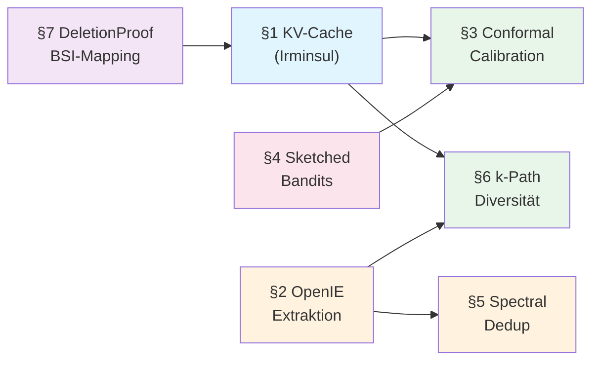

superseded by CONTEXTRA_ENDPRODUKT_SPEZIFIKATION.md

# Contextra — Advanced Algorithms Specification v1

**Stand:** 2026-10-14 · **Autor:** Principal Architect  
**Status:** Draft — Entwurf zur Vorlage für ADR-Review  
**Bezug:** [ARCHITECTURE_PLAN_v1.md](ARCHITECTURE_PLAN_v1.md) Phase 2–4, [ARCHITEKTUR_OPTIMIERUNG_v1.md](ARCHITEKTUR_OPTIMIERUNG_v1.md) §1–7

> [!IMPORTANT]
> Dieses Dokument ist eine **Planungsspezifikation**. Implementierungen erfordern jeweils einen
> dedizierten ADR und eine Task-Karte. Keine Änderung am Produktionscode ohne Gates-Durchlauf
> gemäß `AGENTS.md` §3.

---

## Inhaltsverzeichnis

1. [KV-Cache Eviction & 2-Bit-Quantisierung (Irminsul)](#1-kv-cache-eviction--2-bit-quantisierung-irminsul)
2. [Automatische Wissensgraph-Konstruktion (OpenIE)](#2-automatische-wissensgraph-konstruktion-openie)
3. [Conformal Fusion Calibration](#3-conformal-fusion-calibration)
4. [Sketched Contextual Bandit Projection](#4-sketched-contextual-bandit-projection)
5. [Spectral Hyperedge Deduplication](#5-spectral-hyperedge-deduplication)
6. [Budgeted k-Path Diffusion](#6-budgeted-k-path-diffusion)
7. [Verifizierbare Löschnachweise & Crypto-Shredding](#7-verifizierbare-löschnachweise--crypto-shredding)
8. [Querschnittsthemen](#8-querschnittsthemen)

---

## 1. KV-Cache Eviction & 2-Bit-Quantisierung (Irminsul)

**Crate:** `contextra-kvcache` (Ring 2)  
**Bestandscode:** [`quantize_kivi.rs`](../crates/contextra-kvcache/src/quantize_kivi.rs), [`attention_score.rs`](../crates/contextra-kvcache/src/attention_score.rs), [`eviction_worker.rs`](../crates/contextra-kvcache/src/eviction_worker.rs), [`store.rs`](../crates/contextra-kvcache/src/store.rs), [`segment.rs`](../crates/contextra-kvcache/src/segment.rs)  
**Feature-Gates:** `kivi-quantization` | `kvcache-kivi-quant`  
**Unsafe-Insel:** `src/aligned_alloc.rs` (ADR-019)  
**Referenzen:** KIVI (arXiv:2402.02750), SnapKV (arXiv:2404.14469)

### 1.1 Architektur-Übersicht

```
┌─────────────────────────────────────────────────────────────┐
│                    TenantIsolatedKvStore                     │
│  ┌───────────────┐  ┌──────────────┐  ┌──────────────────┐  │
│  │  Tier-1 (Hot) │  │ Tier-2 (Warm)│  │ PrefixRadixTree  │  │
│  │  fp16/fp32    │→ │ 2-bit KIVI   │  │  Prefix-Reuse    │  │
│  │  in-memory    │  │ mmap+zstd    │  │  Ref-Counting    │  │
│  └───────┬───────┘  └───────┬──────┘  └──────────────────┘  │
│          │                  │                                │
│  ┌───────▼──────────────────▼──────┐                        │
│  │    EvictionWorker (Irminsul)    │                        │
│  │  SnapKV + Attention-Pool       │                        │
│  │  Budget-Constraint per Tenant  │                        │
│  └─────────────────────────────────┘                        │
└─────────────────────────────────────────────────────────────┘
```

### 1.2 Irminsul-Eviction-Algorithmus

Der Name „Irminsul" bezeichnet Contextras deterministische Eviction-Strategie, die SnapKV-Attention-Pooling mit Prefix-Schutz und Budget-Limits vereint.

#### Algorithmus (Pseudocode)

```
FUNCTION irminsul_evict(cache, tenant_budget, attention_window_size):
    segments ← cache.segments_for_tenant(tenant_id)
    
    // Phase 1: Prefix-Schutz
    protected ← ∅
    FOR seg IN segments:
        IF seg.prefix_refcount > 1:
            protected ← protected ∪ {seg.id}
    
    // Phase 2: SnapKV Attention-Scoring
    evictable ← segments \ protected
    obs_window ← last(attention_window_size) tokens
    
    FOR seg IN evictable:
        pooled_score ← 0.0
        FOR token IN obs_window:
            pooled_score ← pooled_score + attention(token, seg)
        seg.eviction_priority ← pooled_score / |obs_window|
    
    // Phase 3: Budget-gesteuerte Eviction (total_cmp-Sortierung)
    sort(evictable, by=eviction_priority, cmp=f64::total_cmp)  // NaN → Ende
    
    excess ← cache.token_count(tenant_id) - tenant_budget
    evicted ← []
    FOR seg IN evictable (aufsteigend nach priority):
        IF excess ≤ 0: BREAK
        spill_to_tier2(seg)  // Quantisierung + Kompression
        excess ← excess - seg.token_count
        evicted.push(seg.id)
    
    RETURN Ok(EvictionReport { evicted, budget_exhausted: excess > 0 })
```

#### Komplexität

| Phase | Zeit | Speicher |
|-------|------|----------|
| Prefix-Schutz | O(S) | O(S) |
| Attention-Scoring | O(S · W) | O(1) |
| Sortierung | O(S log S) | O(1) |
| Eviction + Tier-2-Spill | O(E · T · C) | O(T · C / 4) |

S = Segmentzahl, W = Observation-Window, E = Evicted-Count, T = Tokens, C = Channels

### 1.3 KIVI 2-Bit-Quantisierung (bestehend, Erweiterungen)

Die bestehende Implementierung in [`quantize_kivi.rs`](../crates/contextra-kvcache/src/quantize_kivi.rs) implementiert bereits:
- Asymmetrische 2-Bit-Quantisierung (per-Channel Keys, per-Token Values)
- `KvTensorView`, `KiviBlockMeta`, `KiviQuantizedBlock`
- `kivi_quantize()` / `kivi_dequantize()` Roundtrip
- RLE-Kompression (`compress_bytes` / `decompress_bytes`)

**Geplante Erweiterungen:**

#### 1.3.1 Residual-Length-Normalisierung

```rust
/// Residual-Length-Normalisierung vor Quantisierung (arXiv:2402.02750 §3.2).
/// Normalisiert Keys pro Channel auf Einheitslänge, speichert Normen separat.
pub fn normalize_residual_length(
    keys: &mut [f32],
    num_tokens: usize,
    num_channels: usize,
) -> Result<Vec<f32>> {
    let mut norms = Vec::with_capacity(num_tokens);
    for t in 0..num_tokens {
        let start = t.checked_mul(num_channels)
            .ok_or_else(|| ContextraError::overflow("token * channels"))?;
        let end = start.checked_add(num_channels)
            .ok_or_else(|| ContextraError::overflow("start + channels"))?;
        let slice = keys.get_mut(start..end)
            .ok_or_else(|| ContextraError::bounds("key slice"))?;
        
        // Kahan-Summe für numerische Stabilität
        let mut sum = 0.0f64;
        let mut comp = 0.0f64;
        for &v in slice.iter() {
            let y = (v as f64) * (v as f64) - comp;
            let t = sum + y;
            comp = (t - sum) - y;
            sum = t;
        }
        let norm = sum.sqrt();
        
        if norm > f64::EPSILON {
            let inv_norm = 1.0 / norm;
            for v in slice.iter_mut() {
                *v = (*v as f64 * inv_norm) as f32;
            }
        }
        norms.push(norm as f32);
    }
    Ok(norms)
}
```

#### 1.3.2 Adaptive Gruppengrößen-Selektion

```rust
/// Wählt optimale Gruppengröße basierend auf Channel-Varianz.
/// Hohe Varianz → kleinere Gruppen (16), niedrige Varianz → größere (128).
pub fn select_group_size(keys: &[f32], num_channels: usize) -> usize {
    if keys.is_empty() || num_channels == 0 {
        return 64; // Default
    }
    // Variance-basierte Heuristik über erste 256 Elemente (capped)
    let sample_size = keys.len().min(256);
    let sample = &keys[..sample_size];
    
    let mean = sample.iter().map(|&v| v as f64).sum::<f64>() / sample_size as f64;
    let variance = sample.iter()
        .map(|&v| { let d = v as f64 - mean; d * d })
        .sum::<f64>() / sample_size as f64;
    
    match variance {
        v if v > 10.0 => 16,    // hohe Varianz: feine Gruppen
        v if v > 1.0  => 32,    // mittlere Varianz
        v if v > 0.1  => 64,    // niedrige Varianz
        _             => 128,   // sehr homogen: grobe Gruppen
    }
}
```

### 1.4 Tier-2 Spill-Pipeline

```
Eviction → Residual-Normalisierung → KIVI-Quantisierung (2-bit)
         → RLE/zstd-Kompression (Level 1)
         → AEAD-Verschlüsselung (ShreddableSegmentKey)
         → mmap-Backing (SpillHandler Trait)
```

**Integration mit Crypto-Shredding:** Die bestehenden `ShreddableSegmentKey` und `Tier2EncryptedSegment` in [`segment.rs`](../crates/contextra-kvcache/src/segment.rs) sichern, dass gespillte Segmente über Key-Destruktion kryptographisch gelöscht werden können.

### 1.5 Fehlermodell (Zero-Panic)

| Situation | Behandlung |
|-----------|-----------|
| NaN/Inf in Attention-Scores | `total_cmp` sortiert NaN ans Ende; Eviction-Priorität = 0 |
| Budget-Overflow | `checked_sub` → `EvictionReport { budget_exhausted: true }` |
| Tier-2-Schreibfehler | `Result<_, ContextraError::SpillFailed>` → Segment bleibt in Tier-1 |
| Quantisierungs-Roundtrip-Fehler | `KiviBlockMeta` Validierung, finiter Checks auf Scale/ZeroPoint |
| mmap-Fehler | Propagation via `SpillHandler` Port (Ring 1) |

### 1.6 Ring-Integration

```
Ring 0: ContextraError (Fehlervarianten), TenantId
Ring 1: SpillHandler (Port-Trait), ClockPort (Determinismus)
Ring 2: contextra-kvcache (Irminsul-Logik, KIVI, EvictionWorker)
Ring 3: contextra-store (mmap-SpillHandler-Implementierung)
Ring 4: contextra-engine (Budget-Konfiguration, Tenant-Wiring)
```

---

## 2. Automatische Wissensgraph-Konstruktion (OpenIE)

**Crate:** `contextra-engine` (Ring 4, Orchestrierung), `contextra-graph` (Ring 2, Storage)  
**Bestandscode:** [`entity_extraction.rs`](../crates/contextra-graph/src/entity_extraction.rs), [`hyperedge.rs`](../crates/contextra-graph/src/hyperedge.rs), [`csr.rs`](../crates/contextra-graph/src/csr.rs)  
**Referenzen:** OpenIE (Banko et al. 2007), Deterministic KG Construction

### 2.1 Extraktions-Pipeline

```
Dokument → Chunking (contextra-text)
         → Entitätserkennung (Phase 1: regelbasiert, Phase 2: LLM-Validierung)
         → Relationsextraktion (SPO-Tripel + Hyperkanten)
         → Kanonisierung & Deduplizierung
         → CSR-Graph-Insertion (contextra-graph)
         → Embedding (contextra-embedder, parallel)
```

### 2.2 Deterministisches Entitäts-Extraktionsprotokoll

```rust
/// Deterministische Entitätsextraktion mit kanonischer Sortierung.
/// 
/// Invariante: Identische Eingabe → identische Ausgabe (P28).
/// LLM-Aufrufe über `LlmPort` mit temperature=0.0 und fixed seed.
pub struct DeterministicEntityExtractor<L: LlmPort, C: ClockPort> {
    llm: L,
    clock: C,
    /// Regelbasierte Muster (Datumsformate, E-Mail, URLs, Eigennamen).
    rule_patterns: Vec<CompiledPattern>,
    /// Kanonisierungsstrategie.
    canonicalization: CanonicalizationStrategy,
}

/// Extrahierte Entität mit Provenienz.
#[derive(Debug, Clone, PartialEq, Eq, PartialOrd, Ord)]
pub struct ExtractedEntity {
    /// Kanonische ID (lowercase, stemmed, dedupliziert).
    pub canonical_id: EntityCanonId,
    /// Originaltext-Span im Quell-Chunk.
    pub surface_form: String,
    /// Byte-Offset im Chunk.
    pub span_start: u32,
    pub span_end: u32,
    /// Entitätstyp (Person, Organization, Location, Date, Custom).
    pub entity_type: EntityType,
    /// Konfidenz [0.0, 1.0], validiert via is_finite().
    pub confidence: f32,
    /// Provenienz: Chunk-ID, Dokument-ID.
    pub provenance: EntityProvenance,
}

/// Kanonische Entity-ID für Deduplizierung.
/// Invariante: Ord-Implementierung ist total (kein PartialOrd allein).
#[derive(Debug, Clone, PartialEq, Eq, PartialOrd, Ord, Hash)]
pub struct EntityCanonId(String);

impl EntityCanonId {
    pub fn new(raw: &str) -> Self {
        // Deterministische Kanonisierung:
        // 1. Unicode-NFC-Normalisierung
        // 2. Lowercase (locale-unabhängig: .to_lowercase())
        // 3. Whitespace-Normalisierung (collapse + trim)
        // 4. Suffix/Prefix-Stripping (Inc., GmbH, etc.)
        let normalized = raw.to_lowercase()
            .split_whitespace()
            .collect::<Vec<_>>()
            .join(" ");
        Self(normalized)
    }
}
```

### 2.3 Relationsextraktion und Hyperkanten

```rust
/// Subject-Predicate-Object-Tripel.
#[derive(Debug, Clone, PartialEq, Eq, PartialOrd, Ord)]
pub struct SpoTriple {
    pub subject: EntityCanonId,
    pub predicate: String,
    pub object: EntityCanonId,
    pub confidence: OrderedFloat<f32>,  // total_cmp-kompatibel
    pub provenance: RelationProvenance,
}

/// N-äre Relation als Hyperkante.
/// Für Relationen mit > 2 Entitäten (z.B. "A gründete B mit C in D").
#[derive(Debug, Clone)]
pub struct NaryRelation {
    pub participants: Vec<(EntityCanonId, RoleId)>,
    pub predicate: String,
    pub confidence: OrderedFloat<f32>,
}

impl NaryRelation {
    /// Konvertiert n-äre Relation in HyperEdge für CSR-Graph.
    pub fn to_hyperedge(&self, interner: &RoleInterner) -> Result<HyperEdge> {
        let mut bindings: Vec<RoleBinding> = self.participants.iter()
            .map(|(entity, role)| RoleBinding {
                entity: entity.to_entity_id(),
                role: *role,
            })
            .collect();
        // Deterministische Sortierung (AGT-GRAPH-001)
        bindings.sort_by(|a, b| a.entity.cmp(&b.entity).then(a.role.cmp(&b.role)));
        sort_dedup_entities(&mut bindings);
        Ok(HyperEdge {
            participants: Arc::from(bindings),
            weight: self.confidence.into_inner(),
            // ...
        })
    }
}
```

### 2.4 Ingestion-Integration (Ring 4)

```rust
/// Integrationspunkt in contextra-engine Ingestion-Pipeline.
/// Aufgerufen NACH Chunking, VOR Embedding.
pub async fn ingest_with_graph_extraction<G, L, C>(
    engine: &IngestionEngine<G, L, C>,
    chunks: &[Chunk],
    tenant_id: TenantId,
    tx: TxId,
) -> Result<IngestionResult>
where
    G: GraphIndex,
    L: LlmPort,
    C: ClockPort,
{
    let mut all_entities = Vec::new();
    let mut all_relations = Vec::new();
    
    for chunk in chunks {
        // Phase 1: Regelbasierte Extraktion
        let rule_entities = engine.extractor.extract_rule_based(chunk)?;
        
        // Phase 2: LLM-Validierung (temperature=0, deterministic)
        let validated = engine.extractor.validate_with_llm(&rule_entities, chunk).await?;
        
        // Phase 3: Relationsextraktion
        let relations = engine.extractor.extract_relations(chunk, &validated).await?;
        
        all_entities.extend(validated);
        all_relations.extend(relations);
    }
    
    // Deterministische Sortierung vor Graph-Mutation
    all_entities.sort();
    all_relations.sort();
    
    // CSR-Graph-Update (atomare Transaktion)
    ingest_extracted_relations(&engine.graph, tx, &all_relations).await?;
    
    Ok(IngestionResult { entities: all_entities.len(), relations: all_relations.len() })
}
```

### 2.5 Komplexität

| Phase | Zeit | Speicher |
|-------|------|----------|
| Regelbasierte NER | O(T · P) | O(E) |
| LLM-Validierung | O(E · LLM_latency) | O(E) |
| Relationsextraktion | O(S² · LLM_latency) | O(R) |
| Kanonisierung | O(E · L_avg) | O(E) |
| CSR-Insertion | O(R · log V) | O(R) |

T = Textlänge, P = Musterzahl, E = Entitäten, S = Sätze, R = Relationen, V = Knoten

### 2.6 Fehlermodell

| Situation | Behandlung |
|-----------|-----------|
| LLM-Timeout | `Result<_, ContextraError::LlmTimeout>` → regelbasierte Ergebnisse fallback |
| LLM non-deterministic output | temperature=0, fixed seed; bei Abweichung: Warnung + Skip |
| Leerer Chunk | Leere Entity-Liste → kein Graph-Update |
| Duplikat-Entität | `EntityCanonId`-basierte Deduplizierung, idempotentes CSR-Insert |
| Zyklische Relation | Erlaubt im CSR-Graph (gerichtet), kein Spezialfall |

---

## 3. Conformal Fusion Calibration

**Crate:** `contextra-rank` (Ring 2)  
**Bestandscode:** [`calibration/conformal.rs`](../crates/contextra-rank/src/calibration/conformal.rs), [`calibration/isotonic.rs`](../crates/contextra-rank/src/calibration/isotonic.rs), [`calibration/platt.rs`](../crates/contextra-rank/src/calibration/platt.rs)  
**Feature-Gate:** (kein Feature-Gate, in `calibration` Modul integriert)  
**Referenzen:** arXiv:2511.04275 (Conformal Prediction Sets), arXiv:2503.03841 (Adaptive Conformal), arXiv:2606.29054 (Distribution-Free Coverage)

### 3.1 Status Quo

Die bestehende `AdaptiveConformalCalibrator` implementiert bereits:
- Online-Quantil-Updates mit Pinball-Loss
- Propensity-Weighting für Kovariate-Shift
- `ConfigFingerprint`-basierte Invalidierung (P8)
- Bounded Thresholds `[min, max]`
- Vollständige Zero-Panic-Validierung aller Inputs

### 3.2 Erweiterung: Split-Conformal Fusion mit Coverage-Garantie

```rust
/// Split-Conformal Calibrator mit garantierter Coverage ≥ 1 - α.
///
/// Ersetzt PAVA/Platt durch distributionsfreie Methode:
/// - PAVA: Monotone Regression, gibt kalibrierte Wahrscheinlichkeiten,
///   aber keine Coverage-Garantie.
/// - Platt: Logistische Regression auf Scores, nimmt spezifische
///   Verteilungsform an.
/// - Conformal: Keine Verteilungsannahmen, finite-sample Coverage.
///
/// Referenz: arXiv:2511.04275, §3.
pub struct SplitConformalFusion {
    /// Kalibrierungs-Nonconformity-Scores, sortiert via total_cmp.
    calibration_scores: Vec<f32>,
    /// Target-Miscoverage α ∈ (0, 1).
    alpha: f32,
    /// Cached quantile threshold q̂.
    cached_threshold: f32,
    /// Anzahl der Signal-Quellen (BM25, Vector, Graph, KV, etc.).
    num_signals: usize,
    /// Pro-Collection persistierter Kalibrierungszustand.
    collection_id: CollectionId,
}
```

#### Kalibrierungs-Algorithmus

```
FUNCTION calibrate(labeled_data, signal_scores, alpha):
    // Schritt 1: Fusionierten Score berechnen
    FOR (doc, label) IN labeled_data:
        fused ← weighted_fusion(signal_scores[doc])
        
        // Nonconformity Score: Wie "falsch" ist der fused Score?
        IF label == RELEVANT:
            s ← 1.0 - fused       // Relevante Dokumente sollten hohen Score haben
        ELSE:
            s ← fused              // Irrelevante sollten niedrigen Score haben
        
        calibration_scores.push(s)
    
    // Schritt 2: Sortierung mit total_cmp (Determinismus, NaN-sicher)
    calibration_scores.sort_by(f32::total_cmp)
    
    // Schritt 3: Konforme Quantil-Berechnung
    // Ceil((n+1)(1-α))-ter kleinster Score
    n ← |calibration_scores|
    rank ← ceil((n + 1) * (1.0 - alpha))
    rank ← clamp(rank, 1, n)
    q_hat ← calibration_scores[rank - 1]    // 0-indiziert
    
    RETURN q_hat
```

#### Vorhersage (Prediction Set)

```
FUNCTION predict_set(query_signals, q_hat):
    prediction_set ← {}
    FOR doc IN candidate_documents:
        fused ← weighted_fusion(query_signals[doc])
        nonconformity ← 1.0 - fused    // Annahme: suchen Relevante
        IF nonconformity ≤ q_hat:
            prediction_set ← prediction_set ∪ {doc}
    
    RETURN prediction_set   // Garantie: P(true_relevant ∈ set) ≥ 1 - α
```

### 3.3 Rust-Implementierung

```rust
impl SplitConformalFusion {
    /// Erstellt einen neuen Calibrator.
    pub fn new(alpha: f32, num_signals: usize, collection_id: CollectionId)
        -> Result<Self, ConformalError>
    {
        if !alpha.is_finite() || alpha <= 0.0 || alpha >= 1.0 {
            return Err(ConformalError::InvalidAlpha(alpha));
        }
        Ok(Self {
            calibration_scores: Vec::new(),
            alpha,
            cached_threshold: 1.0,  // Konservativ: alles einschließen
            num_signals,
            collection_id,
        })
    }
    
    /// Kalibriert mit gelabelten Daten. O(n log n).
    pub fn calibrate(&mut self, scores_and_labels: &[(f32, bool)]) -> Result<f32, ConformalError> {
        self.calibration_scores.clear();
        
        for &(score, is_relevant) in scores_and_labels {
            if !score.is_finite() {
                return Err(ConformalError::InvalidNonConformityScore(score));
            }
            let nc = if is_relevant { 1.0 - score } else { score };
            self.calibration_scores.push(nc);
        }
        
        // Deterministische Sortierung
        self.calibration_scores.sort_by(f32::total_cmp);
        
        let n = self.calibration_scores.len();
        if n == 0 {
            self.cached_threshold = 1.0;
            return Ok(self.cached_threshold);
        }
        
        // Quantil-Berechnung: ⌈(n+1)(1−α)⌉
        let raw_rank = ((n as f64 + 1.0) * (1.0 - self.alpha as f64)).ceil();
        let rank = (raw_rank as usize).clamp(1, n);
        
        self.cached_threshold = self.calibration_scores
            .get(rank - 1)
            .copied()
            .unwrap_or(1.0);  // Fallback statt panic
        
        Ok(self.cached_threshold)
    }
    
    /// Prediction-Set: Alle Dokumente mit Nonconformity ≤ q̂.
    pub fn prediction_set(&self, fused_scores: &[(DocId, f32)]) -> Vec<DocId> {
        let mut result: Vec<DocId> = fused_scores.iter()
            .filter(|(_, score)| {
                let nc = 1.0 - score;
                nc.total_cmp(&self.cached_threshold) != std::cmp::Ordering::Greater
            })
            .map(|(id, _)| *id)
            .collect();
        // Deterministische Reihenfolge
        result.sort();
        result
    }
}
```

### 3.4 Online-Adaptation (bestehend erweitern)

Die bestehende `AdaptiveConformalCalibrator` wird als **Online-Update-Schicht** über dem `SplitConformalFusion` verwendet:

```
Offline-Kalibrierung (SplitConformalFusion::calibrate)
    ↓ q̂₀
Online-Updates (AdaptiveConformalCalibrator::update)
    ↓ q̂ₜ (adaptiv)
Prediction (prediction_set mit q̂ₜ)
```

### 3.5 Komplexität

| Operation | Zeit | Speicher |
|-----------|------|----------|
| Offline-Kalibrierung | O(n log n) | O(n) |
| Online-Update | O(1) | O(1) |
| Prediction-Set | O(m) | O(m) |
| Threshold-Lookup | O(1) | O(1) |

n = Kalibrierungsdaten, m = Kandidaten-Dokumente

### 3.6 Fehlermodell

| Situation | Behandlung |
|-----------|-----------|
| NaN in Scores | `ConformalError::InvalidNonConformityScore` |
| Leere Kalibrierungsdaten | Threshold = 1.0 (konservativ, alles einschließen) |
| α außerhalb (0,1) | `ConformalError::InvalidAlpha` |
| Score-Overflow | f32-Bereich; `is_finite()` Guard |

---

## 4. Sketched Contextual Bandit Projection

**Crate:** `contextra-adapt` (Ring 2)  
**Bestandscode:** [`bandit.rs`](../crates/contextra-adapt/src/bandit.rs) (1211 Zeilen, vollständiges LinUCB)  
**Feature-Gate:** `bandit-routing`  
**Referenzen:** arXiv:2606.27917 (Sketched LinUCB), arXiv:2605.00500 (JL Contextual Bandits)

### 4.1 Motivation

Der bestehende LinUCB-Bandit in `bandit.rs` hält eine d×d-Kovarianzmatrix `A` pro Arm und aktualisiert die Inverse via Sherman-Morrison:

```
A⁻¹ ← A⁻¹ - (A⁻¹ x xᵀ A⁻¹) / (1 + xᵀ A⁻¹ x)    // O(d²) pro Update
```

Bei d = 768 (typische Embedding-Dimension) kostet jedes Update ~2.4M FP-Operationen und belegt ~2.4 MB pro Arm. Mit Sketched Projection sinkt dies auf O(k²) mit k ≈ 50–100.

### 4.2 Algorithmus

```
FUNCTION sketched_bandit_init(d, k, num_arms, rng_port):
    // Sparse Johnson-Lindenstrauss Matrix (Achlioptas-Verteilung)
    S ← sparse_jl_matrix(k, d, rng_port)
    // S[i,j] = √(3/k) · {+1 mit P=1/6, 0 mit P=2/3, -1 mit P=1/6}
    
    FOR arm IN 0..num_arms:
        A_proj[arm] ← I_k          // k×k Identitätsmatrix
        A_proj_inv[arm] ← I_k      // k×k Inverse
        b_proj[arm] ← 0_k          // k-Vektor
        update_count[arm] ← 0
    
    RETURN SketchedBanditState { S, A_proj, A_proj_inv, b_proj, update_count }

FUNCTION select_arm(state, context_x, alpha):
    z ← state.S × context_x          // O(nnz(S)) ≈ O(k·d/3)
    
    best_ucb ← -∞
    best_arm ← 0
    FOR arm IN 0..num_arms:
        θ ← state.A_proj_inv[arm] × state.b_proj[arm]     // O(k²)
        exploitation ← zᵀ θ                                // O(k)
        
        // Varianzterm: zᵀ A_proj_inv z
        v ← state.A_proj_inv[arm] × z                      // O(k²)
        variance ← zᵀ v                                    // O(k)
        IF variance < 0.0 OR !variance.is_finite():
            RETURN Err(NonFiniteVariance(variance))
        
        exploration ← alpha × √variance
        ucb ← exploitation + exploration
        IF ucb >_total_cmp best_ucb:
            best_ucb ← ucb
            best_arm ← arm
    
    RETURN Ok(best_arm)

FUNCTION update(state, arm, context_x, reward):
    z ← state.S × context_x          // O(nnz(S))
    
    // Sherman-Morrison auf k×k Matrix: O(k²)
    v ← state.A_proj_inv[arm] × z
    denom ← 1.0 + zᵀ v
    IF |denom| < ε OR !denom.is_finite():
        RETURN Err(PrecisionMatrixDriftDetected)
    
    state.A_proj_inv[arm] ← A_proj_inv - (v vᵀ) / denom
    state.b_proj[arm] ← b_proj + reward × z
    state.update_count[arm] += 1
    
    // Periodische Re-Faktorisierung (existierender Mechanismus)
    IF update_count[arm] % REFACTORIZATION_INTERVAL == 0:
        refactorize_inverse(state, arm)
    
    RETURN Ok(())
```

### 4.3 Sparse JL-Matrix-Konstruktion

```rust
/// Sparse Johnson-Lindenstrauss Projektionsmatrix (Achlioptas 2003).
///
/// Jeder Eintrag S[i,j] = √(3/k) · X, wobei X ~ {+1 mit P=1/6, 0 mit P=2/3, -1 mit P=1/6}.
/// Sparsity: ~2/3 der Einträge sind Null → effiziente Sparse-Multiplikation.
///
/// Determinismus: RNG-Seed über `RngPort` (P28).
pub struct SparseJLMatrix {
    /// Dimension: k × d (k Zeilen, d Spalten).
    k: usize,
    d: usize,
    /// CSR-Format: (row_offsets, col_indices, values).
    row_offsets: Vec<usize>,
    col_indices: Vec<u32>,
    values: Vec<f32>,  // √(3/k) oder -√(3/k)
}

impl SparseJLMatrix {
    pub fn generate<R: RngPort>(k: usize, d: usize, rng: &mut R) -> Result<Self> {
        let scale = (3.0f64 / k as f64).sqrt() as f32;
        let mut row_offsets = Vec::with_capacity(k + 1);
        let mut col_indices = Vec::new();
        let mut values = Vec::new();
        
        row_offsets.push(0);
        for _i in 0..k {
            for j in 0..d {
                let sample = rng.gen_range_u32(0, 6); // P28: deterministic
                match sample {
                    0 => {  // P = 1/6 → +1
                        col_indices.push(j as u32);
                        values.push(scale);
                    }
                    5 => {  // P = 1/6 → -1
                        col_indices.push(j as u32);
                        values.push(-scale);
                    }
                    _ => {} // P = 4/6 → 0 (sparse)
                }
            }
            row_offsets.push(col_indices.len());
        }
        
        Ok(Self { k, d, row_offsets, col_indices, values })
    }
    
    /// Projiziert Vektor x ∈ ℝᵈ auf z ∈ ℝᵏ. O(nnz).
    pub fn project(&self, x: &[f32]) -> Result<Vec<f32>> {
        if x.len() != self.d {
            return Err(BanditError::DimensionMismatch {
                expected: self.d, actual: x.len()
            }.into());
        }
        let mut z = vec![0.0f32; self.k];
        for row in 0..self.k {
            let start = self.row_offsets[row];
            let end = self.row_offsets.get(row + 1).copied().unwrap_or(start);
            let mut sum = 0.0f64;  // f64-Akkumulation für Stabilität
            for idx in start..end {
                let col = self.col_indices.get(idx).copied().unwrap_or(0) as usize;
                let val = self.values.get(idx).copied().unwrap_or(0.0);
                let x_val = x.get(col).copied().unwrap_or(0.0);
                sum += (val as f64) * (x_val as f64);
            }
            z[row] = sum as f32;
        }
        Ok(z)
    }
}
```

### 4.4 Dimensionsreduktion und Regret

| Parameter | Formel | Typischer Wert (d=768) |
|-----------|--------|----------------------|
| Sketch-Dimension k | O(√d · log d) | k ≈ 50–100 |
| Update-Kosten | O(k²) | ~5K–10K FP-Ops (vs. 590K) |
| Speicher pro Arm | O(k²) | ~20 KB (vs. 2.4 MB) |
| Projektionskosten | O(nnz(S)) ≈ O(k·d/3) | ~13K FP-Ops |
| Regret-Bound | O(k√T · log T) | Sublinear |

### 4.5 Re-Sketching bei Drift

```rust
/// Triggerung: DriftDetector (aus contextra-adapt::drift) meldet Shift.
/// Action: Neue JL-Matrix generieren, alle Arms re-projizieren.
pub fn re_sketch<R: RngPort>(
    state: &mut SketchedBanditState,
    new_seed: u64,
    rng: &mut R,
) -> Result<()> {
    let new_s = SparseJLMatrix::generate(state.s.k, state.s.d, rng)?;
    state.s = new_s;
    // Reset aller Arms (Exploration-Phase erneut)
    for arm in 0..state.num_arms {
        state.a_proj_inv[arm] = identity_matrix(state.s.k);
        state.b_proj[arm] = vec![0.0; state.s.k];
        state.update_count[arm] = 0;
    }
    Ok(())
}
```

### 4.6 Fehlermodell

| Situation | Behandlung |
|-----------|-----------|
| Dimensionsmismatch | `BanditError::DimensionMismatch` (bestehend) |
| Sherman-Morrison-Denominator ≈ 0 | `BanditError::PrecisionMatrixDriftDetected` (bestehend) |
| NaN/Inf in Variance | `BanditError::NonFiniteVariance` (bestehend) |
| RNG-Determinismus | P28: `RngPort` mit gesetztem Seed |
| Speicher-Budget | k ist konfigurierbar, Default-Limit via `SketchedBanditConfig` |

---

## 5. Spectral Hyperedge Deduplication

**Crate:** `contextra-cognition` (Ring 2)  
**Bestandscode:** [`memory_consolidation.rs`](../crates/contextra-cognition/src/memory_consolidation.rs) (`detect_near_duplicates`), [`aggregation_phase.rs`](../crates/contextra-cognition/src/aggregation_phase.rs), [`semantic_aggregation_facade.rs`](../crates/contextra-cognition/src/semantic_aggregation_facade.rs)  
**Referenzen:** arXiv:2502.03313 (Spectral Hypergraph Analysis)

### 5.1 Problem

Neue Hyperkanten aus Ingestion können semantische Duplikate bestehender Kanten sein. Naive Vergleiche sind O(|E|²). Spectral Deduplication nutzt inkrementelle SVD, um Hyperkanten in einen niedrigdimensionalen Raum zu projizieren und dort effizient zu deduplizieren.

### 5.2 Brand's Inkrementelle SVD

```
FUNCTION incremental_svd_update(U_k, Σ_k, V_k, new_column_c, rank_k):
    // Projektion auf bestehenden Unterraum
    p ← U_kᵀ · c                           // O(k · |V|)
    
    // Residual (orthogonaler Anteil)
    r ← c - U_k · p                         // O(k · |V|)
    r_norm ← ‖r‖₂
    
    IF r_norm < ε_svd:                       // Nahezu im Span
        q ← 0-Vektor
        r_norm ← 0.0
    ELSE:
        q ← r / r_norm                      // Normalisierung
    
    // Augmentierte Matrix K (k+1) × (k+1)
    K ← [ Σ_k  p  ]
        [  0  r_norm]
    
    // Kleine SVD von K: O(k³)
    (U', Σ', V') ← svd(K)
    
    // Update der großen Faktoren
    U_{k+1} ← [U_k | q] · U'               // O(|V| · k²)
    V_{k+1} ← blockdiag(V_k, 1) · V'       // O(|E| · k²)
    Σ_{k+1} ← Σ'
    
    // Truncate zurück auf Rang k (größte k Singulärwerte behalten)
    U_k ← U_{k+1}[:, :k]
    V_k ← V_{k+1}[:, :k]
    Σ_k ← Σ_{k+1}[:k]
    
    RETURN (U_k, Σ_k, V_k)
```

### 5.3 Hyperkanten-Deduplizierung

```rust
/// Spectral Hyperedge Deduplication Engine.
///
/// Hält inkrementelle Low-Rank-SVD der Hypergraph-Inzidenzmatrix.
/// Erkennt Duplikate ohne vollständige SVD-Neuberechnung.
pub struct SpectralDeduplicator {
    /// Low-Rank-Faktoren: U (|V| × k), Σ (k), V (|E| × k).
    u_factor: Vec<Vec<f64>>,   // |V| × k
    sigma: Vec<f64>,           // k Singulärwerte
    v_factor: Vec<Vec<f64>>,   // |E| × k (Hyperkanten-Embeddings)
    
    /// Rang der Approximation.
    rank_k: usize,
    /// Similarity-Schwelle θ für Duplikat-Erkennung.
    dedup_threshold: f64,
    /// Vertexzahl |V|.
    num_vertices: usize,
    /// Anzahl bisher eingefügter Hyperkanten |E|.
    num_edges: usize,
    /// Residual-Mindest-Norm ε für numerische Stabilität.
    epsilon_svd: f64,
}

impl SpectralDeduplicator {
    /// Prüft ob eine neue Hyperkante ein Duplikat ist. O(k · |E|).
    pub fn check_duplicate(
        &self,
        incidence_vector: &[f64],  // Sparse: 1.0 an Vertex-Positionen
    ) -> Result<DedupResult> {
        // Projektion in Spectral-Space
        let embedding = self.project_to_spectral(incidence_vector)?;
        
        // Cosinus-Ähnlichkeit mit allen bestehenden Embeddings
        let mut best_similarity = 0.0f64;
        let mut best_match: Option<usize> = None;
        
        for (edge_idx, existing_emb) in self.v_factor.iter().enumerate() {
            let sim = cosine_similarity_f64(&embedding, existing_emb);
            if sim.total_cmp(&best_similarity) == std::cmp::Ordering::Greater {
                best_similarity = sim;
                best_match = Some(edge_idx);
            }
        }
        
        if best_similarity > self.dedup_threshold {
            Ok(DedupResult::Duplicate {
                matching_edge: best_match.unwrap_or(0),
                similarity: best_similarity,
            })
        } else {
            Ok(DedupResult::Unique)
        }
    }
    
    /// Fügt eine neue Hyperkante hinzu und aktualisiert die SVD. O(k² · |V|).
    pub fn insert_and_update(
        &mut self,
        incidence_vector: &[f64],
    ) -> Result<()> {
        // Brand's Incremental SVD Update
        let p = mat_vec_mul_transpose(&self.u_factor, incidence_vector);  // O(k·|V|)
        let r = vec_sub(incidence_vector, &mat_vec_mul(&self.u_factor, &p));  // O(k·|V|)
        let r_norm = vec_norm(&r);
        
        let q = if r_norm > self.epsilon_svd {
            vec_scale(&r, 1.0 / r_norm)
        } else {
            vec![0.0; self.num_vertices]
        };
        
        // Augmentierte (k+1)×(k+1) Matrix
        let mut k_mat = vec![vec![0.0f64; self.rank_k + 1]; self.rank_k + 1];
        for i in 0..self.rank_k {
            k_mat[i][i] = self.sigma.get(i).copied().unwrap_or(0.0);
            k_mat[i][self.rank_k] = p.get(i).copied().unwrap_or(0.0);
        }
        k_mat[self.rank_k][self.rank_k] = r_norm;
        
        // SVD der kleinen Matrix (Jacobi-Rotation, O(k³))
        let (u_small, sigma_new, v_small) = small_svd(&k_mat)?;
        
        // Große Faktoren updaten (truncate auf Rang k)
        self.update_factors(&u_small, &sigma_new, &v_small, &q)?;
        
        // Neues Embedding speichern
        let new_embedding = self.project_to_spectral(incidence_vector)?;
        self.v_factor.push(new_embedding);
        self.num_edges += 1;
        
        Ok(())
    }
}

/// Ergebnis der Duplikat-Prüfung.
#[derive(Debug, Clone, PartialEq)]
pub enum DedupResult {
    /// Kein Duplikat gefunden.
    Unique,
    /// Duplikat erkannt.
    Duplicate {
        matching_edge: usize,
        similarity: f64,
    },
}
```

### 5.4 Komplexität

| Operation | Zeit | Speicher |
|-----------|------|----------|
| Duplikat-Check | O(k · \|E\|) | O(k) |
| Inkrementelle SVD | O(k² · \|V\|) | O(k · (\|V\| + \|E\|)) |
| Kleine SVD (k+1)² | O(k³) | O(k²) |
| Vollständige SVD (vermieden) | O(\|V\| · \|E\| · k) | O(\|V\| · \|E\|) |

### 5.5 Integration mit Consolidation-Pipeline

```
Ingestion → HyperEdge-Extraktion (OpenIE, §2)
    ↓
SpectralDeduplicator::check_duplicate()
    ↓ Unique?
    ├─ Yes → insert_and_update() → CSR-Graph-Insert
    └─ No  → Merge mit bestehendem Edge (Weight-Update, Provenienz-Merge)
```

**Trigger-Punkte:**
1. **Ingestion-Zeit:** Jede neue Hyperkante wird vor CSR-Insert geprüft
2. **Consolidation-Cycle:** `execute_consolidation_pass()` triggeriert periodische Batch-Deduplizierung

### 5.6 Fehlermodell

| Situation | Behandlung |
|-----------|-----------|
| SVD-Numerische Instabilität | `epsilon_svd` Guard, Singulärwerte < ε werden abgeschnitten |
| NaN in Incidence-Vector | `is_finite()` Check auf alle Einträge |
| Leerer Hypergraph | Initialisierung mit Nullmatrix, erster Insert bootstrapped |
| Speicher-Limit | `rank_k` begrenzt; bei |E| > Limit: periodische Re-Konstruktion |

---

## 6. Budgeted k-Path Diffusion

**Crate:** `contextra-graph` (Ring 2)  
**Bestandscode:** [`path_rag/mod.rs`](../crates/contextra-graph/src/path_rag/mod.rs) (PathRAGEngine, Bidirektionaler Dijkstra), [`path_rag/k_path.rs`](../crates/contextra-graph/src/path_rag/k_path.rs) (KPathDiffusion Trait + Impl)  
**Feature-Gate:** `k-path-diffusion`  
**Referenzen:** PathRAG (arXiv:2502.14902), Budgeted Shortest Paths

### 6.1 Status Quo

Die bestehende `KPathDiffusion`-Implementierung in [`k_path.rs`](../crates/contextra-graph/src/path_rag/k_path.rs):
- Findet bis zu k Pfade via bidirektionale Suche
- Budget `max_visited_nodes` begrenzt Knotenexpansion
- Cycle-Detection via `is_simple_path`
- Forward/Backward-Heap mit `HeapItem` (f32-Bits-Ordering)

### 6.2 Erweiterungen: Diversitäts-Score und O(B log B) Guarantee

Die bestehende Implementierung hat **keine Diversitäts-Metrik**. Pfade können stark überlappen. Erweiterung:

```rust
/// Erweiterte KPathDiffusion mit Diversitäts-Constraint.
///
/// Garantie: O(B log B) für Budget-Verwaltung.
/// Diversität: Minimale Jaccard-Distanz zwischen ausgewählten Pfaden.
#[derive(Debug, Clone)]
pub struct DiverseKPathConfig {
    /// Basis-Konfiguration.
    pub base: KPathConfig,
    /// Diversitäts-Gewicht λ ∈ [0, 1]. 0 = nur Relevanz, 1 = nur Diversität.
    pub diversity_weight: f32,
    /// Minimale Jaccard-Distanz zwischen Pfaden. Pfade unter dieser Schwelle werden verworfen.
    pub min_jaccard_distance: f32,
}

impl Default for DiverseKPathConfig {
    fn default() -> Self {
        Self {
            base: KPathConfig::default(),
            diversity_weight: 0.3,
            min_jaccard_distance: 0.2,
        }
    }
}
```

#### Diversitäts-bewerteter Algorithmus

```
FUNCTION diverse_k_paths(graph, source, target, config):
    // Phase 1: Kandidaten-Pfade generieren (bestehende KPathDiffusion)
    // Erweitere Kandidaten-Pool auf 3k Pfade
    expanded_config ← config.base mit k ← 3 * config.base.k
    candidates ← find_k_paths(graph, source, target, expanded_config)
    
    IF candidates.paths.is_empty():
        RETURN Ok(KPathResult::empty())
    
    // Phase 2: Greedy-Diversitätsselektion
    // (Maximal-Marginal-Relevance-Strategie)
    selected ← []
    remaining ← candidates.paths (als PriorityQueue nach Relevanz)
    
    WHILE |selected| < config.base.k AND !remaining.is_empty():
        best_score ← -∞
        best_idx ← 0
        
        FOR (idx, candidate) IN remaining:
            relevance ← path_relevance(candidate)       // Inverted distance
            diversity ← min_jaccard_distance(candidate, selected)
            
            // Combined Score (total_cmp für Determinismus)
            combined ← (1.0 - λ) × relevance + λ × diversity
            
            IF combined >_total_cmp best_score:
                best_score ← combined
                best_idx ← idx
        
        candidate ← remaining.remove(best_idx)
        IF diversity ≥ config.min_jaccard_distance OR selected.is_empty():
            selected.push(candidate)
    
    RETURN Ok(KPathResult { paths: selected, budget_exhausted: ... })
```

#### Jaccard-Distanz-Berechnung

```rust
/// Jaccard-Distanz zwischen zwei Pfaden. O(|P₁| + |P₂|).
/// Verwendet sorted merge statt HashSet für Determinismus.
fn jaccard_distance(path_a: &[EntityId], path_b: &[EntityId]) -> f32 {
    // Sorted unique nodes
    let mut a: Vec<EntityId> = path_a.to_vec();
    let mut b: Vec<EntityId> = path_b.to_vec();
    a.sort();
    a.dedup();
    b.sort();
    b.dedup();
    
    // Sorted intersection + union count
    let (mut i, mut j) = (0usize, 0usize);
    let mut intersection = 0u32;
    let mut union_count = 0u32;
    
    while i < a.len() && j < b.len() {
        match a[i].cmp(&b[j]) {
            Ordering::Less => { union_count += 1; i += 1; }
            Ordering::Greater => { union_count += 1; j += 1; }
            Ordering::Equal => { intersection += 1; union_count += 1; i += 1; j += 1; }
        }
    }
    union_count += (a.len() - i) as u32 + (b.len() - j) as u32;
    
    if union_count == 0 {
        return 1.0; // Leere Pfade → maximal divers
    }
    
    1.0 - (intersection as f32 / union_count as f32)
}

/// Minimale Jaccard-Distanz zu allen bereits selektierten Pfaden.
fn min_jaccard_distance(candidate: &[EntityId], selected: &[Vec<EntityId>]) -> f32 {
    if selected.is_empty() {
        return 1.0;
    }
    selected.iter()
        .map(|p| jaccard_distance(candidate, p))
        .min_by(f32::total_cmp)
        .unwrap_or(1.0)
}
```

### 6.3 Komplexitätsanalyse

| Operation | Zeit | Anmerkung |
|-----------|------|-----------|
| Kandidaten-Generierung | O(B log B + k · E · log V) | Bestehende KPathDiffusion |
| Diversitäts-Selektion | O(3k · k · L) | L = avg. Pfadlänge |
| Jaccard pro Pfad-Paar | O(L log L) | Sortierung + Merge |
| **Gesamt Budget-Management** | **O(B log B)** | Heap-Operationen dominieren |

### 6.4 PPR-Diffusion-Integration

Für Pfad-Relevanz-Scoring nutzen wir den bestehenden `forward_push_ppr` aus [`path_rag/mod.rs`](../crates/contextra-graph/src/path_rag/mod.rs):

```rust
/// Pfad-Relevanz basierend auf PPR-Scores der Pfad-Knoten.
fn path_relevance_ppr<G: PathGraph>(
    path: &[EntityId],
    ppr_scores: &AHashMap<EntityId, f32>,
) -> f32 {
    if path.is_empty() {
        return 0.0;
    }
    let sum: f64 = path.iter()
        .map(|node| ppr_scores.get(node).copied().unwrap_or(0.0) as f64)
        .sum();
    // Normalisierung nach Pfadlänge
    (sum / path.len() as f64) as f32
}
```

### 6.5 Fehlermodell

| Situation | Behandlung |
|-----------|-----------|
| Kein Pfad gefunden | `Ok(KPathResult { paths: [], budget_exhausted })` |
| Budget erschöpft | `budget_exhausted: true` als Teil des regulären Results |
| NaN in Gewichten | `f32::total_cmp` sortiert NaN ans Ende |
| Overflow in Jaccard | `checked_add` auf Intersection/Union-Counters |
| Zyklen | `is_simple_path()` Guard (bestehend) |

---

## 7. Verifizierbare Löschnachweise & Crypto-Shredding

**Crate:** `contextra-crypto` (Ring 2)  
**Bestandscode:** [`deletion_proof/proof_v4.rs`](../crates/contextra-crypto/src/deletion_proof/proof_v4.rs), [`deletion_proof/verify.rs`](../crates/contextra-crypto/src/deletion_proof/verify.rs), [`deletion_proof/audit_export.rs`](../crates/contextra-crypto/src/deletion_proof/audit_export.rs), [`kdf.rs`](../crates/contextra-crypto/src/kdf.rs), [`kv_shredding.rs`](../crates/contextra-crypto/src/kv_shredding.rs)  
**Invarianten:** INV-DELETION-1/2, INV-VAULT-1/2/3  
**Referenzen:** BSI TR-02102-1/2/4, NIST SP 800-57

### 7.1 DeletionProof v4 — 7-Layer-Modell (bestehend)

Die bestehende `ProofV4`-Struktur implementiert bereits:

| Layer | ID-Bereich | Zweck | Claim |
|-------|-----------|-------|-------|
| 1 — Logical | 1, 20 | Tombstone-Marker | CT-S0: "marked for deletion" |
| 2 — Physical | 2, 21 | Daten-Nullung | CT-S1: "zeroed on storage" |
| 3 — Index | 3, 22 | Index-Entfernung | CT-S2: "removed from indices" |
| 4 — WAL | 4, 23 | WAL-Purge | CT-S3: "purged from WAL" |
| 5 — Replica | 5, 24 | Replikat-Propagation | CT-S4: "confirmed on replicas" |
| 6 — Crypto | 6, 25 | Key-Destruktion | CT-SHRED: "key destroyed" |
| 7 — Audit | 7, 26 | Hash-verkettete Audit-Spur | CT-AUDIT: "chained in log" |

### 7.2 BSI TR-02102 Mapping

```
┌──────────────────────────────────────────────────────────────────┐
│                    BSI TR-02102 Compliance Matrix                 │
├──────────────────┬───────────────────────┬───────────────────────┤
│ Anforderung      │ BSI Vorgabe           │ Contextra Umsetzung   │
├──────────────────┼───────────────────────┼───────────────────────┤
│ Symmetric Cipher │ AES-256-GCM           │ kv_cipher.rs (AES-256)│
│ Hash Function    │ SHA-256/SHA-3/BLAKE3  │ BLAKE3 (Proof-Chain)  │
│ HMAC             │ HMAC-SHA-256 min      │ HMAC-SHA-256 (Audit)  │
│ Key Derivation   │ HKDF-SHA-256          │ kdf.rs (HKDF)         │
│ Signature        │ Ed25519 / ECDSA P-256 │ Ed25519 (ProofSigner) │
│ RNG              │ Approved DRBG         │ RngPort (P28, CSPRNG) │
│ Key Separation   │ Separate Zwecke       │ KEK → DEK Hierarchie  │
│ Key Destruction  │ Irrecoverable         │ zeroize + Drop        │
│ Key Lifetime     │ Begrenzt              │ Key-Rotation Policy   │
└──────────────────┴───────────────────────┴───────────────────────┘
```

### 7.3 Schlüsselhierarchie

```
Master Key (MK)
  │  Schutz: HSM oder OS-Keyring via KeystorePort (Ring 1)
  │  Algorithmus: AES-256 (BSI TR-02102-1 konform)
  │
  ├── Key Encryption Key (KEK) per Tenant
  │     │  Ableitung: HKDF-SHA-256(MK, "tenant/" || tenant_id)
  │     │  Lebensdauer: bis Tenant-Löschung
  │     │  Invariante: INV-VAULT-3 (Key-Isolation)
  │     │
  │     ├── Data Encryption Key (DEK) per Collection
  │     │     Ableitung: HKDF-SHA-256(KEK, "collection/" || collection_id)
  │     │     Verschlüsselt: Chunks, Embeddings, Graph-Daten
  │     │     Crypto-Shredding: DEK-Destruktion → Daten unlesbar
  │     │
  │     └── KV-Cache Segment Key per Segment
  │           Ableitung: HKDF-SHA-256(KEK, "kvseg/" || segment_id || version)
  │           Verschlüsselt: Tier-2-Spill-Segmente
  │           Bestehend: ShreddableSegmentKey in kvcache/segment.rs
  │
  └── Audit Chain Key
        Ableitung: HKDF-SHA-256(MK, "audit-chain/v1")
        HMAC: Proof-Chain-Verkettung
        Invariante: INV-EGRESS-AUDIT-1
```

### 7.4 Externe Auditierbarkeit

```rust
/// Exportiert DeletionProof als extern verifizierbares Dokument.
///
/// Format: CBOR-kodiert, Ed25519-signiert.
/// Verifizierbar OHNE Zugang zu Plaintext-Daten.
pub struct AuditExportDocument {
    /// Die vollständige ProofV4-Struktur.
    pub proof: ProofV4,
    /// BSI TR-02102 Compliance-Attestation.
    pub compliance: ComplianceAttestation,
    /// Verifikationsinstruktionen (maschinenlesbar).
    pub verification_instructions: VerificationInstructions,
}

/// BSI TR-02102 Compliance-Attestation.
#[derive(Debug, Clone, Serialize, Deserialize)]
pub struct ComplianceAttestation {
    /// TR-02102-Version die bestätigt wird.
    pub tr_version: String,  // "TR-02102-1:2024"
    /// Kryptographische Algorithmen in Verwendung.
    pub algorithms: AlgorithmInventory,
    /// Schlüssellängen-Bestätigung.
    pub key_lengths: KeyLengthAttestation,
    /// DRBG-Typ.
    pub rng_type: String,    // "CSPRNG via RngPort (P28)"
    /// Schlüssel-Lebensdauer-Policy.
    pub key_lifetime_policy: KeyLifetimePolicy,
}

#[derive(Debug, Clone, Serialize, Deserialize)]
pub struct AlgorithmInventory {
    pub symmetric: String,       // "AES-256-GCM"
    pub hash: String,            // "BLAKE3"
    pub hmac: String,            // "HMAC-SHA-256"
    pub kdf: String,             // "HKDF-SHA-256"
    pub signature: String,       // "Ed25519"
}

/// Verifikationsanleitung für externen Auditor.
#[derive(Debug, Clone, Serialize, Deserialize)]
pub struct VerificationInstructions {
    /// Schritte zur Verifikation.
    pub steps: Vec<VerificationStep>,
}

#[derive(Debug, Clone, Serialize, Deserialize)]
pub enum VerificationStep {
    /// Prüfe Ed25519-Signatur über canonical_payload.
    VerifySignature {
        public_key_id: [u8; 32],
        algorithm: String,
    },
    /// Prüfe Proof-Chain-Hash-Verkettung.
    VerifyChainLink {
        expected_prev_hash: [u8; 32],
        chain_domain_tag: String,
    },
    /// Prüfe Layer-Witness-Digests.
    VerifyLayerDigests {
        layer_ids: Vec<u16>,
    },
    /// Prüfe WAL-Receipt-Integrität.
    VerifyWalReceipt {
        receipt_hash: [u8; 32],
    },
}
```

### 7.5 Verifikationsprotokoll (für externen Auditor)

```
VERIFIKATION eines DeletionProof v4:

1. SIGNATUR-PRÜFUNG
   - Rekonstruiere canonical_payload aus ProofV4-Feldern via TLV-Encoding
   - Prüfe Ed25519-Signatur: verify(signer_pubkey, PROOF_V4_DOMAIN_TAG || canonical_payload, signature)
   - ✓ Signatur valide

2. CHAIN-INTEGRITÄT
   - Berechne expected_chain_hash = BLAKE3(PROOF_CHAIN_DOMAIN_TAG || prev_proof_payload)
   - Vergleiche mit proof.chain.prev_hash
   - Prüfe Monotonie: proof.chain.seq > prev_proof.chain.seq
   - ✓ Chain konsistent

3. LAYER-VOLLSTÄNDIGKEIT
   - Für jeden Layer 1-7:
     - Prüfe: ProofClaimV4 vorhanden mit assurance ≥ erwartetes Level
     - Prüfe: witness_digest ist non-zero
     - Prüfe: evidence_tlv decodierbar und konsistent
   - ✓ Alle Layer belegt

4. CRYPTO-SHREDDING-NACHWEIS (Layer 6)
   - Prüfe: Key-ID referenziert einen zerstörten Schlüssel
   - Prüfe: KDF-Parameter konsistent (HKDF-SHA-256, Salt, Info)
   - Prüfe: Key-Destruction-Zeitstempel vor Proof-Issuance
   - ✓ Schlüssel nachweislich zerstört

5. TEMPORAL-KONSISTENZ
   - Prüfe: deleted_after_tx ≤ scanned_at_tx für alle Claims
   - Prüfe: issued_wall_ms plausibel (nicht in der Zukunft)
   - ✓ Zeitliche Ordnung konsistent

6. COMPLIANCE-ATTESTATION
   - Prüfe: Alle genannten Algorithmen in BSI TR-02102 zugelassen
   - Prüfe: Schlüssellängen ≥ BSI-Mindestanforderungen
   - ✓ BSI-konform
```

### 7.6 Zeroize-Invarianten (bestehend)

```rust
// INV-VAULT-1: Alle Key-Materialien implementieren Zeroize + ZeroizeOnDrop
#[derive(Zeroize, ZeroizeOnDrop)]
pub struct DataEncryptionKey {
    material: [u8; 32],
}

// INV-VAULT-2: Kein Clone auf Key-Typen
// (Clone ist NICHT abgeleitet — verhindert Key-Duplikation)

// INV-VAULT-3: Key-Isolation — verschiedene Schlüssel für verschiedene Zwecke
// Erzwungen durch HKDF info-Parameter ("tenant/", "collection/", "kvseg/", "audit-chain/")
```

### 7.7 Fehlermodell

| Situation | Behandlung |
|-----------|-----------|
| Signatur ungültig | `CryptoError::SignatureVerificationFailed` |
| Chain-Hash-Mismatch | `CryptoError::ChainIntegrityViolation` |
| Fehlender Layer-Claim | `CryptoError::IncompleteDeletionProof` |
| Key nicht zeroized | Compile-Time: `#[derive(ZeroizeOnDrop)]` erzwingt Drop-Implementierung |
| CSPRNG-Fehler | `CryptoError::RngFailure` → fail-closed |
| Proof-Deserialisierung | `CryptoError::ProofDeserializationFailed` |

---

## 8. Querschnittsthemen

### 8.1 Gleitkomma-Determinismus

**Regel:** Alle Gleitkomma-Vergleiche und -Sortierungen verwenden `total_cmp`.

```rust
// ✅ Korrekt: Deterministische Sortierung
scores.sort_by(f32::total_cmp);

// ❌ Verboten: partial_cmp kann None bei NaN zurückgeben
scores.sort_by(|a, b| a.partial_cmp(b).unwrap());  // PANIC-RISIKO!

// ✅ NaN-Semantik unter total_cmp:
// -0.0 < +0.0 < ... < +∞ < NaN
// NaN wird deterministisch ans Ende sortiert.
```

**Akkumulation:** Kahan-Summation für alle Gleitkomma-Aggregationen:

```rust
/// Kahan-kompensierte Summation für numerische Stabilität.
/// Fehler: O(ε) statt O(n·ε) bei naiver Summation.
pub fn kahan_sum(values: &[f64]) -> f64 {
    let mut sum = 0.0f64;
    let mut comp = 0.0f64;
    for &v in values {
        let y = v - comp;
        let t = sum + y;
        comp = (t - sum) - y;
        sum = t;
    }
    sum
}
```

### 8.2 Zero-Panic-Fehlermodell (alle Module)

| Muster | Statt | Verwende |
|--------|-------|---------|
| Index-Zugriff | `arr[i]` | `arr.get(i).ok_or_else(\|\| ContextraError::bounds(...))` |
| Overflow | `a * b` | `a.checked_mul(b).ok_or_else(\|\| ContextraError::overflow(...))` |
| Division | `a / b` | Prüfe `b != 0` / `b.is_finite()` vorab |
| Float-Cast | `x as u32` | Prüfe Range + `is_finite()` vorab |
| Collection | `vec.pop().unwrap()` | `vec.pop().ok_or_else(\|\| ContextraError::empty(...))` |
| Unwrap | `result.unwrap()` | `result?` oder `result.map_err(...)` |

### 8.3 Ring-Modell Zusammenfassung

```
Ring 0 ─ contextra-types, contextra-errors
         ContextraError, TenantId, DocId, EntityId, TxId, OrderedFloat

Ring 1 ─ contextra-ports
         SpillHandler, LlmPort, ClockPort, RngPort, KeystorePort, GraphIndex

Ring 2 ─ Domain-Crates (alle Algorithmen dieses Dokuments)
         ├── contextra-kvcache   §1: Irminsul, KIVI
         ├── contextra-graph     §2: OpenIE-Storage, §6: k-Path
         ├── contextra-rank      §3: Conformal Fusion
         ├── contextra-adapt     §4: Sketched Bandits
         ├── contextra-cognition §5: Spectral Dedup
         └── contextra-crypto    §7: DeletionProof v4

Ring 3 ─ contextra-store, contextra-embedder, contextra-mcp
         mmap-SpillHandler, LLM-Adapter, Embedding-Adapter

Ring 4 ─ contextra, contextra-engine
         §2: OpenIE Orchestrierung, Wiring, Konfiguration
```

### 8.4 Feature-Gate-Übersicht

| Feature | Crate | Standard | Abschnitt |
|---------|-------|----------|-----------|
| `kivi-quantization` / `kvcache-kivi-quant` | contextra-kvcache | off | §1 |
| `k-path-diffusion` | contextra-graph | off | §6 |
| `bandit-routing` | contextra-adapt | off | §4 |
| `edge-reinforcement-learning` | contextra-graph | off | — |
| `content-addressed-kv-cache` | contextra-kvcache | off | — |
| `graph-connectivity-health` | contextra-graph | off | — |

### 8.5 Invarianten-Zuordnung

| Invariante | Betroffene Abschnitte | Prüfbefehl |
|------------|----------------------|-----------|
| P2 (Zero-Panic) | §1–§7 | `cargo clippy`, `cargo xtask doctrine-scan` |
| P5 (DAG-Ring) | §1–§7 | `cargo xtask dependency-graph-audit` |
| P12 (capabilities.toml) | §1–§7 | `cargo xtask check-ring-capabilities-consistency` |
| P28 (Determinismus) | §1, §4, §7 | `cargo xtask determinism-check` |
| AGT-GRAPH-001 | §2, §5, §6 | `cargo test -p contextra-graph` |
| INV-DELETION-1/2 | §7 | `cargo test -p contextra-crypto` |
| INV-VAULT-1/2/3 | §7 | `cargo test -p contextra-crypto` |
| INV-EGRESS-AUDIT-1 | §7 | `cargo test -p contextra-privacy` |

### 8.6 Implementierungs-Reihenfolge (empfohlen)



**Phase 1 (Foundation):** §7 (DeletionProof BSI-Mapping) → §1 (Irminsul Eviction)  
**Phase 2 (Retrieval):** §6 (k-Path Diversität) → §3 (Conformal Calibration) → §4 (Sketched Bandits)  
**Phase 3 (Cognitive):** §2 (OpenIE Extraktion) → §5 (Spectral Dedup)

---

## Anhang A: Algorithmus-Komplexitäts-Übersicht

| Algorithmus | Zeit (Haupt-Op) | Speicher | Determinismus |
|-------------|----------------|----------|---------------|
| Irminsul Eviction | O(S log S) | O(S) | `total_cmp` Sort |
| KIVI 2-Bit Quant | O(T · C) | O(T · C / 4) | `clamp` + `round` |
| OpenIE Extraction | O(S² · LLM) | O(E + R) | temperature=0, sort |
| Conformal Calibration | O(n log n) | O(n) | `total_cmp` Sort |
| Conformal Online | O(1) | O(1) | Pinball SGD |
| Sketched Bandit Update | O(k²) | O(k²) per arm | CSPRNG Seed (P28) |
| JL Projection | O(nnz(S)) | O(k · d / 3) | Deterministic RNG |
| Brand's Incr. SVD | O(k² · \|V\|) | O(k · (\|V\| + \|E\|)) | `total_cmp` + ε-guard |
| Spectral Dedup Check | O(k · \|E\|) | O(k) | Cosine via `total_cmp` |
| k-Path Diffusion | O(B log B) | O(B) | Sorted merge Jaccard |
| DeletionProof v4 Verify | O(L) | O(1) | BLAKE3 + Ed25519 |

L = Anzahl Layers (7), S = Segmente, T = Tokens, C = Channels, n = Kalibrierungsdaten, k = Sketch-Dim, B = Knotenbudget

## Anhang B: Glossar

| Begriff | Definition |
|---------|-----------|
| **Irminsul** | Contextra-eigener Name für den Eviction-Algorithmus (SnapKV + Prefix-Schutz + Budget) |
| **KIVI** | Key-Value Inference Quantization — asymmetrische 2-Bit-Quantisierung (arXiv:2402.02750) |
| **SnapKV** | Attention-basierte KV-Cache-Eviction (arXiv:2404.14469) |
| **Conformal Prediction** | Distributionsfreie Methode für Prediction Sets mit Coverage-Garantie |
| **PAVA** | Pool Adjacent Violators Algorithm — isotonische Regression |
| **Platt Scaling** | Logistische Regression zur Wahrscheinlichkeitskalibrierung |
| **LinUCB** | Linear Upper Confidence Bound — Contextual Bandit |
| **JL-Matrix** | Johnson-Lindenstrauss-Projektionsmatrix für Dimensionsreduktion |
| **Brand's SVD** | Inkrementelle SVD via Rang-1-Updates ohne vollständige Neuberechnung |
| **PathRAG** | Path-basiertes Retrieval-Augmented Generation (arXiv:2502.14902) |
| **Crypto-Shredding** | Kryptographische Löschung durch Schlüsselvernichtung |
| **BSI TR-02102** | BSI Technical Guideline für kryptographische Mechanismen |
| **HKDF** | HMAC-based Key Derivation Function |
| **CSPRNG** | Cryptographically Secure Pseudo-Random Number Generator |
| **total_cmp** | IEEE 754 totalOrder — deterministische Gleitkomma-Vergleichsfunktion |
