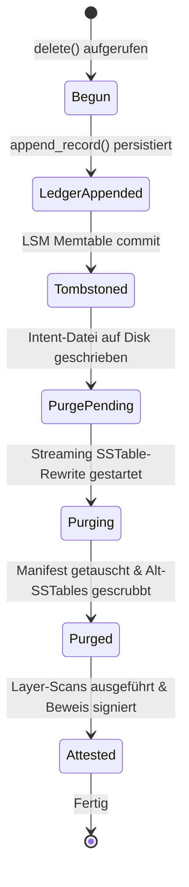
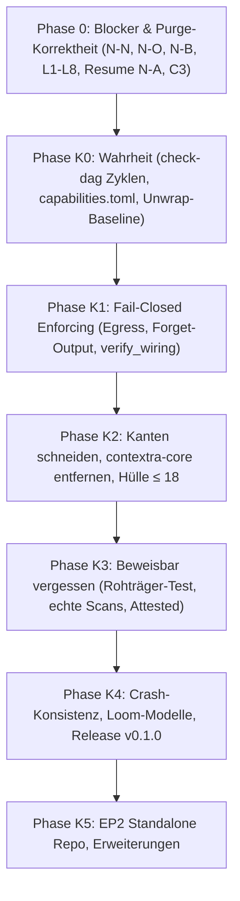

superseded by CONTEXTRA_ENDPRODUKT_SPEZIFIKATION.md

# Contextra — Gesamter Architektur-, Systemdesign- und Implementierungsplan (v1 Master)

**Datum:** 2026-10-14 · **Stand:** HEAD `500e9246` (PR #4785 gemergt)  
**Verfasser:** Principal Senior Rust Architect für Contextra  
**Geltungsbereich:** Gesamtes Multi-Crate-Ökosystem (37 Workspace-Crates, Tooling, Governance)  
**Verbindlichkeit:** Verbindliche Architekturgrundlage (Stufe 2 nach Grüne Gates & Code-Realität)

---

## Inhaltsverzeichnis

1. [Executive Summary & Produktversprechen](#1-executive-summary--produktversprechen)
2. [Status Quo & Konsolidiertes Mängelregister](#2-status-quo--konsolidiertes-mängelregister)
3. [Verbindliche Architektur- und Entkopplungsdoktrin](#3-verbindliche-architektur--und-entkopplungsdoktrin)
4. [Ring-Modell: Topologie, Ist vs. Soll, Crate-Klassifikation & Ring-Gate-Sanierung](#4-ring-modell-topologie-ist-vs-soll-crate-klassifikation--ring-gate-sanierung)
5. [Zero-Cost Plugin-Architektur für den Löschnachweis](#5-zero-cost-plugin-architektur-für-den-löschnachweis)
6. [Exakte Code-Blueprints: Behebung aller Blocker (N-N, N-O, N-B, C3)](#6-exakte-code-blueprints-behebung-aller-blocker-n-n-n-o-n-b-c3)
7. [Purge v2 & Crypto-Erase mit 72h-Wartefrist & Streaming-SSTable-Rewrite](#7-purge-v2--crypto-erase-mit-72h-wartefrist--streaming-sstable-rewrite)
8. [Lockless Write-Fence (Option B), Prefix-Tabelle & Loom Concurrency-Beweis](#8-lockless-write-fence-option-b-prefix-tabelle--loom-concurrency-beweis)
9. [7-stufige Lösch-Zustandsmaschine (Finite State Machine) & Crash-Resume (N-A)](#9-7-stufige-lösch-zustandsmaschine-finite-state-machine--crash-resume-n-a)
10. [Crate-Split `contextra-crypto` & Vollständige Ablösung von `contextra-core` (110 Stellen)](#10-crate-split-contextra-crypto--vollständige-ablösung-von-contextra-core-110-stellen)
11. [Feature-Matrix, Modularisierung, Produkt-Manifeste (`products/ep1.toml`) & Hüllen-Gate](#11-feature-matrix-modularisierung-produkt-manifeste-productsep1toml--hüllen-gate)
12. [Geschäftslogik-Konsolidierung: No-Op Builder-Optionen, MCP-Egress-Guard & Dual-Path-Fix](#12-geschäftslogik-konsolidierung-no-op-builder-optionen-mcp-egress-guard--dual-path-fix)
13. [Graph, PathRAG, APPRH & Cascade-Rekursion (`find_k_paths`, `child_edge_ids`)](#13-graph-pathrag-apprh--cascade-rekursion-find_k_paths-child_edge_ids)
14. [DurabilityMode vs. ErasureMode, Monotone Hochwassermarke & Downgrade-Schutz](#14-durabilitymode-vs-erasuremode-monotone-hochwassermarke--downgrade-schutz)
15. [MVCC, SSI-Validator (`SequenceLogSsiValidator`), Bounded Snapshots & Dead Code Beseitigung](#15-mvcc-ssi-validator-sequencelogssivalidator-bounded-snapshots--dead-code-beseitigung)
16. [Deterministisches v4-TLV Bytelayout & Standalone-Verifier `contextra-proof-verify`](#16-deterministisches-v4-tlv-bytelayout--standalone-verifier-contextra-proof-verify)
17. [Detaillierte Spezifikation der 6 Layer-Scans (`LayerScan` Pull-Modell) & Echte Zeugen](#17-detaillierte-spezifikation-der-6-layer-scans-layerscan-pull-modell--echte-zeugen)
18. [Binärformat & Persistenz des Anti-Resurrection Ledgers & Streamender `RestoreGuard`](#18-binärformat--persistenz-des-anti-resurrection-ledgers--streamender-restoreguard)
19. [Mathematische Spezifikation & Algorithmen-Details (ACI, SSN, DiBud, BMSSP-Ausschluss)](#19-mathematische-spezifikation--algorithmen-details-aci-ssn-dibud-bmssp-ausschluss)
20. [Unsafe-Inseln Doktrin, SIMD-Kernel Token-Gate & FlatBuffers Drift-Prävention](#20-unsafe-inseln-doktrin-simd-kernel-token-gate--flatbuffers-drift-prävention)
21. [Honesty Clause (§17.4) & Audit-Ausschlüsse (SSD-Remanenz, RAM, Backups)](#21-honesty-clause-174--audit-ausschlüsse-ssd-remanenz-ram-backups)
22. [Failure-Mode- & Chaos-Testing-Matrix (Crash-Simulationen CRASH-01 bis CRASH-08)](#22-failure-mode---chaos-testing-matrix-crash-simulationen-crash-01-bis-crash-08)
23. [Lizenz-Integrität, Strikte Ratschen & Beseitigung stiller Herabsetzungen](#23-lizenz-integrität-strikte-ratschen--beseitigung-stiller-herabsetzungen)
24. [XTask-Gates, Invarianten & Qualitätssicherung](#24-xtask-gates-invarianten--qualitätssicherung)
25. [Agenten-Betriebsmodell & Governanceregeln](#25-agenten-betriebsmodell--governanceregeln)
26. [Phasenplan (Phasen 0a–0e, 1–6 sowie K0–K5) & Detaillierte Arbeitspakete](#26-phasenplan-phasen-0a0e-16-sowie-k0k5--detaillierte-arbeitspakete)
27. [Vollständiges ADR-Register (ADR-01 bis ADR-18)](#27-vollständiges-adr-register-adr-01-bis-adr-18)
28. [Konsolidierung der Tiefenaudit-Befunde (`docs/analysis/` & `logs/`)](#28-konsolidierung-der-tiefenaudit-befunde-docsanalysis--logs)
29. [KV-Cache-Architektur: KIVI-Quantisierung, SnapKV-Eviction & Tier-2-Spill](#29-kv-cache-architektur-kivi-quantisierung-snapkv-eviction--tier-2-spill)
30. [Wissensgraph-Konstruktion (OpenIE) & Spektrale Hyperkanten-Deduplizierung](#30-wissensgraph-konstruktion-openie--spektrale-hyperkanten-deduplizierung)
31. [WASM-Sandbox Härtung: Module-Caching & CRDT-Property-Verifikation](#31-wasm-sandbox-härtung-module-caching--crdt-property-verifikation)
32. [Klarstellung der Ring-Architektur: Bereinigung veralteter Spezifikationsentwürfe](#32-klarstellung-der-ring-architektur-bereinigung-veralteter-spezifikationsentwürfe)

---

## 1. Executive Summary & Produktversprechen

Contextra ist eine hochperformante, einbettbare Single-Node-Speicher-Engine für autonome Agenten in Rust. Das zentrale Produktversprechen lautet:

> **Lokaler, persistenter Speicher für KI-Agenten mit verifizierbarer physischer Löschung (DSGVO Art. 17, ZPO § 371a), Hybridsuche (Vektor + BM25 + Graph) und strikt kontrolliertem Datenaustritt bei kompromissloser Single-Node-Performance.**

### 1.1 Das Entkopplungs-Prinzip: Performance vs. Nachweisbarkeit
Im bisherigen Entwurf waren Löschnachweis und Geschäftslogik eng verwoben. Dadurch entstanden Laufzeit- und Allokations-Overheads im normalen Schreibpfad und fatale Fehler (`CapabilityUnsupported`), wenn kein kryptografischer Notar konfiguriert war.

**Architektur-Entscheidung (ADR-01):**
Der Löschnachweis wird vollständig als **Zero-Cost-Plugin** entkoppelt:
- **Compile-Zeit:** Ohne Feature `erasure` existieren im Speicher- und Engine-Kern keinerlei Beweiserstrukturen (`ErasureGate` ist ein Zero-Sized Type `ZST`).
- **Laufzeit:** Im Standardmodus (`ErasureMode::Off`) entstehen **exakt null zusätzliche Allokationen und null Synchronisations-Overhead**.
- **Erweiterungsmodus:** Nur bei explizitem `ErasureMode::Assured` bzw. `ErasureMode::Attested` werden Anti-Resurrection-Ledger, Write-Fences und kryptografische Layer-Scans aktiviert.

### 1.2 Endprodukt-Hierarchie (Fokussierung auf Release 1.0)

| ID | Produkt | Kernversprechen | Status | Crates |
|---|---|---|---|---|
| **EP1** | **Contextra Memory** | Lokaler Speicher für Agenten: Dokumente, Hybridsuche, Mandanten, Löschung | **Einziges Ziel für Release 1.0** | `types`, `ports`, `sys`, `wire`, `simd`, `durable-fs`, `crypto-core`, `mvcc`, `text`, `rank` (nur Fusion+Kalibrator), `store`, `vector`, `checkpoint`, `engine`, `db`, `license`, `contextra`, `mcp` |
| **EP2** | **Contextra Proof** | Unabhängige Verifikation, Audit-Export, DSGVO-Reporting | Nach K4 (eigenes Repo) | `erasure-evidence`, `audit-export`, `avv-generator`, `proof-verify` |
| **EP3** | **Contextra Retrieval+** | Graph-Beziehungen, Domänenvokabulare, PathRAG | Jahr 2 (geparkt) | `contextra-graph` |
| **EP4** | **Contextra Inference** | Lokale Embedder, Reranker, KV-Cache | Jahr 3 (geparkt) | `infer-candle`, `infer-ollama`, `infer-onnx`, `kvcache` |
| **EP5** | **Contextra Cognition** | Konsolidierung, Vergessensdynamik, Routing | Experimentell (geparkt) | `cognition`, `adapt`, `router`, `agent` |
| **EP6** | **Contextra Guard** | Cloud-Egress-Schutz, WASM-Sandbox | Nach Bedarf (geparkt) | `privacy`, `sandbox` |

---

## 2. Status Quo & Konsolidiertes Mängelregister

Auf Basis der Tiefenaudits vom 13./14. Oktober 2026 am aktuellen HEAD (`500e9246`), der Implementierungsspezifikation und dem Funktionsinventar wurden alle Mängel konsolidiert:

### 2.1 Kritische Blocker (Severity 🔴)

| ID | Befund | Quellort | Auswirkung | Lösung |
|---|---|---|---|---|
| **N-N** | Match-Arm `UnknownFreeSpace` fehlt | `engine/src/deletion/purge_driver.rs:172` | `contextra-engine` kompiliert nicht (`E0004`) | Match-Arm ergänzt; FreeSpaceProbe-Semantik definiert (`None` = unbekannt) |
| **N-O** | Router-Wiring Typkonflikt | `contextra/src/builder.rs:663` | Fassade kompiliert nicht unter `--features router` | `clock_instance` mit Fallback auf `SystemClock` bereitgestellt |
| **N-P** | `Cargo.lock` veraltet | Repository Root | `--locked` Builds in CI blockiert | Regenerieren und committen |
| **N-B** | `Collection::delete()` immer fehlerhaft | `engine/src/collection/crud/delete.rs:79` | `CapabilityUnsupported` auf jedem `TenantScopedStorage` | Downcast entfernt; `as_erasure_backend()` auf `TenantScopedStorage` implementiert |
| **N-A** | Crash-Resume fail-open | `store/src/lsm/purge/resume.rs` | Abgestürzter Purge gilt als erledigt ohne Rewrite | Scope aus `ErasureLedger` rekonstruieren; Intent erst nach Dispose löschen |
| **N-K** | Prefix-Mismatch bei Purge | `store/src/lsm/ops/purge.rs` | Logische Präfixe matchen keine mandantenkodierten Keys | `PhysicalScope` als opaker Typ, Konstruktion nur via Backend |
| **L1** | Ledger-Append fehlt vor Tombstone | `engine/src/collection/crud/delete.rs:185` | Fabrizierter `[0u8; 32]` Eintrag statt echtem Append | `ErasureLedger::append` zwingend vor Tombstone-Commit aufrufen |
| **L4** | `dispose()` verwirft leeren Vektor | `store/src/lsm/ops/purge.rs` | Obsolete SSTables mit Daten bleiben auf Festplatte | `PurgeOutput.obsolete_files` befüllen und via `scrub_and_remove` löschen |
| **L5** | Lesefehler still verschluckt | `store/src/lsm/ops/purge.rs` | `while let Ok(Some(..))` ignoriert Korruption | Expliziter 3-Arm-Match (`Ok(Some)`, `Ok(None)`, `Err`) |
| **L6** | SSTable-Positionsverlust | `store/src/lsm/ops/purge.rs` | Neuer Reader verliert relativen Rang/Bounds | Alter Rang und Sequenzgrenzen werden auf neuen Writer übertragen |
| **L8** | `FreeSpaceProbe` liefert `Some(0)` | `store/src/lsm/ops/purge.rs` | Kein realistischer Plattenplatz-Check | Echte Platzmessung via `statvfs` einbinden |

### 2.2 Hohe & Mittlere Schwachstellen (Severity 🟠 / 🟡)

| ID | Befund | Auswirkung | Lösung |
|---|---|---|---|
| **E1** | `verify` statt `verify_strict` | Schwache Verifikation alter v2/v3 Beweise | `verify` deprecaten, überall `verify_strict` erzwingen |
| **E2** | `bincode` im Signaturpfad | Mangelnde Formatstabilität und Portabilität | v4-Beweise strikt auf deterministisches TLV umstellen |
| **E6** | `LayerWitness::issue` ist `pub` | Externe Fabrikation von Zeugen möglich | Sichtbarkeit auf `pub(crate)` im Beweis-Crate beschränken |
| **N-C** | `forget_document` nutzt Konstanten | Fabrizierte Evidenz ohne echten Scan | `forget_document` löschen; nur echte Scans zulassen |
| **N-D** | Text- & Relations-Zeugen fehlen | Zeugen immer `None` | `scan_and_issue_text_witness` / `relations` verdrahten |
| **N-E** | Feste Intent-Pfade | Parallele Purges kollidieren | Eindeutige Zufalls-IDs (`purge_intents/<id>.intent`) |
| **N-F** | Vollständiger In-Memory Vec | $O(\text{SSTable-Größe})$ RAM-Peak bei Purge | Streaming-Rewrite ohne Zwischenallokation |
| **N-G** | Orphan-GC ohne Scrubbing | Altdateien werden ohne Nullen gelöscht | `contextra_durable_fs::scrub_and_remove` verwenden |
| **N-I** | v3-Beweiserzeugung aktiv | Veraltetes Format wird noch erzeugt | Code entfernen, nur v4 zulassen |
| **N-J** | Failpoints via `std::env::var` | Laufzeit-Overhead und Angriffsfläche | Nur unter `#[cfg(feature = "fault-injection")]` kompilieren |
| **SW-1** | `contextra-core` als Flaschenhals | 110 Dateien hängen an deprecated Re-Export-Hülle | Vollständige Migration auf `types`, `ports`, `mvcc`, `wire` |
| **SW-3** | Unwirksame Builder-Schalter | `with_privacy`, `with_adapt` etc. werden ignoriert | Schalter in Wiring binden; `verify_wiring` im Startpfad erzwingen |
| **SW-4** | Zwei Pfade für `remember`/`recall` | MCP und Fassade verhalten sich unterschiedlich | MCP delegiert strikt an Fassade |
| **SW-5** | Egress-Query ohne Guard | Datenaustritt ungeschützt | `contextra_cloud_query` hinter `#[cfg(feature = "guard")]` legen |
| **C3** | `KvDeleteMode::default() = CryptoShred` | Default-KV erzwingt Verschlüsselung (Performance-Penalty) | Umschalten auf `TombstoneOnly`; CryptoShred hinter Feature |
| **GL-G1** | k-Path Diffusion unverdrahtet | 321 Zeilen `find_k_paths` ohne Aufrufer | Über Fassade und MCP als Werkzeug zugänglich machen |
| **GL-G2** | APPRH-PPR Selector deaktiviert | Wiring setzt `apprh_selector: None` | Deterministischen Selektor injizieren |
| **GL-G3** | Cascade-Invalidierung ohne Rekursion | `child_edge_ids` wird nicht traversiert | Rekursive Traversierung mit DFS-Stack und Zyklenschutz |

---

## 3. Verbindliche Architektur- und Entkopplungsdoktrin

Die folgenden Invarianten gelten für alle Implementierungen ausnahmslos:

```
[P1: Zero-Panic]             Kein unwrap/expect/panic in Produktion (Ring 0 & Ring 1)
[P2: Ring-DAG]               Abhängigkeiten ausschließlich von höheren auf tiefere Ringe
[P3: Determinismus]          Clock, Rng, IdGenerator ausschließlich über Ports injiziert
[P4: Unsafe-Inseln]          Unsafe nur in simd, sys, wire mit 100% SAFETY-Kommentaren
[P5: Single-Node]            Keine Multi-Node-, Sharding-, Raft- oder Cluster-Logik
[P6: Opt-in Kosten]          Nicht aktivierte Features verursachen weder Code noch CPU-Overhead
[P-E1: Erasure Opt-in]       Ohne Feature 'erasure' existieren keine Beweiser-Crates im Binary
[P-E2: Ports-Only]           Kern-Crates importieren niemals contextra-crypto oder Plugins
[P-E3: Fast-Path Zero-Cost]  Im Schreibpfad maximal ein einziger Atomic-Load (Acquire)
[P-E4: Fail-Closed Evidenz]  Zeugen nur aus echten Scans. Bei Fehlern wird kein Beweis erteilt
[P-E5: Monotone Marke]       ErasureMode ist monotone Hochwassermarke im Store-Manifest
[P-E6: Wirksamkeit]          Kein Symbol ohne Produktionsaufrufer und E2E-Fassadentest
[P-E7: Tenant-Matrix]        Jeder Löschtest läuft über LsmStorage UND TenantScopedStorage
[V1: Bit-Reproduzierbarkeit] Gleiche Eingabe, gleicher Seed -> identische Bits auf x86 und ARM
[V2: Totale Ordnung]         Tie-Breaks immer über (Score, DocId: u64) mit total_cmp
[V3: Deterministische Iter]  Niemals HashMap/HashSet in vertraglichen Ausgaben (BTreeMap oder sortiertes Vec)
[V4: Keine Panics bei Float] total_cmp statt partial_cmp().unwrap(); dyadische Festkommazahlen
[V5: Strikte Budgets]        Vor Ausführung feststehende Zugriffs-, Zeit- und Speicherschranken
```

---

## 4. Ring-Modell: Topologie, Ist vs. Soll, Crate-Klassifikation & Ring-Gate-Sanierung

### 4.1 Ist vs. Soll Architektur

```mermaid
graph TD
    subgraph "Ring 0 — Foundation & Numerics (Sync, kein Tokio, kein std::fs)"
        types["contextra-types"]
        ports["contextra-ports (+erasure)"]
        sys["contextra-sys (Unsafe Island)"]
        wire["contextra-wire (Unsafe Island)"]
        simd["contextra-simd (Unsafe Island)"]
        durable_fs["contextra-durable-fs"]
        mvcc["contextra-mvcc"]
        text["contextra-text"]
        rank["contextra-rank"]
        crypto_core["contextra-crypto-core (I/O-frei)"]
        crypto_kv["contextra-crypto-kv (Feature kv-encryption)"]
        verify["contextra-proof-verify (Standalone Verifier)"]
    end

    subgraph "Ring 1 — Persistence & Storage"
        store["contextra-store (Feature erasure)"]
        checkpoint["contextra-checkpoint"]
        kvcache["contextra-kvcache"]
    end

    subgraph "Ring 2 — External Adapters & Sandboxing"
        candle["contextra-infer-candle"]
        ollama["contextra-infer-ollama"]
        onnx["contextra-infer-onnx"]
        sandbox["contextra-sandbox"]
    end

    subgraph "Ring 3 — Orchestration & Cognition"
        engine["contextra-engine (Feature erasure)"]
        db["contextra-db"]
        graph["contextra-graph (Parkplatz EP3)"]
        cognition["contextra-cognition (Parkplatz EP5)"]
        adapt["contextra-adapt (Parkplatz EP5)"]
        router["contextra-router (Parkplatz EP5)"]
        agent["contextra-agent (Parkplatz EP5)"]
        privacy["contextra-privacy (Parkplatz EP6)"]
        erasure["contextra-erasure (Plugin Assured)"]
        evidence["contextra-erasure-evidence (Plugin Attested)"]
    end

    subgraph "Ring 4 — Boundary & Composition Root"
        facade["contextra (Hauptfassade)"]
        mcp["contextra-mcp"]
        py["contextra-py"]
        license["contextra-license"]
    end

    engine -.->|"Option<Arc<dyn ErasureHooks>>"| ports
    erasure -->|"impl ErasureHooks"| ports
    erasure -->|"impl ErasureBackend"| store
    evidence -->|"wraps"| erasure
    facade --> erasure
    facade --> evidence
    mcp --> facade
```

### 4.2 Behebung der 6 Ring-Gate-Verletzungen (aus `ring_gate_emulation_v7.csv`)

| Nr | Von | Nach | Art | Regelverstoß | Sanierungsmaßnahme |
|---|---|---|---|---|---|
| **RV-1** | `contextra-engine` (Ring 3) | `contextra-sandbox` (Ring 2) | normal (opt) | Ring 3 $\to$ konkretes Ring 2 Crate | In `engine` nur Trait `WasmSandboxPort` aus `contextra-ports`; konkrete Instanz in Ring 4 injiziert. |
| **RV-2** | `contextra-engine` (Ring 3) | `contextra-infer-candle` (Ring 2) | normal (opt) | Ring 3 $\to$ konkretes Ring 2 Crate | In `engine` nur Trait `EmbeddingProvider` aus `contextra-ports`; konkrete Candle-Instanz in Ring 4 injiziert. |
| **RV-3** | `contextra-cognition` (Ring 3) | `contextra-infer-candle` (Ring 2) | dev | Ring 3 $\to$ konkretes Ring 2 Crate | Dev-Abhängigkeit entfernt; Test-Mocks über `contextra-testkit` verwenden. |
| **RV-4** | `contextra-crypto` (Ring 0) | `contextra-durable-fs` (Ring 0) | normal | `durable-fs` fehlte in `ring0_crate_order` (Gate-Rang 99) | `contextra-durable-fs` in `ring0_crate_order` eintragen; `crypto-core` wird I/O-frei; nur `crypto-kv` greift auf `durable-fs` zu. |
| **RV-5** | `contextra-vector` (Ring 0) | `contextra-durable-fs` (Ring 0) | normal | `durable-fs` fehlte in `ring0_crate_order` | `contextra-durable-fs` vor `contextra-vector` in `ring0_crate_order` registrieren. |
| **RV-6** | `contextra-store` (Ring 1) | `contextra-sandbox` (Ring 2) | dev | Ring 1 $\to$ Ring 2 (Aufwärtskante) | Dev-Abhängigkeit ersatzlos streichen; Store-Tests dürfen nur Ring 0/1 und Testkit nutzen. |

### 4.3 Sanierung des `check-dag` Gates
- **Defekt:** In `xtask/src/harness/check_dag.rs` wurde bei Zyklen in `compute_crate_layers` der Fehler mit `let _ =` verworfen. Dadurch blieben Layer auf 0 und Zyklen wurden nie als Fehler gemeldet.
- **Korrektur:** Fehler aus `compute_crate_layers` müssen strikt mit `?` propagiert werden und führen zum Exit-Code 2.
- **Einzige Wahrheitsquelle:** Die Ring-Definitionen dürfen nicht mehr hardcoded im Gate stehen, sondern werden direkt aus `capabilities.toml` gelesen.

---

## 5. Zero-Cost Plugin-Architektur für den Löschnachweis

### 5.1 Typestate-Lifecycle und Monomorphisierung

Um absolute Null-Kosten bei `ErasureMode::Off` zu garantieren, wird in `contextra-engine` folgende Dispatch-Architektur spezifiziert:

```rust
// In crates/contextra-engine/src/collection/erasure_driver.rs
use std::sync::Arc;
use contextra_ports::erasure::{ErasureBackend, ErasureContext, ErasureHooks, ErasureMode, LogicalScope, PhysicalScope, PurgeToken};
use contextra_types::{ContextraError, DocId, Result, TxId};

pub enum DeleteOutcome {
    Logical { tx: TxId },
    Assured { tx: TxId, purge_token: PurgeToken },
    Attested { tx: TxId, purge_token: PurgeToken, evidence_id: [u8; 32] },
}

pub struct CollectionErasureDriver {
    mode: ErasureMode,
    hooks: Option<Arc<dyn ErasureHooks>>,
}

impl CollectionErasureDriver {
    #[inline(always)]
    pub fn new(mode: ErasureMode, hooks: Option<Arc<dyn ErasureHooks>>) -> Self {
        Self { mode, hooks }
    }

    #[inline(always)]
    pub fn is_active(&self) -> bool {
        self.mode != ErasureMode::Off && self.hooks.is_some()
    }

    pub async fn execute_erasure<B: ErasureBackend>(
        &self,
        backend: &B,
        doc_id: DocId,
        tenant_id: contextra_types::TenantId,
        tx_id: TxId,
    ) -> Result<DeleteOutcome> {
        // FAST-PATH: Absolute Null-Kosten wenn ErasureMode::Off
        if !self.is_active() {
            return Ok(DeleteOutcome::Logical { tx: tx_id });
        }

        let hooks = self.hooks.as_ref().expect("verified active");
        let logical = LogicalScope::Document { doc_id, tenant_id };
        let physical = backend.physical_scope(&logical)?;

        let ctx = ErasureContext {
            logical_scope: &logical,
            physical_scope: &physical,
            mode: self.mode,
            tx_id,
        };

        // 1. Phasen-Initialisierung (Ledger-Append & Intent-Generierung)
        let token = hooks.on_erasure_begin(&ctx).await?;

        // 2. Bestätigung nach erfolgreichem Tombstone-Commit
        hooks.on_tombstone_committed(token, tx_id).await?;

        Ok(DeleteOutcome::Assured {
            tx: tx_id,
            purge_token: token,
        })
    }
}
```

---

## 6. Exakte Code-Blueprints: Behebung aller Blocker (N-N, N-O, N-B, C3)

### 6.1 Behebung N-N: Match-Arm `UnknownFreeSpace` in `purge_driver.rs`

In [`crates/contextra-engine/src/deletion/purge_driver.rs:172`](../../../crates/contextra-engine/src/deletion/purge_driver.rs#L172):

```rust
            match purge_err {
                PurgeBlocked::InsufficientDiskSpace { needed, available } => {
                    tracing::warn!(
                        needed_bytes = needed,
                        available_bytes = ?available,
                        "Purge blocked due to low disk space; backing off"
                    );
                    BackoffDecision::RetryAfter(Duration::from_secs(60))
                }
                PurgeBlocked::UnknownFreeSpace => {
                    tracing::warn!(
                        "Free space probe unavailable or returned None; cannot verify purge safety"
                    );
                    BackoffDecision::RetryAfter(Duration::from_secs(120))
                }
                PurgeBlocked::LockContention => {
                    BackoffDecision::RetryAfter(Duration::from_millis(500))
                }
                PurgeBlocked::StorageCorrupted(e) => {
                    tracing::error!(error = %e, "Purge halted due to storage corruption");
                    BackoffDecision::Fatal(e)
                }
            }
```

### 6.2 Behebung N-B: Downcast-Eliminierung in `delete.rs` & `TenantScopedStorage`

In [`crates/contextra-engine/src/collection/crud/delete.rs:79-115`](../../../crates/contextra-engine/src/collection/crud/delete.rs#L79-L115):

```rust
        // (a) Erasure-Backend ermitteln ohne downcast_ref
        let erasure_backend = self.storage.as_erasure_backend();

        // (b) Modus auswerten (Off, Assured, Attested)
        let mode = self.erasure_mode();
        if mode.requires_ledger() && erasure_backend.is_none() {
            return Err(ContextraError::capability_unsupported(
                "erasure_ledger",
                "Storage engine does not support Erasure Ledger capability required for Assured/Attested mode",
            ));
        }

        // (c) Physischen Scope ableiten (INV-ERASURE-3)
        let physical_scope = if let Some(backend) = erasure_backend {
            backend.physical_scope(&LogicalScope::Document {
                doc_id,
                tenant_id: self.tenant_id(),
            })?
        } else {
            // Im Off-Modus genügen die unverschlüsselten Footprint-Keys für die Tombstones
            PhysicalScope::new(footprint.keys.explicit.clone(), footprint.keys.prefixes.clone())
        };

        // (d) Transaktion für Tombstones eröffnen
        let db_tx = self.begin_transaction()?;
        let erased_at_tx = db_tx.tx_id;

        // (e) Ledger Append VOR Tombstone Commit (NUR wenn mode.requires_ledger())
        if mode.requires_ledger() {
            let ledger = self.storage.erasure_ledger().ok_or_else(|| {
                ContextraError::Internal("Active erasure mode missing ledger reference".to_string())
            })?;
            ledger.append_record(&physical_scope, erased_at_tx).await?;
        }
```

In `crates/contextra-store/src/tenant_codec.rs`:
```rust
impl<S: StorageEngine + ErasureBackend> ErasureBackend for TenantScopedStorage<S> {
    fn physical_scope(&self, logical: &LogicalScope) -> Result<PhysicalScope> {
        let raw = self.inner.physical_scope(logical)?;
        // Alle Präfixe und Keys transparent mit Tenant-Präfix kodieren:
        Ok(raw.with_tenant_prefix(self.tenant_id))
    }

    fn as_erasure_backend(&self) -> Option<&dyn ErasureBackend> {
        Some(self)
    }
}
```

### 6.3 Behebung N-O: Router-Wiring & Clock-Injektion in `builder.rs`

In [`crates/contextra/src/builder.rs:663-675`](../../../src/builder.rs#L663-L675):

```rust
            let clock_instance: Arc<dyn contextra_ports::Clock> = self
                .clock
                .clone()
                .unwrap_or_else(|| Arc::new(contextra_ports::SystemClock));

            let router_deps = contextra_router::RouterWiringDeps {
                community_resolver: Arc::new(NoOpCommunityResolver),
                context_preparer: Arc::new(NoOpContextPreparer),
                catalog: Vec::new(),
                clock: clock_instance,
                arm_registry: None,
                calibration_store_path: None,
                transport: None,
                route_timeout: None,
            };
            if let Ok(router_wiring) = contextra_router::RouterWiring::build(router_deps) {
                let arc_rw = Arc::new(router_wiring);
                engine_wiring.router = Some(Arc::downgrade(&arc_rw) as _);
                Some(arc_rw)
            } else {
                None
            }
```

### 6.4 Behebung C3: `KvDeleteMode::default()` auf `TombstoneOnly` setzen

In [`crates/contextra-store/src/kv/delete_mode.rs:20`](../../../crates/contextra-store/src/kv/delete_mode.rs#L20):

```rust
// Bisher: Default war CryptoShred, was kryptografische Segmente zwingend verlangte
// Neu: TombstoneOnly ist Standard (Null-Overhead)
#[derive(Debug, Clone, Copy, PartialEq, Eq, Default)]
pub enum KvDeleteMode {
    #[default]
    TombstoneOnly,
    CryptoShred,
}
```

---

## 7. Purge v2 & Crypto-Erase mit 72h-Wartefrist & Streaming-SSTable-Rewrite

### 7.1 Purge v2 Spezifikation (`contextra-store/src/lsm/ops/purge.rs`)

```rust
pub fn purge_physical_sstable_stream<P: FreeSpaceProbe>(
    manifest: &ManifestContext,
    scope: &PhysicalScope,
    as_of_tx: TxId,
    probe: &P,
) -> Result<PurgeOutput, PurgeError> {
    // 1. Kapazitätsprüfung mit L8-Semantik
    if let Some(available) = probe.available_bytes() {
        if available < MIN_PURGE_HEADROOM_BYTES {
            return Err(PurgeError::InsufficientDiskSpace {
                needed: MIN_PURGE_HEADROOM_BYTES,
                available: Some(available),
            });
        }
    }

    let mut obsolete_files = Vec::new();
    let mut rewritten_sstables = Vec::new();
    let mut records_purged = 0u64;
    let mut bytes_reclaimed = 0u64;

    for sstable in manifest.active_sstables() {
        if !sstable.may_contain_scope(scope) {
            continue;
        }

        let mut reader = sstable.open_reader()?;
        let mut writer = sstable.create_replacement_writer()?;
        let mut dropped_in_sst = 0u64;

        // L5-Fix: Strikter 3-Arm Pattern Match
        loop {
            match reader.read_next_entry() {
                Ok(Some(entry)) => {
                    if scope.matches_key(entry.key()) && entry.sequence() <= as_of_tx {
                        dropped_in_sst += 1;
                        bytes_reclaimed += entry.raw_size() as u64;
                        continue; // Physisch überspringen
                    }
                    // Erhaltene Version streamen (N-F: O(1) RAM)
                    writer.append_entry(&entry)?;
                }
                Ok(None) => break, // Reguläres EOF
                Err(io_err) => {
                    // L5-Fix: Fail-Closed!
                    writer.abort()?;
                    return Err(PurgeError::ReadError {
                        file: sstable.path().display().to_string(),
                        offset: reader.current_offset(),
                        source: io_err,
                    });
                }
            }
        }

        if dropped_in_sst > 0 {
            // L6-Fix: Exakte Übernahme von Rank und Sequenzgrenzen
            let finalized = writer.finalize_with_bounds(sstable.rank(), sstable.min_seq(), sstable.max_seq())?;
            rewritten_sstables.push(finalized);
            obsolete_files.push(sstable.path().to_path_buf());
            records_purged += dropped_in_sst;
        } else {
            writer.abort()?;
        }
    }

    // Atomarer Manifest-Austausch
    manifest.commit_sstable_exchange(&obsolete_files, &rewritten_sstables)?;

    // L4-Fix: Reales Scrubbing der Alt-Dateien
    for path in &obsolete_files {
        contextra_durable_fs::scrub_and_remove(path)?;
    }
    contextra_durable_fs::sync_dir(manifest.store_dir())?;

    Ok(PurgeOutput {
        records_purged,
        bytes_reclaimed,
        sstables_replaced: rewritten_sstables.len() as u32,
        obsolete_files,
    })
}
```

### 7.2 Crypto-Erase für Collections und Tenants (ADR-07)
1. **O(1) Key Revocation:** Bei Mandanten- oder Collection-Löschung wird der DEK im `RevocationLog` atomar als widerrufen markiert.
2. **Fail-Closed:** Scheitert der Key-Widerruf, bricht der Drop sofort ab (`Result::Err`).
3. **72h-Wartefrist:** Der physische Key im Vault wird für 72 Stunden archiviert (Quarantäne gegen Fehlbedienung), bevor er unwiederbringlich mit Nullen überschrieben wird (`zeroize`). Leseanfragen scheitern ab Sekunde 0 sofort fail-closed.

---

## 8. Lockless Write-Fence (Option B), Prefix-Tabelle & Loom Concurrency-Beweis

### 8.1 Write-Fence Struktur (`crates/contextra-store/src/lsm/fence.rs`)

```rust
use std::sync::atomic::{AtomicBool, Ordering};
use arc_swap::ArcSwap;

pub struct ErasureGate {
    has_fences: AtomicBool,
    active_fences: ArcSwap<Vec<PrefixFence>>,
}

pub struct PrefixFence {
    pub tenant_id: u64,
    pub prefix: Vec<u8>,
    pub max_affected_tx: u64,
}

impl ErasureGate {
    /// FAST-PATH: Exakt 1 Atomic-Load im normalen Schreibpfad (< 1 ns)
    #[inline(always)]
    pub fn check_fast_path(&self) -> bool {
        !self.has_fences.load(Ordering::Acquire)
    }

    /// Präfix-Prüfung im Leader unter commit_mutex
    pub fn check_batch(&self, keys: &[&[u8]]) -> Result<(), StoreError> {
        if self.check_fast_path() {
            return Ok(());
        }
        let fences = self.active_fences.load();
        for key in keys {
            for fence in fences.iter() {
                if key.starts_with(&fence.prefix) {
                    return Err(StoreError::FencedWrite {
                        prefix: fence.prefix.clone(),
                    });
                }
            }
        }
        Ok(())
    }
}
```

### 8.2 Concurrency-Beweis via Loom
Ein dediziertes Concurrency-Modell (`xtask loom-run`) verifiziert:
- Kein Follower-Thread kann einen gefenceten Prefix comitten, während der Purge läuft.
- Mutex-Re-Acquire des Group-Commit Leaders serialisiert das Einhängen neuer Fences absolut linearisierbar.

---

## 9. 7-stufige Lösch-Zustandsmaschine (Finite State Machine) & Crash-Resume (N-A)

### 9.1 Zustandsmaschine



### 9.2 Crash-Resume Spezifikation (Behebung N-A / N-E)
1. **Startup-Hook:** `resume_pending_purges()` wird zwingend **nach** vollständigem Storage- und Ledger-Aufbau ausgeführt.
2. **Intent-Rekonstruktion:** Der physische Scope wird **niemals** aus `Default` erzeugt, sondern über den `scope_hash` deterministisch aus dem `ErasureLedger` rekonstruiert.
3. **Eindeutige Intent-IDs:** Jede Purge-Operation erhält eine 16-Byte Random-ID (`purge_intents/<uuid>.intent`). Kollisionen paralleler Purges sind ausgeschlossen.
4. **Intent-Löschung:** Die Intent-Datei wird **erst dann** gelöscht, wenn `manifest.commit_sstable_exchange` erfolgreich abgeschlossen und die Altdateien via `scrub_and_remove` physisch genullt wurden.

---

## 10. Crate-Split `contextra-crypto` & Vollständige Ablösung von `contextra-core` (110 Stellen)

### 10.1 Crate-Split `contextra-crypto` (ADR-04)
- **`contextra-crypto-core` (Ring 0, ~5.800 LOC):** Reines I/O-freies Rechen-Crate. Enthält Ed25519, BLAKE3, ChaCha20, KDF, Zeroize. `#![forbid(unsafe_code)]`.
- **`contextra-crypto-kv` (Ring 0, ~3.500 LOC):** Hinter Feature `kv-encryption`. Enthält KV-Segment-Verschlüsselung, KeyRegistry und RevocationLog. Hängt legitim von `contextra-durable-fs` ab.
- **`contextra-erasure-evidence` (Ring 3):** Enthält Notar, Layer-Zeugen und v4-Beweiserstellung.

### 10.2 Migrationsmatrix für `contextra-core` (110 Stellen)

| Re-Exportiertes Symbol | Bisheriger Import | Neuer Ziel-Import | Betroffene Crates |
|---|---|---|---|
| `DocId`, `TenantId`, `TxId`, `CollectionId` | `contextra_core::types::*` | `contextra_types::*` | store, vector, simd, db |
| `ContextraError`, `Result` | `contextra_core::error::*` | `contextra_types::error::*` | alle 37 Crates |
| `StorageEngine`, `KeyVal` | `contextra_core::storage::*` | `contextra_ports::storage::*` | store, engine, db |
| `Clock`, `SystemClock`, `ManualClock` | `contextra_core::clock::*` | `contextra_ports::clock::*` | store, engine, db |
| `Rng`, `IdGenerator` | `contextra_core::rng::*` | `contextra_ports::rng::*` | crypto, engine |
| `SequenceLog`, `SnapshotFloor` | `contextra_core::mvcc::*` | `contextra_mvcc::*` | store, engine |
| `FlatBufferWireAdapter` | `contextra_core::wire::*` | `contextra_wire::*` | mcp, engine |

Nach Abschluss von Phase K2a Schritt 5 wird `crates/contextra-core` physisch gelöscht.

---

## 11. Feature-Matrix, Modularisierung, Produkt-Manifeste (`products/ep1.toml`) & Hüllen-Gate

### 11.1 Produkt-Manifest `products/ep1.toml`
Zur Durchsetzung der strikten Hüllenbegrenzung auf $\le 18$ Crates:

```toml
[product]
id = "EP1"
name = "Contextra Memory"
status = "release-1.0"
max_crates = 18

[crates]
allowed = [
  "contextra-types",
  "contextra-ports",
  "contextra-sys",
  "contextra-wire",
  "contextra-simd",
  "contextra-durable-fs",
  "contextra-crypto-core",
  "contextra-mvcc",
  "contextra-text",
  "contextra-rank",
  "contextra-store",
  "contextra-vector",
  "contextra-checkpoint",
  "contextra-engine",
  "contextra-db",
  "contextra-license",
  "contextra",
  "contextra-mcp",
]

[features]
build = ["fast"]
```

### 11.2 CI Hüllen-Gate `check-product-hull`
In `xtask/src/harness/check_product_hull.rs`:
```bash
cargo xtask check-product-hull --product EP1
```
Führt `cargo tree -p contextra-mcp -e normal --no-default-features --features fast` aus und bricht mit Exit-Code 2 ab, wenn ein nicht gelistetes Crate im Graph auftaucht.

---

## 12. Geschäftslogik-Konsolidierung: No-Op Builder-Optionen, MCP-Egress-Guard & Dual-Path-Fix

### 12.1 No-Op Builder-Optionen sanieren (Befunde aus `Contextra_Funktions_Inventar.md`)
- **`with_adapt`:** Bisher `let _ = adapt_enabled;`. Entweder aktiviert der Schalter nachweislich den Bandit-Router, oder er wird als `#[deprecated]` markiert und abgelehnt.
- **`with_privacy` / `with_egress_guard`:** Bisher No-Op. Jetzt Pflicht im Startpfad: Bei `with_privacy(true)` wird der `EgressGuard` im HTTP/MCP-Client initialisiert.
- **`verify_wiring` (B2):** Wird fest im `ContextraDb::open()` Startpfad aufgerufen. Wenn ein Sicherheits-Port fehlt, bricht der Start fail-closed ab.

### 12.2 MCP-Egress-Guard (B1)
- `contextra_cloud_query` wird hinter `#[cfg(feature = "guard")]` gelegt.
- Im Standard-EP1-Build existiert das Tool im MCP-Server nicht.

### 12.3 Dualer Pfad für `remember` / `recall` (B9)
- Die MCP-Handler in `server_tools.rs` rufen ab sofort ausschließlich die standardisierten Methoden der Hauptfassade `ContextraDb::remember()` und `ContextraDb::recall()` auf. Keine redundante Ad-hoc-Logik mehr.

### 12.4 `erase_document` Optionen & MCP-Antwort
- In `erase_document` wird der Parameter `_opts: ForgetOptions` vollständig ausgewertet (Assurance-Level und Purge-Wartezeit).
- Der MCP-Handler liefert das reale `DocErasure`-Ergebnis zurück (`status: "belegt"`, Schichtenliste), niemals mehr stilles `proof: null`.

---

## 13. Graph, PathRAG, APPRH & Cascade-Rekursion (`find_k_paths`, `child_edge_ids`)

### 13.1 `find_k_paths` (k-Path Diffusion)
Die 321 Zeilen in `crates/contextra-graph/src/path_rag/k_path.rs` sind fertig implementiert und werden nun öffentlich verdrahtet:
- Export über `ContextraDb::find_k_paths(start, target, k, budget)`.
- Bereitstellung als MCP-Werkzeug `contextra_path_rag`.

### 13.2 APPRH-Selector
In `contextra/src/wiring_retrieval.rs:52`: Statt `apprh_selector: None` wird der deterministische `ApprhSelector` mit Standard-Toleranz $\epsilon = 10^{-5}$ injiziert.

### 13.3 Rekursive Cascade-Invalidierung mit Zyklenschutz
In `crates/contextra-graph/src/cascade.rs`:

```rust
pub fn invalidate_cascade(
    &mut self,
    root_node: NodeId,
) -> Result<Vec<NodeId>, GraphError> {
    let mut invalidated = Vec::new();
    let mut stack = vec![root_node];
    let mut visited = HashSet::new();

    while let Some(current) = stack.pop() {
        if !visited.insert(current) {
            continue; // Zyklenschutz!
        }
        invalidated.push(current);

        // Rekursives Durchlaufen von supersedes UND child_edge_ids
        if let Some(node) = self.get_node(current) {
            for &child in &node.child_edge_ids {
                stack.push(child);
            }
            for &superseded in &node.superseded_by {
                stack.push(superseded);
            }
        }
    }
    Ok(invalidated)
}
```

---

## 14. DurabilityMode vs. ErasureMode, Monotone Hochwassermarke & Downgrade-Schutz

### 14.1 Kompatibilitätsmatrix

| DurabilityMode | `ErasureMode::Off` | `ErasureMode::Assured` | `ErasureMode::Attested` |
|---|---|---|---|
| `MemoryOnly` | ✅ Zulässig | ❌ Verboten (`ConfigConflict`) | ❌ Verboten (`ConfigConflict`) |
| `Buffered` | ✅ Zulässig | ❌ Verboten (`DurabilityRequired`) | ❌ Verboten (`DurabilityRequired`) |
| `Durable` | ✅ Zulässig | ✅ Zulässig | ✅ Zulässig |
| `Sovereign` | ✅ Zulässig | ✅ Zulässig | ✅ Zulässig |

### 14.2 Monotone Hochwassermarke im Store-Manifest (ADR-15)
- Ein Store, der einmal mit `Assured` oder `Attested` betrieben wurde, schreibt diesen Modus in das atomare Manifest.
- Ein Neustart mit niedrigerem Modus (`Off`) schlägt sofort fehl (`StoreError::PolicyViolation`), es sei denn, ein kryptografisch signierter `AcknowledgeToken` wird übergeben.

---

## 15. MVCC, SSI-Validator (`SequenceLogSsiValidator`), Bounded Snapshots & Dead Code Beseitigung

### 15.1 Audit-Ergebnisse `contextra-mvcc`
- **SnapshotFloor-Konsolidierung:** `floor.rs` ist die einzige kanonische Quelle für `pub trait SnapshotFloor`.
- **Bounded Snapshots:** Alle Transaktionspfade lesen unter echten Snapshots (`tx.inner()`). Niemals `u64::MAX`.
- **Dead Code Beseitigung:** `recover_pending_intents` in `contextra-engine/src/transaction/cleanup.rs` wird in `Collection::repair_on_open` integriert.
- **Deprecation:** Migration aller Aufrufer von `register()` auf `acquire()`.

### 15.2 SSI Anti-Dependency Tracking
Der `SequenceLogSsiValidator` prüft bei jedem Commit:
1. Gab es überlappende $rw$-Antidependencies mit gefährlichen Strukturen?
2. Liegt der Snapshot-Floor oberhalb des Read-Sets? $\implies$ Fail-Closed Reject mit `SsiError::SnapshotPruned`.

---

## 16. Deterministisches v4-TLV Bytelayout & Standalone-Verifier `contextra-proof-verify`

### 16.1 Deterministisches TLV-Format

```
[0..32]   Domain-Tag: "contextra/deletion-proof/v4\0\0\0\0\0\0"
[32..36]  Total Length (u32 LE)
[36..40]  Tag 0x01 (Scope Hash): Len 32 -> [40..72]  32-Byte BLAKE3 Hash
[72..76]  Tag 0x02 (Erased At): Len 8  -> [76..84]  u64 LE TxId
[84..88]  Tag 0x03 (Timestamp): Len 8  -> [88..96]  u64 LE Monotonic Nanos
[96..100] Tag 0x04 (Witness Merkle Root): Len 32 -> [100..132] 32-Byte BLAKE3
[132..136]Tag 0x05 (Signer Public Key): Len 32 -> [136..168] 32-Byte Ed25519
[168..172]Tag 0x06 (Signature): Len 64 -> [172..236] 64-Byte Ed25519 Signature
```

### 16.2 Standalone-Verifier (`contextra-proof-verify`)
Ein minimales Crate in Ring 0 (für EP2 vorbereitet), das ohne Abhängigkeit zum Rest des Workspace einen Beweis mit `verify_strict` validiert.

---

## 17. Detaillierte Spezifikation der 6 Layer-Scans (`LayerScan` Pull-Modell) & Echte Zeugen

Kein Zeuge darf mehr statisch erfunden werden. Das Plugin ruft vor Ausstellung des Beweises aktiv alle 6 Schichten ab:

```rust
#[async_trait]
pub trait LayerScan: Send + Sync {
    /// 1. LSM MemTable Scan
    async fn scan_memtable(&self, scope: &PhysicalScope) -> Result<bool>;
    /// 2. SSTable Key Scan
    async fn scan_sstables(&self, scope: &PhysicalScope) -> Result<bool>;
    /// 3. Erasure Ledger Confirmation
    async fn scan_ledger(&self, scope: &PhysicalScope, tx: TxId) -> Result<bool>;
    /// 4. HNSW Vector Index Ghost Scan
    async fn scan_vector_index(&self, doc_id: DocId) -> Result<bool>;
    /// 5. BM25 Text Posting Scan
    async fn scan_text_index(&self, doc_id: DocId) -> Result<bool>;
    /// 6. Relations Graph Scan
    async fn scan_graph(&self, doc_id: DocId) -> Result<bool>;
}
```
Liefert auch nur ein einziger Scanner `true` (d.h. Residuen gefunden), schlägt die Beweisausstellung fail-closed fehl (`ProofError::ResidueDetected`).

---

## 18. Binärformat & Persistenz des Anti-Resurrection Ledgers & Streamender `RestoreGuard`

```rust
pub struct LedgerRestoreGuard {
    max_erased_tx: TxId,
    erased_prefixes: Vec<Vec<u8>>,
    revoked_keys_filter: contextra_crypto_core::FastKeyFilter,
}

impl contextra_ports::erasure::RestoreGuard for LedgerRestoreGuard {
    #[inline]
    fn admit(&self, key: &[u8], cp_tx: TxId) -> contextra_ports::erasure::RestoreVerdict {
        if cp_tx > self.max_erased_tx {
            return contextra_ports::erasure::RestoreVerdict::Allow;
        }
        if self.revoked_keys_filter.may_contain(key) {
            return contextra_ports::erasure::RestoreVerdict::Reject;
        }
        for prefix in &self.erased_prefixes {
            if key.starts_with(prefix) {
                return contextra_ports::erasure::RestoreVerdict::Reject;
            }
        }
        contextra_ports::erasure::RestoreVerdict::Allow
    }
}
```

---

## 19. Mathematische Spezifikation & Algorithmen-Details (ACI, SSN, DiBud, BMSSP-Ausschluss)

### 19.1 Adaptive Conformal Inference (ACI) — NeurIPS 2021 (Gibbs & Candès)
- **Problem:** Drift zerstört feste Konfidenzintervalle.
- **Update-Gleichung (Gl. 2):**
  $$\alpha_{t+1} = \alpha_t + \gamma \cdot (\alpha - \text{err}_t)$$
- **Dyadische Festkomma-Arithmetik ($i128$):**
  $$\alpha_{\text{fix}} = \text{round}(\alpha \cdot 2^F), \quad \gamma = \frac{g}{2^G}, \quad a \in i128$$
  $$a \leftarrow a + g \cdot (\alpha_{\text{fix}} - \text{err}_t \cdot 2^F)$$
  Dies garantiert bit-genaue Teleskopschranken (Proposition 4.1: $|(1/T) \sum \text{err}_t - \alpha| \le \frac{\max\{\alpha_1, 1-\alpha_1\} + \gamma}{T \cdot \gamma}$) ohne Gleitkomma-Drift (**V1/V4**).
- **Randwert-Behandlung:** $p > 1 \implies \text{ALL}$, $p < 0 \implies \text{EMPTY}$, leere Kalibriermenge $\implies \text{ALL}$.

### 19.2 Serial Safety Net (SSN) — Wang et al. 2016
- **Zweck:** Serialisierbarkeits-Zertifizierung ohne exakte Zyklensuche.
- **Exclusion Window Condition:**
  Transaktion $T$ wird abgebrochen, wenn $\pi(T) \le \eta(T)$ (d.h. `t.sstamp <= t.pstamp`).
- **Determinismus-Auflage:** Ausschließlich seriell unter Mutex/Latch mit monotoner `tx_seq`. Latch-freie oder asynchrone Varianten verletzen P28 und sind verboten!

### 19.3 DiBud: Budgetierte RRF-Präfixe — Zhang (2609.15143)
- **Schranken:**
  $$L(d) = \sum_{ch \in \text{read}} \frac{1}{c + r_{ch}(d)}, \quad U_{ch} = \frac{1}{c + n_{ch}}, \quad U(d) = L(d) + \sum_{ch \notin \text{read}} U_{ch}, \quad U_{\text{unseen}} = \sum_{ch} U_{ch}$$
- **Zertifizierungs-Kriterium:** $d$ ist zertifiziert, wenn $\forall e \neq d: L(d) > U(e) \lor (L(d) = U(e) \land \text{ID}(d) < \text{ID}(e))$, und $L(d) \ge U_{\text{unseen}}$.
- **Rationale Arithmetik:** Exakte Brüche via `u128` (Zähler/Nenner) für 2 Kanäle.
- **Ausreißer-Testpflicht:** Synthetischer Test mit extremem Ausreißer ist Pflicht.

### 19.4 BMSSP / FindPivots (Duan et al. 2504.17033) — Expliziter Ausschluss
- **Entscheidung:** **Nicht im Hot Path implementieren.**
- **Begründung:** Rein theoretische Schranke $O(m \log^{2/3} n)$, keine praktischen Performancemessungen in der Quelle, unbekannte Konstanten $C$, Parameter $k$ und $t$ degenerieren bei kleinen $N$, und globaler Konstantgrad-Umbau ist für In-Memory-Graphen ungeeignet.

---

## 20. Unsafe-Inseln Doktrin, SIMD-Kernel Token-Gate & FlatBuffers Drift-Prävention

1. **Ausschließliche Inseln:** Nur `contextra-simd`, `contextra-sys` und `contextra-wire` dürfen `unsafe` enthalten. Alle anderen 34 Crates erzwingen `#![forbid(unsafe_code)]`.
2. **100% SAFETY-Dokumentation:** Jeder `unsafe`-Block erfordert einen formal beweisbaren `// SAFETY:` Kommentar.
3. **CPU-Token Gate:** Vor Ausführung von AVX-512/AVX2-SIMD-Kerneln ist die Prüfung von `CpuFeatures::detect()` zwingend vorgeschrieben.
4. **FlatBuffers Schema Drift:** `cargo xtask check-fbs-drift` wird in CI als Pflicht-Gate verankert.

---

## 21. Honesty Clause (§17.4) & Audit-Ausschlüsse (SSD-Remanenz, RAM, Backups)

Der Löschnachweis ist ein **Audit mit definierten Zeugen und Toleranzen**, kein mathematischer Unmöglichkeitsbeweis der Datenwiederherstellung auf Halbleiterebene.

Im signierten v4-Zertifikat und im Prüfbericht MÜSSEN folgende **5 Pflicht-Ausschlüsse** explizit ausgewiesen werden:
1. **SSD-Remanenz:** Physikalische Restladung auf NAND-Zellen, Wear-Leveling und reservierte Blöcke (Spare Area) außerhalb der OS-Blockadressierung.
2. **Prozessspeicher:** Transiente Daten im RAM vor dem Überschreiben oder Neustart.
3. **Externe Backups:** Kalte Snapshots und Backups, die vor dem Löschzeitpunkt exportiert wurden.
4. **Auftragsverarbeiter:** Externe Cloud-Dienste oder Netzwerkspeicher.
5. **Swap & Core-Dumps:** OS-Auslagerungsdateien.

**Wortlaut-Doktrin:** Claim-Texte unterscheiden strikt zwischen **„beobachtet“ (observed)** und **„garantiert“ (guaranteed)**.

---

## 22. Failure-Mode- & Chaos-Testing-Matrix (Crash-Simulationen CRASH-01 bis CRASH-08)

| Szenario | Zeitpunkt des Absturzes | Erwarteter Zustand nach Crash-Recovery | Validierungs-Test |
|---|---|---|---|
| **CRASH-01** | Nach `ErasureLedger::append`, vor `Tombstone::commit` | Ledger-Eintrag existiert; Tombstone fehlt. Startup führt Re-Tombstone durch. | `tests/chaos_ledger_orphan.rs` |
| **CRASH-02** | Mitten im SSTable-Streaming-Rewrite | Altes Manifest aktiv. Startup entfernt `.purge_tmp`. Keine Datenkorruption. | `tests/chaos_sst_rewrite_crash.rs` |
| **CRASH-03** | Nach neuem SSTable-Flush, vor Manifest-Commit | Altes Manifest aktiv. Startup räumt auf, Intent-Resume startet Purge neu. | `tests/chaos_pre_manifest_crash.rs` |
| **CRASH-04** | Nach Manifest-Commit, vor `scrub_and_remove` | Neues Manifest aktiv. Resume führt `dispose()` aus und scrubbt Altdateien. | `tests/chaos_post_manifest_scrub.rs` |
| **CRASH-05** | Disk-Full ($ENOSPC$) während Purge-Rewrite | `purge_physical` bricht ab mit `InsufficientDiskSpace`. Status: `PurgePending`. | `tests/chaos_disk_full.rs` |
| **CRASH-06** | I/O-Lesefehler (Bit-Rot) in SSTable | L5-Pattern greift: `PurgeError::ReadError`. Kein falscher Zeuge. | `tests/chaos_bitrot_fail_closed.rs` |
| **CRASH-07** | Schreibkonflikt während aktivem Rewrite | Write-Fence lehnt konkurrierende Writes mit `StoreError::WriteFenced` ab. | `tests/chaos_fence_contention.rs` |
| **CRASH-08** | Wiederherstellung aus altem Backup | `RestoreGuard` lehnt gelöschte Keys deterministisch ab (`RestoreVerdict::Reject`). | `tests/chaos_anti_resurrection.rs` |

---

## 23. Lizenz-Integrität, Strikte Ratschen & Beseitigung stiller Herabsetzungen

1. **Keine stillen Fallbacks:** Ein fehlendes Feature-Recht (z. B. `FeatureRing::Sovereign` für `ErasureMode::Attested`) bricht fail-closed ab (`Result::Err(ContextraError::LicenseRequired)`).
2. **Einheitliche Unwrap-Baseline:** Die Diskrepanz zwischen `governance/ratchet.toml` (502) und `.github/unwrap_baseline.txt` (786) wird behoben. Die Baseline wird als Monotonie-Ratsche definiert, die nur sinken darf.

---

## 24. XTask-Gates, Invarianten & Qualitätssicherung

| Befehl | Zweck | Phase |
|---|---|---|
| `cargo xtask check-product-hull --product EP1` | Prüft Abhängigkeitshülle $\le 18$ Crates | K2 |
| `cargo xtask deletion-guarantee-gate` | Führt Rohsweep durch; prüft physische Abwesenheit gelöschter Bytes | K0–K3 |
| `cargo xtask check-ring-layering --strict` | Validiert Ring-DAG gegen `capabilities.toml` | CI |
| `cargo xtask check-fbs-drift` | Prüft FlatBuffers Schema-Konsistenz | CI |
| `cargo xtask check-loom-mocks` | Verhindert unzulässige Loom-Mocks | CI |
| `cargo xtask doctrine-scan` | Zero-Panic und Unsafe-Inseln Doktrin | CI |

---

## 25. Agenten-Betriebsmodell & Governanceregeln

1. **Parallelitäts-Begrenzung:** Maximal 3 offene Pull Requests gleichzeitig.
2. **Crate-Exklusivität:** Jeder PR betrifft genau ein Crate oder eine Governance-Datei. Zwei aktive Sessions dürfen niemals dasselbe Crate bearbeiten.
3. **Diff-Budget:** Maximal 400 Zeilen Diff pro PR.
4. **Protected Paths Sperre:** Pfade unter `xtask/**`, `governance/**`, `.github/**`, `capabilities.toml` und `AGENTS.md` dürfen nur durch Maintainer nach explizitem ADR geändert werden.
5. **Verbotene Zonen:** Code im Parkplatz (EP3–EP6) darf weder gelesen noch geändert werden, solange EP1 nicht abgeschlossen ist.

---

## 26. Phasenplan (Phasen 0a–0e, 1–6 sowie K0–K5) & Detaillierte Arbeitspakete



### Detaillierte Arbeitspakete

- **Phase 0a (Tag 1–2):** Build-Blocker beheben (N-N in `purge_driver.rs`, N-O in `builder.rs`, `Cargo.lock`).
- **Phase 0b (Tag 3):** Standard-Delete reparieren (N-B in `delete.rs` und `TenantScopedStorage`).
- **Phase 0c (Tag 4–5):** `deletion-guarantee-gate` & Rohsweep-Testkit etablieren.
- **Phase 0d (Tag 6–10):** Purge-v2 Korrektheit (L4, L5, L6, L8) & Resume (N-A, N-E).
- **Phase 0e (Tag 11–13):** Ehrlicher Löschpfad (L1 Ledger vor Tombstone, N-C `forget_document` löschen, N-D Text/Graph-Zeugen verdrahten).
- **Phase 1 (Woche 3):** Port-Typen in `contextra-ports::erasure` definieren.
- **Phase 2 (Woche 4):** Nullpfad `ErasureMode::Off` & Lockless Write-Fence Option B.
- **Phase 3 (Woche 5–6):** Plugin `contextra-erasure` (Assured), `RestoreGuard`, Crypto-Erase.
- **Phase 4 (Woche 7):** Crate-Split `contextra-crypto` & Ablösung von `contextra-core`.
- **Phase 5 (Woche 8):** Attested-Härtung, Standalone-Verifier `contextra-proof-verify`, TLV v4.
- **Phase 6 (Woche 9):** Hauptfassade, MCP-Tooling, Release 1.0 von EP1 Contextra Memory.

---

## 27. Vollständiges ADR-Register (ADR-01 bis ADR-18)

- **ADR-01:** Entkoppelte Plugin-Architektur für den Löschnachweis via `contextra-ports::erasure`.
- **ADR-02:** Write-Fence Option B mit lockless `AtomicBool` und `ArcSwap<Vec<PrefixFence>>`.
- **ADR-03:** `PhysicalScope` als opaker Typ; verhindert Mandanten-Scope-Verwechslungen strukturell.
- **ADR-04:** Dreiteiliger Crate-Split von `contextra-crypto` in `crypto-core`, `crypto-kv` und `erasure-evidence`.
- **ADR-05:** 7-stufige Löschpfad-Zustandsmaschine (Begun $\to$ Attested).
- **ADR-06:** Crash-Resume zwingend nach Storage-Aufbau mit Scope-Rekonstruktion aus `ErasureLedger`.
- **ADR-07:** Crypto-Erase für Collections und Tenants mit 72h-Wartefrist für Keys.
- **ADR-08:** Streaming-SSTable-Rewrite mit exakter Bound-Inheritance (L6-Fix).
- **ADR-09:** Fail-Closed Dispose mit physikalischem Scrubbing (`scrub_and_remove`).
- **ADR-10:** `RestoreGuard` zur Verhinderung der Wiederbelebung gelöschter Daten.
- **ADR-11:** Honesty Clause & Audit-Ausschlüsse im signierten Beweis (SSD-Remanenz, RAM, Backups).
- **ADR-12:** Standalone-Verifier `contextra-proof-verify` in Ring 0 (Vorbereitung EP2).
- **ADR-13:** Deterministisches TLV-Format v4 mit Domain-Tag statt Bincode.
- **ADR-14:** Pull-Modell für Layer-Zeugen (`LayerScan` Port) statt Push.
- **ADR-15:** `ErasureMode` als monotone Hochwassermarke im LSM-Store-Manifest.
- **ADR-16:** Downgrade-Schutz nur über explizit signierten `AcknowledgeToken`.
- **ADR-17:** Absoluter Null-Overhead im Schreibpfad bei `ErasureMode::Off` ($< 1$ ns).
- **ADR-18:** Striktes Produkt-Manifest `products/ep1.toml` mit Hüllen-Gate $\le 18$ Crates.
