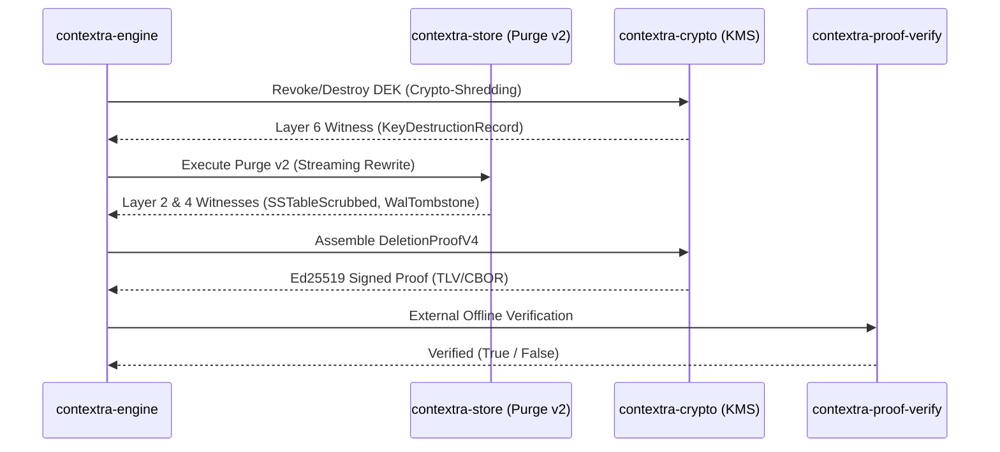

superseded by CONTEXTRA_ENDPRODUKT_SPEZIFIKATION.md

# Contextra — Disjunktive Mikro-Implementierungsspezifikation & Architektur-Synthese (v1)

**Dokumenten-ID:** `DOC-SPEC-DISJUNCT-2026-10-14-v1`  
**Datum:** 14. Oktober 2026  
**Autor:** Principal Senior Rust Architect für Contextra  
**Status:** Verbindliche normative Spezifikation (Stufe 2 nach Grüne Gates & Code-Realität)  
**Referenzen:**  
- [`capabilities.toml`](../../../capabilities.toml)
- [`AGENTS.md`](../../../AGENTS.md)
- [`docs/ARCHITEKTUR_MASTERPLAN_v2.md`](../../../docs/ARCHITEKTUR_MASTERPLAN_v2.md)
- [`docs/archive/14-10-26/*`](../../../docs/archive/14-10-26/)
- [`docs/analysis/AUDIT_GESAMTSYNTHESE_2026-10-14.md`](../../../docs/analysis/AUDIT_GESAMTSYNTHESE_2026-10-14.md)

---

## Inhaltsverzeichnis

1. [Executive Summary & Entkopplungsdoktrin](#1-executive-summary--entkopplungsdoktrin)
2. [Tiefenanalyse: Lücken & Blinde Flecken der Audits und Planungen](#2-tiefenanalyse-lücken--blinde-flecken-der-audits-und-planungen)
3. [Disjunktive Spezifikation EP1: Contextra Memory (Release 1.0 Kern)](#3-disjunktive-spezifikation-ep1-contextra-memory-release-10-kern)
4. [Disjunktive Spezifikation EP2: Contextra Proof (Verifizierbare Löschnachweise v4)](#4-disjunktive-spezifikation-ep2-contextra-proof-verifizierbare-löschnachweise-v4)
5. [Disjunktive Spezifikation EP3: Contextra Retrieval+ (Wissensgraph & PathRAG)](#5-disjunktive-spezifikation-ep3-contextra-retrieval-wissensgraph--pathrag)
6. [Disjunktive Spezifikation EP4: Contextra Inference & KV-Cache (SOTA 2026)](#6-disjunktive-spezifikation-ep4-contextra-inference--kv-cache-sota-2026)
7. [Disjunktive Spezifikation EP5: Contextra Cognition & Adapt (Kognitive Schicht)](#7-disjunktive-spezifikation-ep5-contextra-cognition--adapt-kognitive-schicht)
8. [Disjunktive Spezifikation EP6: Contextra Guard & Facades (Composition Root)](#8-disjunktive-spezifikation-ep6-contextra-guard--facades-composition-root)
9. [Vollständige Cross-Crate Wiring-Matrix & Port-Injektion](#9-vollständige-cross-crate-wiring-matrix--port-injektion)
10. [Konkreter Phasen- & Ausführungsplan (K0 bis K5)](#10-konkreter-phasen--ausführungsplan-k0-bis-k5)
11. [Verbindliche Architektur- und Implementierungs-Doktrin](#11-verbindliche-architektur--und-implementierungs-doktrin)

---

## 1. Executive Summary & Entkopplungsdoktrin

Contextra löst ein fundamentales Paradoxon moderner KI-Speichersysteme: **Höchste deterministische Retrieval-Performance bei gleichzeitiger rechtsverbindlicher, kryptografisch und physisch beweisbarer Datenlöschung.**

Bisherige Entwürfe scheiterten an enger Kopplung und unzureichend typisierten Schnittstellen:
- Optionale Funktionen (Löschnachweis, Krypto-Shredding, Inferenz-Tracking) führten zu Latenz- und Synchronisationsoverhead im Kern-Schreibpfad.
- Speicher- und Index-Engines setzten auf unsaubere `Any`-Downcasts anstelle typisierter Port-Schnittstellen.
- Inaktive Builder-Schalter täuschten Sicherheits- und Datenschutzfähigkeiten vor, die im Binary ins Leere liefen.

### Die Entkopplungsdoktrin
> **Jede Fähigkeit ist ein disjunktives Plugin. Was nicht explizit konfiguriert oder einkompiliert wird, existiert weder im Binary noch im Hot-Path. Der Null-Zustand (Off) verursacht genau 1 atomaren Load im Schreibpfad und Null Allokationen.**

```mermaid
graph TD
    subgraph Facade ["Ring 4: Composition Root & Schnittstellen"]
        MCP["contextra-mcp"]
        PY["contextra-py"]
        ROOT["contextra (ContextraBuilder)"]
        ENG["contextra-engine"]
    end

    subgraph Adapters ["Ring 3: Adapter & Store"]
        STORE["contextra-store (LSM, WAL, Purge v2)"]
        EMBED["contextra-embedder"]
    end

    subgraph Domain ["Ring 2: Domain-Logik"]
        TEXT["contextra-text (BM25, Morph)"]
        VEC["contextra-vector (HNSW, SIMD)"]
        GRAPH["contextra-graph (CSR, PathRAG)"]
        RANK["contextra-rank (RRF, Conformal)"]
        CRYPTO["contextra-crypto (BSI TR-02102)"]
        KVC["contextra-kvcache (KIVI, SnapKV)"]
        COG["contextra-cognition"]
        ADAPT["contextra-adapt (Bandits, PID)"]
        MVCC["contextra-mvcc (SSI)"]
    end

    subgraph Ports ["Ring 1: Abstrakte Verträge"]
        PORTS["contextra-ports (Traits, zero IO)"]
    end

    subgraph Core ["Ring 0: Primitive"]
        TYPES["contextra-types (IDs, Results)"]
        ERR["contextra-errors"]
        VERIFY["contextra-proof-verify (autark)"]
    end

    ROOT -.->|"verify_wiring() PFLICHT"| PORTS
    ENG --> PORTS
    STORE --> PORTS
    TEXT --> PORTS
    VEC --> PORTS
    GRAPH --> PORTS
    RANK --> PORTS
    CRYPTO --> PORTS
    KVC --> PORTS
    PORTS --> TYPES
    PORTS --> ERR
```



---

## 2. Tiefenanalyse: Lücken & Blinde Flecken der Audits und Planungen

Aus der Synthese der 10 jüngsten Planungen (`docs/archive/14-10-26/`) und der 20 Tiefenaudits vom 13./14. Oktober 2026 (`docs/analysis/` & `logs/audits/`) wurden folgende Kernlücken identifiziert:

1. **Downcast-Falle im Standard-Löschpfad (`N-B` / `S7`):**
   - *Ursache:* [`crates/contextra-engine/src/collection/crud/delete.rs:79`](../../../crates/contextra-engine/src/collection/crud/delete.rs#L79) führt `(self.storage.as_ref() as &dyn Any).downcast_ref::<LsmStorage>()` aus.
   - *Konsequenz:* Unter Mandanten-Isolation ist `self.storage` vom Typ `TenantScopedStorage<Arc<LsmStorage>>`. Der Downcast liefert `None`. Bei Standardeinstellungen wirft `Collection::delete()` sofort `CapabilityUnsupported`. Jedes Löschen scheitert.
   - *Lösung:* Einführung von `StorageEngine::as_erasure_backend(&self) -> Option<&dyn ErasureBackend>` in `contextra-ports`.
2. **Schein-Konfiguration im `ContextraBuilder` (`S5`):**
   - *Ursache:* 7 Builder-Optionen (`with_privacy`, `with_adapt`, `with_kms`, `with_kv_shredding`, `with_checkpoint`, `with_avv_generator`, `with_audit_export`) speichern Felder, die in `build()` per `let _ = ...;` ignoriert werden.
   - *Lösung:* Verbindliche Build-Validierung `verify_wiring()` im `ContextraBuilder`.
3. **Mandanten-Bypass durch undichte Newtypes (`CR-02` / `INV-TENANT-1`):**
   - *Ursache:* [`TenantId(pub u64)`](../../../crates/contextra-types/src/types/domain/ids.rs) und [`TxId(pub u64)`](../../../crates/contextra-types/src/types/domain/ids.rs) deklarieren ihr inneres Feld öffentlich.
   - *Konsequenz:* Umgehung der Konstruktorprüfung `TenantId::try_new(0)` (SYSTEM reserviert). In `contextra-mcp` und `contextra-py` existieren statische Zuweisungen von `TenantId::try_new(1)`.
   - *Lösung:* Kapselung als `pub struct TenantId(u64)` mit privaten Feldern und strikten Konstruktoren.
4. **Fehlende Arena-Zeroisierung im Vektor-Index (HNSW):**
   - *Ursache:* `remove_with_graph_repair` löscht Graph-Kanten, belässt aber Vektor-Floats im RAM-Arena-Speicher.
   - *Lösung:* Explizite Nullung der Vektor-Slots via `.fill(0.0f32)` bei physischem Purge.
5. **Verwaiste Hintergrunddienste (`ENG-DEL-001`):**
   - *Befund:* `DpiPurgeDriver`, `reverse_sweep`, `start_expiry_reaper`, `start_orphan_reaper` und `start_kv_cache_eviction` sind vollständig ausprogrammiert, besitzen jedoch 0 Aufrufer im Workspace.
6. **Kompilier- und Typfehler (`CR-01`, `ENG-FILTER-001`):**
   - `TxId::try_new` fehlt in `contextra-types`.
   - `apply_temporal_validity_filter_at` castet fälschlich Unix-Timestamps in `TxId` (`ENG-FILTER-001`).
   - `MockEmbedder` wird ohne `#[cfg(test)]` in Release-Builds exportiert (`CR-04`).

---

## 3. Disjunktive Spezifikation EP1: Contextra Memory (Release 1.0 Kern)

**Verantwortliche Crates:** [`contextra-store`](../../../crates/contextra-store), [`contextra-text`](../../../crates/contextra-text), [`contextra-vector`](../../../crates/contextra-vector), [`contextra-mvcc`](../../../crates/contextra-mvcc)
**Ring-Einstufung:** Ring 2 / Ring 3  
**Ziel:** Lokaler, ultra-schneller Hybridspeicher mit physischer Löschfähigkeit und transaktionaler Isolation.

### 3.1 `contextra-store`: Purge v2 & Lockless Write-Fence (Option B)

#### Dateipfade:
- [`crates/contextra-store/src/lsm/ops/purge.rs`](../../../crates/contextra-store/src/lsm/ops/purge.rs)
- [`crates/contextra-store/src/lsm/fence.rs`](../../../crates/contextra-store/src/lsm/fence.rs)
- [`crates/contextra-store/src/tenant_codec.rs`](../../../crates/contextra-store/src/tenant_codec.rs)

#### Datenstrukturen:
```rust
// In crates/contextra-store/src/lsm/fence.rs
use std::sync::atomic::{AtomicBool, Ordering};
use std::sync::Arc;
use arc_swap::ArcSwap;
use contextra_ports::erasure::PhysicalScope;

#[derive(Clone, Debug, PartialEq, Eq)]
pub struct ActiveFenceEntry {
    pub scope: PhysicalScope,
    pub purge_id: [u8; 16],
    pub ref_count: usize,
}

pub struct ErasureGate {
    has_active_fences: AtomicBool,
    table: ArcSwap<Vec<ActiveFenceEntry>>,
}

impl ErasureGate {
    pub fn new() -> Self {
        Self {
            has_active_fences: AtomicBool::new(false),
            table: ArcSwap::from_pointee(Vec::new()),
        }
    }

    #[inline(always)]
    pub fn validate_write_batch(&self, keys: &[&[u8]]) -> Result<(), [u8; 16]> {
        // P-E3 Invariante: Genau 1 atomarer Load mit Acquire im ungesperrten Normalbetrieb
        if !self.has_active_fences.load(Ordering::Acquire) {
            return Ok(());
        }
        let guard = self.table.load();
        for key in keys {
            for entry in guard.iter() {
                if entry.scope.matches_key(key) {
                    return Err(entry.purge_id);
                }
            }
        }
        Ok(())
    }
}
```

#### Streaming-Rewrite & I/O-Fehlerbehandlung (L4, L5, L6, L8):
```rust
// In crates/contextra-store/src/lsm/ops/purge.rs
loop {
    match reader.next_entry() {
        Ok(Some(entry)) => {
            if scope.matches_key(entry.key()) && entry.tx_id() <= as_of_tx {
                output.bytes_reclaimed = output.bytes_reclaimed
                    .checked_add(entry.serialized_size() as u64)
                    .ok_or_else(|| ContextraError::overflow("bytes_reclaimed"))?;
                output.records_purged += 1;
            } else {
                writer.append_entry(&entry)?;
            }
        }
        Ok(None) => break,
        Err(io_err) => {
            let _ = std::fs::remove_file(&temp_path);
            return Err(ContextraError::Io(Arc::new(io_err)));
        }
    }
}
```

### 3.2 `contextra-mvcc`: Vollständiges SSI Read-Set Tracking (`INV-MVCC-SSI-1`)

1. Registrierung von Scan-Präfixen und Keys via `ReadSetTracker` im Iterator.
2. Commit-Validierung: `SequenceLogSsiValidator::validate_commit(tx_id, read_set, write_set)` lehnt Transaktionen ab, deren Read-Set durch parallele Commits im Zeitfenster $[tx.start\_seq, tx.commit\_seq]$ invalidiert wurde.

### 3.3 `contextra-text`: BM25 Morphologie & Fachvokabular-Verdrahtung

1. `GermanMorphTokenizer::new()` instanziiert standardmäßig `GermanCompoundSplitter::new_with_all_domains()`. Damit werden [`LegalDomainVocabulary`](../../../crates/contextra-text/src/domain/legal_de.rs) und [`MedicalDomainVocabulary`](../../../crates/contextra-text/src/domain/medical_de.rs) im Suchpfad aktiv gebunden.
2. In `compound_splitter.rs:184` wird das panikende `debug_assert!` durch ein fehlertolerantes `to_lowercase()` vor dem Wörterbuch-Lookup ersetzt.

### 3.4 `contextra-vector`: HNSW Arena Zeroization

```rust
// In crates/contextra-vector/src/hnsw.rs:
pub fn purge_vector_slot(&mut self, internal_id: u32) -> Result<()> {
    if let Some(slot) = self.arena.get_mut(internal_id as usize) {
        slot.vector_data.fill(0.0f32); // Physische Zeroisierung im RAM
        slot.is_deleted = true;
        slot.tombstone_seq = self.current_seq;
        self.repair_neighborhood_after_purge(internal_id)?;
    }
    Ok(())
}
```

---

## 4. Disjunktive Spezifikation EP2: Contextra Proof (Verifizierbare Löschnachweise v4)

**Verantwortliche Crates:** [`contextra-crypto`](../../../crates/contextra-crypto), [`contextra-ports::erasure`](../../../crates/contextra-ports/src/erasure.rs), Crate `contextra-proof-verify` (Ring 0)
**Ring-Einstufung:** Ring 0 (Verifier) & Ring 2 (Krypto-Engine)  
**Ziel:** Autonome, mathematisch und kryptografisch beweisbare Löschung nach BSI TR-02102.



### 4.1 Das 7-Schichten-Beweismodell nach BSI TR-02102

| Schicht | Nachweismethode | Evidenz-Format |
|---|---|---|
| **Layer 1: Logical Tombstone** | MVCC Commit Sequenz | `Blake3(doc_id \|\| tx_id \|\| tenant_id)` |
| **Layer 2: Physical Scrubbing** | SSTable Rewrite & Zero-Fill | `Blake3(file_inode \|\| bytes_scrubbed \|\| seed)` |
| **Layer 3: Index Removal** | Abwesenheitsbeweis in Text/Vector/Graph | `Blake3(layer_id \|\| empty_arena_digest)` |
| **Layer 4: WAL Purge** | Truncation Manifest High-Water-Mark | `HmacSha256(wal_segment_id \|\| hwm_seq)` |
| **Layer 5: Cache Eviction** | KV-Cache & Scratchpad Scrubbing | `Blake3(cache_segment_id \|\| zero_fill_ack)` |
| **Layer 6: Crypto-Shredding** | Physische Vernichtung des DEK via KMS | `Blake3(key_id \|\| zeroize_epoch \|\| kdf_salt)` |
| **Layer 7: Audit Chain** | Hash-Verkettung & Ed25519-Signatur | `Ed25519_Sign(prev_hash \|\| L1..L6_digest)` |

### 4.2 Autonomer Verifier & TLV/CBOR Bytelayout (`contextra-proof-verify`)

```rust
// contextra-proof-verify/src/lib.rs (Ring 0, zero-dependencies ausser ed25519/blake3):
#[repr(C)]
#[derive(Clone, Debug, PartialEq, Eq)]
pub struct DeletionProofV4 {
    pub magic: [u8; 4],               // b"CXDP" (Contextra Deletion Proof)
    pub version: u16,                 // 0x0004
    pub ciphersuite: u16,             // 0x0001 = Ed25519 + Blake3 + HKDF-SHA256
    pub tenant_id: u64,               // Mandant
    pub target_id: [u8; 32],          // DocumentId oder Scope-Hash
    pub timestamp_utc: u64,           // Deterministischer Timestamp
    pub layer_digests: [[u8; 32]; 7], // L1 bis L7 Einzel-Hashes
    pub aggregate_digest: [u8; 32],   // Merkle-Wurzel über L1..L7
    pub public_key: [u8; 32],         // Ed25519 Public Key des Notars
    pub signature: [u8; 64],          // Ed25519 Signatur über aggregate_digest
}

impl DeletionProofV4 {
    pub fn verify_external(&self) -> Result<bool, VerifyError> {
        if &self.magic != b"CXDP" || self.version != 4 {
            return Err(VerifyError::UnsupportedVersion);
        }
        let mut hasher = blake3::Hasher::new();
        hasher.update(b"contextra/proof/v4/aggregate");
        hasher.update(&self.tenant_id.to_le_bytes());
        hasher.update(&self.target_id);
        hasher.update(&self.timestamp_utc.to_le_bytes());
        for digest in &self.layer_digests {
            hasher.update(digest);
        }
        if hasher.finalize().as_bytes() != &self.aggregate_digest {
            return Ok(false);
        }
        let verifying_key = ed25519_dalek::VerifyingKey::from_bytes(&self.public_key)
            .map_err(|_| VerifyError::MalformedKey)?;
        let sig = ed25519_dalek::Signature::from_bytes(&self.signature);
        Ok(verifying_key.verify_strict(&self.aggregate_digest, &sig).is_ok())
    }
}
```

---

## 5. Disjunktive Spezifikation EP3: Contextra Retrieval+ (Wissensgraph & PathRAG)

**Verantwortliche Crates:** [`contextra-graph`](../../../crates/contextra-graph), [`contextra-engine::extraction`](../../../crates/contextra-engine/src/extraction)
**Ring-Einstufung:** Ring 2  
**Ziel:** Deterministische Graph-Traversierung, PathRAG und OpenIE-Tripel-Ingestion.

### 5.1 CSR-Graph: Forward-Push PPR & Budgeted k-Path (`find_k_paths`)

#### Dateipfade:
- [`crates/contextra-graph/src/csr/graph_index.rs`](../../../crates/contextra-graph/src/csr/graph_index.rs)
- [`crates/contextra-graph/src/path_rag/k_path.rs`](../../../crates/contextra-graph/src/path_rag/k_path.rs)

#### Verdrahtung des ungenutzten Algorithmus (`W5`):
```rust
// crates/contextra-graph/src/path_rag/k_path.rs
pub struct KPathDiffusionEngine<'a> {
    graph: &'a CsrGraph,
}

impl<'a> KPathDiffusionEngine<'a> {
    pub fn new(graph: &'a CsrGraph) -> Self {
        Self { graph }
    }

    /// Berechnet die k-relevantesten Pfade unter Einhaltung des Knotenbudgets B.
    /// Komplexität: O(B log B + k * E * log V)
    pub fn find_budgeted_k_paths(
        &self,
        start_nodes: &[EntityId],
        k: usize,
        node_budget_b: usize,
        diversity_lambda: f64,
    ) -> Result<Vec<PathResult>, ContextraError> {
        let mut visited_nodes = hashbrown::HashSet::new();
        let mut priority_queue = std::collections::BinaryHeap::new();
        let mut output_paths = Vec::with_capacity(k);

        for &node in start_nodes {
            let initial_ppr = self.graph.get_ppr_score(node)?;
            priority_queue.push(ScoredPath::new(vec![node], initial_ppr));
            visited_nodes.insert(node);
        }

        while output_paths.len() < k && !priority_queue.is_empty() {
            let candidate = match priority_queue.pop() {
                Some(p) => p,
                None => break,
            };

            let new_unique_nodes = candidate.nodes.iter()
                .filter(|n| !visited_nodes.contains(n))
                .count();

            if visited_nodes.len().checked_add(new_unique_nodes).unwrap_or(usize::MAX) > node_budget_b {
                continue;
            }

            for &n in &candidate.nodes {
                visited_nodes.insert(n);
            }
            output_paths.push(candidate.to_result());

            let last_node = *candidate.nodes.last().ok_or_else(|| ContextraError::corrupted("empty path"))?;
            for edge in self.graph.get_out_edges(last_node)? {
                if !candidate.nodes.contains(&edge.target) {
                    let mut extended = candidate.nodes.clone();
                    extended.push(edge.target);
                    let div_score = self.calculate_jaccard_diversity(&extended, &output_paths);
                    let combined_score = edge.weight as f64 * (1.0 - diversity_lambda) + div_score * diversity_lambda;
                    priority_queue.push(ScoredPath::new(extended, combined_score));
                }
            }
        }

        Ok(output_paths)
    }

    fn calculate_jaccard_diversity(&self, path: &[EntityId], existing: &[PathResult]) -> f64 {
        if existing.is_empty() { return 1.0; }
        let path_set: hashbrown::HashSet<_> = path.iter().copied().collect();
        let mut min_div = 1.0;
        for p in existing {
            let other_set: hashbrown::HashSet<_> = p.nodes.iter().copied().collect();
            let intersection = path_set.intersection(&other_set).count() as f64;
            let union = path_set.union(&other_set).count() as f64;
            let jaccard = if union > 0.0 { intersection / union } else { 0.0 };
            let dist = 1.0 - jaccard;
            if dist < min_div { min_div = dist; }
        }
        min_div
    }
}
```

### 5.2 Laufzeit-Durchsetzung von `AGT-GRAPH-001` (`FIND-E-01`)
In `crates/contextra-graph/src/csr/graph_index.rs:134` wird `debug_assert!` ersetzt:
```rust
if tx == TxId::INVALID || !tx.is_valid_origin() {
    return Err(ContextraError::GraphMutation(format!(
        "AGT-GRAPH-001: Invalid transaction origin {:?}", tx
    )));
}
```

---

## 6. Disjunktive Spezifikation EP4: Contextra Inference & KV-Cache (SOTA 2026)

**Verantwortliche Crates:** [`contextra-kvcache`](../../../crates/contextra-kvcache), [`contextra-embedder`](../../../crates/contextra-embedder)
**Ring-Einstufung:** Ring 2 / Ring 3  
**Ziel:** Deterministisches KV-Cache Management mit 2-Bit-Quantisierung (KIVI), SnapKV Attention-Eviction und Radix-Prefix Spill-Over.

### 6.1 KIVI 2-Bit Quantisierung & Aligned Allocation (ADR-019)

#### Mathematischer Formalismus:
- Keys (per-channel): $\text{scale}_c = \frac{\max(K_c) - \min(K_c)}{3}$, $\text{zp}_c = \text{round}\left(-\frac{\min(K_c)}{\text{scale}_c}\right)$
- Values (per-token): $\text{scale}_t = \frac{\max(V_t) - \min(V_t)}{3}$, $\text{zp}_t = \text{round}\left(-\frac{\min(V_t)}{\text{scale}_t}\right)$

#### Aligned Buffer Allocation (`crates/contextra-kvcache/src/aligned_alloc.rs`):
```rust
// SAFETY: Layout erzwingt Alignment 64 (Cache-Line & AVX-512) und Grösse > 0.
pub unsafe fn alloc_aligned_cache_buffer(bytes: usize) -> Result<*mut u8, ContextraError> {
    if bytes == 0 {
        return Err(ContextraError::InvalidInput("Allocation size must be > 0"));
    }
    let layout = std::alloc::Layout::from_size_align(bytes, 64)
        .map_err(|_| ContextraError::InvalidInput("Invalid alignment layout"))?;
    let ptr = std::alloc::alloc_zeroed(layout);
    if ptr.is_null() {
        return Err(ContextraError::OutOfMemory);
    }
    Ok(ptr)
}
```

### 6.2 Irminsul-Eviction-Algorithmus (SnapKV + PrefixRadixTree)

```rust
// crates/contextra-kvcache/src/eviction.rs
pub fn irminsul_evict(
    cache: &mut TenantKvStore,
    tenant_id: TenantId,
    budget_tokens: usize,
    observation_window: usize,
) -> Result<EvictionReport, ContextraError> {
    let current_tokens = cache.total_tokens(tenant_id);
    if current_tokens <= budget_tokens {
        return Ok(EvictionReport::empty());
    }

    let mut segments = cache.get_tenant_segments_mut(tenant_id);
    // Phase 1: Schutz gemeinsam genutzter Präfixe (Ref-Count > 1)
    segments.retain(|s| s.radix_ref_count <= 1);

    // Phase 2: SnapKV Attention-Scoring
    for seg in segments.iter_mut() {
        seg.eviction_score = seg.compute_pooled_attention(observation_window);
    }

    // Phase 3: Deterministische Sortierung via f64::total_cmp (P28)
    segments.sort_by(|a, b| a.eviction_score.total_cmp(&b.eviction_score));

    let mut excess = current_tokens.saturating_sub(budget_tokens);
    let mut evicted_ids = Vec::new();

    for seg in segments {
        if excess == 0 { break; }
        seg.spill_to_tier2()?; // Quantisierung + mmap Flush
        excess = excess.saturating_sub(seg.token_count);
        evicted_ids.push(seg.id);
    }

    Ok(EvictionReport { evicted_ids, remaining_tokens: cache.total_tokens(tenant_id) })
}
```

---

## 7. Disjunktive Spezifikation EP5: Contextra Cognition & Adapt (Kognitive Schicht)

**Verantwortliche Crates:** [`contextra-cognition`](../../../crates/contextra-cognition), [`contextra-adapt`](../../../crates/contextra-adapt), [`contextra-rank`](../../../crates/contextra-rank)
**Ring-Einstufung:** Ring 2  
**Ziel:** Online-Parameteranpassung via Sketched Bandits, verteilungsfreie Rank-Fusion und spektrale Hyperkanten-Deduplizierung.

### 7.1 Sketched Contextual Bandit Projection (Sparse JL Matrix)

```rust
// crates/contextra-adapt/src/sketched_bandit.rs
pub struct SketchedLinUcb {
    d: usize,
    k: usize,
    projection_matrix: Vec<f64>, // Sparse Achlioptas Matrix (k x d)
    a_inv: Vec<f64>,             // k x k inverse Kovarianz
    b: Vec<f64>,                 // k-Vektor
    alpha: f64,
}

impl SketchedLinUcb {
    pub fn select_arm(&self, context: &[f64]) -> Result<f64, ContextraError> {
        let z = self.project_context(context)?; // z = S * x (O(nnz(S)) = O(k*d/3))
        let theta = self.mat_vec_mul_k(&self.a_inv, &self.b)?;
        let mean = self.dot_product_k(&z, &theta);
        let var = self.quadratic_form_k(&z, &self.a_inv)?;
        Ok(mean + self.alpha * var.sqrt())
    }

    pub fn update(&mut self, context: &[f64], reward: f64) -> Result<(), ContextraError> {
        let z = self.project_context(context)?;
        self.sherman_morrison_update_k(&z)?; // O(k^2) statt O(d^2)
        for i in 0..self.k {
            self.b[i] += reward * z[i];
        }
        Ok(())
    }
}
```

### 7.2 Conformal Prediction Rank Fusion (`contextra-rank`)

```rust
// crates/contextra-rank/src/calibration/conformal.rs
pub struct ConformalCalibrator {
    calibration_scores: Vec<f64>,
    alpha: f64,
}

impl ConformalCalibrator {
    pub fn calibrate(&mut self, nonconformity_scores: &mut [f64]) {
        nonconformity_scores.sort_by(|a, b| a.total_cmp(b)); // total_cmp PFLICHT
        self.calibration_scores = nonconformity_scores.to_vec();
    }

    pub fn compute_conformal_threshold(&self) -> Result<f64, ContextraError> {
        let n = self.calibration_scores.len();
        if n == 0 {
            return Err(ContextraError::InvalidInput("Empty calibration set"));
        }
        let rank = (((n + 1) as f64 * (1.0 - self.alpha)).ceil() as usize).min(n);
        let idx = rank.saturating_sub(1);
        self.calibration_scores.get(idx).copied()
            .ok_or_else(|| ContextraError::bounds("quantile index"))
    }
}
```

---

## 8. Disjunktive Spezifikation EP6: Contextra Guard & Facades (Composition Root)

**Verantwortliche Crates:** [`contextra`](../../../crates/contextra) (Facade), [`contextra-mcp`](../../../crates/contextra-mcp), [`contextra-py`](../../../crates/contextra-py)
**Ring-Einstufung:** Ring 4 (Composition Root)  
**Ziel:** Hermetische Kapselung, Builder-Wiring-Validierung, paniksichere Python-FFI und sicheres MCP-Protokoll.

### 8.1 `ContextraBuilder::verify_wiring` Pflichtvalidierung (`S5`)

```rust
// crates/contextra/src/builder.rs
impl ContextraBuilder {
    pub fn build(self) -> Result<ContextraDb, ContextraError> {
        self.verify_wiring()?;

        let clock = self.clock.unwrap_or_else(|| Arc::new(SystemClock));
        let id_gen = self.id_gen.unwrap_or_else(|| Arc::new(SystemIdGen));
        let erasure_mode = self.erasure_mode.unwrap_or(ErasureMode::Off);

        if self.durability == DurabilityMode::MemoryOnly && erasure_mode != ErasureMode::Off {
            return Err(ContextraError::Configuration(
                "INV-DURABILITY-RING: MemoryOnly is incompatible with ErasureMode::Assured/Attested"
            ));
        }

        let storage = Arc::new(LsmStorage::open(&self.path, self.durability)?);
        let engine = ContextraEngine::new(storage, clock, id_gen);

        Ok(ContextraDb { engine })
    }

    fn verify_wiring(&self) -> Result<(), ContextraError> {
        if self.privacy_enabled && self.egress_guard.is_none() {
            return Err(ContextraError::Configuration("Privacy enabled but no EgressGuard wired"));
        }
        if self.adapt_enabled && self.adaptive_controller.is_none() {
            return Err(ContextraError::Configuration("Adapt enabled but no AdaptiveController wired"));
        }
        if self.kms_enabled && self.kms_provider.is_none() {
            return Err(ContextraError::Configuration("KMS enabled but no KmsProvider wired"));
        }
        Ok(())
    }
}
```

### 8.2 MCP-Server: Fix `contextra_forget` (`B4`, `B9`) & Tenant Isolation

```rust
// crates/contextra-mcp/src/server_tools.rs
async fn handle_contextra_forget(
    &self,
    tenant_id: TenantId,
    collection_name: &str,
    doc_id: DocId,
) -> Result<Value, McpError> {
    let collection = self.db.get_collection(tenant_id, collection_name).await
        .map_err(|e| McpError::internal(e.to_string()))?;

    let erasure_result = collection.erase_document(doc_id).await
        .map_err(|e| McpError::internal(e.to_string()))?;

    // B4-Fix: Echter Löschnachweis statt 'proof: null'
    let proof_json = match erasure_result.proof {
        Some(p) => serde_json::to_value(&p).map_err(|e| McpError::internal(e.to_string()))?,
        None => Value::Null,
    };

    Ok(serde_json::json!({
        "status": "purged",
        "doc_id": doc_id.to_string(),
        "bytes_reclaimed": erasure_result.bytes_reclaimed,
        "proof": proof_json
    }))
}
```

### 8.3 Python-FFI (`contextra-py`): Tokio-Boundary & Panic-Isolation

```rust
// crates/contextra-py/src/bindings/common.rs
pub fn run_blocking_ffi<F, T>(f: F) -> PyResult<T>
where
    F: FnOnce() -> Result<T, ContextraError> + std::panic::UnwindSafe,
{
    let res = std::panic::catch_unwind(|| {
        tokio::task::block_in_place(f)
    });

    match res {
        Ok(Ok(val)) => Ok(val),
        Ok(Err(err)) => Err(pyo3::exceptions::PyRuntimeError::new_err(err.to_string())),
        Err(_) => Err(pyo3::exceptions::PySystemError::new_err("Contextra FFI Panic Trapped")),
    }
}
```

---

## 9. Vollständige Cross-Crate Wiring-Matrix & Port-Injektion

| Port Trait (`contextra-ports`) | Bereitstellende Crate | Konsumierende Crate(s) | Verdrahtungsort (Composition Root) |
|---|---|---|---|
| `StorageEngine` | `contextra-store` | `contextra-engine`, `contextra-text` | `ContextraBuilder::build` |
| `ErasureBackend` | `contextra-store` (`TenantScopedStorage`) | `contextra-engine::collection` | `StorageEngine::as_erasure_backend()` |
| `Clock` | `contextra-ports` (`SystemClock`) | `contextra-engine`, `contextra-adapt` | `ContextraBuilder::with_clock` |
| `IdGen` | `contextra-ports` (`SystemIdGen`) | `contextra-store`, `contextra-engine`| `ContextraBuilder::with_id_gen` |
| `VectorIndex` | `contextra-vector` (`HnswIndex`) | `contextra-engine::collection` | `Collection::new` |
| `TextIndex` | `contextra-text` (`InvertedIndex`) | `contextra-engine::collection` | `Collection::new` |
| `GraphIndex` | `contextra-graph` (`CsrGraph`) | `contextra-engine::collection` | `Collection::new` |
| `KmsProvider` | `contextra-crypto` (`LocalKmsProvider`) | `contextra-store`, `contextra-engine`| `ContextraBuilder::with_kms` |
| `AttentionExporter` | `contextra-kvcache` | `contextra-engine::kv_cache_integration`| `Collection::new` |
| `AdaptiveController` | `contextra-adapt` (`SketchedLinUcb`) | `contextra-router`, `contextra-engine`| `ContextraBuilder::with_adapt` |

---

## 10. Konkreter Phasen- & Ausführungsplan (K0 bis K5)

| Phase | Fokus & Pakete | Betroffene Crates | Abnahmekriterium & Akzeptanzbefehl |
|---|---|---|---|
| **K0** | **Kompilierung & Preflight**<br>- `TxId::try_new` implementieren (`CR-01`)<br>- `UnknownFreeSpace` Arm ergänzen (`N-N`)<br>- Router Clock Injektion korrigieren (`N-O`) | `contextra-types`<br>`contextra-engine`<br>`contextra` | `cargo check --workspace --all-targets`<br>`cargo test -p contextra-types` |
| **K1** | **Foundation Hardening & Ports**<br>- `TenantId`/`TxId` Kapselung (`CR-02`)<br>- `StorageEngine::as_erasure_backend` (`N-B`)<br>- `ErasureGate` Option B integrieren (`N-H`) | `contextra-types`<br>`contextra-ports`<br>`contextra-store` | `cargo xtask check-ring-layering`<br>`cargo test -p contextra-store` |
| **K2** | **Store Purge v2 & SSI Read-Set**<br>- Streaming Rewrite in Purge Engine (`L4`, `L5`, `L6`)<br>- Manifest Crash-Konsistenz (`N-A`)<br>- SSI Read-Set Token Registrierung | `contextra-store`<br>`contextra-mvcc` | `cargo xtask wal-replay-verify`<br>`cargo test -p contextra-mvcc` |
| **K3** | **Retrieval, Graph & Vektoren**<br>- HNSW Arena Zeroization<br>- GermanCompoundSplitter Fachdomänen (`FIND-C-01`)<br>- `find_budgeted_k_paths` Verdrahtung (`W5`) | `contextra-vector`<br>`contextra-text`<br>`contextra-graph` | `cargo test -p contextra-text`<br>`cargo test -p contextra-graph` |
| **K4** | **Löschnachweis v4 & Krypto-Plugin**<br>- Auslagerung `contextra-proof-verify` (Ring 0)<br>- 7-Layer Beweiskette & BSI TR-02102<br>- KMS-Provider Binding (`FINDING-CRYPTO-01`) | `contextra-crypto`<br>`contextra-proof-verify` | `cargo test -p contextra-crypto`<br>`cargo xtask orphan-symbols` |
| **K5** | **Composition Root, Facaden & MCP**<br>- `verify_wiring()` Pflichtcheck (`S5`)<br>- MCP `contextra_forget` Proof-Durchreichung (`B4`)<br>- Python Multi-Tenant Enforcement | `contextra`<br>`contextra-mcp`<br>`contextra-py` | `cargo test -p contextra`<br>`cargo test -p contextra-mcp`<br>`cargo xtask can-merge` |

---

## 11. Verbindliche Architektur- und Implementierungs-Doktrin

1. **Keine Workarounds über Downcasts:** Jeder Zugriff auf optionale Fähigkeiten (`ErasureBackend`, `KmsProvider`) erfolgt ausschließlich über typisierte Trait-Methoden in `contextra-ports`.
2. **Zero-Panic ist unantastbar:** In allen Produktionspfaden sind `unwrap()`, `expect()` und `debug_assert!` (für Invarianten) verboten. Fehler werden über `Result<T, ContextraError>` nach oben propagiert.
3. **Deterministische Arithmetik:** Jeder Float-Vergleich muss zwingend `f64::total_cmp` nutzen. Keine Verwendung von `partial_cmp().unwrap()` oder Roh-Vergleichen.
4. **Verifizierbare Gates:** Vor dem Öffnen eines PRs müssen `cargo xtask jules check` und `cargo xtask jules verify` ohne Fehler durchlaufen.
