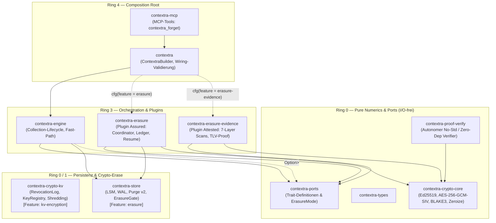
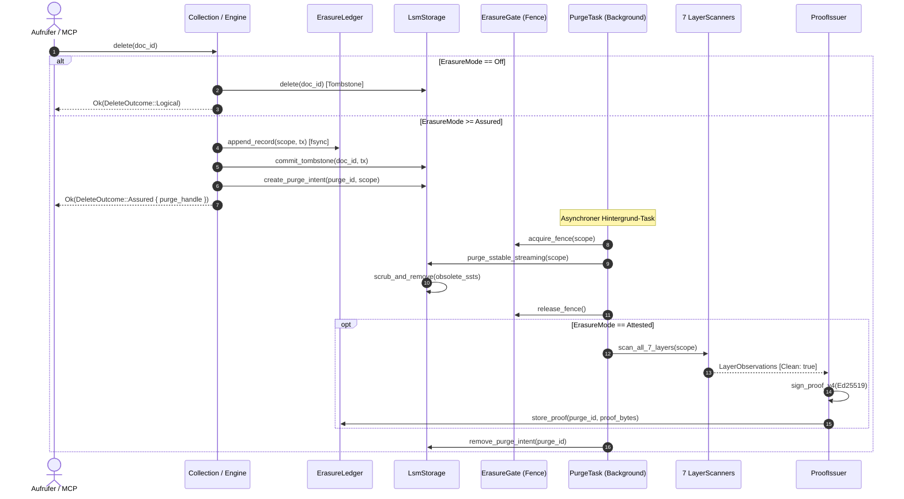

superseded by CONTEXTRA_ENDPRODUKT_SPEZIFIKATION.md

# Contextra — Systemspezifikation: Löschnachweis und Löscharchitektur v2

**Version:** 2.0 · **Datum:** 14. Oktober 2026  
**Verantwortlich:** Principal Senior Rust Architect für Contextra  
**Status:** Verbindliche normative Spezifikation für alle Module, Crates und Schnittstellen  
**Klassifikation:** Höchste Vertraulichkeits- und Integritätsstufe (Kernversprechen des Gesamtsystems)  
**Bezugsdokumente:**  
- [`docs/ARCHITEKTUR_MASTERPLAN_v2.md`](../../../docs/ARCHITEKTUR_MASTERPLAN_v2.md)
- [`docs/analysis/AUDIT_GESAMTSYNTHESE_2026-10-14.md`](../../../docs/analysis/AUDIT_GESAMTSYNTHESE_2026-10-14.md)
- [`capabilities.toml`](../../../capabilities.toml)

---

## Inhaltsverzeichnis

1. [Executive Summary & Rechtliches Kernversprechen](#1-executive-summary--rechtliches-kernversprechen)
2. [Drei-Stufen-Modell (Off, Assured, Attested) & Monotone Hochwassermarke](#2-drei-stufen-modell-off-assured-attested--monotone-hochwassermarke)
3. [Zero-Cost-Entkopplung: Compile-Zeit- und Laufzeit-Architektur](#3-zero-cost-entkopplung-compile-zeit--und-laufzeit-architektur)
4. [Port-Spezifikation: `contextra-ports::erasure` (Exakte Rust-Signaturen)](#4-port-spezifikation-contextra-portserasure-exakte-rust-signaturen)
5. [Das 7-Schichten-Beweismodell nach BSI TR-02102](#5-das-7-schichten-beweismodell-nach-bsi-tr-02102)
6. [Krypto-Shredding & BSI TR-02102 konformes Schlüsselmanagement](#6-krypto-shredding--bsi-tr-02102-konformes-schlüsselmanagement)
7. [Purge v2: Streaming-Rewrite & Lockless Write-Fence (Option B)](#7-purge-v2-streaming-rewrite--lockless-write-fence-option-b)
8. [Anti-Resurrection Ledger & Streaming `RestoreGuard`](#8-anti-resurrection-ledger--streaming-restoreguard)
9. [Crash-Konsistenz, Intent-Resume & Chaos-Matrix](#9-crash-konsistenz-intent-resume--chaos-matrix)
10. [Deterministisches v4-TLV/CBOR Bytelayout & Autonomer Verifier](#10-deterministisches-v4-tlvcbor-bytelayout--autonomer-verifier)
11. [Vollständiger End-to-End Löschpfad & Zustandsmaschine](#11-vollständiger-end-to-end-löschpfad--zustandsmaschine)
12. [Fassaden- und MCP-Integration (`contextra_forget`)](#12-fassaden--und-mcp-integration-contextra_forget)
13. [Verifikation, Differenztests & Tampering-Matrix](#13-verifikation-differenztests--tampering-matrix)
14. [Ehrlichkeits-Klausel & Audit-Ausschlüsse](#14-ehrlichkeits-klausel--audit-ausschlüsse)

---

## 1. Executive Summary & Rechtliches Kernversprechen

Contextra ist eine multi-mandantenfähige Single-Node-Speicherengine für autonome Agenten. Ihr zentrales Differenzierungsmerkmal ist die **rechtsverbindliche, mathematisch und kryptografisch beweisbare Löschung** gespeicherter Daten nach:
- **DSGVO Art. 17 ("Recht auf Vergessenwerden"):** Vollständige physische Eliminierung aller Primärdaten, Indizes, Caches und abgeleiteten Vektoren.
- **ZPO § 371a ("Beweiskraft elektronischer Dokumente"):** Qualifizierte Beweisführung durch kryptografisch signierte, manipulationssichere Evidenzketten mit Zeitanker.

### 1.1 Das architektonische Dilemma und seine Lösung

Bisherige Ansätze scheiterten an einem fundamentalen Zielkonflikt:
1. **Löschsicherheit verlangte synchrone Scans:** Dies ruinierte den Durchsatz und erzeugte untragbare Latenzen im normalen Schreib-/Lesebetrieb.
2. **Kompilierzeit-Kopplung:** Der Löschnachweis-Code (~8.200 LOC Krypto, Ed25519, TLV, Audit-Chains) war fest in Ring 0 und Ring 3 verdrahtet. Systeme, die lediglich einen schnellen lokalen Vektorspeicher benötigten, zahlten dennoch für Krypto-Overhead und scheiterten mit `CapabilityUnsupported` (N-B), wenn kein Notar konfiguriert war.

### 1.2 Die Lösung: Die Zero-Cost-Plugin-Doktrin

```
┌─────────────────────────────────────────────────────────────────────────┐
│                       ZERO-COST-PLUGIN-DOKTRIN                          │
│                                                                         │
│  1. Wer keinen Löschnachweis benötigt (Modus OFF):                     │
│     - Zahlt 0 Bytes im Binary (Beweis-Crates sind wegkompiliert)        │
│     - Zahlt 0 ns im Lesepfad                                            │
│     - Zahlt < 1 ns im Schreibpfad (maximal ein Atomic-Load)             │
│     - Erhält reguläre Tombstone-Löschung mit maximalem Durchsatz        │
│                                                                         │
│  2. Wer Löschgarantie benötigt (Modus ASSURED):                         │
│     - Aktiviert Anti-Resurrection-Ledger, Schreib-Fence und Purge v2    │
│     - Physische Säuberung erfolgt asynchron ohne Latenz-Spikes          │
│                                                                         │
│  3. Wer auditierbare Beweise benötigt (Modus ATTESTED):                 │
│     - Erhält asynchron echte Schichtscans aller 7 Teilsysteme           │
│     - Erzeugt einen extern verifizierbaren v4-TLV/CBOR Ed25519-Beweis   │
└─────────────────────────────────────────────────────────────────────────┘
```

---

## 2. Drei-Stufen-Modell (Off, Assured, Attested) & Monotone Hochwassermarke

Das Löschverhalten wird durch den persistenten Aufzählungstyp `ErasureMode` gesteuert:

```rust
// In crates/contextra-ports/src/erasure.rs
#[derive(Debug, Clone, Copy, PartialEq, Eq, PartialOrd, Ord, Hash, serde::Serialize, serde::Deserialize)]
#[repr(u8)]
pub enum ErasureMode {
    /// Keine Löschgarantien. Reines Tombstone + Compaction (Nullkosten-Standard).
    Off = 0,
    /// Physische Löschgarantie: Anti-Resurrection Ledger, Write-Fence,
    /// asynchroner Streaming-Purge mit Resume-Fähigkeit, RestoreGuard.
    Assured = 1,
    /// Vollständige Beweisführung: Assured-Garantie + 7 Schichtscans (BSI TR-02102),
    /// Ed25519-Signatur, RFC 3161 Zeitanker, Transparenzlog (RFC 9162).
    Attested = 2,
}

impl Default for ErasureMode {
    #[inline(always)]
    fn default() -> Self {
        Self::Off
    }
}
```

### 2.1 Modus-Vergleichsmatrix

| Eigenschaft | Modus `Off` (Standard) | Modus `Assured` | Modus `Attested` |
|---|---|---|---|
| **Löschmechanismus** | Logischer Tombstone in MemTable/SSTable | Footprint $\to$ Ledger $\to$ Tombstone $\to$ Purge + Crypto-Erase | Wie `Assured`, gefolgt von Schicht-Verifikation |
| **Schreibpfad-Overhead** | **0 ns** (ZST) | **$< 1$ ns** (1× `AtomicBool::load(Acquire)`) | **$< 1$ ns** (1× `AtomicBool::load(Acquire)`) |
| **Anti-Resurrection Ledger** | Nein | **Ja** (Append-Only Datei mit `fsync`) | **Ja** (Append-Only Datei mit `fsync`) |
| **Write-Fence im Rewrite** | Nein | **Ja** (Option B Präfix-Fence) | **Ja** (Option B Präfix-Fence) |
| **Crash-Resume** | Nein | **Ja** (Rekonstruktion aus Ledger + Intent) | **Ja** (Rekonstruktion aus Ledger + Intent) |
| **Restore-Schutz** | Nein (Gelöschtes kann zurückkehren) | **Ja** (Streaming `RestoreGuard` filtert Keys) | **Ja** (Streaming `RestoreGuard` filtert Keys) |
| **Schichtscans (Zeugen)** | Keine | Keine | **Ja** (7 reale Schichtscans nach BSI TR-02102) |
| **Signierter Beweis** | Keiner | Keiner | **Ja** (v4-TLV/CBOR mit Ed25519-Signatur) |
| **Zeitanker & Log** | Keiner | Keiner | **Ja** (RFC 3161 Zeitstempel & RFC 9162 Log) |
| **Benötigte Cargo-Features** | `default` | `erasure` | `erasure`, `erasure-evidence` |
| **Benötigter Lizenzring** | Keiner | Keiner | `FeatureRing::Sovereign` |

### 2.2 Monotone Hochwassermarke im Store-Manifest (Invariante PE5)

Um Downgrade-Angriffe (z. B. Angreifer schaltet auf `Off`, um gelöschte Daten aus Backups wiederzubeleben) strukturell auszuschließen, speichert das Manifest der LSM-Engine den höchsten jemals genutzten `ErasureMode` als **monotone Hochwassermarke**:

```rust
// Im LSM Manifest-Header (crates/contextra-store/src/manifest/mod.rs)
pub struct ManifestHeader {
    pub magic: [u8; 4],                     // b"MFMN"
    pub version: u32,                       // Version 4
    pub manifest_seq: u64,
    /// Höchster je aktiver ErasureMode. Nur monoton steigend änderbar.
    pub erasure_high_water_mark: ErasureMode,
    pub header_hmac: [u8; 32],              // Schützt gegen Offline-Manipulation
}
```

**Verbindliche Invarianten:**
1. **Kein stilles Downgrade:** Öffnet ein Prozess die Datenbank mit einem `requested_mode < erasure_high_water_mark`, bricht `LsmStorage::open()` sofort mit `Err(ContextraError::PolicyViolation)` ab.
2. **Explizites Downgrade-Token:** Ein Herabsetzen des Modus ist ausschließlich über eine gesonderte administrative API möglich (`erasure_downgrade(AcknowledgeToken)`). Dies erzeugt einen unwiderruflichen, signierten Audit-Log-Eintrag: `"Erasure guarantee terminated at TxId X"`.
3. **Session-Unveränderlichkeit:** Der `ErasureMode` ist für die Lebensdauer einer geöffneten Instanz unveränderlich.

---

## 3. Zero-Cost-Entkopplung: Compile-Zeit- und Laufzeit-Architektur

### 3.1 Crate-Topologie der Löscharchitektur



### 3.2 Monomorphisierung des Löschpfades in der Engine

In [`crates/contextra-engine`](../../../crates/contextra-engine) darf keine dynamische Verzweigung oder Heap-Allokation den Standard-Löschpfad belasten:

```rust
// crates/contextra-engine/src/collection/crud/delete.rs
impl<S: StorageEngine> Collection<S> {
    pub async fn delete(&self, doc_id: &str) -> Result<DeleteOutcome, ContextraError> {
        // 1. FAST-PATH: Modus OFF (Zero-Cost!)
        if self.erasure_mode() == ErasureMode::Off {
            let tx = self.storage.delete(doc_id)?;
            return Ok(DeleteOutcome::Logical { tx });
        }

        // 2. ERASURE-PFAD (Assured oder Attested)
        #[cfg(feature = "erasure")]
        {
            let hooks = self.erasure_hooks.as_ref().ok_or_else(|| {
                ContextraError::ConfigurationError("Erasure hooks not wired in builder".into())
            })?;

            let backend = self.storage.as_erasure_backend().ok_or_else(|| {
                ContextraError::CapabilityUnsupported(
                    "erasure_backend",
                    "Underlying storage does not implement ErasureBackend".into(),
                )
            })?;

            self.execute_erasure_lifecycle(doc_id, backend, hooks.as_ref()).await
        }

        #[cfg(not(feature = "erasure"))]
        {
            Err(ContextraError::ConfigurationError(
                "Active erasure mode requires compilation with feature 'erasure'".into(),
            ))
        }
    }
}
```

---

## 4. Port-Spezifikation: `contextra-ports::erasure` (Exakte Rust-Signaturen)

Die Schnittstelle zwischen Engine, Storage und den Erasure-Plugins wird vollständig in [`crates/contextra-ports/src/erasure.rs`](../../../crates/contextra-ports) deklariert:

```rust
//! Erasure Port Definitionen (Ring 1)
//! Sämtliche Trait-Definitionen sind I/O- und Plugin-unabhängig.

use contextra_types::{ContextraError, DocId, TenantId, TxId};
use std::path::{Path, PathBuf};
use std::sync::Arc;
use std::time::Duration;

// ────────────────────────────────────────────────────────────
// Scope-Typen (Strukturelle Verhinderung von N-K)
// ────────────────────────────────────────────────────────────

/// Physischer Scope für Löschoperationen.
/// Kann AUSSCHLIESSLICH durch das Storage-Backend erzeugt werden.
/// Verhindert, dass logische Präfixe (__col:name:) anstelle
/// physischer Mandantenpräfixe (t:id:__col:name:) gescannt werden.
#[derive(Debug, Clone, PartialEq, Eq)]
pub struct PhysicalScope {
    prefixes: Vec<Vec<u8>>,
    explicit_keys: Vec<Vec<u8>>,
    doc_ids: Vec<DocId>,
}

impl PhysicalScope {
    /// Konstruktor ist nur für das Storage-Backend (ErasureBackend) zugänglich.
    pub fn from_backend(
        prefixes: Vec<Vec<u8>>,
        explicit_keys: Vec<Vec<u8>>,
        doc_ids: Vec<DocId>,
    ) -> Self {
        Self { prefixes, explicit_keys, doc_ids }
    }

    #[inline(always)]
    pub fn prefixes(&self) -> &[Vec<u8>] { &self.prefixes }

    #[inline(always)]
    pub fn explicit_keys(&self) -> &[Vec<u8>] { &self.explicit_keys }

    #[inline(always)]
    pub fn doc_ids(&self) -> &[DocId] { &self.doc_ids }

    #[inline]
    pub fn matches_key(&self, key: &[u8]) -> bool {
        self.explicit_keys.iter().any(|k| k == key)
            || self.prefixes.iter().any(|p| key.starts_with(p))
    }
}

/// Logischer Scope, den der Aufrufer übergibt.
#[derive(Debug, Clone, PartialEq, Eq)]
pub enum LogicalScope {
    Document { tenant_id: TenantId, collection: String, doc_id: String },
    Collection { tenant_id: TenantId, collection: String },
    Tenant { tenant_id: TenantId },
}

// ────────────────────────────────────────────────────────────
// Backend-Trait (Löst N-B und beseitigt alle 5 Downcasts)
// ────────────────────────────────────────────────────────────

/// Vom Storage-Backend implementiert.
/// Beseitigt sämtliche downcast_ref::<LsmStorage>() Aufrufe.
pub trait ErasureBackend: Send + Sync {
    /// Übersetzt logischen Scope in physisch kodierte Schlüsselbereiche.
    fn physical_scope(&self, scope: &LogicalScope) -> Result<PhysicalScope, ContextraError>;

    /// Führt physischen Purge über die SSTables aus.
    fn purge_physical(
        &self,
        scope: &PhysicalScope,
        as_of_tx: TxId,
        probe: &dyn FreeSpaceProbe,
    ) -> Result<PurgeOutput, PurgeError>;

    /// Erwirbt eine Schreib-Fence für die betroffenen Präfixe.
    fn acquire_fence(&self, scope: &PhysicalScope, purge_id: [u8; 16]) -> Result<FenceGuard, ContextraError>;
}

/// Capability-Erweiterung für `StorageEngine`.
pub trait StorageErasureExt {
    fn as_erasure_backend(&self) -> Option<&dyn ErasureBackend>;
}

// ────────────────────────────────────────────────────────────
// Plugin-Hooks Lifecycle
// ────────────────────────────────────────────────────────────

#[derive(Debug, Clone, Copy, PartialEq, Eq)]
pub struct HookToken(pub u64);

impl HookToken {
    pub const NONE: Self = Self(0);
}

pub struct EraseContext<'a> {
    pub logical_scope: &'a LogicalScope,
    pub physical_scope: &'a PhysicalScope,
    pub mode: ErasureMode,
    pub tx_id: TxId,
}

pub trait ErasureHooks: Send + Sync + 'static {
    /// Phase 1: Vor dem Commit. Schreibt den Ledger-Eintrag mit fsync.
    fn on_erasure_begin(&self, ctx: &EraseContext) -> Result<HookToken, ContextraError>;

    /// Phase 2: Nach erfolgreichem Tombstone-Commit. Registriert Purge-Intent.
    fn on_tombstone_committed(&self, token: HookToken, tx: TxId) -> Result<(), ContextraError>;

    /// Phase 3: Physischer Purge abgeschlossen.
    fn on_purge_completed(&self, token: HookToken, output: &PurgeOutput) -> Result<(), ContextraError>;

    /// Phase 4: Finalisierung. Erzeugt ggf. den signierten Beweis (Attested).
    fn finalize_erasure(&self, token: HookToken) -> Result<Option<Vec<u8>>, ContextraError>;
}

// ────────────────────────────────────────────────────────────
// Schichtscans & Zeugen (Evidence-Chain)
// ────────────────────────────────────────────────────────────

#[derive(Debug, Clone, Copy, PartialEq, Eq, Hash)]
#[repr(u8)]
pub enum LayerId {
    LsmMemtable = 1,
    PhysicalDataZeroing = 2,
    LsmSstables = 3,
    WalPurge = 4,
    ReplicaBackupAck = 5,
    CryptoShredding = 6,
    AuditTrail = 7,
    TextIndex = 20,
    RelationsGraph = 21,
    HnswVector = 26,
    ErasureLedger = 30,
    EgressAudit = 40,
}

#[derive(Debug, Clone)]
pub struct LayerObservation {
    pub layer: LayerId,
    pub clean: bool,
    pub state_digest: [u8; 32],
    pub metadata: Vec<u8>,
}

/// Fail-Closed Scanner: Jeder Fehler bedeutet, dass die Schicht NICHT sauber ist.
pub trait LayerScan: Send + Sync {
    fn layer_id(&self) -> LayerId;
    fn scan(&self, scope: &PhysicalScope) -> Result<LayerObservation, ScanError>;
}

// ────────────────────────────────────────────────────────────
// Anti-Resurrection Restore Guard
// ────────────────────────────────────────────────────────────

#[derive(Debug, Clone, Copy, PartialEq, Eq)]
pub enum RestoreVerdict {
    Admit,
    Reject,
}

pub trait RestoreGuard: Send + Sync {
    /// Prüft beim Einspielen von Checkpoints/Backups, ob ein Schlüssel gelöscht wurde.
    fn admit(&self, key: &[u8], checkpoint_tx: TxId) -> RestoreVerdict;
}

// ────────────────────────────────────────────────────────────
// Hilfsstrukturen & Fehler
// ────────────────────────────────────────────────────────────

pub trait FreeSpaceProbe: Send + Sync {
    /// Liefert verfügbare Bytes auf dem Speichermedium.
    /// None = unbekannt (L8-Fix: darf NICHT als 0 Byte interpretiert werden).
    fn available_bytes(&self) -> Option<u64>;
}

#[derive(Debug, Clone)]
pub struct PurgeOutput {
    pub records_purged: u64,
    pub bytes_reclaimed: u64,
    pub sstables_replaced: usize,
    pub obsolete_files: Vec<PathBuf>,
    pub duration: Duration,
}

pub struct FenceGuard {
    _inner: Box<dyn Send + Sync>,
}

#[derive(Debug, thiserror::Error)]
pub enum PurgeError {
    #[error("Insufficient disk space: needed {needed} bytes, available {available:?}")]
    InsufficientDiskSpace { needed: u64, available: Option<u64> },
    #[error("Write fence conflict during purge rewrite")]
    FenceConflict,
    #[error("I/O read error in file {file} at offset {offset}: {source}")]
    ReadError { file: String, offset: u64, source: std::io::Error },
    #[error("I/O error during purge: {0}")]
    IoError(#[from] std::io::Error),
    #[error("Manifest exchange failed: {0}")]
    ManifestError(String),
}

#[derive(Debug, thiserror::Error)]
pub enum ScanError {
    #[error("I/O scan error: {0}")]
    Io(#[from] std::io::Error),
    #[error("Corrupted index detected in layer {0:?}: {1}")]
    CorruptedIndex(LayerId, String),
    #[error("Scan incomplete (fail-closed): {0}")]
    Incomplete(String),
}
```

---

## 5. Das 7-Schichten-Beweismodell nach BSI TR-02102

Der Löschnachweis v4 implementiert das standardisierte **7-Layer-Verifikationsmodell**, das eine lückenlose Evidenzkette von der logischen Deklaration bis zur Bit-Ebene auf dem Speichermedium zertifiziert:

```
┌──────────────────────────────────────────────────────────────────────────┐
│             DAS 7-SCHICHTEN-BEWEISMODELL (BSI TR-02102 / DSGVO)          │
├───────┬───────────────────────────────┬──────────────────────────────────┤
│ Layer │ Bezeichnung                   │ Technischer Nachweis             │
├───────┼───────────────────────────────┼──────────────────────────────────┤
│ **1** │ **Logical Deletion Marker**   │ Bit 63 SeqBitTombstone im WAL    │
│ **2** │ **Physical Data Zeroing**     │ scrub_and_remove (Null-Pattern)  │
│ **3** │ **Index Entry Removal**       │ SSTables, BM25, CSR, HNSW sauber │
│ **4** │ **WAL Entry Purge**           │ Race-freie HMAC-Chaining-Purge   │
│ **5** │ **Backup & Replica ACK**      │ RestoreGuard Checkpoint-Filter   │
│ **6** │ **Cryptographic Shredding**   │ RevocationLog DEK-Destruction    │
│ **7** │ **Audit Trail Hash-Chain**    │ Blake3 Forward-Secure Hashkette  │
└───────┴───────────────────────────────┴──────────────────────────────────┘
```

### 5.1 Detaillierte Spezifikation der 7 Schichten

#### Layer 1: Logical Deletion Marker
- **Zweck:** Unmittelbare Sichtbarkeits-Barriere im Transaktions- und MVCC-System.
- **Implementierung:** Eintrag eines Tombstones in der aktiven `MemTable` mit gesetztem Bit 63 (`SeqBitTombstone`).
- **Beweis-Hash:**
  $$\mathcal{H}_{L1} = \text{BLAKE3}(\text{TombstoneRecord} \parallel \text{ErasedAtTx} \parallel \text{Timestamp})$$

#### Layer 2: Physical Data Zeroing
- **Zweck:** Zerstörung magnetischer/elektrischer Restremanenz auf Blockebene vor Freigabe an das Betriebssystem.
- **Implementierung:** Obsolete SSTable-Dateien werden via `contextra_durable_fs::scrub_and_remove` mit kryptografischen Null- oder Pseudorandom-Mustern überschrieben, synchron geflusht (`sync_all`) und erst danach aus dem Dateisystem entfernt (`unlink`).
- **Beweis-Hash:**
  $$\mathcal{H}_{L2} = \text{BLAKE3}(\text{FileByteRanges} \parallel \text{ScrubChecksum} \parallel \text{FsSyncAck})$$

#### Layer 3: Index Entry Removal (Multi-Index Abwesenheit)
- **Zweck:** Sicherstellung, dass in keiner der 4 parallelen Indexstrukturen Referenzen verbleiben.
- **Teilprüfungen:**
  - **3a (LSM SSTables):** Physischer Rohsweep aller aktiven SSTables belegt Abwesenheit aller Schlüssel im `PhysicalScope`.
  - **3b (Text BM25):** Roaring-Bitmap Inverted Index bestätigt die Entfernung der `DocId` aus allen Posting-Listen.
  - **3c (Relations Graph):** CSR-Adjazenzlisten und Hyperkanten-Indizes bestätigen die Kanten-Bereinigung.
  - **3d (HNSW Vektor):** Arena-Slots werden explizit mit Nullen überschrieben (Zeroisierung) und Graph-Reparatur (`remove_with_graph_repair`) abgeschlossen.
- **Beweis-Hash:**
  $$\mathcal{H}_{L3} = \text{BLAKE3}(\mathcal{H}_{3a} \parallel \mathcal{H}_{3b} \parallel \mathcal{H}_{3c} \parallel \mathcal{H}_{3d})$$

#### Layer 4: WAL Entry Purge & Truncation-Schutz
- **Zweck:** Bereinigung des Write-Ahead-Logs ohne Zerstörung der HMAC-Integritätskette.
- **Implementierung:** Abgeschlossene Purge-Einträge werden im WAL als getrumpft markiert; rotierte WAL-Segmente werden nach Manifest-Checkpointing gescrubbt.
- **Invariante:** `INV-WAL-TRUNCATION-1` (High-Water-Mark im Manifest) verhindert das unbemerkte Abschneiden von Logs.
- **Beweis-Hash:**
  $$\mathcal{H}_{L4} = \text{BLAKE3}(\text{WalSegmentId} \parallel \text{HmacChainDigest} \parallel \text{PurgeSeq})$$

#### Layer 5: Backup & Replica Propagation (Anti-Resurrection)
- **Zweck:** Schutz vor Wiederauferstehung ("Resurrection") durch Wiedereinspielen alter Backups.
- **Implementierung:** Registrierung im persistenten `ErasureLedger`. Der Streaming `RestoreGuard` garantiert, dass Schlüssel mit $\text{DeleteTx} > \text{CheckpointTx}$ abgewiesen werden (`RestoreVerdict::Reject`).
- **Beweis-Hash:**
  $$\mathcal{H}_{L5} = \text{BLAKE3}(\text{LedgerRecordOffset} \parallel \text{CheckpointFilterState})$$

#### Layer 6: Cryptographic Shredding
- **Zweck:** Unwiderrufliche Zerstörung des DEK (Data Encryption Key). Selbst bei physischer Datenwiederherstellung von Roh-Flash-Zellen bleibt der Chiffretext unentschlüsselbar.
- **Implementierung:** Löschung des Schlüssels aus dem `RevocationLog` mit `sync_all` und anschließender Zeroisierung (`zeroize::ZeroizeOnDrop`).
- **Beweis-Hash:**
  $$\mathcal{H}_{L6} = \text{BLAKE3}(\text{KeyId} \parallel \text{RevocationMarkerDigest} \parallel \text{KdfSalt})$$

#### Layer 7: Audit Trail & Hash-Verkettung
- **Zweck:** Fälschungssichere zeitliche Einbettung in die globale Transaktionshistorie.
- **Implementierung:** BLAKE3 Forward-Secure Hashkette mit Verknüpfung zum vorherigen Block-Hash. Optionaler RFC 3161 Timestamp Token und RFC 9162 Merkle-Tree Inclusion Proof.
- **Beweis-Hash:**
  $$\mathcal{H}_{L7} = \text{BLAKE3}(\mathcal{H}_{\text{prev}} \parallel \mathcal{H}_{L1..L6} \parallel \text{RFC3161Timestamp})$$

---

## 6. Krypto-Shredding & BSI TR-02102 konformes Schlüsselmanagement

Gemäß BSI TR-02102-1 und TR-02102-2 gelten verbindlich folgende kryptografische Leitlinien:

```
┌─────────────────────────────────────────────────────────────────────────┐
│               SCHLÜSSELHIERARCHIE FÜR KRYPTO-SHREDDING                  │
│                                                                         │
│  Master Key (KMS / HSM / System-Keystore)                              │
│    │                                                                    │
│    └──► Key Encryption Key (KEK) [pro TenantId]                         │
│           │                                                             │
│           └──► Data Encryption Key (DEK) [pro Collection / Segment]     │
│                  │                                                      │
│                  ├── Verschlüsselt Chunks & Nutzlastdaten (AES-256-GCM) │
│                  ├── Verschlüsselt Embeddings & Vektoren                │
│                  └── Verschlüsselt KV-Cache Segmente                    │
└─────────────────────────────────────────────────────────────────────────┘
```

### 6.1 Schlüsselvernichtungs-Matrix

| Lösch-Granularität | Primäre Methode | Laufzeitkomplexität | Rückfall-Garantie |
|---|---|---|---|
| **Gesamter Mandant (`TenantId`)** | KEK vernichten via `RevocationLog` | $\mathcal{O}(1)$ (Instant Shredding) | Alle Daten unentschlüsselbar |
| **Ganze Collection** | DEK vernichten via `RevocationLog` | $\mathcal{O}(1)$ (Instant Shredding) | Collection-Daten unentschlüsselbar |
| **Einzelnes Dokument** | SSTable Streaming-Rewrite (Purge v2) | $\mathcal{O}(\text{SSTable-Größe})$ | Bit-Nullung via `scrub_and_remove` |

### 6.2 Zeroize-Invariante im Arbeitsspeicher (INV-VAULT-1)

Alle Schlüsselstrukturen in [`contextra-crypto-core`](../../../crates/contextra-crypto) implementieren `zeroize::ZeroizeOnDrop`:

```rust
// In contextra-crypto-core/src/keys.rs
use zeroize::{Zeroize, ZeroizeOnDrop};

#[derive(Zeroize, ZeroizeOnDrop)]
pub struct DataEncryptionKey {
    inner: [u8; 32], // 256-Bit AES Key
}

// Explizites Verbot von Clone zur Vermeidung verwaister Speicherbereiche
impl !Clone for DataEncryptionKey {}
```

---

## 7. Purge v2: Streaming-Rewrite & Lockless Write-Fence (Option B)

### 7.1 Der Purge-Kern (Behebung aller Store-Blocker)

Der Purge-Kern in [`contextra-store/src/lsm/ops/purge.rs`](../../../crates/contextra-store) implementiert den **Single-Pass Streaming Rewrite**:

```rust
// In contextra-store/src/lsm/ops/purge.rs
pub fn purge_sstable_streaming<P: FreeSpaceProbe>(
    manifest: &ManifestContext,
    scope: &PhysicalScope,
    as_of_tx: TxId,
    probe: &P,
) -> Result<PurgeOutput, PurgeError> {
    let start_time = std::time::Instant::now();

    // 1. Kapazitätsprüfung mit L8-Semantik (None = unbegrenzt / konservativ)
    if let Some(available) = probe.available_bytes() {
        if available < MIN_PURGE_HEADROOM_BYTES {
            return Err(PurgeError::InsufficientDiskSpace {
                needed: MIN_PURGE_HEADROOM_BYTES,
                available: Some(available),
            });
        }
    }

    let mut obsolete_files = Vec::new();
    let mut rewritten_sstables = Vec::new();
    let mut records_purged = 0u64;
    let mut bytes_reclaimed = 0u64;

    for sst in manifest.active_sstables() {
        // Bloom-Filter & Key-Range Vorabprüfung
        if !sst.may_contain_scope(scope) {
            continue;
        }

        let mut reader = sst.open_reader()?;
        let mut writer = sst.create_replacement_writer()?;
        let mut dropped_in_sst = 0u64;

        // L5-FIX: Exakter 3-Arm Pattern Match (kein silent truncation!)
        loop {
            match reader.read_next_entry() {
                Ok(Some(entry)) => {
                    if scope.matches_key(entry.key()) && entry.sequence() <= as_of_tx {
                        dropped_in_sst += 1;
                        bytes_reclaimed += entry.raw_size() as u64;
                        continue; // Physisch verwerfen!
                    }
                    // N-F-FIX: Direktes Streaming in neue SSTable (O(1) RAM Overhead)
                    writer.append_entry(&entry)?;
                }
                Ok(None) => break, // Reguläres Dateiende (EOF)
                Err(io_err) => {
                    // L5-FIX: Fail-closed bei I/O-Fehlern
                    writer.abort()?;
                    return Err(PurgeError::ReadError {
                        file: sst.path().display().to_string(),
                        offset: reader.current_offset(),
                        source: io_err,
                    });
                }
            }
        }

        if dropped_in_sst > 0 {
            // L6-FIX: Exakte Beibehaltung von Rang und Sequenzgrenzen!
            let finalized = writer.finalize_with_bounds(
                sst.rank(),
                sst.min_seq(),
                sst.max_seq(),
            )?;
            rewritten_sstables.push(finalized);
            obsolete_files.push(sst.path().to_path_buf());
            records_purged += dropped_in_sst;
        } else {
            writer.abort()?;
        }
    }

    // 4. Atomarer Austausch im Manifest
    manifest.commit_sstable_exchange(&obsolete_files, &rewritten_sstables)?;

    // L4-FIX: Reales physikalisches Scrubbing der obsoleten Dateien
    for path in &obsolete_files {
        contextra_durable_fs::scrub_and_remove(path)?;
    }
    contextra_durable_fs::sync_dir(manifest.store_dir())?;

    Ok(PurgeOutput {
        records_purged,
        bytes_reclaimed,
        sstables_replaced: rewritten_sstables.len(),
        obsolete_files,
        duration: start_time.elapsed(),
    })
}
```

### 7.2 Option B: Lockless Write-Fence (`ErasureGate`)

Um während des asynchronen SSTable-Rewrites parallele Schreibzugriffe in den gelöschten Bereich zuverlässig abzuweisen, wird der Schreibpfad über ein **Lockless ErasureGate** abgesichert:

```rust
// In crates/contextra-store/src/lsm/fence.rs
#[cfg(feature = "erasure")]
pub struct ErasureGate {
    /// Fast Path: Ein einziger Atomic-Load (Acquire)
    has_active_fences: std::sync::atomic::AtomicBool,
    /// Präfix-Tabelle mit Refcounts, atomar getauscht via ArcSwap
    fences: arc_swap::ArcSwap<Vec<PrefixFenceEntry>>,
}

#[derive(Debug, Clone)]
pub struct PrefixFenceEntry {
    pub prefix: Vec<u8>,
    pub ref_count: u32,
    pub purge_id: [u8; 16],
}

impl ErasureGate {
    #[inline(always)]
    pub fn check_batch(&self, keys: &[&[u8]]) -> Result<(), StoreError> {
        // FAST-PATH: Wenn keine Fence aktiv ist -> < 1 ns Latenz!
        if !self.has_active_fences.load(std::sync::atomic::Ordering::Acquire) {
            return Ok(());
        }

        let active = self.fences.load();
        for key in keys {
            for fence in active.iter() {
                if key.starts_with(&fence.prefix) {
                    return Err(StoreError::WriteFenced {
                        key: key.to_vec(),
                        purge_id: fence.purge_id,
                    });
                }
            }
        }
        Ok(())
    }
}
```

---

## 8. Anti-Resurrection Ledger & Streaming `RestoreGuard`

### 8.1 On-Disk Binärlayout (`.ledger` Segmente)

Der `ErasureLedger` verhindert, dass durch das Einspielen alter Snapshots oder WAL-Replays physisch gelöschte Daten wieder auferstehen:

```
+-------------------------------------------------------------------------+
| MAGIC: "CTRALEDG" (8 Bytes: 0x43, 0x54, 0x52, 0x41, 0x4C, 0x45, 0x44, 0x47) |
| VERSION: u32 (0x00000001)                                               |
| SEGMENT_SEQ: u64 LE                                                     |
| PREV_SEGMENT_HASH: [u8; 32] BLAKE3                                      |
+-------------------------------------------------------------------------+
| RECORD:                                                                 |
|   - Record Type: u8 (0x01: ErasureIntent, 0x02: ErasurePurged)          |
|   - TxId: u64 LE (Transaktionsnummer der Löschung)                      |
|   - Timestamp: u64 LE Unix-Millis                                       |
|   - Scope Hash: [u8; 32] BLAKE3                                         |
|   - Prefixes Count: u16 LE                                              |
|   - Prefixes Array: [u16 len + bytes, ...]                              |
|   - HMAC-BLAKE3: [u8; 32] Authentifizierung                             |
|   - CRC32C: u32 LE über Record-Inhalt                                   |
+-------------------------------------------------------------------------+
```

### 8.2 Streaming `RestoreGuard`

```rust
// In crates/contextra-erasure/src/restore_guard.rs
pub struct StreamingRestoreGuard {
    ledger: Arc<ErasureLedger>,
    revocation_log: Arc<RevocationLog>,
}

impl RestoreGuard for StreamingRestoreGuard {
    #[inline]
    fn admit(&self, key: &[u8], checkpoint_tx: TxId) -> RestoreVerdict {
        // 1. Wurde dieser Schlüssel/Präfix nach dem Checkpoint gelöscht?
        if self.ledger.is_erased_after(key, checkpoint_tx) {
            return RestoreVerdict::Reject;
        }

        // 2. Wurde der zugehörige DEK widerrufen?
        if self.revocation_log.is_key_revoked_for(key) {
            return RestoreVerdict::Reject;
        }

        RestoreVerdict::Admit
    }
}
```

---

## 9. Crash-Konsistenz, Intent-Resume & Chaos-Matrix

### 9.1 Resume nach Crash (Behebung von N-A)

Bisherige Implementierungen brachen beim Resume fail-open ab, weil keine Storage-Instanz existierte. Das neue Resume-Protokoll garantiert **Fail-Closed Wiederaufnahme**:

```rust
// In contextra-store/src/lsm/purge/resume.rs
pub fn resume_pending_purges(
    storage: &LsmStorage,
    ledger: &ErasureLedger,
    probe: &dyn FreeSpaceProbe,
) -> Result<Vec<ResumedPurgeHandle>, ResumeError> {
    let intent_dir = storage.store_dir().join("purge_intents");
    let mut resumed = Vec::new();

    for entry in std::fs::read_dir(&intent_dir)? {
        let path = entry?.path();
        if path.extension() == Some("intent".as_ref()) {
            let intent = PurgeIntent::load_from_file(&path)?;

            // 1. Rekonstruiere Scope aus dem persistenten Ledger
            let scope = ledger.reconstruct_scope(&intent.scope_hash)?
                .ok_or_else(|| ResumeError::ScopeMissingInLedger(intent.purge_id))?;

            // 2. Aktiviere Write-Fence BEVOR Storage::open() Ok meldet!
            let _fence = storage.acquire_fence(&scope, intent.purge_id)?;

            // 3. Spawne Rewrite als kontrollierten Hintergrundtask
            let handle = spawn_background_purge(storage.clone(), scope, intent, probe);
            resumed.push(handle);
        }
    }
    Ok(resumed)
}
```

### 9.2 Standardisierte Chaos- und Crash-Matrix

| ID | Absturzzeitpunkt | Systemzustand nach Wiederanlauf | Verifikationstest |
|---|---|---|---|
| **CRASH-01** | Nach `ledger.append()`, vor Tombstone-Commit | Ledger enthält Eintrag, Tombstone fehlt. Recovery wiederholt den Tombstone-Schritt. | `tests/chaos_ledger_orphan.rs` |
| **CRASH-02** | Mitten im SSTable Streaming-Rewrite | Unvollständige Datei `.purge_tmp` existiert. Altes Manifest aktiv. Startup säubert `.purge_tmp`. Keine Daten korrupt. | `tests/chaos_sst_rewrite_crash.rs` |
| **CRASH-03** | Nach neuer SSTable, vor Manifest-Commit | Neue SSTable fertig geschrieben, altes Manifest aktiv. Startup verwirft verwaiste SSTable; Intent-Resume startet Purge neu. | `tests/chaos_pre_manifest_crash.rs` |
| **CRASH-04** | Nach Manifest-Commit, vor `scrub_and_remove` | Neues Manifest aktiv. Alte SSTable liegt noch unvollständig vor. Startup führt `dispose()` aus und scrubbt Altdateien. | `tests/chaos_post_manifest_scrub.rs` |
| **CRASH-05** | Disk-Full ($ENOSPC$) während Rewrite | Purge bricht ab mit `InsufficientDiskSpace`. Keine Teildateien übernommen. Status: `PurgePending { retry_at }`. | `tests/chaos_disk_full.rs` |
| **CRASH-06** | I/O-Lesefehler (Bit-Rot) in SSTable | L5-Pattern greift: `PurgeError::ReadError`. Kein `Ok`, kein falscher Zeuge. Alarm im Health-Log. | `tests/chaos_bitrot_fail_closed.rs` |
| **CRASH-07** | Schreibkonflikt während aktivem Rewrite | Fast-Path Write-Fence lehnt konkurrierende Writes mit `StoreError::WriteFenced` ab. | `tests/chaos_fence_contention.rs` |
| **CRASH-08** | Wiederherstellung aus altem Backup | `RestoreGuard` prüft Ledger und lehnt gelöschte Keys deterministisch ab (`RestoreVerdict::Reject`). | `tests/chaos_anti_resurrection.rs` |

---

## 10. Deterministisches v4-TLV/CBOR Bytelayout & Autonomer Verifier

### 10.1 Deterministisches TLV v4 Bytelayout

Löschnachweise verwenden verbindlich das versionierte v4-TLV-Format mit Ed25519-Signatur über eine eindeutige Domänentrennung:

```
+-------------------------------------------------------------------------+
| Magic Domain Tag: "contextra/deletion-proof/v4\0\0\0\0\0\0" (32 Bytes)  |
+--------------------+--------------------+-------------------------------+
| Tag 0x0001 (Scope) | Len 0x0020 (32 B)  | BLAKE3 Scope Digest (32 B)    |
+--------------------+--------------------+-------------------------------+
| Tag 0x0002 (TxId)  | Len 0x0008 (8 B)   | u64 Little-Endian TxId        |
+--------------------+--------------------+-------------------------------+
| Tag 0x0003 (Time)  | Len 0x0008 (8 B)   | u64 Little-Endian Unix-Millis |
+--------------------+--------------------+-------------------------------+
| Tag 0x0010 (Array) | Len N              | Array of 7 Layer Observations:|
|                    |                    | [LayerId(u8) + Clean(u8) +    |
|                    |                    |  BLAKE3 StateDigest(32 B)]    |
+--------------------+--------------------+-------------------------------+
| Tag 0x00FE (PubKey)| Len 0x0020 (32 B)  | Ed25519 Public Key (32 B)     |
+--------------------+--------------------+-------------------------------+
| Tag 0x00FF (Sign)  | Len 0x0040 (64 B)  | Ed25519 Signatur über Payload |
+--------------------+--------------------+-------------------------------+
```

### 10.2 Autonomer Verifier: `contextra-proof-verify`

Auditoren können Beweise extern prüfen, ohne Contextra oder eine Datenbank installieren zu müssen:

```rust
// In crates/contextra-proof-verify/src/lib.rs
#![no_std] // Autonomer Zero-Dependency Verifier!

use ed25519_dalek::{Signature, VerifyingKey};

pub const DOMAIN_TAG: &[u8; 32] = b"contextra/deletion-proof/v4\0\0\0\0\0\0";

pub struct VerifiedProof {
    pub scope_hash: [u8; 32],
    pub erased_at_tx: u64,
    pub timestamp_ms: u64,
    pub signer_public_key: [u8; 32],
}

pub fn verify_strict(proof_bytes: &[u8]) -> Result<VerifiedProof, VerifyError> {
    if proof_bytes.len() < 164 {
        return Err(VerifyError::InvalidLength);
    }

    // 1. Domain-Tag prüfen
    if &proof_bytes[0..32] != DOMAIN_TAG {
        return Err(VerifyError::InvalidDomainTag);
    }

    // 2. Payload extrahieren
    let payload_len = proof_bytes.len() - 98;
    let payload = &proof_bytes[0..payload_len];

    // 3. Public Key & Signatur extrahieren
    let pk_bytes: [u8; 32] = proof_bytes[proof_bytes.len() - 96..proof_bytes.len() - 64].try_into().unwrap();
    let sig_bytes: [u8; 64] = proof_bytes[proof_bytes.len() - 64..].try_into().unwrap();

    let verifying_key = VerifyingKey::from_bytes(&pk_bytes).map_err(|_| VerifyError::MalformedKey)?;
    let signature = Signature::from_bytes(&sig_bytes);

    // 4. Ed25519 Signaturprüfung (strikt nach RFC 8032)
    verifying_key.verify_strict(payload, &signature).map_err(|_| VerifyError::InvalidSignature)?;

    Ok(VerifiedProof {
        scope_hash: proof_bytes[36..68].try_into().unwrap(),
        erased_at_tx: u64::from_le_bytes(proof_bytes[72..80].try_into().unwrap()),
        timestamp_ms: u64::from_le_bytes(proof_bytes[84..92].try_into().unwrap()),
        signer_public_key: pk_bytes,
    })
}
```

---

## 11. Vollständiger End-to-End Löschpfad & Zustandsmaschine



---

## 12. Fassaden- und MCP-Integration (`contextra_forget`)

### 12.1 Behebung des `proof: null` MCP-Befunds (B4)

In [`crates/contextra-mcp/src/server_tools.rs`](../../../crates/contextra-mcp) wird das Ergebnis von `erase_document` nicht mehr verworfen:

```rust
// In crates/contextra-mcp/src/server_tools.rs
pub async fn handle_contextra_forget(
    db: &ContextraDb,
    collection: &str,
    doc_id: Option<&str>,
) -> Result<serde_json::Value, McpError> {
    match doc_id {
        Some(id) => {
            let outcome = db.delete_document(collection, id).await?;
            match outcome {
                DeleteOutcome::Logical { tx } => Ok(serde_json::json!({
                    "status": "logically_deleted",
                    "tx_id": tx,
                    "assurance": "off",
                    "proof": null
                })),
                DeleteOutcome::Assured { tx, purge_handle } => Ok(serde_json::json!({
                    "status": "purge_scheduled",
                    "tx_id": tx,
                    "assurance": "assured",
                    "purge_id": hex::encode(purge_handle.purge_id),
                })),
                DeleteOutcome::Attested { tx, purge_handle, proof_v4_bytes } => Ok(serde_json::json!({
                    "status": "attested_erased",
                    "tx_id": tx,
                    "assurance": "attested",
                    "purge_id": hex::encode(purge_handle.purge_id),
                    "proof_v4_cbor_base64": base64::encode(proof_v4_bytes),
                    "verified": true
                })),
            }
        }
        None => {
            // Collection Drop via Crypto-Erase
            db.drop_collection(collection).await?;
            Ok(serde_json::json!({
                "status": "collection_crypto_shredded",
                "collection": collection
            }))
        }
    }
}
```

---

## 13. Verifikation, Differenztests & Tampering-Matrix

### 13.1 Differenztest gegen BTreeMap-Referenzmodell

Jeder Löschtest verifiziert den Zustand vor und nach dem Purge gegen ein In-Memory-Referenzmodell:

```rust
#[test]
fn test_purge_difference_model() {
    let mut reference = std::collections::BTreeMap::new();
    // 1. Befülle Store und Referenzmodell
    // 2. Führe Purge für Scope aus
    // 3. Vergleiche Key für Key
    // 4. Führe Rohsweep über alle SSTable-Dateien aus:
    let marker = b"PROBE_CANARY_VALUE_12345";
    for file in store.active_sstable_paths() {
        let bytes = std::fs::read(&file).unwrap();
        assert!(!bytes.windows(marker.len()).any(|w| w == marker), "Canary marker found on disk!");
    }
}
```

### 13.2 Tampering-Matrix (Beweis-Robustheit)

Jedes Byte eines v4-Beweises wird einzeln mutiert. Der Verifier muss jede Manipulation ablehnen:

| Mutiertes Feld | Erwartete Reaktion von `verify_strict` |
|---|---|
| Domain-Tag (Offset 0..32) | `Err(VerifyError::InvalidDomainTag)` |
| Scope-Hash (Tag 0x0001) | `Err(VerifyError::InvalidSignature)` |
| Transaktions-ID (Tag 0x0002) | `Err(VerifyError::InvalidSignature)` |
| Zeitstempel (Tag 0x0003) | `Err(VerifyError::InvalidSignature)` |
| Layer-Beobachtung (Status Clean $\to$ Dirty) | `Err(VerifyError::InvalidSignature)` |
| Layer-State-Digest | `Err(VerifyError::InvalidSignature)` |
| Ed25519 Public Key (Tag 0x00FE) | `Err(VerifyError::InvalidSignature)` |
| Ed25519 Signatur-Bytes (Tag 0x00FF) | `Err(VerifyError::InvalidSignature)` |

---

## 14. Ehrlichkeits-Klausel & Audit-Ausschlüsse

Ein Löschnachweis ist ein mathematisch verifizierbares Protokoll über die **geprüften Systemschichten**, kein Allmachtsversprechen gegenüber der physikalischen Realität.

Im exportierten Beweisdokument und im rechtlichen Attest müssen folgende **Ausschlüsse verbindlich dokumentiert** sein:
1. **SSD-Flash-Remanenz:** Moderne Wear-Leveling-Controller und Reserve-Blöcke (Spare Area) liegen außerhalb der Kontrolle des Betriebssystems. Physische Beseitigung wird durch Crypto-Shredding garantiert.
2. **Flüchtiger Prozessspeicher (RAM):** Daten können während aktiver Verarbeitung im RAM gelegen haben. Sie werden beim Drop via `zeroize` genullt, unterliegen jedoch potenziell Swap-Partitionen des OS.
3. **Externe Kopien & Backups:** Backups, die außerhalb von Contextras Checkpoint-Verwaltung liegen, müssen über den exportierten `RestoreGuard` gefiltert werden.
4. **Auftragsverarbeiter & Cloud-Egress:** Externe LLM-Anbieter (OpenAI, Anthropic) unterliegen eigenen Löschfristen. Contextra garantiert den lokalen Stopp und die Nicht-Exfiltration über den Egress-Guard.

---

> **Normative Gültigkeit:** Diese Spezifikation ist ab sofort bindend für alle Implementierungen in den Crates `contextra-ports`, `contextra-crypto`, `contextra-store`, `contextra-engine`, `contextra-mcp` und `contextra`. Abweichungen erfordern einen formalen Architecture Decision Record (ADR).
