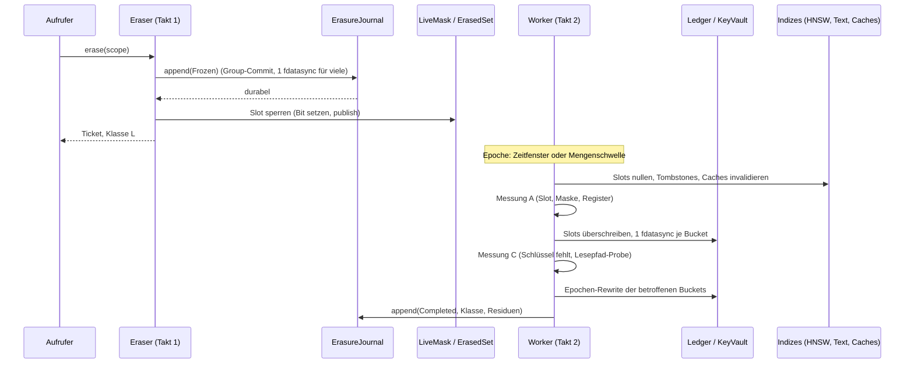

# Contextra: Neukonzeption der Löschkette („Erasure by Design“)

| Feld | Wert |
| --- | --- |
| Datum | 31.10.2026 |
| Geprüfter Stand | Remote-HEAD `ba62852` („Shell-Commit“, 31.10.2026), Shallow-Klon nach Pull. Davor `a01a18b` |
| Auftrag | Die Löschkette völlig neu denken, damit Löschen im Alltag effizient und performant ist und die Datenschutzziele der V1-Kernspezifikation trägt |
| Verhältnis zu früheren Dokumenten | Ersetzt Abschnitt 9 und korrigiert Abschnitt 7 der „V1-Kernspezifikation“ (Korrekturen in Abschnitt 13) |
| Charakter | Entwurf. **Nichts wurde kompiliert, getestet oder gemessen:** In der Sandbox ist kein `cargo` installiert. Keine Rechtsberatung |

---

## 0. Lesehilfe

| Marke | Bedeutung |
| --- | --- |
| **\[K\]** | Im Klon `ba62852` am Quelltext gelesen (Datei genannt). Nicht kompiliert, nicht ausgeführt |
| **\[Q\]** | Aus den früher hochgeladenen Berichten übernommen, hier nicht erneut geprüft |
| **\[E\]** | Entwurf dieses Dokuments |
| **\[S\]** | Schätzung oder Zielwert, keine Messung. Zielwerte sind Vorschläge für Gates, keine Zusagen |
| **\[?\]** | Aus dem Gedächtnis, vor Übernahme prüfen |

---

## 1. Ergebnis in Kürze

1. **Die heutige Löschkette löscht am Ende und prüft per Scan.** Beim Löschen eines Dokuments laufen Purger in fester Reihenfolge über Text, Vektor und LSM, danach scannen drei bis fünf Scanner jede Schicht erneut, am Schluss wird ein Beweis ausgestellt \[K: `erasure.rs`\]. Der HNSW-Purger durchläuft dabei alle Knoten im RAM unter dem globalen Schreib-Mutex \[K: `hnsw/purge.rs`\]. Die Kosten wachsen mit der Datenmenge, nicht mit dem gelöschten Dokument.
2. **Die Kette ruht auf einem Fundament, das es nicht gibt.** Der Store verschlüsselt SSTable-Blöcke und WAL-Einträge mit **einem** Schlüssel für alles \[K: `sstable/builder.rs:362`, `wal/io.rs:179`\]. Die vorhandene Einzelschlüssel-Mechanik (`KeyRegistry`, `RecordDek`) lebt nur im Arbeitsspeicher und wird im Produktionspfad nur für den KV-Cache benutzt \[K: `kv_shredding.rs`\]. Für Dokumente gibt es heute keine Schlüsselvernichtung. Die Löschung ist reines physisches Überschreiben und Kompaktieren.
3. **Neue Leitidee:** Löschbarkeit wird **beim Schreiben** gebaut, nicht beim Löschen nachgeholt. Jedes Dokument hat einen eigenen zufälligen Schlüssel, einen dichten Slot in allen Indizes und eine einzige Lebend-Maske. Löschen heißt dann: einen Bit setzen, einen Schlüssel vernichten, alles Weitere geschieht gebündelt im Hintergrund.
4. **Zwei Takte statt einer Saga im Vordergrund:**
   - **Takt 1** (synchron, Zielwert p99 ≤ 5 ms \[S\]): durabler Journal-Eintrag per Group-Commit, Lesesperre für alle Pfade. Ergebnis: Klasse **L**.
   - **Takt 2** (asynchron, gebündelt, Zielwert ≤ 60 s \[S\]): Klartext-Strukturen bereinigen (**P**), Schlüssel vernichten (**C**), Epoche abschließen.
5. **Der Snapshot-Stau entfällt.** Heute wird jede Löschung abgewiesen, solange irgendein Snapshot offen ist \[K: `erasure.rs:153`, `:361`\]. Im neuen Modell sind alte Versionen ohne Schlüssel nicht mehr lesbar. Leser blockieren das Löschen nicht mehr.
6. **Collection- und Mandanten-Löschung werden O(1)** in der Kryptografie, weil Schlüssel zufällig und hierarchisch gewrappt sind (nicht per HKDF abgeleitet, siehe Korrektur in 13).
7. **Verifikation ohne Voll-Scan pro Löschung:** Zeugen entstehen aus Konstruktion (Slot, Maske, Schlüsselabwesenheit, Lesepfad-Probe). Ein Voll-Audit läuft getrennt und zeitversetzt.
8. **Ehrliche Grenze:** Ohne schreibbare, wirklich löschbare Schlüsselablage (TPM, Secure Element, OS-Keystore) bleibt Flash-Remanenz ein deklariertes Restrisiko. Das ist physikalisch, nicht ein Designmangel, und gehört in jeden Bericht (Abschnitt 5.4).

---

## 2. Ist-Analyse am Stand `ba62852`

### 2.1 Zustand des Repos

Der Reduzierungs-Commit entfernt sieben Crates (`adapt`, `cognition`, `graph`, `infer-candle`, `infer-onnx`, `kvcache`, `router`) und 313 Dateien mit 80.585 gelöschten Zeilen \[K: `git show --stat`\]. Der Workspace ist **noch nicht konsistent**: `Cargo.toml` führt die sieben Crates weiter als Mitglieder, und die Manifeste von `engine`, `db`, `store` und `agent` hängen weiter von `contextra-graph` bzw. `contextra-cognition` ab. Im Quelltext der Engine stehen 88 Treffer auf `contextra_graph` \[K\]. `cargo metadata` würde scheitern. Das ist erwartbar mitten in einer Reduktion und gehört in WP0 des Fahrplans (Abschnitt 14).

### 2.2 Wie die Löschkette heute arbeitet \[K\]

| Schritt | Ort | Verhalten |
| --- | --- | --- |
| Preflight | `engine/…/erasure.rs` | Verlangt einen `ProofKeyProvider` (sonst Fehler), lehnt bei **jedem** offenen Snapshot ab |
| Logisches Löschen | `col.delete(id)` | Fehler ⇒ `Ok(ErasureReport { verified: false })` |
| Purger | `spawn_blocking`, Reihenfolge Text → Vektor → LSM | Erster Fehler bricht ab, bereits Gelöschtes bleibt gelöscht |
| Scanner | drei LSM-Scanner plus Text und HNSW | Jeder Scanner läuft einzeln, `remaining > 0` ⇒ Fehlschlag |
| Beweis | `DeletionProof::issue` | Nur wenn alle Witnesses sauber |
| Collection-Löschen | `erase_collection` | Ziel ist `t:{tenant}:`, also mandantenweit statt collection-genau |

### 2.3 Strukturelle Schwächen

| # | Befund | Beleg | Folge |
| --- | --- | --- | --- |
| E1 | **Kosten wachsen mit N.** Der HNSW-Purger iteriert über alle RAM-Knoten, um das Ziel zu finden, obwohl `doc_to_node` existiert, und hält dabei `write_mutex` | `hnsw/purge.rs` | Eine Löschung blockiert alle Schreiber und kostet O(N) |
| E2 | **Graph-Reparatur pro Löschung.** `remove_with_graph_repair` entfernt eingehende und ausgehende Kanten und wählt den Entry-Point neu. Das widerspricht dem Veto „kein HNSW-Rewiring“ aus der Löschkonzeption \[Q\] | `hnsw/deletion.rs`, Kopfkommentar `purge.rs` | Hoher Aufwand, Recall-Risiko |
| E3 | **Blockierendes Async.** Der Text-Purger ruft `block_on_async` für jedes `get`/`delete` auf, pro Dokument, danach je Term | `text/inverted/purge.rs` | Latenz, Deadlock-Risiko (passt zu den 18 Test-Hängern \[Q\]) |
| E4 | **Ein Schlüssel für alles.** SSTable-Blöcke und WAL mit demselben `KeyManager` | `sstable/builder.rs:362`, `wal/io.rs:179` | Kein Dokument ist kryptografisch einzeln vernichtbar |
| E5 | **Schlüsselregister nur im RAM.** `KeyRegistry` hält Gruppen- und Record-Schlüssel in `AHashMap`, ohne Persistenz. Aufrufer außerhalb von `kv_*`, Tests und Benches wurden nicht gefunden | `kv_shredding.rs` | Die vorhandene Shredding-Mechanik schützt keine Dokumente |
| E6 | **Snapshot-Sperre.** Offener Snapshot ⇒ Löschen unmöglich | `erasure.rs:153,361` | Im Alltag mit langen Lesern kaum löschbar |
| E7 | **Scan statt Konstruktion.** Verifikation durch erneutes Lesen jeder Schicht | `scanner/*`, Orchestrierung | Doppelte I/O-Kosten, Scanner vertraut nur dem Scan |
| E8 | **Report als Zustandsflag.** `Ok(report{verified:false})` statt Fehlerzustand und Retry | `erasure.rs` | Kein Wiederaufsetzen, keine Frist-Überwachung |
| E9 | **Klartext-Schlüsselname.** Ziel-IDs werden als Strings gebaut (`t:{tenant}:{col}:doc:{id}`) und per Präfix interpretiert | `erasure.rs` | F01-Fehlerklasse (Scope-Verwechslung) \[Q\] |
| E10 | **Größe.** Rund 2.600 Zeilen Produktionscode nur für Orchestrierung, Purger und Scanner (616 + 228 + 213 + 353 + 489 + ca. 700 im Store) | `wc -l` | Wartungslast für eine Person |

### 2.4 Was brauchbar ist

Die Ed25519-Signatur und die Hash-Kette in `crypto`, das Zeroize-Muster, die Idee der Positivkontrolle (Canary), die Typen für Witnesses und die vorhandenen Tests als Anforderungsliste. Der Rest wird ersetzt (Abschnitt 14).

---

## 3. Grundidee: Löschbarkeit beim Schreiben bauen

Fünf Prinzipien:

| # | Prinzip | Konsequenz |
| --- | --- | --- |
| P1 | **Eine Löscheinheit = ein Dokument = ein Schlüssel.** Chunks, Vektoren, Blobs und Hilfsstrukturen eines Dokuments laufen unter demselben zufälligen `DocDek` | Schlüsselvernichtung wirkt auf alles Persistente eines Dokuments gleichzeitig |
| P2 | **Eine Identität in allen Indizes: der `Slot`.** Jedes Dokument bekommt pro Collection eine dichte `u32`-Nummer. HNSW-Knoten, Posting-Einträge und Caches referenzieren nur den Slot | Ein Bit in einer gemeinsamen Maske sperrt das Dokument in allen Indizes |
| P3 | **Die Lebend-Maske ist die Wahrheit im Lesepfad.** Jede Suche und jedes Lesen prüft `LiveMask` (O(1)) | Löschen wirkt sofort, ohne dass Indizes umgebaut werden |
| P4 | **Indizes sind Ableitungen.** Persistierte Index-Stände enthalten nichts, was ohne `DocDek` lesbar ist, und sie müssen nie bei einer Löschung neu geschrieben werden | Kein Rewrite großer Dateien pro Löschung |
| P5 | **Aufwand wird gebündelt (Epochen).** Teure Schritte laufen für viele Löschungen zusammen: ein Journal-`fsync`, ein Ledger-Rewrite je betroffenem Bucket, ein Rebuild nach Tombstone-Schwelle | Amortisierte Kosten pro Löschung nahe konstant |

Daraus folgt der Zusammenhang zwischen Recht und Technik: **Rechtlich und praktisch sofort wirksam ist die Sperre (L) und die Schlüsselvernichtung (C). Physische Bereinigung der Klartext-Strukturen (P) folgt in Sekunden bis Minuten, nicht Wochen** und liegt weit innerhalb der Monatsfrist nach Art. 12 Abs. 3 DSGVO.

---

## 4. Datenmodell und Schichtenkatalog

### 4.1 Wo ein Dokument liegt und wie es verschwindet

| Schicht | Repräsentation | Löschmechanismus | Takt | Kosten pro Dokument \[S\] | Messung |
| --- | --- | --- | --- | --- | --- |
| Chunk-Text, Blob, Metadaten | `Sealed` unter `DocDek` im `KvStore` | Schlüsselvernichtung. Optional Löschen der Einträge beim nächsten Kompaktieren (Speicherplatz) | 2 | 1 Slot-Überschreibung (64 B) | Schlüsselabwesenheit, Lesepfad-Probe |
| Vektor (fp32 und SQ8) persistent | `Sealed` unter `DocDek` | wie oben | 2 | wie oben | wie oben |
| Vektor im RAM (HNSW-Arena) | Klartext, Slot-adressiert | Slot nullen (fp32 und SQ8), Tombstone | 2 | O(d), Mikrosekunden | Slot-Check, Stichproben-Canary |
| HNSW-Graph (Nachbarlisten) | Slot-IDs, kein Inhalt | bleibt bis zum Shadow-Rebuild; Navigation über „Waypoint“ (6.2) | 2 | O(1) | Tombstone-Anteil |
| Volltextindex Postings | Segmente: `blind(term) → [slot, tf]` | Eintrag in `LiveMask`, Posting-Zeilen bleiben bis Segment-Merge | 1 (Maske), 2 (Merge) | O(1) | Maske, Segment-Audit |
| Volltextindex Wörterbuch | `blind(term) = HMAC(K_idx, term)` | Entfällt je Dokument. Merge entfernt Terme mit `df == 0` | 2 | amortisiert | Merge-Bericht |
| Forward-Terme (`fw:`) | `Sealed` unter `DocDek`, nur für Rebuild | Schlüsselvernichtung | 2 | 0 | Schlüsselabwesenheit |
| Caches (Embedding, Abfrage, Kontext) | `Purgeable`-Register, Slot-adressiert | Invalidierung per Register | 2 | O(1) je Cache | Register-Vollständigkeitstest |
| Audit-Log | nur IDs, Commitments, Zähler | nicht inhaltlich, nichts zu löschen | – | – | Log-Scan auf Canary |
| Backups, Swap, Dumps, externe Kopien | außerhalb | nicht adressierbar, deklariert | – | – | – |

Die Posting-Terme sind blind (`HMAC` unter einem Collection-Schlüssel, 16 Byte), damit der Index selbst keine lesbaren Wörter enthält. Kosten: ein HMAC pro Token beim Indexieren und Abfragen (größenordnungsmäßig 100 bis 300 ns \[S\]).

### 4.2 Der Slot

```
DocId   (128 Bit, zufällig)   ──Katalog──▶   Slot (u32, dicht, pro Collection)
Slot ──▶ HNSW-Knoten, Posting-Einträge, Cache-Schlüssel, LiveMask-Bit
```

- **Slot-Wiederverwendung erst nach Rebuild/Merge**, damit nirgends ein veralteter Verweis auf einen neuen Besitzer zeigt.
- Der Katalog (`DocId ↔ Slot ↔ DocDek-Slot im Ledger`) liegt im `KvStore`, sealed unter dem Collection-Schlüssel.

### 4.3 Eine Lebend-Maske für alles

`LiveMask` ist eine Bitmap (Roaring oder einfaches `Vec<AtomicU64>` \[?\]) je Collection. Der Lesepfad prüft nur ein Bit:

- HNSW-Suche: Kandidaten werden über die Maske gefiltert (dieselbe Stelle, an der heute ACORN-Prädikate filtern).
- BM25-Auswertung: Posting-Iterator überspringt tote Slots.
- Chunk-Abruf: Katalog-Lookup, Maske, erst dann `unwrap` des Schlüssels.

Veröffentlicht wird die Maske lock-frei (copy-on-write mit atomarem Austausch eines `Arc`, oder atomare Wörter). Ein Lesender sieht nach Takt 1 garantiert den gesperrten Zustand.

---

## 5. Schlüsselarchitektur (korrigiert)

### 5.1 Hierarchie mit zufälligen, gewrappten Schlüsseln

```
Passphrase ─Argon2id(m≥64 MiB, t≥3, p≥1; KDF-Header versioniert)─▶ KEK_root
KEK_root   ─wrap─▶ K_tenant   (zufällig, 32 B, je Mandant)
K_tenant   ─wrap─▶ K_coll     (zufällig, 32 B, je Collection)
K_coll     ─wrap─▶ DocDek     (zufällig, 32 B, je Dokument)    ◀── Löscheinheit
```

Alle Zwischenschlüssel sind **zufällig** und liegen nur gewrappt vor. Sie werden nicht per HKDF aus dem Elternschlüssel abgeleitet, weil Abgeleitetes jederzeit neu berechenbar ist und sich deshalb nicht vernichten lässt. Der Code im Bestand macht das bereits richtig (`kek_bytes` aus `OsRng`, „never derived“) \[K: `kv_shredding.rs`\]; die Kernspezifikation (Abschnitt 7.1) hatte HKDF für `KEK_coll` vorgesehen und wird hier korrigiert.

Ausnahmen, in denen Ableitung sinnvoll bleibt: Blind-Index-Schlüssel (`K_idx`) und `K_commit` für den `ErasedSet`, weil sie nicht gelöscht, sondern mit Ablauf rotiert werden.

### 5.2 Das Ledger

Das Ledger ist die persistente Schlüsselablage und das einzige Objekt, das beim Löschen **überschrieben** wird:

| Eigenschaft | Festlegung \[E\] |
| --- | --- |
| Layout | Pro Collection Bucket-Dateien mit festen Slots zu 64 Byte: `{doc_slot u32, key_gen u32, nonce 12, wrapped_dek 48 (32+16 Tag)}`, 4096 Slots je Bucket (256 KiB) |
| Zugriff | `pread`/`pwrite` auf feste Offsets, keine Neuordnung. Das Entpacken eines `DocDek` kostet einen AEAD-Aufruf (rund 100 bis 200 ns \[S\]) |
| Cache | LRU-Cache entpackter `DocDek` (Zeroizing). `mlock` nur für `K_tenant`/`K_coll`, nicht für Millionen `DocDek`, weil `RLIMIT_MEMLOCK` das nicht hergibt |
| Vernichtung (Takt 2) | Slot mit Nullen überschreiben, je betroffener Bucket-Datei ein `fdatasync` für alle Löschungen der Epoche |
| Epochen-Abschluss | Betroffene Buckets in neue Datei ohne die gelöschten Slots schreiben, `fsync`, `rename`, `fsync` Verzeichnis, alte Datei `unlink`, danach `FITRIM`/Discard-Hinweis \[?\] |
| Kosten | Nur die Buckets, in denen gelöscht wurde: Bruchteil eines MiB je Epoche, nicht die ganze Tabelle |

### 5.3 Collection- und Mandanten-Löschung in O(1)

`erase_collection` vernichtet den Eintrag von `K_coll` im Mandanten-Ledger. Damit ist jeder `DocDek` der Collection nicht mehr entwrapbar, ohne ein einziges Dokument anzufassen. Takt 2 gibt danach die RAM-Indizes frei (Arena-Speicher per `zeroize`/`memset`, größenordnungsmäßig GB/s \[S\]). `erase_tenant` entsprechend mit `K_tenant`. **Das behebt auch den Scope-Fehler der alten Kette** (`t:{tenant}:` für Collection-Löschung), weil der Scope ein Typ ist und keine String-Präfixe mehr existieren.

### 5.4 Remanenz: die ehrliche Grenze

Jede gewrappte Kopie, die einmal auf Flash lag, kann wegen Wear-Leveling und Over-Provisioning physisch weiterbestehen, auch wenn sie logisch überschrieben ist \[Q: Rechtssynthese 1.3\]. Ein Angreifer mit Flash-Abbild **und** Passphrase könnte alte Ledger-Seiten entwrappen. Das ist mit Software allein nicht auszuschließen. Deshalb:

| Stufe (`KeyVault::capabilities`) | Bedeutung | Bericht |
| --- | --- | --- |
| `Effaceable` | Wurzelschlüssel (oder `K_tenant`) liegt in TPM, Secure Element oder löschbarem OS-Keystore. Vernichtung dort ist echt | `C` ohne `FlashRemanence` |
| `FileOverwrite` (Default im Core) | In-place-Überschreiben plus Rewrite plus Discard | `C` mit `ResidualRisk::FlashRemanence` |
| `MemoryOnly` | nur Tests | nicht produktiv zulässig |

Gegen Angreifer **ohne** Passphrase (gestohlenes Gerät, abgegriffenes Backup) wirkt die Verschlüsselung unabhängig davon. Der Betreiber, der die Passphrase kennt, ist durch Remanenz nicht ausgeschlossen. Genau diese Aussage gehört in den Bericht, in die Doku und in die DSFA-Hinweise. Die `Effaceable`-Anbindung (TPM/HSM) ist ein natürlicher Enterprise-Adapter hinter demselben Port.

---

## 6. Die Zwei-Takt-Pipeline

### 6.1 Ablauf



### 6.2 Takt 1: synchron, kurz, durabel

| Schritt | Kosten \[S\] |
| --- | --- |
| Scope validieren, `DocId → Slot` im Katalog nachsehen | O(1), Hash-Lookup |
| `Frozen` ins Journal schreiben | Group-Commit: viele gleichzeitige Löschungen teilen sich einen `fdatasync`; Wartefenster 1 bis 2 ms |
| Bit in `LiveMask` setzen und veröffentlichen | O(1) |
| Ticket zurückgeben | – |

Zielwert p99 ≤ 5 ms bei 1 Mio. Dokumenten, unabhängig von N \[S\]. Ab hier verweigert jeder Lesepfad das Dokument (fail-closed).

### 6.3 Takt 2: Epochen, gebündelt

Ein Worker sammelt Tickets, bis das **Zeitfenster** (Default 5 s, Obergrenze `epoch_max` ≤ 60 s) oder die **Mengenschwelle** (z. B. 1.024 Löschungen) erreicht ist \[S\]. Danach in dieser Reihenfolge:

1. **Ebene A (Klartext):** HNSW-Slots nullen, Text-Maske ist bereits gesetzt, Caches per `Purgeable`-Register invalidieren.
2. **Messung A:** je Dokument O(1)-Prüfungen (Slot nullbytig, Bit gesetzt, Register meldet nichts), dazu ein Stichproben-Canary.
3. **Schlüsselvernichtung:** Ledger-Slots überschreiben, aus dem `DocDek`-Cache entfernen und zeroizen.
4. **Messung C:** `present() == false`; Lesepfad-Probe (ein echter `open` auf ein Chiffrat des Dokuments muss `KeyAbsent` liefern).
5. **Epochen-Rewrite** der betroffenen Ledger-Buckets, Discard-Hinweis, `Completed` ins Journal.

`DestroyKey` kommt **nach** Messung A, weil Ebene-A-Arbeit unter Umständen noch entschlüsseln muss (z. B. Rebuild-Hilfsdaten) \[Q: Stand 13.3\].

### 6.4 Zustandsmaschine

Die rein funktionale `step`-Maschine bleibt, wird aber kleiner. Sie beschreibt den Zustand **eines Tickets**, nicht mehr den Ablauf im Vordergrund:

```
Requested → Frozen (L) → PlaintextPurged → PlaintextMeasured (P)
                       → KeyDestroyed → KeyMeasured (C) → Completed
Frozen → Restricted (Aufbewahrung) → Release → Requested
```

Idempotenz jedes Schritts, `recover()` vor Freigabe des Lesepfads, Retry mit Backoff statt Abbruch und `erase_sla`-Alarm bleiben wie in der Konzeption \[Q\].

### 6.5 Fehler, Absturz, Wiederanlauf

| Fall | Verhalten |
| --- | --- |
| Absturz nach Takt 1 | `recover()` liest das Journal, füllt `ErasedSet`/`LiveMask` **bevor** der Lesepfad öffnet, setzt Takt 2 fort |
| Schritt schlägt fehl (z. B. I/O) | Zustand unverändert, Journal hält `attempt` und `next_retry_at`; Backoff. Kein `Ok(verified:false)` |
| Absturz mitten im Epochen-Rewrite | Neue Bucket-Datei ist erst nach `rename` gültig; alte bleibt bis dahin vollständig. Idempotent wiederholbar |
| Journal nicht durabel (Flush-Fehler) | Takt 1 liefert `Err`, **die Lesesperre wird nicht gesetzt**, der Aufrufer weiß, dass nichts zugesagt ist |
| `erase_sla` überschritten | Alarm, Ticket-Status `Overdue` |

---

## 7. Lesegate und Snapshots

### 7.1 `ErasedSet`

Der Lesepfad fragt zwei Dinge:

1. `LiveMask[slot]`: schnelle Sperre für laufende Instanzen.
2. `ErasedSet.contains(commitment)`: persistente Menge der gelöschten Dokumente, gebraucht für Restore und Wiederanlauf.

`SubjectCommitment = HMAC-SHA256(K_commit[tenant, epoch], canonical(scope))`. Die Lebensdauer von `K_commit` ist mindestens `erased_set_retention`, das mindestens `backup_max_age` entspricht \[Q\]. Beide Werte haben bewusst keinen Default.

### 7.2 Warum Snapshots nicht mehr blockieren

Ein Leser mit offenem Snapshot sieht alte Seiten und Versionen. Das ist für gelöschte Dokumente unkritisch, weil

- das Lesegate auch für Snapshot-Leser gilt (Prüfung beim Materialisieren, nicht beim Snapshot-Aufbau), und
- ohne `DocDek` das Chiffrat in der alten Version ohnehin nicht zu öffnen ist.

Der Preflight „kein Snapshot offen“ \[K: `erasure.rs:153`\] entfällt ersatzlos. Der redb-Adapter (Ein-Schreiber, parallele Leser \[?\]) profitiert davon unmittelbar.

---

## 8. Ebene A im Detail: effizient statt Scan

### 8.1 HNSW

| Aspekt | Alt | Neu |
| --- | --- | --- |
| Zielsuche | Alle Knoten durchlaufen | `slot` aus dem Katalog, O(1) |
| Sperre | globaler `write_mutex` über die ganze Operation | nur kurzer Zugriff auf den einzelnen Slot |
| Graph | Kanten ein- und ausgehend entfernen, Entry-Point neu | **keine Umverdrahtung** (Veto). Tombstone plus Waypoint |
| Vektor | zeroize | zeroize von fp32 und SQ8 |
| Aufräumen | – | Shadow-Rebuild bei Tombstone-Anteil ρ |

**Waypoint-Option \[E, zu messen\]:** Ein toter Knoten kann in der Navigation nicht mit einem Nullvektor mitlaufen. Statt den Vektor zu behalten, ersetzt der Eraser ihn durch den **Mittelwert seiner lebenden Nachbarn**. Das enthält nur Daten anderer Dokumente und bewahrt die Durchlaufbarkeit des Graphen. Es bleibt ein schwacher Resthinweis (die Nachbarn waren dem gelöschten Vektor ähnlich). Deshalb zwei Modi:

| Modus | Verhalten | Wann |
| --- | --- | --- |
| `Strict` | toter Knoten wird in der Navigation übersprungen (Distanz ∞), kleinere ρ-Schwelle (z. B. 5 %) | Default für sensible Collections |
| `Waypoint` | Mittelwert der lebenden Nachbarn | Collections mit hohem Löschvolumen; erst nach Recall-Messung freigeben |

**Shadow-Rebuild:** Ein Hintergrund-Thread baut aus den lebenden Slots einen neuen Index, Schreibvorgänge währenddessen landen in einem Delta-Log, am Ende wird per `Arc`-Swap umgeschaltet. Es gibt keinen langen Schreib-Mutex. Der Rebuild entfernt zugleich die Kanten zu toten Slots aus dem Graphen und gibt Slots frei.

**Amortisierung:** Bei Rebuild-Kosten `C(N)` und Schwelle ρ kostet jede Löschung rechnerisch `C(N) / (ρ·N)`. Beispiel \[S\]: `C(1 Mio.) ≈ 2 min`, ρ = 10 % ⇒ ca. 1,2 ms pro Löschung, im Hintergrund. Die Zahl ist ein Platzhalter für die Messung.

### 8.2 Volltext

- **Segmentiert und unveränderlich:** Neue Dokumente gehen in ein kleines In-Memory-Segment, das periodisch als Segment geschrieben wird. Segmente werden gemergt.
- **Löschen = Maske.** Posting-Zeilen bleiben unverändert, der Iterator überspringt tote Slots. Das ersetzt den Weg „Forward-Index lesen, je Term Posting-Liste neu schreiben“ \[K: `purge.rs`\], der pro Dokument O(#Terme) Storage-Zugriffe macht.
- **Merge** entfernt tote Einträge physisch und Terme mit `df == 0`; er läuft nach Tombstone-Schwelle oder nach Zeitplan.
- **BM25-Statistik:** `df` und `avgdl` zählen tote Dokumente bis zum Merge mit. Der Fehler ist klein und wird mit dem Merge korrigiert; als Eigenschaft dokumentieren und in einem Test begrenzen.
- **Blinde Terme:** siehe 4.1. Das Wörterbuch enthält keine lesbaren Wörter.

### 8.3 Caches und Hilfsstrukturen

`Purgeable`-Register: jede Struktur, die Slot-adressierte Kopien hält, registriert sich verpflichtend. Ein Test gegen den `LayerCatalog` scheitert, wenn eine Schicht fehlt. Beispiele: Embedding-Cache, Abfrage-Cache, Re-Ranker-Kontexte, Chunk-Cache. Eingefrorene Schichten (Graph, Checkpoint) stehen als `OutOfScope`.

---

## 9. Messung und Klassen ohne Voll-Scan

### 9.1 Zeugen aus Konstruktion

| Klasse | Zeuge | Kosten je Dokument |
| --- | --- | --- |
| **L** | Journal-Eintrag durabel; `LiveMask`-Bit gesetzt; Lesepfad-Probe liefert `Erased` | O(1) |
| **P** | HNSW-Slot ist nullbytig (fp32 und SQ8); Text-Maske gesetzt; Cache-Register leer; Stichproben-Canary | O(d) |
| **C** | `KeyVault::present == false`; Ledger-Slot nullbytig; `open` auf echtes Chiffrat liefert `KeyAbsent` | O(1) |
| **E** | L ∧ P ∧ C **und** alle Schichten des `LayerCatalog` gemessen oder deklariert; im Core-Scope erreichbar, solange keine ungemessene Pflichtschicht existiert | – |

Der Scan-Aufwand wandert aus dem Pfad jeder Löschung in ein **getrenntes Audit**:

| Audit | Takt | Zweck |
| --- | --- | --- |
| Struktur-Audit der Indizes | nächtlich oder auf Anforderung, niedrige Priorität | Verwaiste Slots, Referenzen auf tote Dokumente, Tombstone-Anteil |
| Ledger-Audit | je Epoche | Keine Slots für Dokumente im `ErasedSet` |
| Canary-Test | in CI und in Testinstanzen, **nie** im Produktiv-WAL | Positivkontrolle der Messverfahren (Scanner-Selbsttest: Canary vorhanden ⇒ Treffer, sonst Lauf ungültig) |

### 9.2 Bericht statt „Beweis“

```rust
pub struct ErasureReceipt {
    pub class: ClassSet,                // L | P | C | E
    pub residual: Vec<ResidualRisk>,    // FlashRemanence, BackupKeyCopies{until},
                                        // SwapOrDumpPossible, ExternalCopies,
                                        // EscrowPresent, CryptoObsolescence,
                                        // UnmeasuredLayer(LayerId)
    pub ledger_generation: u32,
    pub ticket: TicketId,               // Pseudonym, kein Klartext-Bezug
    pub issued_at: Timestamp,           // über Clock-Port
    pub signature: Ed25519Signature,    // ProofSigner-Port, nur diese Ebene extern prüfbar
}
```

Kein Feld enthält Inhalt, Klartext-Kennung oder Chunk-Hash. Der frühere `DeletionProof`-Export mit nachsignierter Mutation (`integrity_warning`) entfällt \[Q: L-02\].

---

## 10. Sonderfälle

| Fall | Behandlung |
| --- | --- |
| **Betroffener** (Art. 17 für eine Person) | `SubjectIndex`: `blind(subject_ref) → [DocId]`, sealed unter `K_coll`. `erase_subject` plant alle Dokumente als **ein** Ticket-Bündel, ein Journal-Eintrag je Dokument im selben Group-Commit. Ab 1.1 |
| **Aufbewahrungspflicht** (Art. 17 Abs. 3) | \`RetentionPolicy::check(scope, now) → Delete |
| **Backups** | Daten und Ledger getrennt sichern. Beim Restore: `open_after_restore` liest den `ErasedSet`, sperrt nach, vernichtet wiederhergestellte `DocDek` erneut. Backup älter als `erased_set_retention` ⇒ `RestoreBeyondHorizon` |
| **Massenlöschung** | Ein Journal-Batch, Maske in einem Schub, Ledger-Rewrite je Bucket einmal. Kein linearer Aufwand pro Dokument im Vordergrund |
| **Spurlose Neu-Indizierung** | Derselbe Inhalt unter neuer `DocId` ist ein neues Dokument. Dedup-Verfahren dürfen nicht über Dokumente hinweg Schlüssel teilen (sonst ist „ein Schlüssel je Dokument“ verletzt) |
| **Checkpoint/Time-Travel** | eingefroren. Wer rekonstruierbare Zustände hält, hält gelöschte Daten vor |
| **Replikation** | Single-Node. Kein verteiltes Löschen |

---

## 11. Typen und Ports (Skizze, nicht compilergeprüft)

```rust
// contextra-types (rein, ohne I/O)
pub struct ErasureScope { pub tenant: TenantId, pub collection: CollectionId, pub target: ErasureTarget }
pub enum ErasureTarget { Document(DocId), Collection, Tenant, Subject(SubjectRef) }

pub struct Slot(u32);

bitflags::bitflags! { pub struct ClassSet: u8 { const L=1; const P=2; const C=4; const E=8; } } // [?]

pub enum TicketState { Requested, Frozen, PlaintextPurged, PlaintextMeasured,
                       KeyDestroyed, KeyMeasured, Completed, Restricted, Overdue }

/// Total, ohne I/O; ungültige Kombinationen => TransitionError
pub fn step(s: TicketState, e: TicketEvent) -> Result<TicketState, TransitionError>;

// contextra-ports (alle synchron)
pub trait ErasureJournal: Send + Sync {
    /// Ok erst nach durablem Flush. Gruppiert intern (Group-Commit).
    fn append(&self, rec: JournalRecord) -> Result<JournalSeq, JournalError>;
    fn replay(&self, from: JournalSeq) -> Result<Vec<JournalRecord>, JournalError>;
}

pub trait KeyVault: Send + Sync {
    fn capabilities(&self) -> VaultCaps;                        // Effaceable | FileOverwrite | MemoryOnly
    fn present(&self, doc: &DocRef) -> Result<bool, VaultError>;
    fn destroy_batch(&self, docs: &[DocRef]) -> Result<DestroyStats, VaultError>; // idempotent
    fn rotate_epoch(&self, touched: &BucketSet) -> Result<(), VaultError>;
}

pub trait LayerPurger: Send + Sync {          // Ebene A, slotbasiert
    fn layer(&self) -> LayerId;
    fn purge_slots(&self, slots: &[Slot]) -> Result<PurgeStats, PurgeError>; // idempotent
    fn witness(&self, slots: &[Slot]) -> Result<LayerWitness, WitnessError>; // unabhängig vom Purger
}

pub trait ErasedSetView: Send + Sync { fn is_erased(&self, slot: Slot) -> bool; }

// contextra-engine
pub struct Eraser { /* Journal, LiveMask, Katalog, Policy */ }
impl Eraser {
    pub fn erase(&self, scope: ErasureScope) -> Result<ErasureTicket, EraseError>; // Takt 1
}
pub struct ErasureTicket { /* id */ }
impl ErasureTicket {
    pub fn status(&self) -> TicketStatus;                                   // nicht blockierend
    pub fn wait(&self, at_least: ClassSet, timeout: Duration) -> Result<ErasureReceipt, WaitError>;
}
```

Ein zentraler Blocking-Adapter im Core ersetzt die verstreuten `block_on_async`-Aufrufe \[K: E3\]. Die Ports sind synchron, Async lebt nur an der äußeren Kante.

---

## 12. Performance-Budget und Gates

### 12.1 Zielwerte \[S\] (Vorschläge für Gates, vor Übernahme messen)

| Kennzahl | Zielwert | Messaufbau |
| --- | --- | --- |
| Takt 1, p50 / p99 | ≤ 1 ms / ≤ 5 ms, unabhängig von N | 10⁴, 10⁶ Dokumente, Einzel- und 64-fach parallele Löschung |
| Durchsatz Takt 1 | ≥ 5.000 Löschungen/s (Group-Commit) | Dauerlast |
| Takt 2, Epoche | ≤ 60 s bis `C` bei Zeitfenster-Default | gemischte Last |
| Lese-Latenz während Massenlöschung | Regression ≤ 5 % | Suchlast parallel |
| Recall@10 nach Löschen von 10 % | ≥ Ausgangswert − 1 Punkt (Strict und Waypoint getrennt) | Vergleich gegen Exakt-Scan |
| `erase_collection` | O(1) im Vordergrund; Speicherfreigabe ≤ 1 s je GB | große Collection |
| Rebuild-Beitrag je Löschung | `C(N) / (ρ·N)` im Bericht ausgewiesen | Benchmark |
| Schreib-Overhead durch Schlüssel je Dokument | ≤ 5 % Ingest-Durchsatz | Ingest-Benchmark |
| Speicher-Overhead | Ledger 64 B je Dokument; Padding im Mittel ca. 1,3× \[Q\] | Messung |

### 12.2 Funktionale Gates

| Gate | Inhalt |
| --- | --- |
| **G-E1** | Dokument A und B in zwei Collections desselben Mandanten; `erase(A)`; B bleibt in **allen** Schichten lesbar (R-F01 neu) |
| **G-E2** | Fault-injizierendes `Vfs`: Fehler in Journal, Ledger, Rewrite; Ticket bleibt konsistent, Nicht-Ziele bleiben lesbar (R-F02 neu) |
| **G-E3** | Kill-Matrix: SIGKILL vor/nach jedem `fdatasync`, `rename`, Journal-Append. Nach `recover()` wird nie ein Inhalt eines `Frozen`-Dokuments ausgeliefert |
| **G-E4** | Snapshot offen während `erase`: Löschung gelingt, der Snapshot-Leser erhält `Erased` |
| **G-E5** | Property-Tests für `step` und `classify` (Monotonie, `E ⇒ L∧P∧C`); Mutationstests für `step`, `classify`, `destroy`, Slot-Filter |
| **G-E6** | Positivkontrolle: Scanner-Selbsttest, Canary-Entschlüsselung vor Vernichtung gelingt, danach scheitert; Canary nie im Produktiv-Datenpfad |
| **G-E7** | Cross-Tenant-Löschtest: `erase` unter Mandant X berührt Mandant Y nie |
| **G-E8** | `loom` auf `LiveMask`-Publikation und Lese-/Löschinteraktion |
| **G-E9** | Fuzz: Journal-Replay, Ledger-Bucket-Parser, KDF-Header |
| **G-E10** | Wording-Lint: „garantiert“, „DSGVO-konform“, „Beweis“ im Quelltext und in Docs verboten |
| **G-E11** | Restore-Test: Backup, Löschen, Restore, Gelöschtes bleibt gesperrt; Backup älter als Horizont ⇒ `RestoreBeyondHorizon` |
| **G-E12** | Performance-Regression ≤ 5 % gegenüber der gespeicherten Basislinie |

---

## 13. Korrekturen an der V1-Kernspezifikation

| Stelle | Alt | Neu |
| --- | --- | --- |
| 7.1 Hierarchie | `KEK_coll = HKDF(KEK_root, tenant ‖ collection)` | Zufällige, gewrappte Schlüssel auf allen Ebenen unter `KEK_root` (5.1). Abgeleitetes lässt sich nicht vernichten |
| 7.2 KeyTable | „`KEK_table[g]` wird vernichtet (SSD-sicher)“ | Nur sicher, wenn der Wurzelschlüssel in einer wirklich löschbaren Ablage liegt. Sonst `FlashRemanence` im Bericht (5.4) |
| 9.3 Saga im Vordergrund | Vollständige Saga je Löschaufruf mit Messung | Zwei Takte (6), Messung aus Konstruktion (9) |
| 9.1 Ebene A „Segment-Rewrite je Fenster“ | Posting-Rewrite | Maske plus Merge (8.2) |
| 9.4 Snapshots | nicht behandelt | Kein Preflight mehr (7.2) |
| 8.2 redb-Adapter | Schlüssel im B-Baum sichtbar, pseudonymisiert | unverändert; zusätzlich Slot-Katalog sealed |
| 12.1 Gates | G-Erase allgemein | G-E1 bis G-E12 (12.2) |
| 3.1 AE-04 | Port synchron | bleibt; ergänzt um Group-Commit-Journal |

Die Kernspezifikation sollte nach Bestätigung dieser Konzeption entsprechend angepasst werden. Auf Wunsch patche ich das veröffentlichte Dokument.

---

## 14. Migration vom Bestand

### 14.1 Was entfällt, was bleibt

| Bestand | Zeilen \[K\] | Schicksal |
| --- | --- | --- |
| `engine/…/erasure.rs` (Orchestrierung, `ErasureReport`, `UNMEASURED_ERASURE_LAYERS`) | 616 | Ersetzt durch `Eraser` + Worker |
| `vector/hnsw/purge.rs`, `scanner.rs`, `deletion.rs` | 228 / 213 / 353 | Ersetzt durch `purge_slots` + Shadow-Rebuild. `remove_with_graph_repair` entfällt (Veto) |
| `text/inverted/purge.rs` | 489 | Ersetzt durch Maske + Segment-Merge |
| `store/scanner/*` (Memtable, SSTable, WAL) | ca. 700 produktiv, 243 Tests | Entfällt mit dem eingefrorenen LSM |
| `crypto/deletion_proof/*`, `integrity_warning`, HMAC-Ebene | – | Entfällt, Ed25519-Bericht (9.2) |
| `crypto/kv_*`, `kvcache` | – | Gestrichen (KV-Cache) |
| `mcp/proof_key*.rs` | – | Entfällt (`ProofSigner`-Port) |
| `KeyRegistry`-Konzept (zufällige Gruppen- und Record-Schlüssel, Revoke mit durablem Log vor RAM-Zeroize) | – | **Wird Vorbild** für das Ledger (zufällig, Log-vor-Zeroize) |
| Ed25519, Hash-Kette, Canary-Idee, Witness-Typen | – | Bleiben und werden angepasst |

### 14.2 Arbeitspakete (ersetzen WP-E0 bis E12 der alten Planung)

| WP | Crate | Inhalt | Abhängigkeit |
| --- | --- | --- | --- |
| N0 | Workspace | Manifeste mit der Reduktion in Einklang bringen (sieben entfernte Crates aus `members`, `default-members`, Abhängigkeiten, Features), `cargo check --locked` grün | – |
| N1 | types | `ErasureScope`, `TicketState`/`step`, `ClassSet`, `ResidualRisk`, `LayerCatalog` (const-Tabelle mit Exhaustivitätstest) | N0 |
| N2 | ports | `ErasureJournal`, `KeyVault`, `LayerPurger`, `ErasedSetView`; ADR | N1 |
| N3 | crypto | `DocDek`, `Sealed`, Hierarchie `K_tenant`/`K_coll`, Argon2id-KDF-Header, AEAD-Suite-ID | N2 |
| N4 | store | `KvStore`-Port + redb-Adapter (Spike-Ergebnis), Slot-Katalog, Ledger-Adapter (Buckets, Epochen-Rewrite) | N3 |
| N5 | engine | `LiveMask`, Slot-Vergabe, `Eraser` (Takt 1), Journal-Adapter mit Group-Commit, `recover()` | N4 |
| N6 | vector | `purge_slots`, Tombstones, Strict-Modus, Shadow-Rebuild, Slot-adressierte Persistenz mit `DocDek`-Hülle | N5 |
| N7 | text | Segmentierung, Maskenfilter, blinde Terme, Merge | N5 |
| N8 | engine | Worker (Takt 2), Epochen, Messung A und C, Retry/Backoff, `Purgeable`-Register | N6, N7 |
| N9 | engine + crypto | `ErasedSet`, `K_commit`, Restore-Guard, `RetentionPolicy`/`Restricted` | N8 |
| N10 | crypto + docs | `ErasureReceipt`, Wording-Lint, Doku mit Restrisiken | N9 |
| N11 | bench/testkit | Gates G-E1 bis G-E12, Basislinie, Regressionsbudget | alle |
| N12 | vector | Waypoint-Modus (nur nach Recall-Messung) | N6, N11 |

Reihenfolge: N0 → N1 → N2 → N3 → N4 → N5 → (N6 ∥ N7) → N8 → N9 → N10 → N11 → N12. **Vorab bleibt der Store-Spike (3 Werktage) maßgeblich**, weil N4 vom Ergebnis abhängt. Aufwand: grob 8 bis 11 Wochen für N1 bis N11 bei einer Person \[S, ±40 %\], deutlich mehr als die frühere Schätzung für Phase 3, weil N4, N6, N7 den Schlüsselpfad in alle Schichten ziehen. Dafür entfallen Wartung und Testlast von rund 2.600 Produktionszeilen der alten Kette.

---

## 15. Rechtliche Einordnung und Außenaussage

Die Neukonzeption ändert die rechtliche Lage nicht. Offen bleibt, ob Schlüsselvernichtung nach Art. 17 DSGVO als Löschung gilt; weder Aufsicht noch Gericht hat sie anerkannt oder abgelehnt \[Q: Rechtssynthese\]. Was sich ändert, ist die **technische Belegbarkeit**:

- Die Klasse L ist sofort und überprüfbar erreicht. Das ist wichtig für Einschränkung (Art. 18) und für die Frist.
- Die Klasse C ist an eine deklarierte Schlüsselablage gebunden. Ohne `Effaceable` steht `FlashRemanence` im Bericht.
- Klasse E bleibt auf den Core-Scope begrenzt und nur erreichbar, wenn alle Pflichtschichten gemessen sind.
- Embeddings liegen unter dem `DocDek` und gelten vorsorglich als personenbezogen \[Q\].

**Entwurf einer belastbaren Aussage (nach Review):**

> Bei einem Löschaufruf wird das Dokument sofort für alle Lese- und Suchpfade gesperrt. Innerhalb eines konfigurierbaren Zeitfensters werden die Klartext-Strukturen im Arbeitsspeicher bereinigt und der dokumentspezifische Schlüssel vernichtet. Das System stellt einen signierten, datensparsamen Bericht über die gemessenen Zustände aus. Nicht erfasst sind externe Backups, Kopien außerhalb der Anwendung sowie Auslagerungsdateien und Speicherabbilder. Je nach Schlüsselablage kann auf Flash-Medien physisch Restmaterial verbleiben; der Bericht weist das aus. Die rechtliche Bewertung der Löschwirkung und die Einhaltung von Aufbewahrungsfristen verbleiben beim Betreiber.

Vor jeder Außenaussage bleiben ein externes Krypto-Review, die Prüfung durch Fachanwalt oder Datenschutzbeauftragte(n) und die Verifikation der nur über Sekundärquellen belegten Fundstellen Pflicht \[Q: Synthese 13, 14\].

---

## 16. Risiken und offene Entscheidungen

| # | Punkt | Einschätzung |
| --- | --- | --- |
| 1 | **Persistenz-Format der HNSW-Index-Dateien** (`persistence/mmap.rs`, `header.rs`, `node.rs`): Ob dort Vektoren im Klartext auf Platte liegen, wurde hier nicht geprüft \[K nur Dateiliste\]. Wenn ja, ist das eine Ebene-B-Verletzung, und die Persistenz muss auf `DocDek`-Hüllen je Vektor oder auf „Neuaufbau aus dem Store“ umgestellt werden | **Vor N6 prüfen** |
| 2 | **Recall-Wirkung von Strict und Waypoint** | Messen, bevor Waypoint freigegeben wird |
| 3 | **Epochen-Fenster und `epoch_max`** | Vorschlag 5 s / 60 s. Betreiber legt `erase_sla` ohne Default fest |
| 4 | **Ledger-Rewrite und TRIM** hängen vom Dateisystem ab (`FITRIM`, Discard, Netz-/FUSE-/Cloud-Dateisysteme). Die Erkennung lag in `durable-fs`, das gestrichen werden soll | Kleine Erkennungsfunktion im Store-Adapter nachbauen oder `FileOverwrite` mit deklariertem Restrisiko |
| 5 | **Blinde Terme** verhindern Präfix- und Wildcard-Suche | Produktentscheidung. Alternative: Terme im Klartext nur im RAM, persistent geblindet |
| 6 | **BM25-Statistik-Drift** durch tote Dokumente bis zum Merge | Klein, begrenzen und testen |
| 7 | **Dedup und Schlüsselteilung** sind ausgeschlossen | Preis: kein inhaltsadressierter Chunk-Speicher über Dokumente hinweg |
| 8 | **`Effaceable`-Adapter** (TPM/HSM) | Enterprise-Repo; Core liefert den Port und die Tests |
| 9 | **Single-Writer-Engpass** im redb-Adapter für den Ledger-Schreibpfad | Ledger liegt bewusst außerhalb des redb-Schreibers (eigene Dateien) |
| 10 | **Zielwerte in 12.1** | Alle \[S\]; erst die Messungen entscheiden, welche Gates bindend werden |

---

## 17. Grenzen dieses Dokuments

1. **Nichts kompiliert, nichts ausgeführt.** Die Sandbox hat kein `cargo`; Aussagen zum Code stammen aus dem Lesen von Quelltext \[K\] an `ba62852`. Das Repo ist mitten in der Reduktion und baut vermutlich nicht.
2. **Gelesen wurde gezielt**: `erasure.rs`, die HNSW- und Text-Purger, `kv_shredding.rs`, Stellen im Store zur Verschlüsselung und Scanner-Dateinamen. Nicht gelesen: HNSW-Persistenz im Detail, `tenant_codec`, `db`-Fassade, Compaction. Die Befundliste in Abschnitt 2.3 ist deshalb keine vollständige Prüfung.
3. **Alle Zielwerte, Dauern und Kosten sind Schätzungen \[S\].** Fremdbibliotheken (`redb`, Roaring-Bitmaps, `bitflags`) sind aus dem Gedächtnis eingesetzt und vor Übernahme zu prüfen.
4. **Remanenz ist nicht lösbar durch Software allein** (5.4). Das Konzept deklariert sie, es beseitigt sie nicht.
5. **Rechtliche Aussagen** stammen aus der Rechtssynthese (Stand 27.10.2026), sind teils nur sekundär belegt und keine Rechtsberatung.